<div align="center">


# Steward

**An open-source AI steward with a computer of its own.**<br>
It does the work, asks before it acts, and keeps a record you can read.

[](LICENSE)
[](https://nodejs.org)
[](#bots)


[Screenshots](#screenshots) · [Quick start](#quick-start) · [Try it](#try-it-in-five-minutes) ·
[How it works](#how-it-works) · [Governance](#governance) · [Bots](#bots) ·
[Other agents](#other-agents-and-models) · [Phone](#your-phone) · [Make it your own](#make-it-your-own)<br>
[Configuration](#configuration) · [API](#api-reference) · [Testing](#testing) ·
[Deployment](#deployment) · [Troubleshooting](#troubleshooting) · [Docs](docs/README.md)

</div>

<p align="center">
  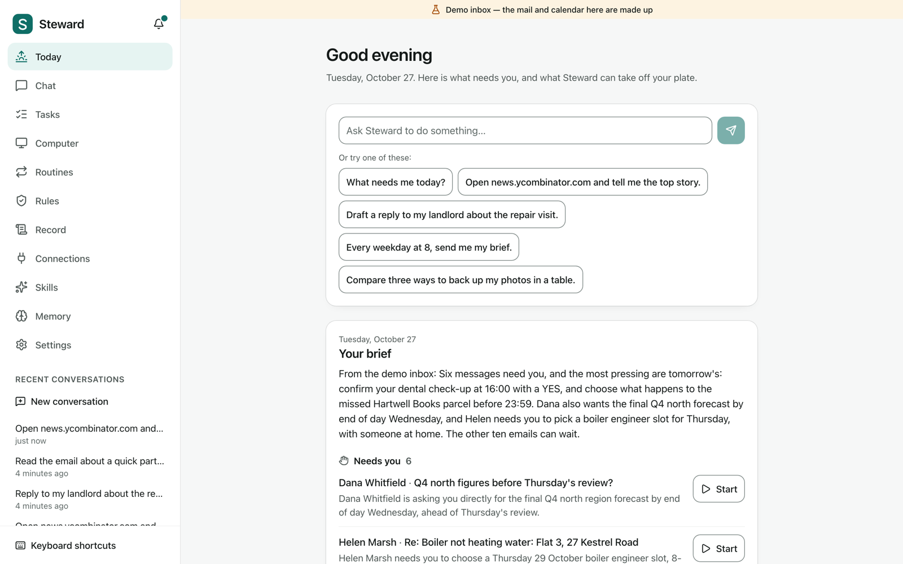
</p>

Steward reads your mail and calendar, tells you each morning what needs you, and does the work on
a computer of its own while you are away: a real browser, its own files and a shell. It never
sends, pays, signs or deletes anything without showing you exactly what and waiting for your
answer. Every action it takes, asks about or is refused goes in a record that checks itself.

It runs on your machine with `pnpm install && pnpm dev`: no Docker, no database server, no account
to sign up for, and no key needed to try it.

> [!NOTE]
> **Alpha.** Steward is young. Expect rough edges, and expect things to move. Issues and pull
> requests are welcome.

## Who it is for

Steward is for one person who wants an assistant that does real work (reading mail, researching,
filling in forms, drafting replies) without handing it the keys. Every agent product has to answer
"what stops it doing something I didn't want?". Steward's answer is not a prompt: it is a gateway
that every tool call passes through, rules you can read and test, a hard stop before anything
leaves your machine, and a record you can check yourself.

It suits:

- **People who want help with their inbox and errands** but will not let a model send, pay or
  delete on its own.
- **Developers** who want a local, hackable agent: one SQLite file, YAML configuration, any
  OpenAI-compatible model, and Claude Code, Codex or Gemini CLI as agents under the same rules.
- **Anyone who relies on a keyboard, a screen reader, large text or voice**, because those paths
  were built in from the start, not added later.

It is not (yet) a multi-user or hosted product: it has no sign-in and listens only on your own
machine. See [Known limitations](#known-limitations).

## Why Steward

| Steward…                        | What that means                                                                                                                                                                                     |
| ------------------------------- | --------------------------------------------------------------------------------------------------------------------------------------------------------------------------------------------------- |
| **does the work**               | A morning brief sorts your mail into "needs you" and "can wait". Research, comparisons, forms, drafts and errands run on Steward's own browser, which you can watch live and take over at any time. |
| **asks first**                  | Sending, paying, signing, deleting and running commands stop on a card that shows exactly what will happen: **Refuse**, **Allow once** or **Always allow**.                                         |
| **can't be talked into things** | Once it has read a web page or an email, anything risky asks you, whatever your rules say, because what it read might be trying to steer it.                                                        |
| **keeps a record**              | Every row seals the one before it with a hash, and the app checks the whole chain for you.                                                                                                          |
| **works for everyone**          | Keyboard and screen reader paths throughout, voice in and out, large text, high contrast, reduced motion and a plain-language mode.                                                                 |
| **becomes yours**               | Its name, agents, skills, rules and model live in one folder of YAML. Add ready-made bots in one tap, bring Claude Code or Codex as an agent, and take it with you on your iPhone.                  |

More of what it does:

- **Never sees your passwords.** You type them into a masked box that fills the page directly. The
  model, the conversation and the record never get the value.
- **Checks what leaves.** Card numbers, IBANs, ID numbers, keys and health details in anything it
  would send are named on the card before they go.
- **Remembers and repeats.** Tasks, routines ("every weekday at 8, send me my brief"), memory you
  can read and edit, and skills you call with `/name`.
- **Shows, not just tells.** Tables, charts, comparisons and pages it makes for you appear in the
  conversation.
- **Runs any model.** OpenRouter, OpenAI, Anthropic, Gemini, NVIDIA, xAI, Ollama on your own
  machine, or any OpenAI-compatible server, chosen per conversation.

## Screenshots

These come from a local run of this repository with the scripted demo model and the made-up demo
inbox (`STEWARD_MODEL_PROVIDER=scripted`), so every name, email and event in them is invented.

| Today, with the morning brief                                                                                                                                                                                 | An email that stops and asks first                                                                                                                                                                                                                             |
| ------------------------------------------------------------------------------------------------------------------------------------------------------------------------------------------------------------- | -------------------------------------------------------------------------------------------------------------------------------------------------------------------------------------------------------------------------------------------------------------- |
| 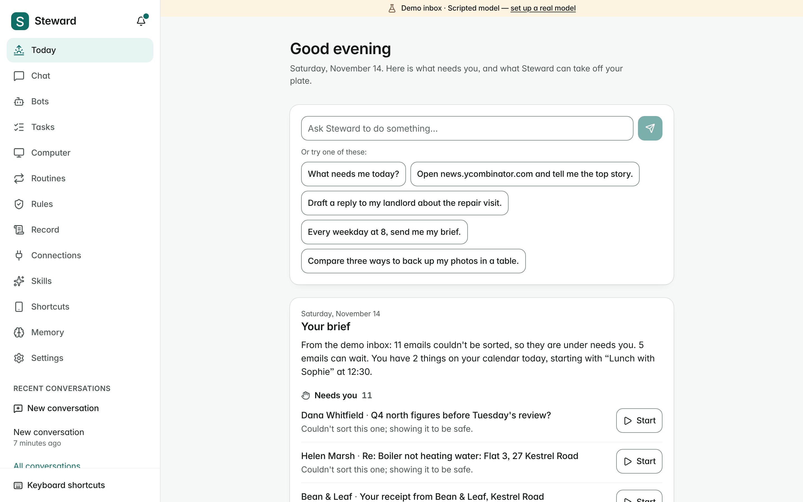 | 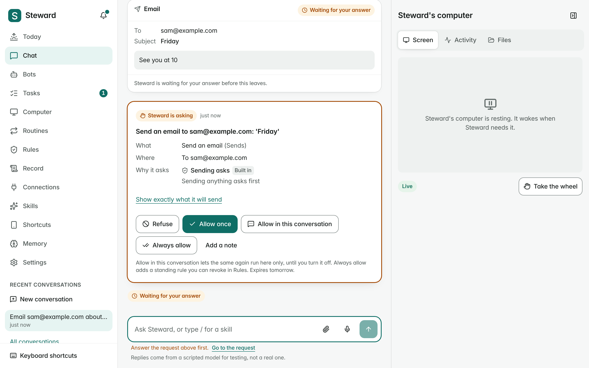 |

| The record, checked (dark theme)                                                                                                                                                                  | Rules and the tester                                                                                                                                        |
| ------------------------------------------------------------------------------------------------------------------------------------------------------------------------------------------------- | ----------------------------------------------------------------------------------------------------------------------------------------------------------- |
| 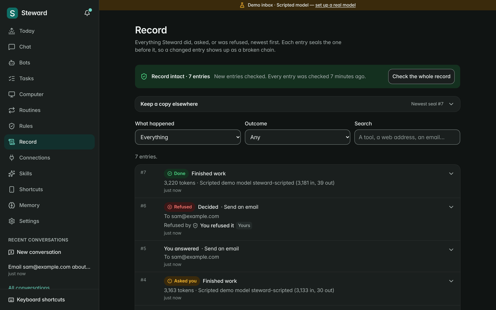 | 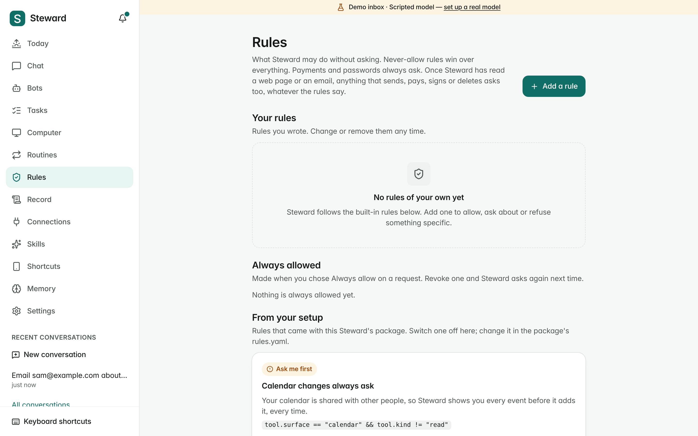 |

| Bots                                                                                                                                                                | Settings and the setup checklist (dark theme)                                                                                                               |
| ------------------------------------------------------------------------------------------------------------------------------------------------------------------- | ----------------------------------------------------------------------------------------------------------------------------------------------------------- |
| 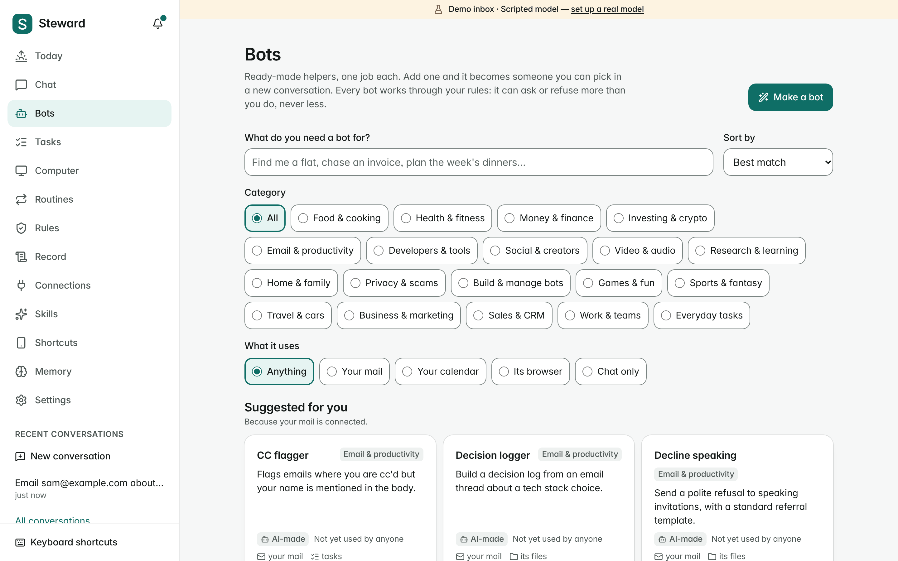 | 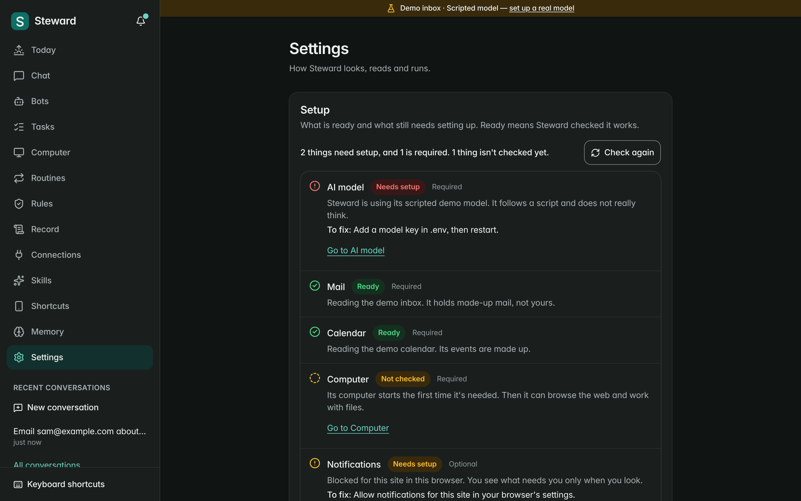 |

On a phone, the left rail becomes a bottom tab bar and every page reflows to one column:

<p align="center">
  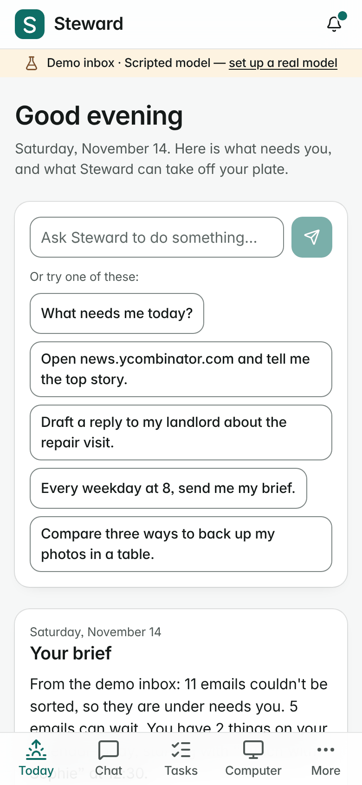
  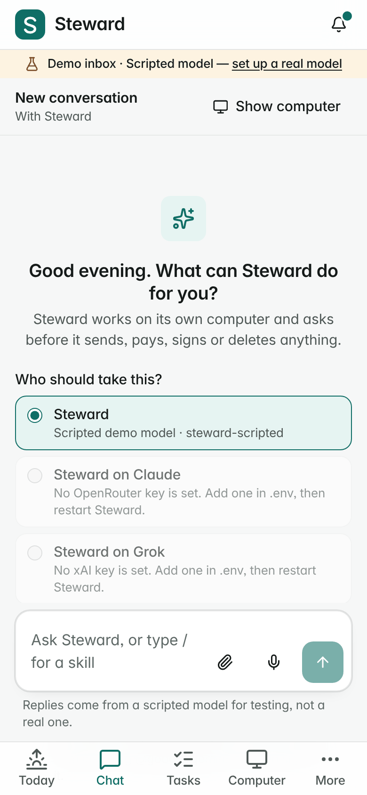
  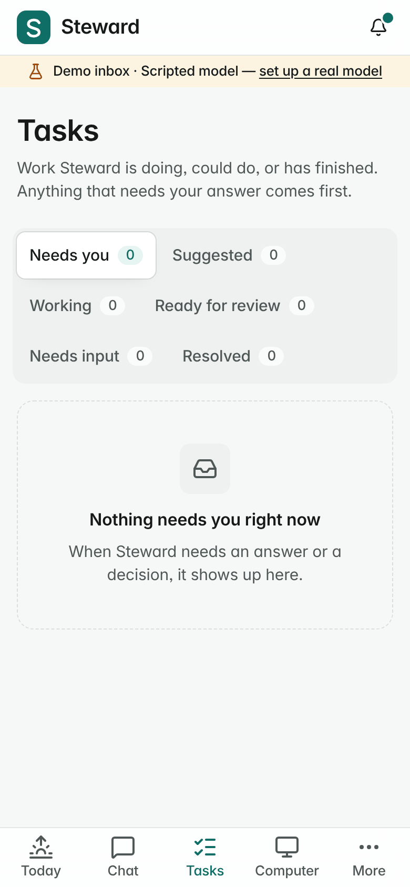
  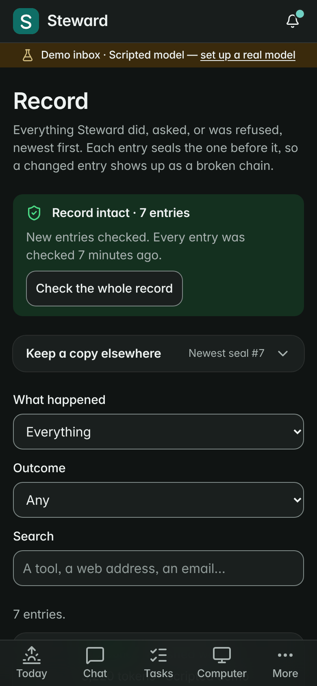
</p>

More screenshots, taken on a real model, are further down and in [docs/images](docs/images).

## Tech stack

| Layer          | What Steward uses                                                                                                                         |
| -------------- | ----------------------------------------------------------------------------------------------------------------------------------------- |
| Language       | TypeScript 7 everywhere, ES modules, run directly by Node through `tsx`                                                                   |
| Runtime        | Node 24.2+ (uses the built-in `node:sqlite` and `import.meta.main`)                                                                       |
| Web app        | React 19, Vite 8, Tailwind CSS 4, React Router 8, TanStack Query 5, Motion, Lucide icons, Sonner toasts, Streamdown for streamed Markdown |
| Agent client   | CopilotKit React v2 over the [AG-UI](https://github.com/ag-ui-protocol/ag-ui) protocol                                                    |
| Server         | [Hono](https://hono.dev) on `@hono/node-server`, the CopilotKit runtime, server-sent events and a WebSocket for the live screen           |
| Models         | The AI SDK through any OpenAI-compatible Chat Completions API; a scripted model for demos and tests                                       |
| Policy         | Rules in [CEL](https://cel.dev) (`cel-js`), validated with Zod 4                                                                          |
| Storage        | One SQLite file (`node:sqlite`) with a hash-chained, append-only record                                                                   |
| Agent computer | Playwright Chromium, a per-agent workspace folder and a shell                                                                             |
| Coding agents  | The [Agent Client Protocol](https://agentclientprotocol.com) SDK (Claude Code, Gemini CLI) and Codex's app server                         |
| Tooling        | pnpm 10 workspaces, Biome 2 (lint and format), Vitest 5 (unit), Playwright 1.64 and axe-core (end-to-end and accessibility)               |

## Quick start

### Prerequisites

- **[Node](https://nodejs.org) 24.2 or newer.** Older versions stop with a message saying so.
- **[pnpm](https://pnpm.io) 10.** On Node 24, `corepack enable` gives you the right pnpm. Node 25 and
  later no longer include corepack, so run `npm install -g pnpm@10` instead.
- **macOS or Linux.** On Windows, use WSL.
- **A model key is optional.** Without one, Steward runs a scripted demo model and says so.

### Install and run

```sh
git clone https://github.com/jeevithg090/Steward.git
cd Steward
pnpm install
pnpm exec playwright install chromium   # the agent's browser
cp .env.example .env
```

Add a model key to `.env`. With [OpenRouter](https://openrouter.ai), one key reaches most models:

```sh
OPENROUTER_API_KEY=sk-or-...
```

Or leave it blank: Steward runs a scripted demo model that needs no key, and says so on every page.

```sh
pnpm dev
```

When it says _Steward is ready: open http://localhost:5173/_, open that address. If the server
could not start, it says why instead. The first run shows a short welcome and a setup checklist.
Steward starts with a made-up demo inbox and calendar, labelled as such, so there is something to
work with straight away.

> [!TIP]
> **Keep your keys outside the repository** by pointing at any `.env` file:
> `STEWARD_ENV_FILE=/path/to/.env pnpm dev`. Every setting is in
> [docs/configuration.md](docs/configuration.md).

## Configuration

Steward reads environment variables from your shell, then the file named by `STEWARD_ENV_FILE`,
then `.env` at the repository root (copy [.env.example](.env.example)); the first value found wins,
and blank values count as unset. Nothing is required: with no variables at all, Steward starts with
the scripted model and the demo inbox. The ones you are most likely to set:

| Variable                                                                                 | Required?                     | Default                        | What it does                                                                                                 |
| ---------------------------------------------------------------------------------------- | ----------------------------- | ------------------------------ | ------------------------------------------------------------------------------------------------------------ |
| `OPENROUTER_API_KEY`                                                                     | No (needed for a real model)  | none                           | Key for OpenRouter, the default provider. Without a key for the chosen provider, the scripted model runs.    |
| `STEWARD_MODEL_PROVIDER`                                                                 | No                            | `openrouter` (from the tenant) | `openrouter`, `openai`, `anthropic`, `gemini`, `nvidia`, `xai`, `ollama`, `openai-compatible` or `scripted`. |
| `STEWARD_MODEL`                                                                          | No                            | the tenant's model             | The model id, such as `anthropic/claude-sonnet-5.5`.                                                         |
| `OPENAI_API_KEY`, `ANTHROPIC_API_KEY`, `GEMINI_API_KEY`, `NVIDIA_API_KEY`, `XAI_API_KEY` | Only for that provider        | none                           | The key for each provider.                                                                                   |
| `STEWARD_MODEL_BASE_URL`                                                                 | Only for `openai-compatible`  | the provider's endpoint        | The endpoint of your own OpenAI-compatible server.                                                           |
| `STEWARD_MODEL_API_KEY`                                                                  | Only if that server needs one | none                           | The key for an `openai-compatible` server.                                                                   |
| `STEWARD_MODEL_MAX_TOKENS`                                                               | No                            | `4096`                         | The most one reply may write (256 to 65536).                                                                 |
| `STEWARD_PORT`                                                                           | No                            | `8787`                         | The server's port.                                                                                           |
| `STEWARD_HOST`                                                                           | No                            | `127.0.0.1`                    | Where the server listens. Steward has no sign-in, so leave it on this machine.                               |
| `STEWARD_DEVICE_PORT`                                                                    | No                            | `8788`                         | The phone port (only `/device/*`, with a token per phone); `off` switches it off.                            |
| `STEWARD_DATA_DIR`                                                                       | No                            | `.steward-data`                | Where the SQLite file and the agent's browser profile and files live.                                        |
| `STEWARD_TENANT`                                                                         | No                            | `steward`                      | Which folder under `tenants/` to load, such as `tempo`.                                                      |
| `STEWARD_DEMO_GOOGLE`                                                                    | No                            | on                             | The made-up demo inbox and calendar. `0` runs with no mail.                                                  |
| `STEWARD_WORKERS`                                                                        | No                            | on                             | Routines, the morning brief and approval expiry. `0` switches them off.                                      |
| `STEWARD_HEADFUL`                                                                        | No                            | off                            | `1` shows the agent's browser as a window instead of running it headless.                                    |
| `STEWARD_DIRECTORY_URL`                                                                  | No                            | `directory/index.json`         | Where the Bots page finds bots: the bundled index, or your own directory's `https://` address.               |
| `STEWARD_ENV_FILE`                                                                       | No                            | none                           | A `.env` file to read before the repository's own.                                                           |

The full reference, with every variable (phone relay, delegation limits, private hosts, the web
app's dev proxy, the eval and the end-to-end tests) and the data folder's layout, is
[docs/configuration.md](docs/configuration.md). Preferences such as the model, plain language, the
brief's time and your time zone can also be changed in the app, under **Settings**.

## Running in production

"Production" for Steward means one long-running process on your own machine, serving the built web
app itself:

```sh
pnpm install --frozen-lockfile
pnpm exec playwright install chromium
pnpm build                                # builds every package and apps/web/dist
NODE_ENV=production pnpm --filter @steward/server start
```

Open `http://127.0.0.1:8787`. When `apps/web/dist` exists, the server serves it at `/` beside the
API, so there is no separate web server to run. `NODE_ENV=production` refuses the development-only
switches `STEWARD_DEV_ORIGINS` and `STEWARD_ALLOW_PRIVATE_HOSTS`. To keep it running, use whatever
your system uses for that (a `launchd` agent, a `systemd --user` unit, `pm2`), and keep
`STEWARD_HOST` on `127.0.0.1`. See [Deployment](#deployment) for the phone, the relay and the bot
directory.

## Try it in five minutes

Everything here works with the demo inbox, and with the scripted model too.

1. **The brief.** On **Today**, press **Make my brief**. Steward reads the demo inbox and calendar
   and shows what needs you, what can wait and what is on today. Press **Start** on a row to hand
   that email to Steward.
2. **The computer.** Ask _"Open news.ycombinator.com and tell me the top story."_ The browser opens
   on Steward's own computer, beside the chat. Press **Take the wheel** to drive it yourself, and
   hand it back when you are done.
3. **An email that asks first.** Ask _"Email sam@example.com about Friday: see you at 10"_. Steward
   writes it and calls the tool, and the call stops on a card showing exactly who it goes to and
   what it says. Press **Refuse**: nothing is sent, and Steward says so.
4. **A rule.** On **Rules**, add a rule: _Never allow_, when `tool.surface == "shell"`. Then, under
   **Would this be allowed?**, pick _Run a command_ and press **Check**: refused, by your rule.
5. **The record.** On **Record**, see every decision: what ran, what asked, what was refused and
   which rule refused it. The badge at the top says _Record intact_ once it has checked the chain.
6. **A bot.** On **Bots**, search _"inbox"_, open **Inbox triage**, read what it may do without
   asking, and press **Add to Steward**. Start a new conversation and pick it.

Then try _"Every weekday at 8, send me my brief."_ for a routine, or _"Compare three ways to back up
my photos in a table."_ with a real model.

<p align="center">
  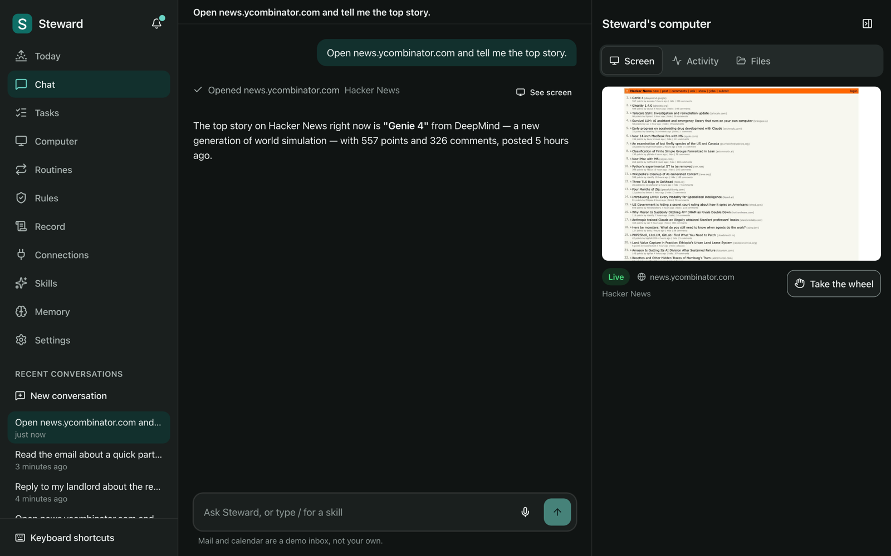
</p>

<p align="center">
  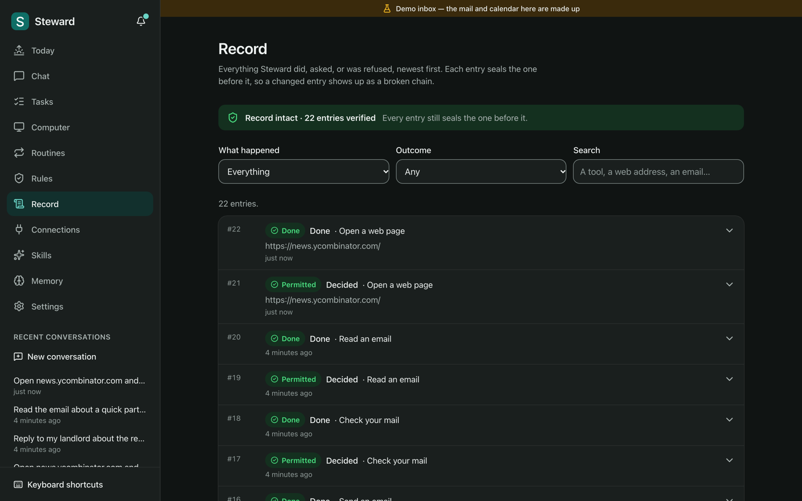
  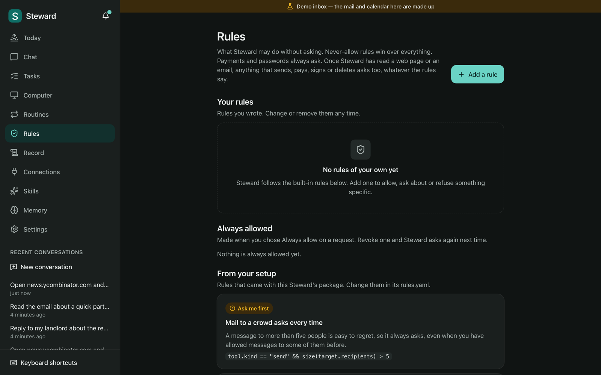
</p>

<sub>Screenshots from a live run on NVIDIA Nemotron 3 Ultra with the demo inbox. The mail and calendar are made up; the web page is real.</sub>

## How it works

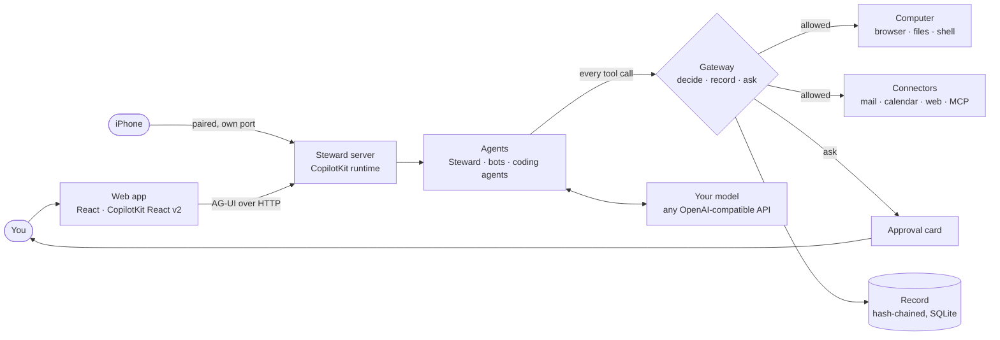

The web app talks to the server over [AG-UI](https://github.com/ag-ui-protocol/ag-ui), through
[CopilotKit](https://github.com/CopilotKit/CopilotKit)'s runtime. Each agent is CopilotKit's
`BuiltInAgent` on any model that speaks the OpenAI API. Steward's tools are never handed to it to
run: a middleware offers them to the model as tools it can only ask for, catches every call, and
sends it to the gateway. The gateway works out what the call touches, decides it against your
rules, writes the decision to the record, and only then acts. When the answer is "ask", the run
ends with an interrupt and the approval card appears; your answer resumes it, and the gateway acts
on the answer exactly once.

What happens when a call has to ask, for example the email in step 3 above:

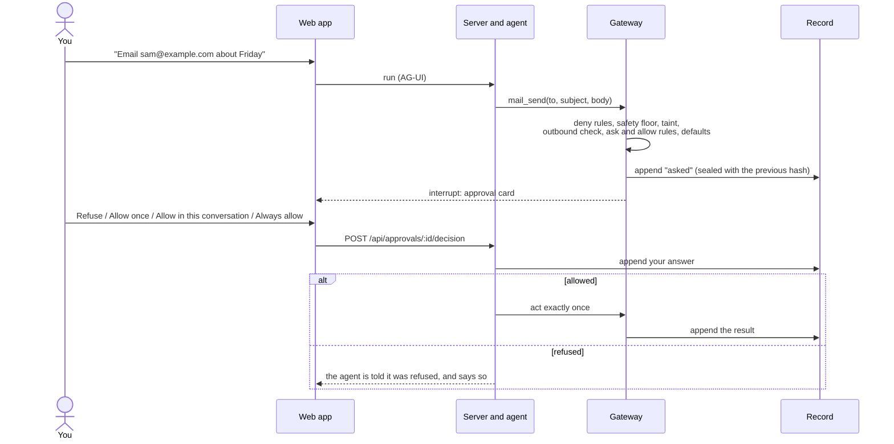

Everything lives in one SQLite file on your machine (Node's built-in `node:sqlite`). More in
[docs/architecture.md](docs/architecture.md).

## Governance

Every tool call is checked in this order, and the first step that decides wins:

1. **Deny rules.** Your "never" beats everything, including Always allow.
2. **The safety floor.** Payments and passwords always ask, every time.
3. **Taint.** After reading a web page, an email or a file, anything that sends, pays, signs,
   deletes or runs a command asks.
4. **The outbound check.** Sensitive details in what would leave make it ask, with the details
   named on the card (a card number by Luhn, an IBAN by mod-97, national ID numbers, keys,
   passwords, health words). The card shows a masked hint, never the value.
5. **Ask rules.**
6. **Allow rules,** including the ones Always allow writes, each pinned to the exact recipient,
   site, button or command.
7. **Defaults by kind.** Reads run. Changes to Steward's own browser, files, memory and tasks run.
   Everything else asks.

Rules are written in [CEL](https://cel.dev), such as `tool.kind == "send" && size(target.recipients) > 5`,
checked when you save them, and testable on the Rules page without running anything. Anything that
goes wrong while deciding refuses: Steward fails closed.

**The secret box** sends a password from your browser to the page and nowhere else. **The record**
is append-only, and each row stores `sha256(previous hash + this row)`, so a changed row breaks
the chain. You can verify it from the app, or from the SQLite file with a few lines of Node.

The full reference, with every variable and the approval lifecycle, is
[docs/governance.md](docs/governance.md).

## Bots

**Bots** is a free directory of ready-made helpers, one job each: _Inbox triage_, _Flat finder_,
_Stack trace explainer_, _Pub quiz maker_. Open one, read what it does and what it needs, and
press **Add to Steward**. It becomes an agent you can pick for a new conversation. Nothing to
copy, nothing to configure.

<p align="center">
  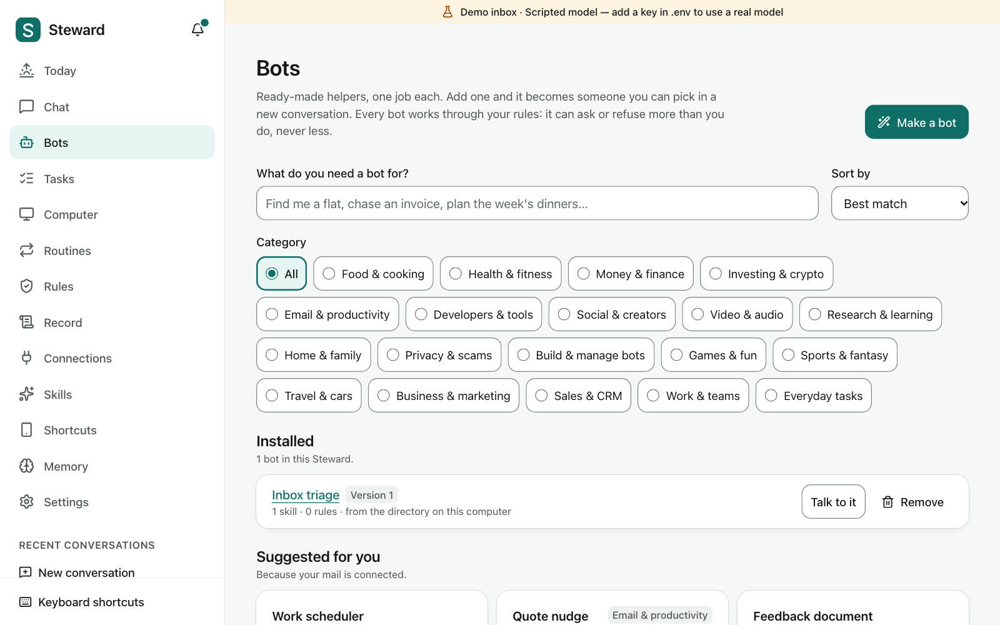
  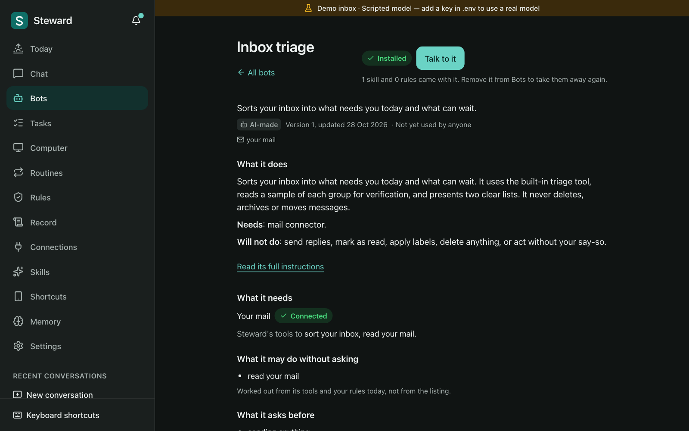
</p>

- **1,251 bots ship with Steward** in `directory/`: 1,064 made by a model from a job taxonomy and
  checked by a second model, a duplicate check by meaning and the gateway's rules (labelled
  **AI-made** until someone uses them; unused ones retire after 90 days), 177 adapted from
  [LobeChat's agent index](https://github.com/lobehub/lobe-chat-agents) with their authors
  credited, and 10 from OpenBot's coworker catalogue.
- **A bot is a pack:** a profile, skills in the open [Agent Skills](https://agentskills.io)
  `SKILL.md` format, starters, and rules that can only make the gateway stricter, never looser.
- **You see what it may do before you add it.** The listing shows what it may do without asking
  and what it asks before, worked out from its tools and _your_ rules, not from its description.
- **Make your own.** **Make a bot** describes one in a sentence and generates it on your own
  model, and can download it ready to submit.
- **Run your own directory.** `apps/directory` is the hosted half: search, an MCP connector so
  other agents can find bots, GitHub sign-in for submissions, and review. Point
  `STEWARD_DIRECTORY_URL` at it. See [docs/directory.md](docs/directory.md).

## Other agents and models

Pick who takes each conversation. Steward on the model you chose, Steward on another model, a bot
you added, or an external coding agent, and every one of them works through your rules.

<p align="center">
  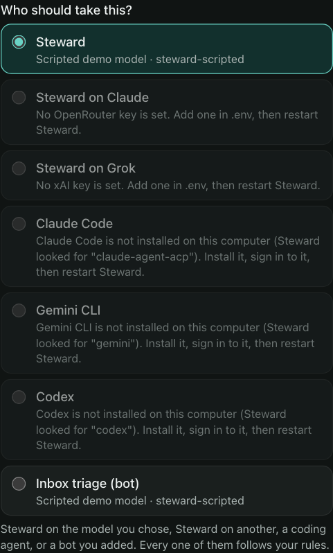
</p>

- **Steward on any model.** An agent in `agents.yaml` can name a model of its own
  (`model: xai/grok-4.7`), so "Steward on Claude" and "Steward on Grok" sit side by side, each on
  its own provider and key.
- **Coding agents as Steward agents.** Claude Code and Gemini CLI (through the
  [Agent Client Protocol](https://agentclientprotocol.com)) and Codex (through its app server) run
  as the vendor's own tool in their own workspace. Every permission they ask for becomes a Steward
  approval, decided by your rules and written to the record.
- **Agents hand work to each other.** `delegate_task` passes a job to another agent, and its
  answer comes back marked as outside content, so it taints the conversation like a web page.
- **Unavailable agents say why**: which key is missing or which tool is not installed, and how to
  fix it.

See [docs/harnesses.md](docs/harnesses.md) and [docs/models.md](docs/models.md).

## Your phone

Use Steward from your iPhone: hear what needs you, answer approval cards and ask for things, while
Steward stays on your computer.

<p align="center">
  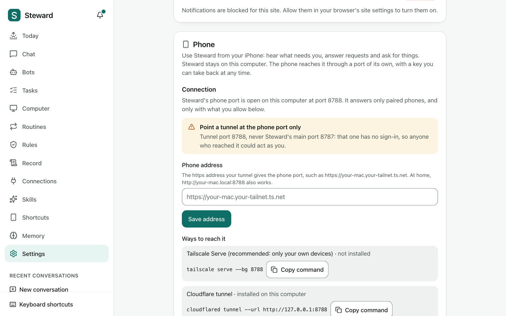
</p>

- **A Steward shortcut that knows you.** Pair with a QR code and get one signed shortcut, built
  from your skills and routines, that opens straight in Apple's Shortcuts app. No setup on the
  phone beyond tapping Add.
- **A port of its own.** Phones reach only `/device/*` on a separate port, with a key per phone you
  can take back at any time. Payments, signing and passwords are always finished on your computer.
- **The phone app (preview).** Live chat, notifications and answers signed by the phone, through
  an end-to-end encrypted relay you host (`apps/relay`), with crypto ported from
  [Happy](https://github.com/slopus/happy).

The guide, including what to check on a real device, is [docs/phone.md](docs/phone.md).

## Make it your own

Everything that makes Steward "Steward" is one folder: `tenants/steward/`.

```text
tenants/steward/
├── brand.yaml      name, tagline, accent colour, voice, starters
├── agents.yaml     the agents, their models and standing instructions
├── skills.yaml     instructions called with /name
├── rules.yaml      extra rules, in CEL
├── model.yaml      the default model
└── harnesses.yaml  the coding agents it may run
```

A package can also have a `shortcuts.yaml` with phone shortcuts of its own; Tempo's has two.

Copy it, change it, and run `STEWARD_TENANT=yours pnpm dev`. The repository ships a second package
to show how far that goes: **Tempo** (`tenants/tempo/`) turns Steward into a personal agent that
wins back money and time. It finds Delay Repay claims for late trains, checks messages and links
for scams, and audits bills and subscriptions, and it never pays or types bank details, because its
rules forbid it, not because its prompt asks nicely.

```sh
STEWARD_TENANT=tempo STEWARD_DATA_DIR=.steward-data/tempo pnpm dev
```

The guide is [docs/make-it-your-own.md](docs/make-it-your-own.md).

## Models

Steward reaches every model through the OpenAI Chat Completions API.

| Provider                                      | `STEWARD_MODEL_PROVIDER` | Key                                                    |
| --------------------------------------------- | ------------------------ | ------------------------------------------------------ |
| [OpenRouter](https://openrouter.ai) (default) | `openrouter`             | `OPENROUTER_API_KEY`                                   |
| OpenAI                                        | `openai`                 | `OPENAI_API_KEY`                                       |
| Anthropic                                     | `anthropic`              | `ANTHROPIC_API_KEY`                                    |
| Google Gemini                                 | `gemini`                 | `GEMINI_API_KEY`                                       |
| NVIDIA                                        | `nvidia`                 | `NVIDIA_API_KEY`                                       |
| xAI (Grok)                                    | `xai`                    | `XAI_API_KEY`                                          |
| [Ollama](https://ollama.com), on your machine | `ollama`                 | none                                                   |
| Any OpenAI-compatible server                  | `openai-compatible`      | `STEWARD_MODEL_API_KEY`, with `STEWARD_MODEL_BASE_URL` |
| The scripted demo model                       | `scripted`               | none                                                   |

The default is `anthropic/claude-sonnet-5.5` through OpenRouter. Change it with `STEWARD_MODEL`, in
Settings, or in the tenant's `model.yaml`. See [docs/models.md](docs/models.md).

## Accessibility

Accessibility is a first-class feature, not a later pass:

- A skip link, landmarks, one heading per page, and focus that moves to the new page's heading.
- Every control reachable by keyboard, a visible focus ring everywhere, and `g`-then-a-letter
  shortcuts that never clash with a screen reader.
- Replies announced as they arrive, and approvals announced wherever you are.
- Text size up to 150%, more contrast, a readable font, light and dark, and reduced motion.
- Voice: dictate a message, and have replies read aloud with your browser's own voices.
- A plain-language mode for the agent's replies.
- The agent's screen described in words in the Activity list, beside the live picture.
- An automated [axe](https://github.com/dequelabs/axe-core) audit of the main pages in the
  end-to-end tests.

How to test it with VoiceOver, NVDA and a keyboard is in [docs/accessibility.md](docs/accessibility.md).

## Compared with OpenBot and OpenDuet

Steward stands on the shoulders of two CopilotKit projects, and borrows from both with thanks:
[OpenBot](https://github.com/CopilotKit/openbot), a governed, self-hosted agent platform for
companies, and [OpenDuet](https://github.com/CopilotKit/OpenDuet), the proactive assistant built on
it. The gateway, the take-the-wheel computer, the secret box, the approval interrupts, the morning
brief, triage, tasks, routines and tenant packages all started there. Files that adapt their code
say so at the top.

|                  | OpenBot and OpenDuet                                                                                             | Steward                                                                                     |
| ---------------- | ---------------------------------------------------------------------------------------------------------------- | ------------------------------------------------------------------------------------------- |
| Runs with        | Docker (OpenBot's desktop app runs it for you), Bun, PostgreSQL, a CopilotKit Intelligence project               | Node 24.2 and `pnpm dev`; one SQLite file                                                   |
| Model            | OpenAI by default                                                                                                | Any OpenAI-compatible endpoint, per agent, or a built-in scripted model for demos and tests |
| Agent's computer | A container per person, with a folder and browser profile per Bot; an Isolated Bot gets its own; optional gVisor | One Playwright Chromium profile and workspace per agent, in-process, on your machine        |
| The record       | An audit table                                                                                                   | A hash-chained record that verifies itself                                                  |
| Prompt injection | Untrusted-content guidance and an LLM reviewer                                                                   | Guidance plus taint: after reading untrusted content, risky actions always ask              |
| What leaves      | Credential scan and a check on messages to others                                                                | Named findings (card numbers, IBANs, ID numbers, keys, health words) on the approval card   |
| Helpers          | A coworker catalogue                                                                                             | A directory of 1,251 bots, AI-made and adapted, whose rules can only tighten yours          |
| Access           | Web and Mac and Windows desktop apps; Slack, Teams, iOS and Android in early access                              | Web, accessibility first; iPhone Shortcuts and a phone app over a relay you host            |
| Telemetry        | OpenDuet sends usage data to CopilotKit unless you turn it off; OpenBot's is opt-in on your own servers          | None: CopilotKit's telemetry is switched off at start-up                                    |

<sub>Checked against their READMEs and docs on 10 November 2026.</sub>

What they do that Steward does not, yet:

- **Desktop apps and chat apps.** OpenBot ships signed Mac and Windows apps that need no terminal,
  and has Slack, Teams, iOS and Android in early access. Steward is web and iPhone only.
- **Many people.** OpenBot has sign-in, SSO, teams, admin roles and per-person policy. Steward is
  single-user and local.
- **Container isolation.** OpenBot runs each person's Bots in a container, can give an Isolated Bot
  a container of its own, and can run them under gVisor. Steward's browser and shell run on your
  machine as you, which is why commands ask.
- **Intelligence.** CopilotKit Intelligence gives OpenDuet threads and memory across devices, and
  learning over time. Steward keeps threads and memory in its own SQLite file, on one machine.
- **Any AG-UI agent as a coworker.** Steward runs its own agents and ACP coding agents, not
  arbitrary AG-UI agents.
- **An action reviewer and a credential vault.** OpenBot can have a model review consequential
  actions, and keeps saved passwords encrypted. Steward relies on deterministic rules and never
  stores passwords.
- **Finer approvals.** OpenBot can allow an action for the rest of one conversation, and has an
  Extra vigilant switch that makes ordinary changes ask too.
- **Teaching by showing.** In OpenBot you can take over a Bot's browser and record a task for it to
  learn.
- **Channels and Make.** OpenDuet groups work into channels, and makes design systems, designs and
  slides on request. Steward makes pages, tables and charts in the conversation.

If you need a platform for a company, use OpenBot. If you want one person's steward that runs
anywhere in a minute, that is Steward.

## Security

Steward listens on `127.0.0.1` only and has no sign-in, so do not expose its main port to a
network. It refuses requests addressed to other host names and state-changing requests from other
sites, its browser cannot reach your local network or cloud metadata, and keys never leave the
environment. Phones get a separate port that answers only paired devices. The agent's shell is
**not** sandboxed: it runs as you, which is why every command asks.

[docs/security.md](docs/security.md) has the threat model, including what Steward does not protect
against. To report a vulnerability, see [SECURITY.md](SECURITY.md).

## Development

Clone and install as in the [quick start](#quick-start), then:

```sh
pnpm dev            # server and web app together, with one prefix per process
pnpm check          # typecheck, lint (Biome) and unit tests (Vitest)
pnpm e2e            # end-to-end tests in Chromium, with the scripted model (Playwright)
```

Run `pnpm check` and `pnpm e2e` before you push. CI (`.github/workflows/ci.yml`) runs them on every
push to `main` and every pull request, on Node 24 and 26 with the scripted model, so it needs no
secrets and sends nothing to any model provider.

### Scripts

Run from the repository root.

| Command                                  | What it does                                                                                   |
| ---------------------------------------- | ---------------------------------------------------------------------------------------------- |
| `pnpm dev`                               | Starts the server (`:8787`, phone port `:8788`) and the web app (`:5173`) and says when ready. |
| `pnpm dev --help`                        | Explains what `pnpm dev` starts and where settings come from.                                  |
| `pnpm dev:server`                        | Only the server, restarting on changes.                                                        |
| `pnpm dev:web`                           | Only the web app; it proxies `/api` and `/ws` to the server.                                   |
| `pnpm build`                             | Builds every package that has a build, including `apps/web/dist`.                              |
| `pnpm --filter @steward/web build:phone` | Builds the phone app.                                                                          |
| `pnpm --filter @steward/server start`    | Runs the server once, without watching; serves `apps/web/dist` when it exists.                 |
| `pnpm typecheck`                         | Type-checks every package, the root and the end-to-end specs.                                  |
| `pnpm lint`                              | Biome's linter and formatter check, without changing files.                                    |
| `pnpm format`                            | Formats everything with Biome.                                                                 |
| `pnpm test` / `pnpm test:watch`          | Unit tests with Vitest, once or watching.                                                      |
| `pnpm e2e`                               | End-to-end tests with Playwright against a fresh server and web app.                           |
| `pnpm budget`                            | Builds the web app and fails if the first load passes 1,000 kB of JavaScript.                  |
| `pnpm eval:triage`                       | Measures how well a model sorts mail, on a labelled set (`--rules-only` needs no model).       |
| `pnpm check`                             | `typecheck`, `lint` and `test` in a row: what to run before a commit.                          |

## Project structure

```text
Steward/
├── apps/
│   ├── web/              the web app (React, Vite, Tailwind): every page, the chat, the computer panel
│   │   ├── src/app/          the shell: routes, layout, accessibility settings, shortcuts, banners
│   │   ├── src/pages/        one lazily loaded page per route, including the 404 page
│   │   ├── src/components/   the design system (ui/) and shared cards: approvals, brief, tasks
│   │   ├── src/features/     chat, computer and voice
│   │   └── phone/            the phone app (built with build:phone)
│   ├── server/           the server: wiring, REST, the CopilotKit runtime endpoint, live updates, the phone port
│   ├── directory/        the hosted bot directory: search, MCP, submissions and review (has a Dockerfile)
│   └── relay/            the end-to-end encrypted relay for the phone app
├── packages/
│   ├── shared/           contracts: types, the tool catalogue, the REST routes and request schemas
│   ├── gateway/          policy (CEL rules, taint, outbound checks), approvals and the hash-chained record
│   ├── agent/            models, tools, the prompt, the governed middleware, tenants
│   ├── computer/         the agent's browser (Playwright), files and shell, and the secret box
│   ├── connectors/       mail and calendar, MCP, web fetch and search
│   ├── proactive/        triage, the brief, tasks, routines, memory, skills, and the triage eval
│   ├── harnesses/        Claude Code, Gemini CLI, Codex and other coding agents as Steward agents
│   ├── bots/             the bot pack format, validation and the directory client
│   ├── bots-gen/         the bot generator, the quality judge and the seed converters
│   ├── phone/            the phone catalogue built from your profile
│   ├── shortcuts/        builds, checks and signs the iPhone shortcuts
│   ├── remote/           crypto and protocol shared by the bridge, the relay and the phone app
│   └── db/               SQLite helpers
├── directory/            The 1,251 bots that ship with Steward, and the index built from them
├── tenants/              tenant packages: steward (the default) and tempo
├── docs/                 reference docs; images/ and screenshots/ hold the README's pictures
├── evals/triage/         the triage eval set and results
├── tests/e2e/            Playwright end-to-end and accessibility tests
├── scripts/              dev.mjs (pnpm dev) and the bundle budget check
├── .env.example          every common setting, commented
├── PLAN.md               the contracts and the decisions behind them
└── biome.json, vitest.config.ts, tsconfig.base.json, pnpm-workspace.yaml
```

[PLAN.md](PLAN.md) holds the contracts and the decisions behind them, and
[docs/plans](docs/plans) the plans for the bot directory, the phone and other agents.

## API reference

The web app talks to the server over a small REST API under `/api`, plus the CopilotKit runtime at
`/api/copilotkit` (AG-UI), a server-sent events stream and one WebSocket. Every route, with its
request and response types, is defined once in
[packages/shared/src/api.ts](packages/shared/src/api.ts), and request bodies are validated with the
Zod schemas there.

**Auth.** The main port has no sign-in: it answers only on `127.0.0.1` (or hosts you list in
`STEWARD_ALLOWED_HOSTS`), refuses requests whose `Host` is anything else, refuses state-changing
requests from other sites, and wants JSON bodies. Phones use the separate device port, where every
`/device/*` call carries a per-phone token. So "Auth" below is **local** (this machine only) for
every route.

| Method                   | Path                                                   | Description                                                                 |
| ------------------------ | ------------------------------------------------------ | --------------------------------------------------------------------------- |
| GET                      | `/api/health`                                          | `{ "ok": true }` when the server is up.                                     |
| GET                      | `/api/info`                                            | Brand, agents, starters, the model in use, and whether mail is the demo.    |
| GET                      | `/api/agents`, `/api/harnesses`                        | Every agent and coding agent, and whether each can answer.                  |
| GET, PUT                 | `/api/settings`                                        | Your preferences.                                                           |
| GET, POST                | `/api/setup`, `/api/setup/check`                       | The setup checklist, and running its checks again.                          |
| GET                      | `/api/events`                                          | Server-sent events: approvals, tasks, notifications and other live changes. |
| POST                     | `/api/copilotkit`                                      | The CopilotKit runtime (AG-UI): runs agents.                                |
| GET, POST                | `/api/threads`                                         | Conversations; start one.                                                   |
| GET, PATCH, DELETE       | `/api/threads/:id`                                     | One conversation: read, rename, delete.                                     |
| GET, DELETE              | `/api/threads/:id/allows[/:allowId]`                   | What was allowed for this conversation only; turn one off.                  |
| GET                      | `/api/approvals`, `/api/approvals/:id`                 | Approvals (`?status=pending`).                                              |
| POST                     | `/api/approvals/:id/decision`                          | Answer one: `once`, `always`, `conversation` or `refuse`, with a note.      |
| GET, POST                | `/api/rules`                                           | Your rules; add one (the CEL is checked first).                             |
| PUT, DELETE              | `/api/rules/:id`                                       | Change or remove a rule.                                                    |
| GET                      | `/api/rules/presets`                                   | The rules Steward ships with (read only).                                   |
| POST                     | `/api/rules/dry-run`                                   | Would this call be allowed? Runs nothing.                                   |
| GET                      | `/api/audit`                                           | The record, newest first (`?before=&limit=&type=&effect=&q=`).              |
| GET                      | `/api/audit/verify`                                    | Checks the hash chain (`?full=1` for every entry).                          |
| GET                      | `/api/audit/export`                                    | The whole record as JSON Lines.                                             |
| GET / PATCH / POST       | `/api/tasks`, `/api/tasks/:id`, `/api/tasks/:id/start` | Tasks: list, change state, hand one to an agent.                            |
| GET, POST                | `/api/brief`, `/api/brief/generate`                    | Today's brief; make a new one.                                              |
| GET                      | `/api/inbox`, `/api/calendar`                          | Mail with triage, and calendar events.                                      |
| GET, POST                | `/api/routines`                                        | Routines; add one.                                                          |
| PATCH, DELETE, POST      | `/api/routines/:id`, `/api/routines/:id/run`           | Change, remove or run a routine now.                                        |
| GET, PATCH               | `/api/inbox-watch`                                     | Whether new mail starts work by itself.                                     |
| GET, POST, DELETE        | `/api/memory[/:id]`                                    | What Steward remembers about you.                                           |
| GET, POST, PUT, DELETE   | `/api/skills[/:id]`                                    | Skills you call with `/name`.                                               |
| GET                      | `/api/connections`                                     | Mail, MCP apps and built-in tools.                                          |
| POST, PUT, DELETE        | `/api/connections/mcp[/:id][/reconnect]`               | Add, change, remove or reconnect an MCP server.                             |
| GET                      | `/api/computer/:agentId[/activity\|/files\|/file]`     | The agent's computer: status, activity, files, one file as text.            |
| POST                     | `/api/computer/:agentId/uploads`, `/reset`             | Put a file in its workspace; restart its browser.                           |
| WS                       | `/ws/computer/:agentId`                                | The live screen and taking the wheel.                                       |
| GET, POST                | `/api/notifications`, `/api/notifications/read-all`    | The bell's list; mark all read.                                             |
| GET                      | `/api/bots`, `/api/bots/installed`                     | Search the directory (`?q=&category=&sort=`); bots you added.               |
| POST                     | `/api/bots/preview`, `/install`, `/make`, `/export`    | Preview what a bot may do, add it, make one, download it as a zip.          |
| POST, DELETE             | `/api/bots/installed/:id[/update]`                     | Update or remove an added bot.                                              |
| GET, POST, PATCH, DELETE | `/api/devices[/pairing\|/:id]`                         | Paired phones: list, pair, rename, revoke.                                  |
| POST, GET                | `/api/devices/remote-pairing[/:id[/confirm\|/refuse]]` | Pairing the phone app through the relay.                                    |
| GET, PUT                 | `/api/phone`, `/api/phone/catalogue`                   | Phone settings and the catalogue a shortcut is built from.                  |
| POST                     | `/api/phone/shortcuts/:id/install`                     | A one-time link to install a shortcut.                                      |

Examples, from a local run with the scripted model:

```sh
$ curl -s http://127.0.0.1:8787/api/health
{"ok":true}

# Would sending this email be allowed? (Nothing is sent.)
$ curl -s -X POST http://127.0.0.1:8787/api/rules/dry-run \
    -H 'content-type: application/json' \
    -d '{"tool":"mail_send","args":{"to":["sam@example.com"],"subject":"Friday","body":"See you at 10"}}'
{"effect":"ask","rule":{"id":"default:send-asks","name":"Sending asks","source":"preset"},"reason":"Sending anything asks first","findings":[]}

# Add a rule that refuses every shell command
$ curl -s -X POST http://127.0.0.1:8787/api/rules \
    -H 'content-type: application/json' \
    -d '{"name":"No shell","effect":"deny","when":"tool.surface == \"shell\""}'
{"id":"rule_01m7e42d6r45x4xeqn5h","name":"No shell","effect":"deny","when":"tool.surface == \"shell\"","description":"","source":"person","enabled":true,"createdAt":"2026-11-14T22:50:23.320Z"}

# A rule that is not valid CEL is refused, with a reason
$ curl -s -X POST http://127.0.0.1:8787/api/rules \
    -H 'content-type: application/json' -d '{"name":"Bad","effect":"deny","when":"tool.surface =="}'
{"error":"That rule's condition doesn't work: This rule cannot be used: it is not valid CEL: it ends too early."}

# Check the record's hash chain
$ curl -s http://127.0.0.1:8787/api/audit/verify
{"ok":true,"count":7,"scope":"recent","fullCheckAt":"2026-11-14T22:41:57.308Z","head":{"seq":7,"hash":"836f2aab…","at":"2026-11-14T22:48:52.493Z"}}
```

The tools an agent can call (`mail_send`, `browser_click`, `shell_run` and the rest), with their
kind and surface, are listed in [docs/tools.md](docs/tools.md).

## Testing

```sh
pnpm test                              # every unit test (Vitest, Node and happy-dom projects)
pnpm vitest run --project web          # only the web app's tests
pnpm vitest run packages/gateway       # only one package
pnpm e2e                               # Playwright, in Chromium, against a fresh server and web app
STEWARD_E2E_REUSE=1 pnpm e2e           # reuse a pnpm dev you already started
```

What is covered:

- **Unit tests** (about 180 files, more than 2,600 tests) sit next to the code in every package and
  app: the gateway's decisions, taint, the outbound check, the record's hash chain, CEL rules, the
  model providers, tools, the agent's browser in real Chromium (`packages/computer`), connectors,
  MCP, bots and their safety scans, the phone's crypto and pairing, the server's routes and
  security checks, and every page and component of the web app.
- **End-to-end tests** in `tests/e2e/` drive the real app with the scripted model: Today and the
  brief, chat, approvals, rules, the record, routines, bots, other agents, the computer, knowledge
  (memory and skills), the phone, and two accessibility suites: an
  [axe](https://github.com/dequelabs/axe-core) audit of the main pages, keyboard paths and the
  display settings (large text, contrast, dark theme, reduced motion).
- **Docs tests** (`docs/docs.test.ts`) fail when a link or anchor in the docs breaks, when the tool
  table drifts from the catalogue, or when the README's bot numbers drift from the directory.
- **The triage eval** (`pnpm eval:triage`) scores a model on a labelled set of emails.

The computer's tests and `pnpm e2e` need Playwright's Chromium: run
`pnpm exec playwright install chromium` first.

## Linting and formatting

[Biome](https://biomejs.dev) does both, configured in [biome.json](biome.json) (two spaces, 110
columns, with accessibility rules on):

```sh
pnpm lint       # check, change nothing
pnpm format     # format everything
```

Types are checked separately with `pnpm typecheck`. `pnpm check` runs types, lint and unit tests
together.

## Deployment

Steward is built to run on your own computer, and the repository ships no hosted deployment for
the main app.

- **Steward itself:** build and run it as in [Running in production](#running-in-production). Keep
  `STEWARD_HOST=127.0.0.1`: it has no sign-in, so never expose port 8787 to a network or a tunnel.
- **Your phone:** tunnel the phone port (8788) only, for example with Tailscale Serve or a
  Cloudflare tunnel. Settings → Phone shows ready-to-copy commands. See [docs/phone.md](docs/phone.md).
- **The phone app's relay** (`apps/relay`) runs anywhere you can host a small Node service:
  `pnpm --filter @steward/relay start`, then point `STEWARD_RELAY_URL` and `STEWARD_RELAY_TOKEN` at it.
- **The bot directory** (`apps/directory`) has a [Dockerfile](apps/directory/Dockerfile):

  ```sh
  docker build -f apps/directory/Dockerfile -t steward-directory .
  docker run -p 8790:8790 -v steward-directory:/data \
    -e DIRECTORY_SITE_URL=https://bots.example.org steward-directory
  ```

  Pass `GITHUB_CLIENT_ID`, `GITHUB_CLIENT_SECRET` and `ADMIN_GITHUB_LOGINS` at run time to take
  submissions, then point Steward's `STEWARD_DIRECTORY_URL` at it. See
  [docs/directory.md](docs/directory.md).

## Troubleshooting

**`Steward needs Node 24.2 or newer, and this is Node 22…`**
Steward uses `node:sqlite` and `import.meta.main`, which arrived in Node 24.2. Install a newer Node
(with `nvm install 24`, for example) and run `pnpm install` again.

**`pnpm: command not found`, or the wrong pnpm version**
On Node 24, run `corepack enable`. On Node 25 or later, which no longer include corepack, run
`npm install -g pnpm@10`.

**`Port 8787 is already in use. Is Steward already running?`**
Another Steward (or something else) holds the port. Stop it, or set `STEWARD_PORT` (and
`STEWARD_DEVICE_PORT` for 8788) to free ports in `.env`. The web app's proxy follows `STEWARD_PORT`.

**`Chromium is not installed for Playwright. Run pnpm exec playwright install chromium.`**
The agent's computer needs Playwright's own Chromium. Run that command once. On Linux, if Chromium
then fails to start for missing libraries, run `pnpm exec playwright install --with-deps chromium`.

**Every page says "Scripted model"**
Steward found no key for the chosen provider, so it runs the scripted demo model. Add the key to
`.env` (for example `OPENROUTER_API_KEY=…`) and restart, or choose a model in **Settings**. The
setup checklist on Settings says exactly what is missing.

**`Steward only answers on this machine's own address.` or `Requests from other sites are refused.`**
These are the server's DNS-rebinding and cross-site protections. Open Steward at
`http://127.0.0.1:5173` or `http://localhost:5173`. If you deliberately put it behind a proxy you
control, list that host name in `STEWARD_ALLOWED_HOSTS`.

**The agent's browser cannot open `localhost` or a page on my network**
By design, it refuses loopback, private and link-local addresses. For local development only, set
`STEWARD_ALLOW_PRIVATE_HOSTS=1` (refused when `NODE_ENV=production`).

**I want to start over**
Stop Steward and delete the data folder (`.steward-data/` by default). To start the welcome again,
open `http://localhost:5173/welcome`.

**Is my data sent anywhere?**
Only to the model provider you chose. CopilotKit's telemetry is switched off at start-up, and the
bot directory is read from the repository unless you point `STEWARD_DIRECTORY_URL` elsewhere.

## Known limitations

- **Single user, local only.** No sign-in, no accounts, no multi-device sync beyond the phone.
- **No real Google account yet.** The mail and calendar client speaks Gmail's and Calendar's API
  shape, but OAuth is not wired up; out of the box you get the demo inbox.
- **The shell is not sandboxed.** The agent's shell and browser run on your machine as you, which
  is why every command asks. There is no container isolation yet.
- **Web and iPhone only.** No desktop app, Android app or chat-app channels.
- **Alpha.** APIs, the data format and the YAML schema may still change between versions.

The comparison with OpenBot and OpenDuet above lists more of what Steward does not do yet.

## Roadmap

- Connecting a real Google account (the client already speaks Gmail's and Calendar's API shape).
- Optional container isolation for the agent's shell and browser.
- A native iPhone app with Siri and Action-button shortcuts that appear on install (needs an Apple
  Developer account and review).
- More AI-made bots: 1,064 of the 2,000 planned are on the shelf; the rest need new jobs in the
  taxonomy (`seed jobs`) and the same resumable run.
- More channels: email in, then chat apps.
- Background research through the day, not only in the morning brief.
- Exporting the record, and anchoring its newest hash outside the machine.
- Signing in, for running Steward somewhere other than your own machine.

Ideas and votes are welcome in the [issues](https://github.com/jeevithg090/Steward/issues).

## Contributing

Contributions are welcome. [CONTRIBUTING.md](CONTRIBUTING.md) covers setting up, finding your way
around, the rules that never bend (everything goes through the gateway, Steward fails closed,
nothing made up passes for real), the code style, tests and the accessibility checklist for
anything on screen. In short:

1. Open an issue first for anything large, so the approach can be agreed.
2. Make the change on a branch, with tests next to the code.
3. Run `pnpm check` and `pnpm e2e`, and check a UI change by keyboard and at phone width.
4. Open a pull request that says what changed and how you checked it.

Please follow the [code of conduct](CODE_OF_CONDUCT.md), and report security problems privately as
[SECURITY.md](SECURITY.md) describes.

## History

This repository used to hold **Tempo**, a personal agent that wins back money and time. Steward
replaces that code here. Tempo's last version is kept on the
[`tempo`](https://github.com/jeevithg090/Steward/tree/tempo) branch and the `tempo-final` tag, and
its use cases live on as a Steward tenant in `tenants/tempo/`.

## Credits

Steward includes ideas, designs and code adapted from these MIT-licensed projects, whose notices
apply to the adapted parts (see [NOTICE](NOTICE)):

- [OpenBot](https://github.com/CopilotKit/openbot) by CopilotKit: the gateway, approvals, the
  computer, the secret box, and coworkers seeded into the directory.
- [OpenDuet](https://github.com/CopilotKit/OpenDuet) by CopilotKit: the proactive layer, the brief,
  triage, tasks, routines, the tenant package.
- [CopilotKit](https://github.com/CopilotKit/CopilotKit): the runtime and the React client Steward
  is built on.
- [AG-UI](https://github.com/ag-ui-protocol/ag-ui): the protocol between the agent and the app.
- [Happy](https://github.com/slopus/happy): the phone app's crypto, pairing and relay design.
- [LobeChat agents](https://github.com/lobehub/lobe-chat-agents): 177 bots in the directory, with
  their authors credited.
- [Perspective Cuts](https://github.com/taylorarndt/perspective-cuts): reference data for building
  iPhone shortcuts.

Skills follow the [Agent Skills](https://agentskills.io) specification, and coding agents are
reached through the [Agent Client Protocol](https://agentclientprotocol.com) SDK. And on the
shoulders of Playwright, Hono, the AI SDK, React, Vite, Tailwind, cel-js and many more. Steward is
an independent project and is not affiliated with or endorsed by CopilotKit, Anthropic, OpenAI,
Google, xAI, NVIDIA or Apple.

## License

[MIT](LICENSE).
