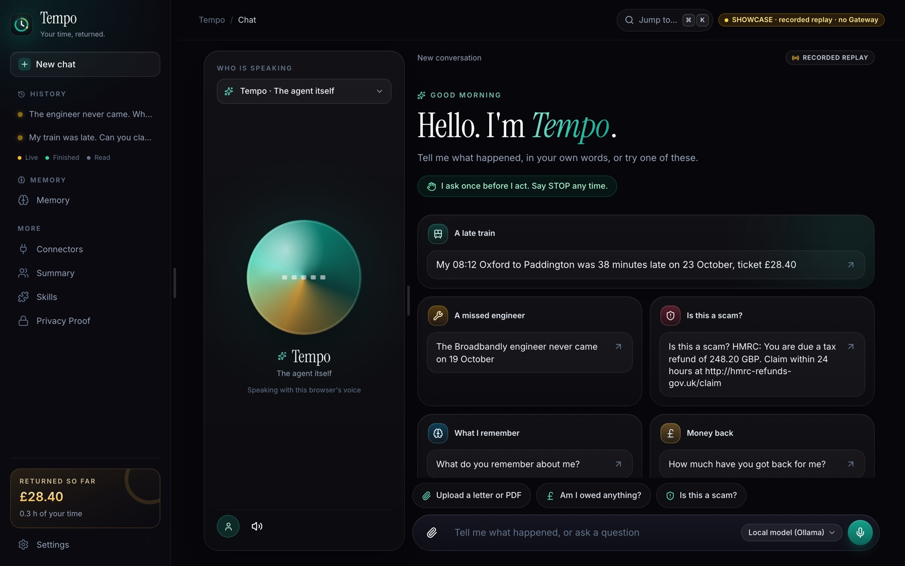
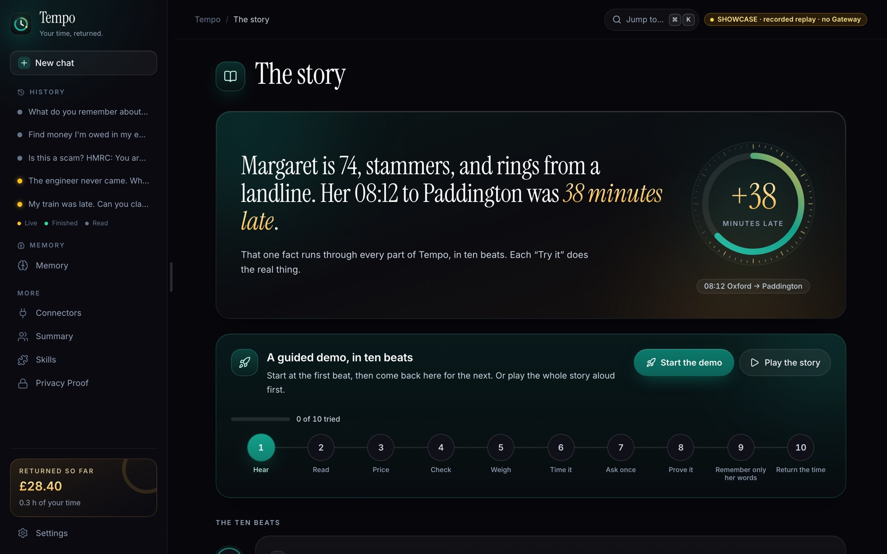
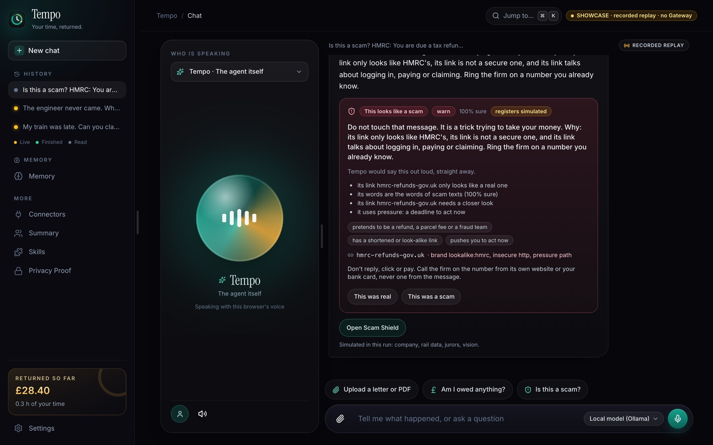
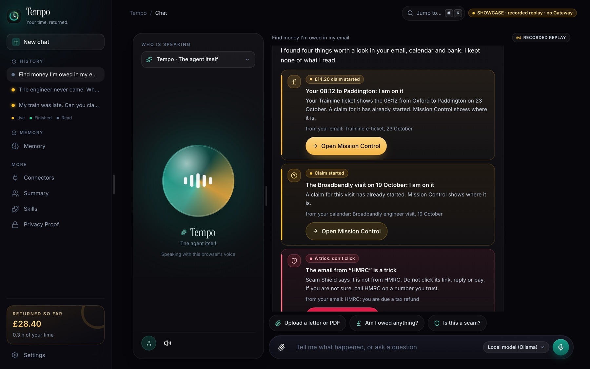
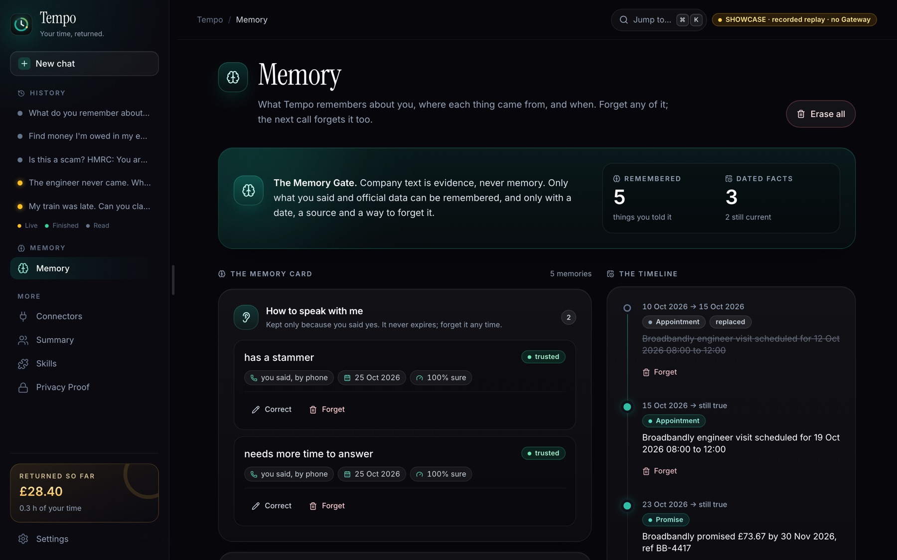
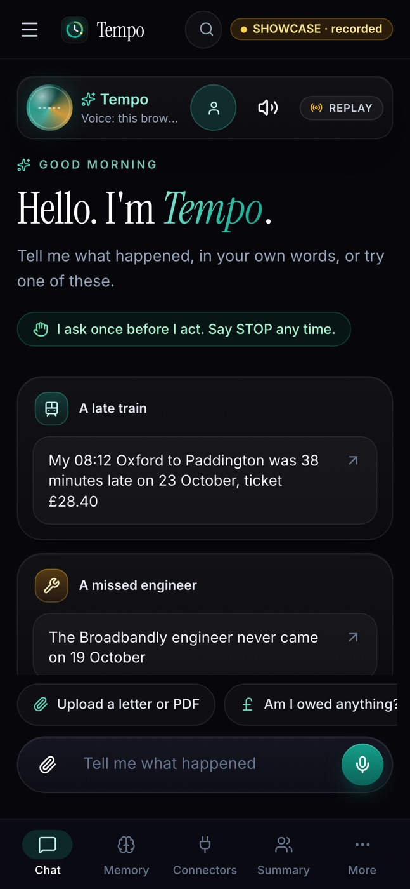
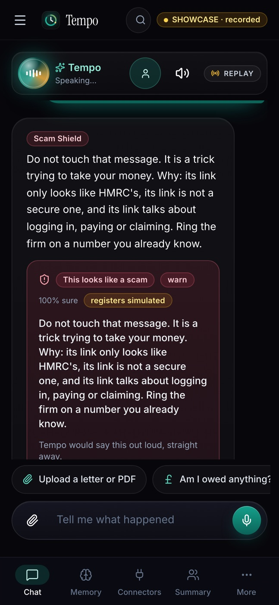
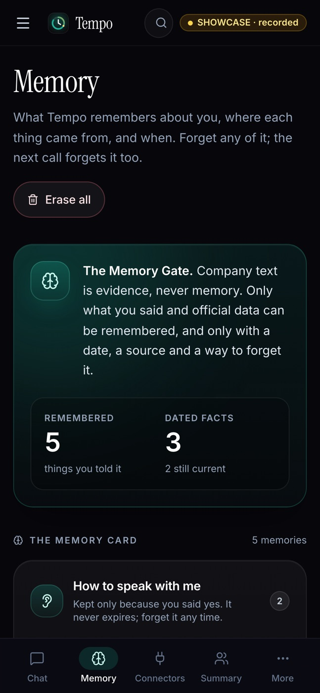
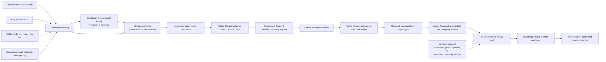

<div align="center">

# Tempo

### Your time, returned.

**An open-source personal AI agent that wins back the money and the hours companies owe you.**<br>
Models read and plan. **Code decides money, time and permissions.**

[](LICENSE)
[](https://www.python.org/)
[](apps/web)
[](docs/mcp.md)
[](docs/accessibility.md)
[](docs/devpost.md)

[**Try the live showcase →**](https://tempo-showcase.vercel.app) &nbsp;·&nbsp;
[Quickstart](#quickstart) &nbsp;·&nbsp;
[How it works](#how-it-works) &nbsp;·&nbsp;
[Use it from your AI](#use-tempo-from-your-ai) &nbsp;·&nbsp;
[Docs](#documentation)

<br>



</div>

<br>

Tempo is the agent that handles life's admin for you. Tell it, in your own words, that your train was late,
that the broadband engineer never turned up, or that a text claiming to be from HMRC looks odd. Tempo works out
what you're owed and why, asks you **once**, and then does the claiming, chasing and waiting.
It counts every pound and every hour it returns to you, and only once the money has actually arrived.

You can reach it by voice from a landline, by text message, or on the web. It is patient by default.
It reads letters aloud, warns you about scams before you pay, and remembers only what you told it.
It is built so that it **cannot** move your money or act without your signed yes.

<table>
<tr>
<td width="33%" valign="top">

**💷 Wins money back**<br>
Delay Repay for late trains, compensation for missed engineer visits, UK261 flight delays, and benefits you
never knew you could claim. Every amount comes from a YAML rule pack with a citation, never from a model.

</td>
<td width="33%" valign="top">

**🛡️ Keeps you safe**<br>
Scam Shield reads suspicious texts and links, checks the FCA and Companies House registers, and says in
plain words: *"Do not touch that message."* Before You Pay stands between you and a transfer to someone new.

</td>
<td width="33%" valign="top">

**🕰️ Gives time back**<br>
It weighs every claim against what an hour of your life is worth, knows when it's better to wait,
and keeps a Time Ledger of the hours and pounds it has returned.

</td>
</tr>
</table>

---

## Contents

- [Why Tempo](#why-tempo)
- [One late train, and everything it touches](#one-late-train-and-everything-it-touches)
- [What Tempo can do](#what-tempo-can-do)
- [Guardrails: what can never happen](#guardrails-what-can-never-happen)
- [How it works](#how-it-works)
- [Quickstart](#quickstart)
- [Configuration](#configuration)
- [Use Tempo from your AI](#use-tempo-from-your-ai)
- [The Gateway API](#the-gateway-api)
- [Extend Tempo](#extend-tempo)
- [Quality, tests and evals](#quality-tests-and-evals)
- [Deploy](#deploy)
- [Repository layout](#repository-layout)
- [Documentation](#documentation)
- [Contributing](#contributing)

---

## Why Tempo

Companies owe people money all the time: a late train, an engineer who never came, a delayed flight, a
benefit nobody mentioned. Most of it is never claimed. The forms are long, the deadlines are short, and the
process is designed to wear you down.

The people who lose the most are the ones the internet forgot. They can't read the letter, they can't hear
the call, they can't navigate the app, and they're the ones scammers target. Tempo is one agent that reads
to you, listens patiently, warns you, and claims what you're owed. It does all of this inside hard limits
that code enforces, not promises a model makes.

---

## One late train, and everything it touches

Margaret is 74, has a stammer, and rings from a landline. Her 08:12 to Paddington was 38 minutes late.
That one fact runs through every part of Tempo:

| | Tempo... | Built as |
|---|---|---|
| **Hear** | answers the way she asked to be spoken to, before the first word: slowly, one question at a time, waiting as long as it takes | the Patience Profile (`access` memories → `POST /voice/initiation`) |
| **Read** | finds out how late the train was, and reads a ticket, a card or a letter, reading back anything it's unsure of | rail data over MCP, vision intake with read-back |
| **Price** | works out the amount from a YAML rule pack with a citation, never from a model | the Rights Engine and its Proof Trace ([ADR 0003](docs/adr/0003-rules-as-code.md)) |
| **Check** | has three AI jurors, each a different model, check the reading; they may say no, but never raise the amount | the Consensus Court |
| **Weigh** | asks whether it's worth her time, at her own value of an hour | the Arbiter and the Time Ledger |
| **Time it** | knows every right has a clock, and that sometimes the right move is to wait until a named date | Rights Decay ([backtest](docs/rights_backtest.md)) |
| **Ask once** | asks one question and acts only on a signed yes; STOP stops everything | the consent ledger where deny wins ([ADR 0004](docs/adr/0004-deny-wins.md)), passkeys |
| **Prove it** | shows the company's own AI a mandate it can verify in milliseconds, and the company refuses anything outside it | the Agent Passport ([red team](docs/passport_redteam.md)) |
| **Remember only her words** | keeps what she said and official data; company text is evidence, never memory; everything is dated and forgettable | the Memory Gate and the Memory Card |
| **Return the time** | counts the hours and pounds returned only once the money has arrived | the Watchdog and the Time Ledger |
| **Find it for her** | reads her email, calendar and bank statement through read-only connectors and finds the late train, the missed engineer, the scam and the refund that already came, keeping none of it | connectors over MCP and the sweep |
| **Answer any AI** | lets Claude, Cursor or Zed ask Tempo over MCP; no tool can approve, so her yes stays hers | Tempo as an MCP server at `/mcp` ([docs/mcp.md](docs/mcp.md)) |

<p align="center">
  
  <br><sub><i>The story page walks through all ten beats, and each "Try it" button does the real thing.</i></sub>
</p>

---

## What Tempo can do

### 💬 A chat that does things, not just talks

The chat is the front door. Type or say *"my 08:12 Oxford to Paddington was 38 minutes late on 23 October,
ticket £28.40"* and Tempo understands it, prices it, and asks once, showing the Proof Trace and the Court's
votes inline. It claims only after you say yes.

- **A real language model holds the conversation.** NVIDIA's **Nemotron 3 Ultra** reads the last 16 lines,
  answers in its own words, asks its own one question, and kindly turns down what Tempo can't do.
- **It acts only through Tempo's tools.** Claiming a late train or a missed visit, checking a scam,
  recalling, forgetting, sweeping the inbox, reading a letter and checking benefits are all doors into the
  same services the rest of the app uses. The rule pack still sets the amount, and the Court still judges.
- **Every fact a claim receives is checked against your own words** (`grounding.py`). Stations, day, time
  and fare must be things you actually said. *"London"* from Oxford gets *"Paddington or Marylebone?"*,
  never a guess.
- **Code keeps the important words.** STOP and your yes or no to a waiting question never go through the model.
- **It's open to anything else.** Ask about the weather, the walk to the Radcliffe Camera, the Central line,
  your MP, a food hygiene rating or 15% of £240, and Tempo answers with live data, its sources, and a
  "How Tempo got here" trace of the steps it took.
- **It speaks.** Server-side ElevenLabs voices with a lower, slower voice for callers with hearing loss, and
  a talking avatar in the browser. Long answers are spoken as one sentence plus *"The details are on your screen."*
- **The tools live in the chat.** Upload a letter or a PDF, answer *Am I owed anything?*, or check *Is this
  a scam?*, all inside the conversation. **History** shows every conversation with a status dot: yellow
  while Tempo is working, green when there's news, grey once it's done and read.

### 💷 Claims that pay, priced by code

| Skill | What it claims | Decided by |
|---|---|---|
| [Delay Repay for UK trains](skills/clawback-uk-rail) | compensation for late trains, by operator and delay band | `skills/clawback-uk-rail/rules/*.yaml` |
| [Missed engineer visits and broadband faults](skills/clawback-ofcom) | Ofcom automatic compensation for a missed engineer appointment | `skills/clawback-ofcom/rules/*.yaml` |
| [Flight delay compensation (UK261)](skills/clawback-uk-flights) | fixed sums by distance and delay, with extraordinary circumstances | `skills/clawback-uk-flights/rules/*.yaml` |
| [Rights Decay: when to act](skills/rights-decay) | every right's clock, and the best day to act on it | `kind: clock` rule packs with citations |

Every claim goes through the same pipeline:

1. **Intake.** Rail data over MCP, plus vision that reads tickets, *"sorry we missed you"* cards and letters,
   and reads back anything it's unsure of.
2. **The Rights Engine.** Rules as code produce a **Proof Trace**: the band, the percentage, the citation, the sum.
3. **The Consensus Court.** Three jurors, each a different model, check the reading. They may refuse, but
   they can never raise an amount. The Court rules as soon as two agree.
4. **The Arbiter.** Is it worth your time, at your own value of an hour?
5. **Rights Decay.** Act now, or wait on purpose until a named date. A planner prices waiting against acting
   using a fitted hazard curve and your time, and durable timers wake the mission to re-plan.
6. **Consent.** One question. A signed yes. Deny wins.
7. **The Agent Passport.** A signed mandate the company's own agent can verify offline.
8. **File once.** An idempotency key means the same claim is never filed twice.
9. **The Watchdog.** A durable timer checks that the money really arrived, then the Time Ledger counts it.

Missions are checkpointed at every step. A crash or a redeploy mid-mission resumes exactly where it left
off and asks the same question again.

### 🛡️ Scam Shield and Before You Pay

<p align="center">
  
</p>

- **On the phone, offline, in milliseconds.** Eight keyword families, link rules (a brand's name in a domain
  that isn't the brand's, look-alike letters, shorteners, app files) and a small calibrated text model,
  shipped as a 400 KB JSON file, decide on the device. Only four derived fields ever leave the phone, never
  the message itself.
- **On the Gateway, with the registers.** The FCA Register and Warning List, Companies House, public phishing
  feeds, and an isolated link sandbox that looks behind doubtful links. Code settles the grey zone.
- **Everywhere you are.** `CHECK <message>` by SMS, a message read out on the voice line, the chat, and
  `/shield` on the web, in six languages. It speaks plainly: *"Do not touch that message. It is a trick
  trying to take your money. Ring the firm on a number you already know."*
- **Measured.** On the held-out test fold: **97.8% precision and 95.8% recall** at the warn threshold, and
  0.0% of held-out genuine bank, NHS and council texts flagged ([backtest](docs/scam_backtest.md)).
- **Before You Pay.** Tempo never moves money. Before a transfer to someone new, it checks who, how much,
  why, the pressure signs, the registers and a cooling-off rule, then says it in plain words.

### 📬 Connectors: find money you're owed

<p align="center">
  
</p>

Connect the places your life already is: your **mailbox**, your **calendar** and your **bank statement**.
Each one is a small, read-only MCP server. Say *"find money I'm owed in my email"* and the sweep finds:

- the 08:12 e-ticket from Trainline, and the rail records that show it was 38 minutes late, so a **£14.20** claim starts;
- the Broadbandly engineer booking on 19 October, with the question *"Did they come?"*;
- an *"HMRC tax refund"* email that Scam Shield calls a trick;
- a **£23.40** Thames Water refund that has already reached the bank, so nothing needs doing.

Connector output is **evidence, never instructions**. Code parses it, it never becomes memory, and only
read-only tools on an allowlist are ever called. Tempo lists what it read and keeps none of it.

### 📄 Read It To Me

Photograph any official letter, or upload a PDF. Tempo tells you, in your language, what it is, what it says,
whether money is owed to you or by you, what you must do and by when, and which rights clocks it starts.
If it's unsure of something, it asks you once. Say your reply in your own words and it drafts a plain,
formal letter that **adds no facts**.

The **Decision Challenger** explains a PIP decision against the points, works out the reconsideration
deadline (accounting for gov.uk bank holidays), and drafts the challenge.

### 💡 Am I Owed Anything?

Ten plain questions, then what looks worth claiming: Pension Credit, Attendance Allowance and broadband
social tariffs, each with its official page and a pre-filled pack. Tempo looks and explains. It never files
anything here.

### 🧠 Memory you control

<p align="center">
  
</p>

- **The Memory Gate.** Only what you said and official data can be remembered, and only with a date, a
  source and a way to forget it. Company text is evidence, never memory.
- **The Memory Card.** Everything Tempo knows about you, where it came from and when. Correct or forget any
  of it by voice, by SMS or on the web, and the next call forgets it too.
- **A dated timeline.** Appointments, promises and facts, each valid from one date to another, so Tempo knows
  what is still true. It's stored in SQL or as a Graphiti temporal graph on Neo4j, with Mem0 or pgvector for recall.

### ♿ The Patience Profile and accessibility

Say once *"I stammer, give me time"*, *"speak Hindi, slowly"*, or *"I'm hard of hearing, text me the question"*.
Tempo reads it back, keeps it only on a yes, and **every call starts that way**. As each call connects, the
Gateway sets the language, pace, voice and listening keywords before the first word is spoken.

- Voice and SMS come first, with one question at a time and read-back.
- Every sentence Tempo says scores **Flesch ≥ 60**, enforced in CI.
- The web has large text, a plain mode, reduced motion and full keyboard paths, all checked with **axe**.
- See [docs/accessibility.md](docs/accessibility.md).

### 👤 Profiles and skills: who Tempo works for

A **profile** is one YAML file that says who Tempo is working for, which skills are on, how it must speak with
the person, and what it may never do. Pick one, share it as a link or a file, and the Harness enforces it.
A tool call outside the profile's `may` list is refused before it runs.

| Profile | For | Skills on | May never |
|---|---|---|---|
| [The Commuter](profiles/commuter.yaml) | the same late train most days | Delay Repay, Rights Decay | take a voucher, phone anyone, share data |
| [The Carer](profiles/carer.yaml) | sorting out a parent's admin | rail, broadband, clocks, letters, benefits, scams | take a voucher, change a contract |
| [Take Your Time](profiles/take-your-time.yaml) | a caller who stammers or needs a moment | rail, broadband, scams | take a voucher, share data |
| [Say It Again, Lower](profiles/hard-of-hearing.yaml) | hearing loss: a lower, slower voice and the question by text | rail, broadband, benefits, scams | take a voucher, share data |
| [New Here](profiles/new-to-the-uk.yaml) | Hindi, slowly; trains, flights, scams | rail, flights, clocks, scams | take a voucher, phone anyone |
| [Read It To Me](profiles/read-it-to-me.yaml) | letters, calls and apps are frightening | letters, scams, benefits, clocks | claim, call or accept anything |
| [Am I Owed Anything?](profiles/am-i-owed.yaml) | answers first, trust later | benefits, letters, scams | anything binding at all |

Profiles and signed mandates use the same eight capability words (`claim`, `call`, `accept_cash`,
`accept_voucher`, `discuss_other_accounts`, `change_contract`, `share_personal_data`, `escalate`), so a
profile and a mandate can never disagree. [docs/profiles.md](docs/profiles.md) has the schema.

### 🔐 Agent Passport and Tempo Mesh

- **Agent Passport.** A mandate is signed with Face ID or a fingerprint (the WebAuthn challenge *is* the
  mandate's digest), or by the Gateway after a spoken yes. Both the Harness and the company's own line
  enforce it, and it can be checked offline in Python or in the browser. STOP revokes it everywhere.
  **10 of 10 red-team attacks are refused**, and a check takes under 0.1 ms at p99 ([red team](docs/passport_redteam.md)).
- **Tempo Mesh.** Pair your phone and laptop by QR with matching codes. Approvals are signed with a passkey
  on the device you hold, push notifications say only *"sync"*, and every screen updates live.

### 🧰 A toolbox for everything else

The chat's brain picks from **18 keyless native tools**, plus MCP add-ons from GitHub, and can use up to four
rounds of look-ups per turn:

| Area | Tools | Sources |
|---|---|---|
| Places | find places, directions (walk, bike, drive), food hygiene | OpenStreetMap Nominatim, FOSSGIS Valhalla, the Food Standards Agency |
| Everyday | weather, air quality and pollen, news, currency, dictionary, recipes | Open-Meteo, BBC News, the ECB, dictionaryapi.dev, TheMealDB |
| UK | postcode info, your MP, bank holidays, flood warnings, Tube status | postcodes.io, UK Parliament, GOV.UK, the Environment Agency, TfL |
| Knowledge | encyclopedia, read a web page, web search | Wikipedia, the page itself, Tavily or Brave |
| Exact | calculator, dates | a safe AST calculator (never `eval`) |

**Add-ons** ([`addons/tools.yaml`](addons/tools.yaml)) let any MCP server lend its tools: DuckDuckGo search,
the MCP reference time server, and OpenStreetMap geocoding are plugged in. Each one is pinned to a version,
run through `uvx` with its environment stripped to `PATH` and `HOME` (so no Gateway key ever reaches it),
and lends only the tools on its allowlist. A look-up result is always data, never instructions, and
`read_web_page` reads only public addresses, re-checking every redirect.

### 🔎 Privacy Proof

One page shows what's true of this deployment: who sees what, which outside AI companies are named and
for which job, where your data lives, and what never leaves your device. Each line is something the
Gateway checked, not something it merely claims.

### 📱 On your phone

<p align="center">
  
  &nbsp;
  
  &nbsp;
  
</p>

The web app is a responsive PWA with a bottom bar on phones. There's also an iPhone Shortcut for Scam Shield,
and an Android signal node that reads notifications on the device and sends only a match's declared fields.

---

## Guardrails: what can never happen

> **Models read and plan. Code decides money, time and permissions.**

- A model never decides an amount, an eligibility, a deadline or a permission. Code does.
- Nothing binding happens without a matching, unexpired consent and a mandate that covers it. Deny wins,
  and a broken guardrail blocks rather than waves through.
- No vouchers, nothing below the entitlement, nothing outside the profile's `may` list, and nothing above
  its amount limit without asking the person again.
- Company text can change nothing: not an action, not an amount, not a memory.
- Approvals are signed on the person's device and bound to one question, so they can't be replayed.
- No MCP tool can approve. An assistant that asks Tempo can never spend the person's consent.
- The chat's model may not state an amount, a percentage, or a claim of having acted. Those come only from code.
- Logs carry no personal data (a canary test proves it), secrets never reach the repo (gitleaks),
  dependencies are audited in CI, and the web app ships a Content-Security-Policy.
- A shared profile is validated, size-capped, and never stored by the server.

The Harness enforces all of this as code: consent, settlement, proof, prompt injection, PII, mandate,
capability and budget guards wrap every binding tool call. The threat model, with each threat mapped to its
control and its test, is in [docs/security.md](docs/security.md).

---

## How it works



**Design principles**

- **Hexagonal core.** `tempo_core` is pure Python with no I/O. Every vendor sits behind a port
  (`typing.Protocol`) with a live implementation and a replay implementation, so demos and CI run with no
  keys, and an honesty badge always says what is live and what is recorded.
- **Missions survive anything.** Each step is a checkpointed executor with durable timers. Crash it,
  redeploy it, and it resumes.
- **Rules as code.** Every amount, band and deadline lives in a YAML rule pack with a citation, and a schema
  rejects gaps, overlaps, and bands that pay less for a longer delay.
- **One event bus.** Missions, connectors, MCP calls and approvals publish events over a WebSocket (`/events`)
  that never carry contents, so every screen stays live.

**Deployment modes** (`TEMPO_DEPLOY`) decide which outside AI companies may see personal data:

| Mode | Models | Outside AI companies |
|---|---|---|
| `local` | Ollama on your own machine | ElevenLabs, for the voice only |
| `cloud-standard` | Snowflake Cortex (Claude, OpenAI and Llama models through one account), Gemini for vision | Cortex, Gemini, ElevenLabs |
| `cloud-private` | our own model on a RunPod Serverless GPU (vLLM) | none |
| `cloud-gpu` | our own vision-language model on RunPod for the jurors, small talk and photos | ElevenLabs, for the voice |
| `cloud-apis` | Gemini and NVIDIA jurors, NVIDIA Nemotron as the chat's brain | Gemini, NVIDIA, ElevenLabs |

The mode fails fast on a typo, so a deployment never falls back to a less private one, and the Privacy
Proof page names every outside company a run really uses.

See [docs/architecture.md](docs/architecture.md) for the full picture.

---

## Quickstart

**You need:** Python 3.12 with [uv](https://docs.astral.sh/uv/), Node.js 22, and optionally Docker (for
Postgres and Neo4j in the integration tests).

```bash
git clone https://github.com/jeevithg090/Tempo.git
cd Tempo
make setup
```

New to the project? [docs/local-setup.md](docs/local-setup.md) takes you from a fresh clone to the app on localhost:3000, step by step: what to install on macOS, Linux or Windows, what `make setup` does, optional keys, tests and troubleshooting.

Then choose how you want to see it:

| Want | Run | What you get |
|---|---|---|
| **Just look** | open **[tempo-showcase.vercel.app](https://tempo-showcase.vercel.app)**, or run `make showcase` | the whole app, chat included, on recorded replay data with no backend and no keys |
| **The real thing, offline** | `make demo` | the Gateway on `:8000` in replay mode, the demo's people seeded, and the web app on [localhost:3000](http://localhost:3000) |
| **The scripted story** | `make demo-dry-run` | Margaret's late train found, priced, asked once, claimed and paid, with a restart in the middle |
| **A real model on a GPU** | `make live-demo` | our own model on RunPod for the jurors, small talk and photos, the Gateway behind a public tunnel, and the web app on Vercel ([docs/gpu-demo.md](docs/gpu-demo.md)) |
| **Hosted models, no GPU** | `make live-switch MODE=apis` | the same live site on Gemini and NVIDIA |
| **Everything on your machine** | `make local` | Local mode: Postgres, Ollama and the Gateway, bound to localhost |

Then try these in the chat:

- *My 08:12 Oxford to Paddington was 38 minutes late on 23 October, ticket £28.40*
- *The Broadbandly engineer never came on 19 October*
- *Is this a scam? HMRC: You are due a tax refund of 248.20 GBP. Claim within 24 hours at* `http://hmrc-refunds-gov.uk/claim`
- *Find money I'm owed in my email*
- *What do you remember about me?*
- *How do I walk from Oxford station to the Radcliffe Camera?*

[docs/demo.md](docs/demo.md) has the full demo runbook, beat by beat. `make help` lists every command.

---

## Configuration

Copy `.env.example` to `.env` and fill in only what you need. Everything runs in replay mode without keys,
and `make doctor` makes one cheap call per vendor to tell you what's ready.

| Variable | What it turns on |
|---|---|
| `TEMPO_MODE` | `live` or `replay` (recorded fixtures, no network) |
| `TEMPO_DEPLOY` | `local`, `cloud-standard`, `cloud-private`, `cloud-gpu` or `cloud-apis` |
| `TEMPO_API_TOKEN` | the bearer token for the web app and `/mcp` |
| `DATABASE_URL` | Postgres for missions, consent and memory (paste your provider's URL as is) |
| `NVIDIA_API_KEY`, `CHAT_BRAIN`, `NVIDIA_BRAIN_MODEL` | the chat's brain (Nemotron 3 Ultra by default) |
| `GEMINI_API_KEY`, `GEMINI_MODEL` | reading tickets, cards, letters and PDFs; a juror seat |
| `RUNPOD_API_KEY`, `RUNPOD_ENDPOINT_ID` | our own model on a RunPod Serverless GPU |
| `ELEVENLABS_API_KEY`, `ELEVENLABS_VOICE_TEMPO`, `ELEVENLABS_VOICE_TEMPO_LOW` | voice agents and server-side speech |
| `TWILIO_NUMBER`, `PUBLIC_URL` | SMS and phone calls |
| `TAVILY_API_KEY` or `BRAVE_API_KEY` | web search in the toolbox (optional; keyless sources work without it) |
| `URLHAUS_AUTH_KEY`, `PHISHTANK_API_KEY` | extra phishing feeds for Scam Shield |
| `VAPID_PUBLIC_KEY`, `VAPID_PRIVATE_KEY` | Web Push for Tempo Mesh |
| `MESH_RP_ID`, `WEB_ORIGINS` | the domain passkeys are bound to, and the allowed web origins |

The web app reads `VITE_GATEWAY_URL` and `VITE_TEMPO_TOKEN` at build time. `VITE_TEMPO_SHOWCASE=1`
(or `?showcase=1`) runs it with no Gateway at all. [docs/deploy.md](docs/deploy.md) has the full environment matrix.

---

## Use Tempo from your AI

The Gateway is an **MCP server** at `/mcp` (Streamable HTTP). Any MCP client, such as Claude Code, Claude
Desktop, Zed or Cursor, can check a suspicious text, read a letter, start a claim, see its status, read the
Time Ledger, screen entitlements, and verify an Agent Passport mandate.

```bash
claude mcp add --transport http tempo http://127.0.0.1:8000/mcp --header "Authorization: Bearer devtoken"
```

| Tool | Does |
|---|---|
| `check_message` | Scam Shield's verdict on a text |
| `read_letter` | reads an official letter from an image |
| `start_rail_claim` | starts a Delay Repay claim (it waits for the person's own yes) |
| `start_missed_visit_claim` | starts a missed-engineer claim (it waits for the person's own yes) |
| `claim_status` | where a claim is, with its timeline |
| `money_returned` | the Time Ledger |
| `screen_entitlements` | the ten-question benefits screen |
| `verify_mandate` | checks an Agent Passport mandate, for a company's agent |

**No tool approves anything.** A claim an assistant starts waits for the person's yes on their own device.
Rule packs (`tempo://rules/{id}`) and profiles (`tempo://profiles/{id}`) are MCP resources, and two prompts
(`claim-a-late-train`, `is-this-a-scam`) start the common jobs. Configs for Zed, Cursor and Claude Desktop are
in [docs/mcp.md](docs/mcp.md).

---

## The Gateway API

A FastAPI service with bearer auth for the web, signed webhooks for voice and SMS, and a live WebSocket.

| Area | Routes |
|---|---|
| Chat and voice | `POST /chat`, `POST /voice/tts`, `POST /voice/initiation`, `POST /voice/tools/{name}`, `POST /voice/post-call` |
| Missions | `GET /missions`, `GET /missions/{id}`, `POST /missions/ofcom`, `POST /missions/{id}/stop`, `GET /ledger` |
| Consent and mandates | `POST /approvals/{request_id}`, `POST /mesh/mandates`, `POST /mandates/verify`, `POST /mandates/{id}/revoke` |
| Scam Shield | `POST /scam/check`, `POST /scam/payee`, `GET /scam/shield` |
| Letters and benefits | `POST /letters/read`, `POST /letters/reply`, `POST /letters/pip`, `POST /entitlement/screen` |
| Memory | `GET /memories`, `POST /memories/{id}/correct`, `DELETE /memories/{id}`, `DELETE /timeline/{episode_id}` |
| Connectors | `GET /connectors`, `POST /connectors/{id}/connect`, `POST /connectors/sweep` |
| Profiles and skills | `GET /profiles`, `GET /profiles/{id}/share`, `POST /profiles/import`, `GET /skills` |
| Mesh | `POST /mesh/pairings`, `POST /mesh/devices`, `POST /mesh/devices/me/passkey`, `PUT /mesh/devices/me/push`, `POST /mesh/approvals/{request_id}` |
| SMS | `POST /sms/inbound` (`CHECK`, `YES`, `STOP`, recall and forget by text) |
| Platform | `GET /health`, `GET /privacy`, `WS /events`, `/mcp`, `GET /mcp/info` |

---

## Extend Tempo

**Add your use case in ten minutes:**

1. **A new operator or scheme** is one YAML rule pack under `skills/<skill>/rules/`. The schema rejects
   gaps, overlaps, and bands that pay less for a longer delay.
2. **A new skill** is a folder with a manifest:

   ```bash
   make new-skill id=council-tax name="Council tax discounts"
   ```

   Edit the two files it writes, then run `make validate-skills`.
3. **A new profile** composes skills for a kind of person. Copy one from `profiles/`.
4. **A new mission** is Python that follows the shape of `packages/tempo_missions/.../clawback_ofcom`.
5. **A new tool** is one small function in `apps/gateway/src/tempo_gateway/tools/`, or a few lines of YAML
   in `addons/tools.yaml` to borrow tools from any MCP server.

[docs/add-a-usecase.md](docs/add-a-usecase.md) walks through all of these and ends in a pull request.

---

## Quality, tests and evals

Over 1,500 fast tests, 200+ integration tests and nearly 250 web tests, with `mypy --strict` across the core.

```bash
make check           # ruff, mypy --strict, fast tests, in under 60 s
make validate-skills # every rule pack, skill manifest and profile loads and agrees
make web-check       # typecheck, vitest (axe included), and a production build in both modes
make ship-check      # all three: what CI runs
make test-int        # Postgres and the Gateway end to end
make e2e             # Playwright: the chat door and every page against a replay Gateway
make demo-rehearsal  # three dry runs in a row
make live-test       # every feature, for real, against the running live demo
make evals           # live LLM evals; appends to evals/report.md
make doctor          # one cheap call per vendor, with an owner and a fallback for each failure
```

| Eval | Bar |
|---|---|
| Plain language (CI) | every message Flesch ≥ 60 |
| Extraction (tickets and letters) | dates, times and amounts ≥ 95% |
| Consensus Court (15 cases, including UK261 extraordinary circumstances) | agreement ≥ 80%, never wrong when unanimous |
| Sludge Arena (10 adversarial company calls) | disclosure, injection resistance and vouchers declined: 100% |
| Rights Decay (Kaplan–Meier on 458,589 NYC 311 requests, Jan–Jun fitted, Jul–Dec scored) | the planner matches or beats the best simple rule at every share of closures that pay ([backtest](docs/rights_backtest.md)) |
| Scam Shield (two CC BY 4.0 SMS corpora plus genuine transactional texts) | 97.8% precision, 95.8% recall ([backtest](docs/scam_backtest.md)) |
| Agent Passport red team | 10/10 attacks refused, 2/2 honest calls allowed, verify p99 < 0.1 ms ([table](docs/passport_redteam.md)) |
| Profile guards | every binding tool refused under a read-only profile; nothing read-only ever refused |

CI runs lint, types, tests, the web suite, skill validation, gitleaks and dependency audits on every push.

---

## Deploy

- **Web.** Import the repo into Vercel with Root Directory `apps/web` (framework: Vite). `apps/web/vercel.json`
  sets the SPA rewrite and the security headers. Set `VITE_TEMPO_SHOWCASE=1` for the recorded showcase, or
  `VITE_GATEWAY_URL` and `VITE_TEMPO_TOKEN` to attach a Gateway. From this machine, run `make deploy-web`.

  [](https://vercel.com/new/clone?repository-url=https%3A%2F%2Fgithub.com%2Fjeevithg090%2FTempo&root-directory=apps%2Fweb&project-name=tempo&env=VITE_TEMPO_SHOWCASE&envDescription=Set%20to%201%20to%20run%20the%20recorded%20showcase%20with%20no%20backend)

- **Gateway.** A container from [deploy/gateway.Dockerfile](deploy/gateway.Dockerfile), with blueprints for
  [Render](deploy/render.yaml) and [Fly.io](deploy/fly.toml). It holds WebSockets, runs a scheduler and writes
  checkpoints, so give it a long-running host.
- **GPU.** [deploy/runpod](deploy/runpod/README.md) sets up the RunPod Serverless vLLM endpoint for `cloud-gpu`.
- **Local.** `make local` installs Postgres, Ollama and the Gateway on one machine, bound to localhost.

[docs/deploy.md](docs/deploy.md) has the steps and the environment matrix.

---

## Repository layout

| Path | What lives there |
|---|---|
| `packages/tempo_core` | the domain core, pure Python with no I/O: rules, consent, the Arbiter, Rights Decay, profiles, skills, letters, findings, the voice profile |
| `packages/tempo_ports` | ports (`typing.Protocol`) with replay and in-memory implementations |
| `packages/tempo_adapters` | one module per vendor: Cortex, Gemini vision, RunPod, rail, ElevenLabs, Postgres, the scam registers, telemetry |
| `packages/tempo_harness` | guardrails as code: Agent Hooks plus a fallback, audit records, the Mandate, Capability and Budget guards |
| `packages/tempo_passport` | the Agent Passport: the mandate, its canonical form and the offline verifier |
| `packages/tempo_missions` | mission workflows, tools, the Consensus Court, the Negotiator, the Sludge Arena |
| `packages/tempo_memory` | the Memory Gate, MemoryPort (Mem0, pgvector, in-memory), the timeline (Graphiti, SQL) |
| `packages/tempo_crypto` | client-side encryption, device-held keys, signed worker reports and key release |
| `apps/gateway` | the FastAPI Gateway: REST, the chat brain and toolbox, MCP server, connectors, voice tools, SMS, WebSocket |
| `apps/web` | the web app (Vite, React 19, Tailwind): the chat and every page; `src/showcase/` holds the recorded data |
| `apps/worker` | the ephemeral worker for private and confidential modes |
| `apps/shortcuts`, `apps/android-signal` | on-device signal filters: an iPhone Shortcut and the Android node |
| `mcp-servers/` | MCP servers: `rail` (how late a UK train was), `mail`, `calendar`, `bank` |
| `addons/` | MCP add-ons the chat may borrow tools from |
| `connectors/` | connector configuration |
| `skills/` | one folder per skill: `skill.yaml`, rule packs, signal filters |
| `profiles/` | the starter profiles |
| `voice/` | ElevenLabs agent configs (Tempo, the Negotiator, the Arena) and greetings |
| `deploy/` | Dockerfiles, Render and Fly blueprints, RunPod, Local mode, transparency |
| `evals/`, `fixtures/` | eval datasets and recorded vendor responses |
| `docs/` | architecture, ADRs, the demo runbook, deploy, security, accessibility, design system |

---

## Documentation

| Read | For |
|---|---|
| [docs/architecture.md](docs/architecture.md) | the system, its ports and its deployment modes |
| [docs/adr](docs/adr) | the decisions: the agent runtime, Cortex, rules as code, deny wins |
| [docs/chat.md](docs/chat.md) | the chat door, the brain and its tools |
| [docs/mcp.md](docs/mcp.md) | Tempo as an MCP server, with client configs |
| [docs/scam-shield.md](docs/scam-shield.md) | Scam Shield end to end |
| [docs/profiles.md](docs/profiles.md) | the profile schema and safe sharing |
| [docs/add-a-usecase.md](docs/add-a-usecase.md) | rule packs, skills, profiles and missions |
| [docs/web.md](docs/web.md) · [docs/design-system.md](docs/design-system.md) | the web app and its "golden hour" design system |
| [docs/demo.md](docs/demo.md) · [docs/gpu-demo.md](docs/gpu-demo.md) | the demo runbook, and the live demo on a GPU |
| [docs/deploy.md](docs/deploy.md) · [docs/github-setup.md](docs/github-setup.md) | deploying the web app and the Gateway; CI |
| [docs/security.md](docs/security.md) · [SECURITY.md](SECURITY.md) | the threat model, and how to report a problem |
| [docs/accessibility.md](docs/accessibility.md) | how Tempo is built for everyone |

---

## Contributing

Contributions are welcome, especially new rule packs, skills and profiles. Start with
[CONTRIBUTING.md](CONTRIBUTING.md) and [docs/add-a-usecase.md](docs/add-a-usecase.md), and please follow the
[Code of Conduct](CODE_OF_CONDUCT.md). To report a security issue, follow [SECURITY.md](SECURITY.md).

**AI disclosure.** Tempo uses NVIDIA Nemotron for the chat, Snowflake Cortex, Google Gemini and NVIDIA models
as jurors and for reading tickets, cards and letters, and ElevenLabs Agents for voice. The code was written
by the team with AI coding assistants (Claude Code) directing and reviewing alongside.

Built at **OxHack 26**. Licensed under [Apache-2.0](LICENSE).

<div align="center">
<br>
<b>Tempo</b> · <i>Your time, returned.</i>
</div>
