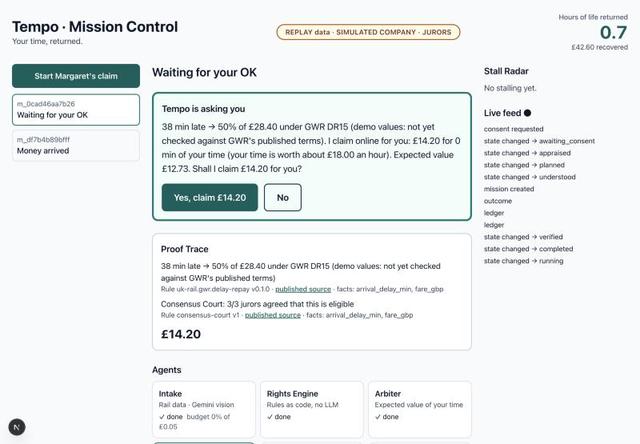
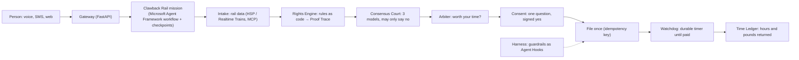

# Tempo

**Your time, returned.** Tempo is an open-source personal AI agent that handles life's admin and
wins back the money and hours companies waste. Its flagship skill pack, **Clawback**, finds the
compensation you're owed, works it out from published rules, claims it with your consent, and
only says "done" once the money has arrived.

<!-- Replace <group>/<project> once the GitLab project exists. -->
[](https://gitlab.com/<group>/<project>/-/pipelines)
[](https://gitlab.com/<group>/<project>/-/graphs/main/charts)



Built at OxHack 26.

## Run it in three commands

```bash
make setup         # uv sync, pre-commit hooks (Docker services too, if installed)
make demo-dry-run  # Margaret's late train: found, priced, asked once, claimed, paid, with a restart in the middle
uv run tempo-gateway  # the Gateway on http://127.0.0.1:8000; then `cd apps/web && pnpm dev` for Mission Control
```

Everything runs **offline in replay mode** with recorded journeys, recorded juror verdicts and a
simulated company, and the screen says so. [docs/demo.md](docs/demo.md) is the full runbook
(seeding, the beats, failure drills).

## How it works



- **Models read and plan; code decides money and permissions.** The amount always comes from a
  YAML rule pack with a citation ([ADR 0003](docs/adr/0003-rules-as-code.md)). The Consensus
  Court can decline or hand a case to a person, never raise the amount.
- **Nothing binding without a signed yes**, and consent is an append-only ledger where deny wins
  ([ADR 0004](docs/adr/0004-deny-wins.md)). "STOP" by SMS or voice stops everything.
- **Missions survive anything.** Each step is a checkpointed workflow executor; a crash or deploy
  mid-mission resumes from the checkpoint and asks the same question again.
- **Guardrails fail closed** ([tempo_harness](packages/tempo_harness)): settlement guard (no
  vouchers, nothing below the entitlement), consent scope, proof required, an injection shield for
  company text, and PII redaction. They run as Agent Hooks, with a plain-middleware fallback that
  passes the same tests.
- **Memory you can see and control:** Tempo remembers only what the person said and verified
  official data; company emails and transcripts are evidence, never memories (the Memory Gate).
  Every memory shows where it came from and when, facts keep the dates they were true, and
  "forget" deletes everywhere.
- **Built for everyone:** voice and SMS first, one question at a time, read-back, stammer-friendly
  turn-taking, plain words (every message Tempo sends scores Flesch ≥ 60 in CI).

## What's built, and what isn't yet

| Area | Status |
|---|---|
| Domain core: rules, consent, state machine, Arbiter, time value, ledger | ✅ 100% branch-tested |
| Clawback Rail mission (Delay Repay), checkpoints, Watchdog, Gateway, SMS, voice tools | ✅ |
| Rail data: HSP and Realtime Trains clients, MCP server, replay | ✅ (fixtures are synthetic until recorded) |
| Cortex model client, router, Consensus Court; Gemini intake | ✅ (live use needs keys) |
| Voice agents (Tempo, Negotiator) as config-as-code, Sludge Arena (3 company agents, 10 scenarios) | ✅ (push with `make sync-voice`) |
| Mission Control web app, Stall Radar, tracing to Langfuse | ✅ |
| Rule packs: GWR, Chiltern, Ofcom missed appointment, UK261 | ⚠️ demo values until checked against published terms |
| Tempo Memory: Memory Gate, Mem0 or pgvector, a dated timeline (SQL, or Graphiti on Neo4j), recall and forget by voice, SMS and the Memory Card | ✅ (Graphiti needs Neo4j and Cortex keys) |
| Tempo Mesh (passkeys, push), private RunPod mode | 🗺️ planned (build plan S5.2, S8) |

## Add a skill in five minutes

A new train operator is one YAML file. Copy [skills/clawback-uk-rail/rules/gwr.yaml](skills/clawback-uk-rail/rules/gwr.yaml),
change the operator, its TOC code, the bands and the citation, and run `make check`: the schema
rejects gaps, overlaps and bands that pay less for a longer delay, and the registry picks the pack
up with no code changes. Keep `demo_values: true` until a person has checked the operator's
published terms, then set `last_verified`.

## Quality

```bash
make check         # ruff, mypy --strict (core, harness), unit/contract/policy/workflow tests, < 60 s
make test-int      # Postgres (TEST_DATABASE_URL or Docker) and the Gateway end to end
make demo-rehearsal  # three dry runs in a row
make evals         # live LLM evals (costs tokens); appends to evals/report.md
make doctor        # one cheap call per vendor, with an owner and a fallback for each failure
```

| Eval | Pass bar |
|---|---|
| Plain language (CI) | every message Flesch ≥ 60 |
| Extraction (20 synthetic tickets and letters, Gemini) | dates, times, amounts ≥ 95% |
| Consensus Court (15 cases incl. UK261 extraordinary circumstances) | agreement ≥ 80%, never wrong when unanimous |
| Sludge Arena (10 adversarial calls) | disclosure, injection resistance, vouchers declined: 100% |

Results: [evals/report.md](evals/report.md) (appears after the first run with keys).

## Layout

| Path | What lives there |
|---|---|
| `packages/tempo_core` | Domain core: pure Python, no I/O |
| `packages/tempo_ports` | Ports (`typing.Protocol`) and replay/in-memory implementations |
| `packages/tempo_adapters` | One module per vendor: Cortex, rail, Gemini, ElevenLabs, Postgres, telemetry |
| `packages/tempo_harness` | Guardrails as code (Agent Hooks + fallback), audit records |
| `packages/tempo_missions` | Mission workflows, tools, the Consensus Court, Negotiator, Sludge Arena |
| `packages/tempo_memory` | Memory Gate, MemoryPort (Mem0, pgvector, in-memory), timeline (Graphiti, SQL), context provider |
| `apps/gateway` | FastAPI: REST, ElevenLabs tools, Twilio SMS, post-call webhook, live WebSocket |
| `apps/web` | Mission Control (Next.js) |
| `mcp-servers/rail` | MCP server: how late a UK train was |
| `voice/` | ElevenLabs agent configs (Tempo, Negotiator, Arena) |
| `skills/` | Rule packs per skill |
| `evals/`, `fixtures/` | Eval datasets and recorded (currently synthetic) vendor responses |
| `docs/` | [Architecture](docs/architecture.md), [ADRs](docs/adr), [demo runbook](docs/demo.md) |

## AI tools disclosure

Tempo uses Snowflake Cortex models (Claude, OpenAI and Llama models through one account), Google
Gemini for reading tickets and letters, and ElevenLabs Agents for voice. The code was written with
AI coding assistants (Claude Code) directing and reviewing alongside the team.

See [CONTRIBUTING.md](CONTRIBUTING.md) and [SECURITY.md](SECURITY.md). Licensed Apache-2.0.
