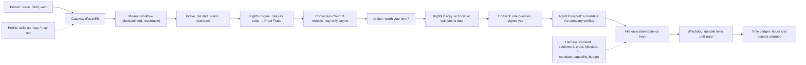

# Tempo

**Your time, returned.** Tempo is an open-source personal AI agent that handles life's admin and
wins back the money and hours companies waste. Models read and plan; **code decides money, time
and permissions**. You can reach it from a landline, by text or on the web, and it is patient by
default.

[](https://gitlab.com/na-group4693543/Tempo/-/pipelines)
[](https://gitlab.com/na-group4693543/Tempo/-/graphs/main/charts)
[](LICENSE)
[](https://vercel.com/new/clone?repository-url=https%3A%2F%2Fgitlab.com%2Fna-group4693543%2FTempo&root-directory=apps%2Fweb&project-name=tempo&env=NEXT_PUBLIC_TEMPO_SHOWCASE&envDescription=Set%20to%201%20to%20run%20the%20recorded%20showcase%20with%20no%20backend)


Built at OxHack 26. The project lives on GitLab at [gitlab.com/na-group4693543/Tempo](https://gitlab.com/na-group4693543/Tempo),
where the pipeline runs; [github.com/jeevithg090/Tempo](https://github.com/jeevithg090/Tempo) is a mirror with its own
Actions workflow for forks. [SHIPPING.md](SHIPPING.md) is the plan that turned the features into a product.

## Try it in sixty seconds

| Want | Do |
|---|---|
| **Just look** | Press *Deploy with Vercel* above (one env var, `NEXT_PUBLIC_TEMPO_SHOWCASE=1`), or run `make setup && make showcase` and open http://localhost:3000. Everything runs on recorded replay data with no backend, and the badge says so. |
| **The real thing, offline** | `make setup`, then `uv run tempo-gateway` in one terminal and `cd apps/web && pnpm dev` in another. Rail data, jurors and the company are simulated; no keys. [docs/demo.md](docs/demo.md) has the beats. |
| **The text demo** | `make demo-dry-run`: Margaret's late train found, priced, asked once, claimed and paid, with a restart in the middle. |
| **Live vendors** | Fill `.env` from `.env.example`; `make doctor` says which are ready. |

## One late train, and everything it touches

Margaret is 74, stammers, and rings from a landline. Her 08:12 to Paddington was 38 minutes late.
That one fact runs through every part of Tempo:

| | Tempo... | Built as |
|---|---|---|
| **Hear** | answers the way she asked to be spoken to, before the first word: slowly, one question at a time, waiting as long as it takes | the Patience Profile (`access` memories → `POST /voice/initiation`) |
| **Read** | finds how late the train was; reads a ticket, a card or a letter and reads back anything it is unsure of | rail data over MCP, vision intake with read-back |
| **Price** | works out the amount from a YAML rule pack with a citation, never from a model | the Rights Engine and its Proof Trace ([ADR 0003](docs/adr/0003-rules-as-code.md)) |
| **Check** | has three models from three providers check the reading; they may say no, never raise the amount | the Consensus Court |
| **Weigh** | asks whether it is worth her time, at her own value of an hour | the Arbiter and the Time Ledger |
| **Time it** | knows every right has a clock, and that sometimes the right move is to wait, with the date | Rights Decay ([backtest](docs/rights_backtest.md)) |
| **Ask once** | asks one question and acts only on a signed yes; STOP stops everything | the consent ledger where deny wins ([ADR 0004](docs/adr/0004-deny-wins.md)), passkeys |
| **Prove it** | shows the company's own AI a mandate it can verify in milliseconds, and the company refuses anything outside it | the Agent Passport ([red team](docs/passport_redteam.md)) |
| **Remember only her words** | keeps what she said and official data; company text is evidence, never memory; everything dated and forgettable | the Memory Gate and the Memory Card |
| **Return the time** | counts hours and pounds returned only once the money has arrived | the Watchdog and the Time Ledger |

## Profiles: who Tempo works for

A **profile** is one YAML file that says who Tempo is working for, which skills are on, how it must
speak with the person, and what it may never do. Pick one, share it as a link or a file, and the
Harness enforces it: a tool call outside the profile's `may` list is refused before it runs.

| Profile | For | Skills on | May never |
|---|---|---|---|
| [The Commuter](profiles/commuter.yaml) | the same late train most days | Delay Repay, Rights Decay | take a voucher, phone anyone, share data |
| [The Carer](profiles/carer.yaml) | sorting out a parent's admin | rail, broadband, clocks, letters, benefits, scams | take a voucher, change a contract |
| [Take Your Time](profiles/take-your-time.yaml) | a caller who stammers or needs a moment | rail, broadband, scams | take a voucher, share data |
| [Say It Again, Lower](profiles/hard-of-hearing.yaml) | hearing loss: a lower, slower voice and the question by text | rail, broadband, benefits, scams | take a voucher, share data |
| [New Here](profiles/new-to-the-uk.yaml) | Hindi, slowly; trains, flights, scams | rail, flights, clocks, scams | take a voucher, phone anyone |
| [Read It To Me](profiles/read-it-to-me.yaml) | letters, calls and apps are frightening | letters, scams, benefits, clocks | claim, call or accept anything |
| [Am I Owed Anything?](profiles/am-i-owed.yaml) | answers first, trust later | benefits, letters, scams | anything binding at all |

The eight capability words (`claim`, `call`, `accept_cash`, `accept_voucher`,
`discuss_other_accounts`, `change_contract`, `share_personal_data`, `escalate`) are the same words
a signed mandate uses, so a profile and a mandate can never disagree. [docs/profiles.md](docs/profiles.md)
has the schema and how sharing stays safe.

## Built for the people the internet forgot

The same people are hit from every side at once: they cannot read the letter, cannot hear the
call, cannot navigate the app, and are the ones scammers target. Tempo's answer is one agent that
reads to you, listens patiently, warns you, and is built so that it **cannot** move your money or
act without your signed yes.

- **Read It To Me.** Photograph any official letter. Tempo says, in your language, what it is,
  what it says, whether money is owed to you or by you, what you must do and by when, and which
  rights clocks it starts. Anything it is unsure of, it asks. Say your reply in your own words and
  it drafts a plain formal letter that adds no facts.
- **The Patience Profile.** Say once "I stammer, give me time" or "speak Hindi, slowly" or "I'm
  hard of hearing, text me the question". Tempo reads it back, keeps it only on a yes, and every
  call starts that way. Forget it and the next call forgets it.
- **Before You Pay.** Tempo never moves money. It stands between you and a transfer to someone new:
  who, how much, why, the pressure signs, the registers, a cooling-off rule, and then plain words:
  "wait, and ring them on a number you already know".
- **Scam signals.** On-device filter rules for suspicious texts; only the matched pattern names
  leave the phone, never the message. Tempo's warning is spoken in plain words.
- **Everywhere:** voice and SMS first; one question at a time with read-back; every sentence Tempo
  says scores Flesch ≥ 60 in CI; large text and a plain mode on the web; keyboard, screen-reader
  and reduced-motion paths checked with axe. [docs/accessibility.md](docs/accessibility.md).

## Guardrails: what can never happen

- A model never decides an amount, an eligibility, a deadline or a permission; code does.
- Nothing binding without a matching, unexpired consent and a mandate that covers it; deny wins;
  a broken guardrail blocks rather than waves through.
- No vouchers, nothing below the entitlement, nothing outside the profile's `may` list, nothing
  above its amount limit without asking the person again.
- Company text can change nothing: not an action, not an amount, not a memory.
- Approvals are signed on the person's device and bound to one question; they cannot be replayed.
- Logs carry no personal data (a canary test proves it); secrets never reach the repo (gitleaks);
  dependencies are audited in CI; the web app ships a Content-Security-Policy.
- A shared profile is validated, size-capped and never stored by the server.

The threat model, with each threat mapped to its control and its test, is
[docs/security.md](docs/security.md). Report a problem the way [SECURITY.md](SECURITY.md) asks.

## Add your use case in ten minutes

1. **A new operator or scheme** is one YAML rule pack under `skills/<skill>/rules/`. The schema
   rejects gaps, overlaps and bands that pay less for a longer delay.
2. **A new skill** is a folder with a manifest: `make new-skill id=council-tax name="Council tax
   discounts"`, then edit the two files it wrote and run `make validate-skills`.
3. **A new profile** composes skills for a kind of person: copy one from `profiles/`.
4. **A new mission** is Python that copies the shape of `packages/tempo_missions/.../clawback_ofcom`.

Keep `demo_values: true` until a person has checked the published source, then set
`last_verified`. [docs/add-a-usecase.md](docs/add-a-usecase.md) walks through all four and ends in
a pull request; [CONTRIBUTING.md](CONTRIBUTING.md) has the house rules.

## How it works



- **Models read and plan; code decides money, time and permissions.**
- **Missions survive anything:** each step is a checkpointed executor; a crash or deploy
  mid-mission resumes and asks the same question again.
- **Every vendor sits behind a port** with a live and a replay implementation, so demos and CI
  run with no keys and the honesty badge says what is real.
- **Deployment modes** (`TEMPO_DEPLOY`): local (Ollama), cloud-standard (Snowflake Cortex),
  cloud-private (our own model on RunPod vLLM, so no outside AI company sees personal data),
  cloud-confidential (roadmap). [docs/architecture.md](docs/architecture.md).

## What's built, and what isn't yet

| Area | Status |
|---|---|
| Domain core: rules, consent, state machine, Arbiter, time value, ledger | ✅ 100% branch-tested |
| Clawback Rail mission (Delay Repay), checkpoints, Watchdog, Gateway, SMS, voice tools | ✅ |
| Rail data: HSP and Realtime Trains clients, MCP server, replay | ✅ (fixtures are synthetic until recorded) |
| Cortex model client, router, Consensus Court; Gemini intake | ✅ (live use needs keys) |
| Voice agents (Tempo, Negotiator) as config-as-code, Sludge Arena (3 company agents, 10 scenarios) | ✅ (push with `make sync-voice`) |
| Mission Control web app, Stall Radar, tracing to Langfuse | ✅ |
| Scam Shield: Companies House, the FCA Register and Warning List, plus pressure signs; by SMS (`CHECK <message>`) or REST; never says "safe" | ✅ (recorded register answers until keys are in) |
| Entitlement Check: ten questions, then Pension Credit, Attendance Allowance and broadband social tariffs worth claiming, with a pre-filled pack; screening, not a decision | ⚠️ 2025/26 figures as demo values until checked against gov.uk |
| Letter Explainer + Decision Challenger: a PIP decision explained against the points, its reconsideration deadline (gov.uk bank holidays) and a draft letter that adds no facts | ✅ (decision letters read by Gemini with keys; the REST route takes the read facts) |
| Rule packs: GWR, Chiltern, Ofcom missed appointment, UK261 | ⚠️ demo values until checked against published terms |
| Tempo Memory: Memory Gate, Mem0 or pgvector, a dated timeline (SQL, or Graphiti on Neo4j), recall and forget by voice, SMS and the Memory Card | ✅ (Graphiti needs Neo4j and Cortex keys) |
| Android signal node: reads notifications on the phone; only a match's declared fields leave it, with a privacy log | ⚠️ written, not yet built (no JDK or Android SDK here); its filter rules are tested in Python against the shared vectors |
| Tempo Mesh v0: QR pairing with matching codes, passkey-signed approvals (Face ID, fingerprint), push that says only "sync", a Device Router, live fan-out to every screen | ✅ (TLS and per-device keys; MLS end-to-end encryption is the roadmap) |
| Deployment modes (`TEMPO_DEPLOY`): local (Ollama), cloud-standard (Cortex), cloud-private (our own model on RunPod vLLM: no outside AI company sees personal data) | ✅ switch, factory and RunPod client (the private endpoint needs keys; [deploy/runpod](deploy/runpod/README.md)) |
| Client-side encryption (device-held keys, crypto-shred), ephemeral workers with signed reports and one-step key release (browser and Python interop-tested), no-logs hardening with a canary test, signed reproducible images with a transparency allowlist, Local mode, the Privacy Proof panel | ✅ code and tests; images not yet built and keys not yet made ([deploy/transparency](deploy/transparency/README.md)); the Vault isn't yet wired into mission checkpoints |
| Confidential mode: key release only to an attested enclave (measurement, no debug, GPU CC mode, freshness, bound to the worker's key) | ⚠️ simulated attestation; real TEEs are roadmap ([deploy/confidential](deploy/confidential/README.md)) |
| Rights Decay: every right has a clock (`kind: clock` rule packs, 8 with citations); a planner prices waiting against acting from a fitted hazard curve and the person's time, and names the day to act; the Ofcom missed-visit mission waits with durable timers and re-plans on every wake; vision reads the "sorry we missed you" card and reads back one unsure fact | ✅ clocks are demo values until checked; the curves are NYC 311 housing requests standing in for UK companies, scaled by the FCA's real UK "upheld" share ([backtest](docs/rights_backtest.md), [calibration](docs/rights_calibration.md)) |
| Agent Passport: a mandate signed with Face ID (the WebAuthn challenge is its digest) or by the Gateway after a spoken yes; checked offline in Python and in the browser; the Harness and the company's line both enforce it; Tempo answers only for the exact mandate it issued; STOP revokes it everywhere | ✅ 10/10 attacks refused ([red team](docs/passport_redteam.md)); the passkey is self-certifying, so a directory or attestation issuer is roadmap |
| Patience Profile: a caller tells Tempo once how to speak with them (a stammer, hearing, a language, a slower pace); the Memory Gate reads it back and keeps it opt-in, dated and forgettable; as each call connects, ElevenLabs asks the Gateway, which sets language, pace, voice and listening keywords, and tells the agent in plain words; the whole line is patient for everyone | ✅ replay and tests; live needs `make sync-voice` (it turns on the conversation-initiation webhook) and a lower voice in `ELEVENLABS_VOICE_TEMPO_LOW`; the five greetings are unchecked by native speakers |
| Tempo Profiles: a shareable YAML that says who Tempo works for, which skills are on, how it must speak with the person and what it may never do; seven starters; share links that are validated, size-capped and never stored; enforced by `CapabilityGuard` and `BudgetGuard` in the Harness | ✅ ([docs/profiles.md](docs/profiles.md)) |
| Skill manifests (`skills/<id>/skill.yaml`) for all seven skills, `make new-skill` and `make validate-skills` | ✅ ([docs/add-a-usecase.md](docs/add-a-usecase.md)) |
| Read It To Me: a photo of any official letter becomes a plain spoken reading (what it is, what it says, what you must do, by when, which rights clocks it starts) with a read-back for anything unsure, and a reply drafted from your own words that adds no facts | ✅ replay fixtures (a water overpayment, a council-tax reminder); live reading needs a Gemini key |
| Before You Pay and scam signals: a deterministic check before a transfer to someone new (Tempo never moves money) and on-device filter rules for suspicious texts, tested against shared vectors | ✅ rules and tests; the Android node that would run the filters is not yet built |
| Showcase mode: the whole of Mission Control on recorded replay data with no backend, so the Vercel deployment works on its own; a landing page that tells the story | ✅ (`make showcase`, `NEXT_PUBLIC_TEMPO_SHOWCASE=1`) |
| GitHub Actions CI (lint, types, tests, web, skills, gitleaks, dependency audits), issue and PR templates, Dependabot, Render and Fly configs for the Gateway | ✅ ([docs/deploy.md](docs/deploy.md), [docs/github-setup.md](docs/github-setup.md)) |
| Skill Forge: narrate a skill and get a draft pack, manifest, MCP server and tests | ⚠️ work in progress on branch `skill-forge-wip` |

## Deploy

- **Web:** the *Deploy with Vercel* button above (it imports from GitLab; the GitHub mirror works
  too), or import the repo by hand with Root Directory `apps/web`. `NEXT_PUBLIC_TEMPO_SHOWCASE=1` runs the recorded showcase with no backend;
  `NEXT_PUBLIC_GATEWAY_URL` and `NEXT_PUBLIC_TEMPO_TOKEN` attach a Gateway.
- **Gateway:** a container from [deploy/gateway.Dockerfile](deploy/gateway.Dockerfile); blueprints
  for [Render](deploy/render.yaml) and [Fly](deploy/fly.toml). It holds WebSockets, runs a
  scheduler and writes checkpoints, so it is not a serverless target.
- [docs/deploy.md](docs/deploy.md) has the steps and the env matrix; [docs/github-setup.md](docs/github-setup.md)
  sets up the GitHub mirror, its Actions CI and branch protection.

## Quality

```bash
make check           # ruff, mypy --strict (core, harness, memory, crypto, passport), fast tests, < 60 s
make validate-skills # every rule pack, skill manifest and profile loads and agrees
make web-check       # typecheck, vitest (incl. axe), next build in both modes
make ship-check      # the three above: what CI runs
make test-int        # Postgres (TEST_DATABASE_URL or Docker) and the Gateway end to end
make e2e             # Playwright: Face ID approval (virtual authenticator) and pairing, in Chromium
make demo-rehearsal  # three dry runs in a row (the rail claim and the Rights Decay beat)
make rights-backtest # fit the Rights Decay curves from .data/ and write the backtest
make evals           # live LLM evals (costs tokens); appends to evals/report.md
make doctor          # one cheap call per vendor, with an owner and a fallback for each failure
make local           # Local mode: Postgres, Ollama and the Gateway on this machine, localhost only
```

| Eval | Pass bar |
|---|---|
| Plain language (CI) | every message Flesch ≥ 60 |
| Extraction (20 synthetic tickets and letters, Gemini) | dates, times, amounts ≥ 95% |
| Consensus Court (15 cases incl. UK261 extraordinary circumstances) | agreement ≥ 80%, never wrong when unanimous |
| Sludge Arena (10 adversarial calls) | disclosure, injection resistance, vouchers declined: 100% |
| Delay model (`make calibrate`: P(late ≥ 15/30/60) by service, last week held out) | Brier below the route average; [backtest](docs/backtest.md), [reliability diagram](docs/calibration.png) (synthetic until HSP keys) |
| Rights Decay (`make rights-backtest`: Kaplan-Meier on 458,589 NYC 311 requests, Jan-Jun fitted, Jul-Dec scored) | the planner matches or beats the best simple rule at every share of closures that pay; [backtest](docs/rights_backtest.md) |
| Agent Passport red team (`tests/policy/test_passport_redteam.py`) | 10/10 attacks refused, 2/2 honest calls allowed; verify p99 under 0.1 ms ([table](docs/passport_redteam.md)) |
| Profile guards (`tests/policy/test_profile_guards.py`) | every binding tool refused under a read-only profile; nothing read-only ever refused |

Results: [evals/report.md](evals/report.md) (appears after the first run with keys).

## Layout

| Path | What lives there |
|---|---|
| `packages/tempo_core` | Domain core: pure Python, no I/O (rules, consent, Arbiter, Rights Decay, profiles, skills, letters, voice profile) |
| `packages/tempo_ports` | Ports (`typing.Protocol`) and replay/in-memory implementations |
| `packages/tempo_adapters` | One module per vendor: Cortex, rail, Gemini, ElevenLabs, Postgres, telemetry |
| `packages/tempo_harness` | Guardrails as code (Agent Hooks + fallback), audit records, MandateGuard, CapabilityGuard, BudgetGuard |
| `packages/tempo_passport` | Agent Passport: the mandate, its canonical form and the offline verifier |
| `packages/tempo_missions` | Mission workflows, tools, the Consensus Court, Negotiator, Sludge Arena |
| `packages/tempo_memory` | Memory Gate, MemoryPort (Mem0, pgvector, in-memory), timeline (Graphiti, SQL), context provider |
| `apps/gateway` | FastAPI: REST, ElevenLabs tools, Twilio SMS, post-call webhook, live WebSocket, profiles, letters |
| `apps/web` | The site and Mission Control (Next.js); `showcase/` holds the recorded replay data |
| `apps/shortcuts`, `apps/android-signal` | On-device signal filters: iPhone Shortcuts (built), Android node (written) |
| `mcp-servers/rail` | MCP server: how late a UK train was |
| `voice/` | ElevenLabs agent configs (Tempo, Negotiator, Arena) and greetings |
| `skills/` | One folder per skill: `skill.yaml`, rule packs, signal filters |
| `profiles/` | The starter profiles |
| `evals/`, `fixtures/` | Eval datasets and recorded (currently synthetic) vendor responses |
| `docs/` | [Architecture](docs/architecture.md), [ADRs](docs/adr), [demo runbook](docs/demo.md), [deploy](docs/deploy.md), [security](docs/security.md), [accessibility](docs/accessibility.md) |
| `.github/` | CI, issue and PR templates, Dependabot |

## AI tools disclosure

Tempo uses Snowflake Cortex models (Claude, OpenAI and Llama models through one account), Google
Gemini for reading tickets, cards and letters, and ElevenLabs Agents for voice. The code was
written with AI coding assistants (Claude Code) directing and reviewing alongside the team.

See [CONTRIBUTING.md](CONTRIBUTING.md), [CODE_OF_CONDUCT.md](CODE_OF_CONDUCT.md) and
[SECURITY.md](SECURITY.md). Licensed Apache-2.0.
