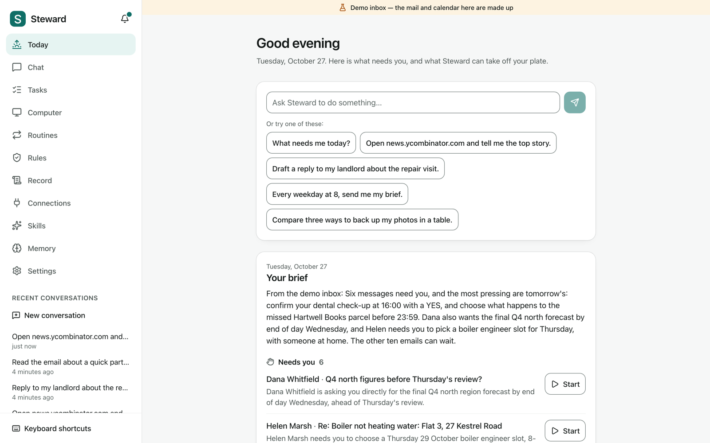
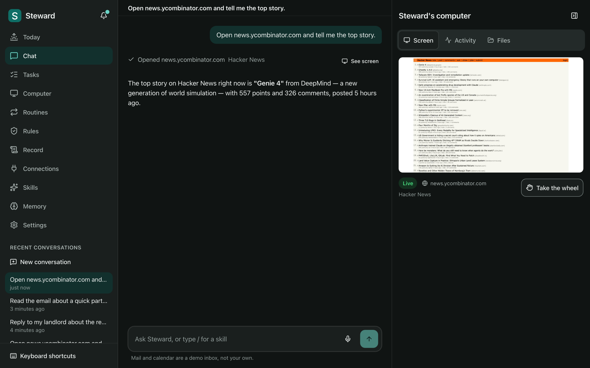
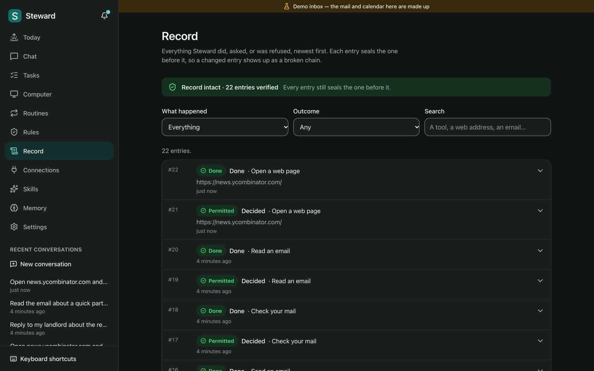
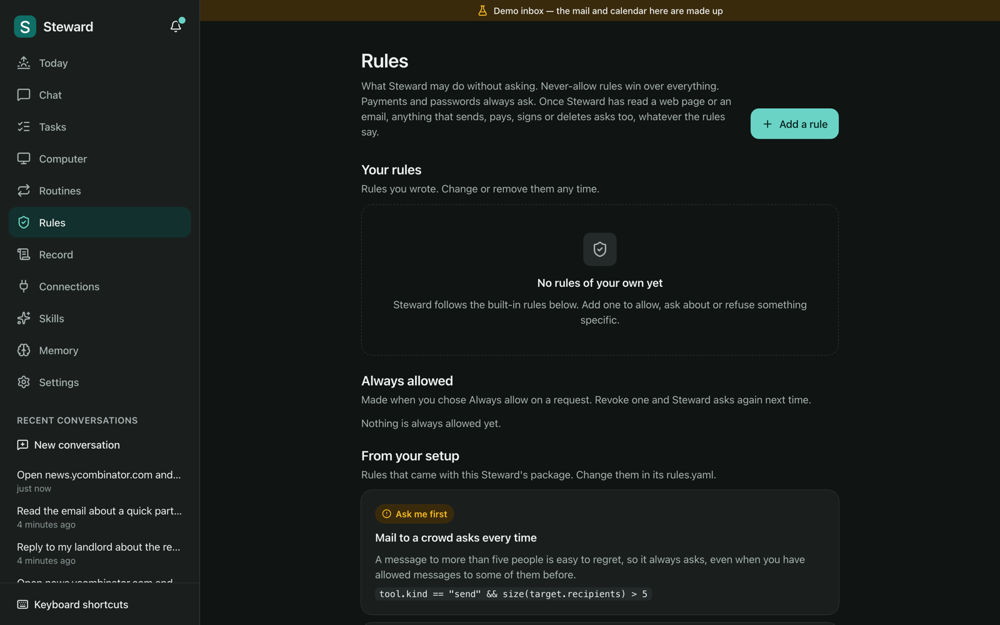
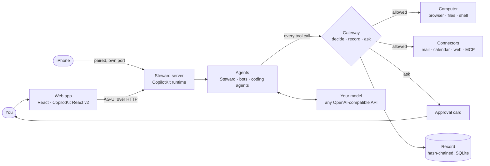
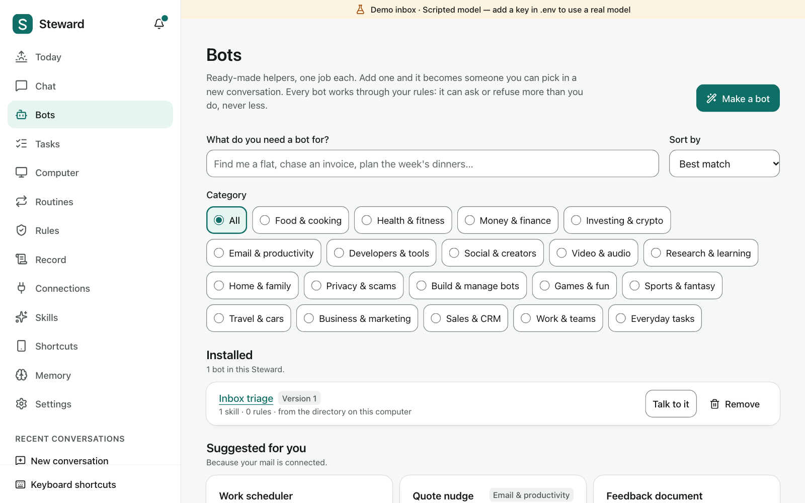
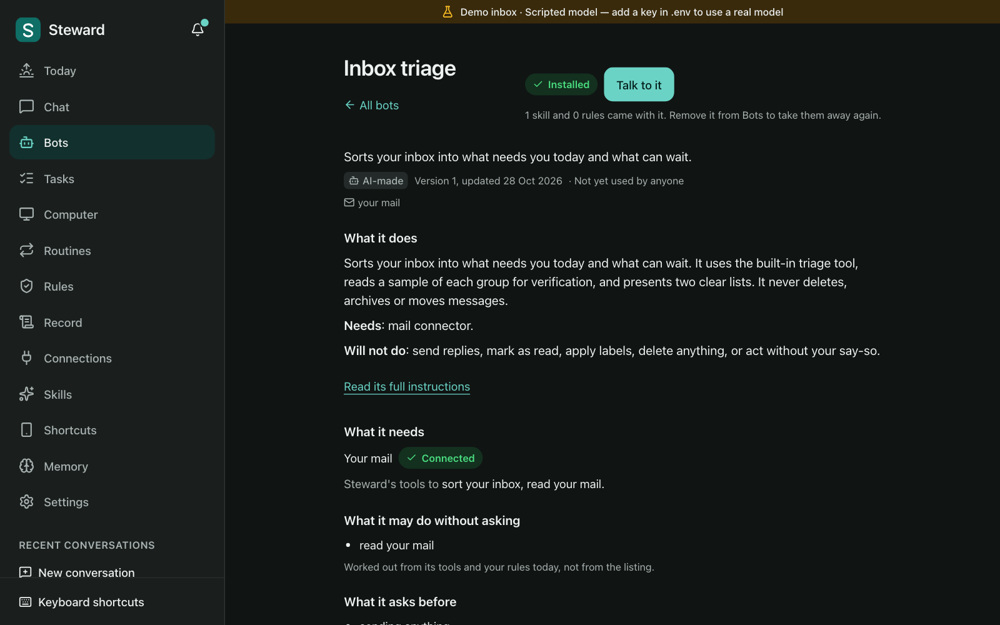
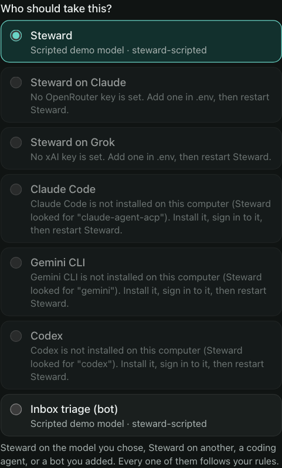
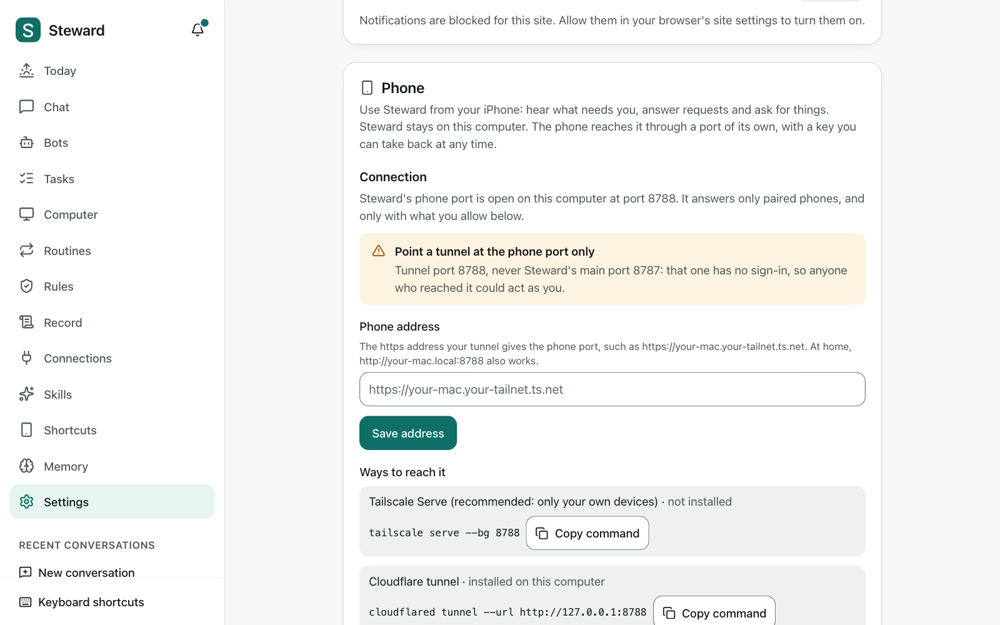

<div align="center">


# Steward

**An open-source AI steward with a computer of its own.**<br>
It does the work, asks before it acts, and keeps a record you can read.

[](LICENSE)
[](https://nodejs.org)
[](#bots)


[Quick start](#quick-start) · [Try it](#try-it-in-five-minutes) · [How it works](#how-it-works) ·
[Governance](#governance) · [Bots](#bots) · [Other agents](#other-agents-and-models) ·
[Phone](#your-phone) · [Make it your own](#make-it-your-own) · [Docs](docs/README.md)

</div>

<p align="center">
  
</p>

Steward reads your mail and calendar, tells you each morning what needs you, and does the work on
a computer of its own while you are away: a real browser, its own files and a shell. It never
sends, pays, signs or deletes anything without showing you exactly what and waiting for your
answer. Every action it takes, asks about or is refused goes in a record that checks itself.

It runs on your machine with `pnpm install && pnpm dev`: no Docker, no database server, no account
to sign up for, and no key needed to try it.

> [!NOTE]
> **Alpha.** Steward is young. Expect rough edges, and expect things to move. Issues and pull
> requests are welcome.

## Why Steward

| Steward…                        | What that means                                                                                                                                                                                     |
| ------------------------------- | --------------------------------------------------------------------------------------------------------------------------------------------------------------------------------------------------- |
| **does the work**               | A morning brief sorts your mail into "needs you" and "can wait". Research, comparisons, forms, drafts and errands run on Steward's own browser, which you can watch live and take over at any time. |
| **asks first**                  | Sending, paying, signing, deleting and running commands stop on a card that shows exactly what will happen: **Refuse**, **Allow once** or **Always allow**.                                         |
| **can't be talked into things** | Once it has read a web page or an email, anything risky asks you, whatever your rules say, because what it read might be trying to steer it.                                                        |
| **keeps a record**              | Every row seals the one before it with a hash, and the app checks the whole chain for you.                                                                                                          |
| **works for everyone**          | Keyboard and screen reader paths throughout, voice in and out, large text, high contrast, reduced motion and a plain-language mode.                                                                 |
| **becomes yours**               | Its name, agents, skills, rules and model live in one folder of YAML. Add ready-made bots in one tap, bring Claude Code or Codex as an agent, and take it with you on your iPhone.                  |

More of what it does:

- **Never sees your passwords.** You type them into a masked box that fills the page directly. The
  model, the conversation and the record never get the value.
- **Checks what leaves.** Card numbers, IBANs, ID numbers, keys and health details in anything it
  would send are named on the card before they go.
- **Remembers and repeats.** Tasks, routines ("every weekday at 8, send me my brief"), memory you
  can read and edit, and skills you call with `/name`.
- **Shows, not just tells.** Tables, charts, comparisons and pages it makes for you appear in the
  conversation.
- **Runs any model.** OpenRouter, OpenAI, Anthropic, Gemini, NVIDIA, xAI, Ollama on your own
  machine, or any OpenAI-compatible server, chosen per conversation.

## Quick start

You need [Node](https://nodejs.org) 24 or newer and [pnpm](https://pnpm.io) 10
(`corepack enable` gives you the right one).

```sh
git clone https://github.com/jeevithg090/Steward.git
cd Steward
pnpm install
cp .env.example .env
```

Add a model key to `.env`. With [OpenRouter](https://openrouter.ai), one key reaches most models:

```sh
OPENROUTER_API_KEY=sk-or-...
```

Or leave it blank: Steward runs a scripted demo model that needs no key, and says so on every page.

```sh
pnpm dev
```

Open <http://localhost:5173>. The first run shows a short welcome and a setup checklist. Steward
starts with a made-up demo inbox and calendar, labelled as such, so there is something to work
with straight away.

> [!TIP]
> **Keep your keys outside the repository** by pointing at any `.env` file:
> `STEWARD_ENV_FILE=/path/to/.env pnpm dev`. Every setting is in
> [docs/configuration.md](docs/configuration.md).

The agent's browser is Playwright's Chromium. If Steward says it is missing, install it once with
`pnpm exec playwright install chromium`.

## Try it in five minutes

Everything here works with the demo inbox, and with the scripted model too.

1. **The brief.** On **Today**, press **Make my brief**. Steward reads the demo inbox and calendar
   and shows what needs you, what can wait and what is on today. Press **Start** on a row to hand
   that email to Steward.
2. **The computer.** Ask _"Open news.ycombinator.com and tell me the top story."_ The browser opens
   on Steward's own computer, beside the chat. Press **Take the wheel** to drive it yourself, and
   hand it back when you are done.
3. **An email that asks first.** Ask _"Email sam@example.com about Friday: see you at 10"_. Steward
   writes it and calls the tool, and the call stops on a card showing exactly who it goes to and
   what it says. Press **Refuse**: nothing is sent, and Steward says so.
4. **A rule.** On **Rules**, add a rule: _Never allow_, when `tool.surface == "shell"`. Then, under
   **Would this be allowed?**, pick _Run a command_ and press **Check**: refused, by your rule.
5. **The record.** On **Record**, see every decision: what ran, what asked, what was refused and
   which rule refused it. The badge at the top says _Record intact_ once it has checked the chain.
6. **A bot.** On **Bots**, search _"inbox"_, open **Inbox triage**, read what it may do without
   asking, and press **Add to Steward**. Start a new conversation and pick it.

Then try _"Every weekday at 8, send me my brief."_ for a routine, or _"Compare three ways to back up
my photos in a table."_ with a real model.

<p align="center">
  
</p>

<p align="center">
  
  
</p>

<sub>Screenshots from a live run on NVIDIA Nemotron 3 Ultra with the demo inbox. The mail and calendar are made up; the web page is real.</sub>

## How it works



The web app talks to the server over [AG-UI](https://github.com/ag-ui-protocol/ag-ui), through
[CopilotKit](https://github.com/CopilotKit/CopilotKit)'s runtime. Each agent is CopilotKit's
`BuiltInAgent` on any model that speaks the OpenAI API. Steward's tools are never handed to it to
run: a middleware offers them to the model as tools it can only ask for, catches every call, and
sends it to the gateway. The gateway works out what the call touches, decides it against your
rules, writes the decision to the record, and only then acts. When the answer is "ask", the run
ends with an interrupt and the approval card appears; your answer resumes it, and the gateway acts
on the answer exactly once.

Everything lives in one SQLite file on your machine (Node's built-in `node:sqlite`). More in
[docs/architecture.md](docs/architecture.md).

## Governance

Every tool call is checked in this order, and the first step that decides wins:

1. **Deny rules.** Your "never" beats everything, including Always allow.
2. **The safety floor.** Payments and passwords always ask, every time.
3. **Taint.** After reading a web page, an email or a file, anything that sends, pays, signs,
   deletes or runs a command asks.
4. **The outbound check.** Sensitive details in what would leave make it ask, with the details
   named on the card (a card number by Luhn, an IBAN by mod-97, national ID numbers, keys,
   passwords, health words). The card shows a masked hint, never the value.
5. **Ask rules.**
6. **Allow rules,** including the ones Always allow writes, each pinned to the exact recipient,
   site, button or command.
7. **Defaults by kind.** Reads run. Changes to Steward's own browser, files, memory and tasks run.
   Everything else asks.

Rules are written in [CEL](https://cel.dev), such as `tool.kind == "send" && size(target.recipients) > 5`,
checked when you save them, and testable on the Rules page without running anything. Anything that
goes wrong while deciding refuses: Steward fails closed.

**The secret box** sends a password from your browser to the page and nowhere else. **The record**
is append-only, and each row stores `sha256(previous hash + this row)`, so a changed row breaks
the chain. You can verify it from the app, or from the SQLite file with a few lines of Node.

The full reference, with every variable and the approval lifecycle, is
[docs/governance.md](docs/governance.md).

## Bots

**Bots** is a free directory of ready-made helpers, one job each: _Inbox triage_, _Flat finder_,
_Stack trace explainer_, _Pub quiz maker_. Open one, read what it does and what it needs, and
press **Add to Steward**. It becomes an agent you can pick for a new conversation. Nothing to
copy, nothing to configure.

<p align="center">
  
  
</p>

- **642 bots ship with Steward** in `directory/`: 455 made by a model from a job taxonomy and
  checked by a second model, a duplicate check by meaning and the gateway's rules (labelled
  **AI-made** until someone uses them; unused ones retire after 90 days), 177 adapted from
  [LobeChat's agent index](https://github.com/lobehub/lobe-chat-agents) with their authors
  credited, and 10 from OpenBot's coworker catalogue.
- **A bot is a pack:** a profile, skills in the open [Agent Skills](https://agentskills.io)
  `SKILL.md` format, starters, and rules that can only make the gateway stricter, never looser.
- **You see what it may do before you add it.** The listing shows what it may do without asking
  and what it asks before, worked out from its tools and _your_ rules, not from its description.
- **Make your own.** **Make a bot** describes one in a sentence and generates it on your own
  model, and can download it ready to submit.
- **Run your own directory.** `apps/directory` is the hosted half: search, an MCP connector so
  other agents can find bots, GitHub sign-in for submissions, and review. Point
  `STEWARD_DIRECTORY_URL` at it. See [docs/directory.md](docs/directory.md).

## Other agents and models

Pick who takes each conversation. Steward on the model you chose, Steward on another model, a bot
you added, or an external coding agent, and every one of them works through your rules.

<p align="center">
  
</p>

- **Steward on any model.** An agent in `agents.yaml` can name a model of its own
  (`model: xai/grok-4.7`), so "Steward on Claude" and "Steward on Grok" sit side by side, each on
  its own provider and key.
- **Coding agents as Steward agents.** Claude Code and Gemini CLI (through the
  [Agent Client Protocol](https://agentclientprotocol.com)) and Codex (through its app server) run
  as the vendor's own tool in their own workspace. Every permission they ask for becomes a Steward
  approval, decided by your rules and written to the record.
- **Agents hand work to each other.** `delegate_task` passes a job to another agent, and its
  answer comes back marked as outside content, so it taints the conversation like a web page.
- **Unavailable agents say why**: which key is missing or which tool is not installed, and how to
  fix it.

See [docs/harnesses.md](docs/harnesses.md) and [docs/models.md](docs/models.md).

## Your phone

Use Steward from your iPhone: hear what needs you, answer approval cards and ask for things, while
Steward stays on your computer.

<p align="center">
  
</p>

- **A Steward shortcut that knows you.** Pair with a QR code and get one signed shortcut, built
  from your skills and routines, that opens straight in Apple's Shortcuts app. No setup on the
  phone beyond tapping Add.
- **A port of its own.** Phones reach only `/device/*` on a separate port, with a key per phone you
  can take back at any time. Payments, signing and passwords are always finished on your computer.
- **The phone app (preview).** Live chat, notifications and answers signed by the phone, through
  an end-to-end encrypted relay you host (`apps/relay`), with crypto ported from
  [Happy](https://github.com/slopus/happy).

The guide, including what to check on a real device, is [docs/phone.md](docs/phone.md).

## Make it your own

Everything that makes Steward "Steward" is one folder: `tenants/steward/`.

```text
tenants/steward/
├── brand.yaml      name, tagline, accent colour, voice, starters
├── agents.yaml     the agents, their models and standing instructions
├── skills.yaml     instructions called with /name
├── rules.yaml      extra rules, in CEL
├── model.yaml      the default model
└── harnesses.yaml  the coding agents it may run
```

Copy it, change it, and run `STEWARD_TENANT=yours pnpm dev`. The repository ships a second package
to show how far that goes: **Tempo** (`tenants/tempo/`) turns Steward into a personal agent that
wins back money and time. It finds Delay Repay claims for late trains, checks messages and links
for scams, and audits bills and subscriptions, and it never pays or types bank details, because its
rules forbid it, not because its prompt asks nicely.

```sh
STEWARD_TENANT=tempo pnpm dev
```

The guide is [docs/make-it-your-own.md](docs/make-it-your-own.md).

## Models

Steward reaches every model through the OpenAI Chat Completions API.

| Provider                                      | `STEWARD_MODEL_PROVIDER` | Key                                                    |
| --------------------------------------------- | ------------------------ | ------------------------------------------------------ |
| [OpenRouter](https://openrouter.ai) (default) | `openrouter`             | `OPENROUTER_API_KEY`                                   |
| OpenAI                                        | `openai`                 | `OPENAI_API_KEY`                                       |
| Anthropic                                     | `anthropic`              | `ANTHROPIC_API_KEY`                                    |
| Google Gemini                                 | `gemini`                 | `GEMINI_API_KEY`                                       |
| NVIDIA                                        | `nvidia`                 | `NVIDIA_API_KEY`                                       |
| xAI (Grok)                                    | `xai`                    | `XAI_API_KEY`                                          |
| [Ollama](https://ollama.com), on your machine | `ollama`                 | none                                                   |
| Any OpenAI-compatible server                  | `openai-compatible`      | `STEWARD_MODEL_API_KEY`, with `STEWARD_MODEL_BASE_URL` |
| The scripted demo model                       | `scripted`               | none                                                   |

The default is `anthropic/claude-sonnet-5.5` through OpenRouter. Change it with `STEWARD_MODEL`, in
Settings, or in the tenant's `model.yaml`. See [docs/models.md](docs/models.md).

## Accessibility

Accessibility is a first-class feature, not a later pass:

- A skip link, landmarks, one heading per page, and focus that moves to the new page's heading.
- Every control reachable by keyboard, a visible focus ring everywhere, and `g`-then-a-letter
  shortcuts that never clash with a screen reader.
- Replies announced as they arrive, and approvals announced wherever you are.
- Text size up to 150%, more contrast, a readable font, light and dark, and reduced motion.
- Voice: dictate a message, and have replies read aloud with your browser's own voices.
- A plain-language mode for the agent's replies.
- The agent's screen described in words in the Activity list, beside the live picture.
- An automated [axe](https://github.com/dequelabs/axe-core) audit of the main pages in the
  end-to-end tests.

How to test it with VoiceOver, NVDA and a keyboard is in [docs/accessibility.md](docs/accessibility.md).

## Compared with OpenBot and OpenDuet

Steward stands on the shoulders of two CopilotKit projects, and borrows from both with thanks:
[OpenBot](https://github.com/CopilotKit/openbot), a governed, self-hosted agent platform for
companies, and [OpenDuet](https://github.com/CopilotKit/OpenDuet), the proactive assistant built on
it. The gateway, the take-the-wheel computer, the secret box, the approval interrupts, the morning
brief, triage, tasks, routines and tenant packages all started there. Files that adapt their code
say so at the top.

|                  | OpenBot and OpenDuet                                       | Steward                                                                                     |
| ---------------- | ---------------------------------------------------------- | ------------------------------------------------------------------------------------------- |
| Runs with        | Docker, Bun, PostgreSQL, a CopilotKit Intelligence project | Node 24 and `pnpm dev`; one SQLite file                                                     |
| Model            | OpenAI by default                                          | Any OpenAI-compatible endpoint, per agent, or a built-in scripted model for demos and tests |
| Agent's computer | One container per agent                                    | One Playwright Chromium profile and workspace per agent, in-process                         |
| The record       | An audit table                                             | A hash-chained record that verifies itself                                                  |
| Prompt injection | Untrusted-content guidance and an LLM reviewer             | Guidance plus taint: after reading untrusted content, risky actions always ask              |
| What leaves      | Credential scan and a check on messages to others          | Named findings (card numbers, IBANs, ID numbers, keys, health words) on the approval card   |
| Helpers          | A coworker catalogue                                       | A directory of 642 bots, AI-made and adapted, whose rules can only tighten yours            |
| Access           | Web (phone-first), Slack, Teams                            | Web, accessibility first; iPhone Shortcuts and a phone app over a relay you host            |

What they do that Steward does not, yet:

- **Slack and Microsoft Teams.** Steward is web and iPhone only.
- **Many people.** OpenBot has sign-in, SSO, teams, admin roles and per-person policy. Steward is
  single-user and local.
- **Container isolation.** OpenBot gives each agent's computer its own container. Steward's browser
  and shell run on your machine as you, which is why commands ask.
- **Intelligence.** CopilotKit Intelligence gives OpenDuet threads and memory across devices, and
  learning over time. Steward keeps threads and memory in its own SQLite file, on one machine.
- **Any AG-UI agent as a coworker.** Steward runs its own agents and ACP coding agents, not
  arbitrary AG-UI agents.
- **An action reviewer and a credential vault.** OpenBot can have a model review consequential
  actions, and keeps saved passwords encrypted. Steward relies on deterministic rules and never
  stores passwords.

If you need a platform for a company, use OpenBot. If you want one person's steward that runs
anywhere in a minute, that is Steward.

## Security

Steward listens on `127.0.0.1` only and has no sign-in, so do not expose its main port to a
network. It refuses requests addressed to other host names and state-changing requests from other
sites, its browser cannot reach your local network or cloud metadata, and keys never leave the
environment. Phones get a separate port that answers only paired devices. The agent's shell is
**not** sandboxed: it runs as you, which is why every command asks.

[docs/security.md](docs/security.md) has the threat model, including what Steward does not protect
against. To report a vulnerability, see [SECURITY.md](SECURITY.md).

## Development

```sh
pnpm dev            # server and web app together
pnpm check          # typecheck, lint (Biome) and unit tests (Vitest)
pnpm e2e            # end-to-end tests in Chromium, with the scripted model (Playwright)
pnpm eval:triage    # how well a model sorts mail, on a labelled set
```

CI runs all of it on Node 24 and 26 with the scripted model, so it needs no secrets and sends
nothing to any model provider.

| Folder                | What is in it                                                                |
| --------------------- | ---------------------------------------------------------------------------- |
| `apps/web`            | The web app                                                                  |
| `apps/server`         | The server: wiring, REST, the runtime endpoint, live updates, the phone port |
| `apps/directory`      | The hosted bot directory: search, MCP, submissions and review                |
| `apps/relay`          | The end-to-end encrypted relay for the phone app                             |
| `packages/shared`     | Contracts: types, the tool catalogue, the REST routes                        |
| `packages/gateway`    | Policy, approvals and the record                                             |
| `packages/agent`      | Models, tools, the prompt, the governed middleware, tenants                  |
| `packages/computer`   | The agent's browser, files and shell                                         |
| `packages/connectors` | Mail and calendar, MCP, web tools                                            |
| `packages/proactive`  | Triage, the brief, tasks, routines, memory, skills                           |
| `packages/harnesses`  | Claude Code, Gemini CLI, Codex and other coding agents as Steward agents     |
| `packages/bots`       | The bot pack format, validation and the directory client                     |
| `packages/bots-gen`   | The bot generator, the quality judge and the seed converters                 |
| `packages/phone`      | The phone catalogue built from your profile                                  |
| `packages/shortcuts`  | Builds, checks and signs the iPhone shortcuts                                |
| `packages/remote`     | Crypto and protocol shared by the bridge, the relay and the phone app        |
| `packages/db`         | SQLite                                                                       |
| `directory`           | The 642 bots that ship with Steward, and the index built from them           |
| `tenants`             | Tenant packages: `steward` and `tempo`                                       |
| `evals/triage`        | The triage eval set and results                                              |
| `tests/e2e`           | End-to-end tests                                                             |

[PLAN.md](PLAN.md) holds the contracts and the decisions behind them, and
[docs/plans](docs/plans) the plans for the bot directory, the phone and other agents.
[CONTRIBUTING.md](CONTRIBUTING.md) says how to propose a change.

## Roadmap

- Connecting a real Google account (the client already speaks Gmail's and Calendar's API shape).
- Optional container isolation for the agent's shell and browser.
- A native iPhone app with Siri and Action-button shortcuts that appear on install (needs an Apple
  Developer account and review).
- More AI-made bots: the generator is resumable and the taxonomy has room for about 2,000.
- More channels: email in, then chat apps.
- Background research through the day, not only in the morning brief.
- Exporting the record, and anchoring its newest hash outside the machine.
- Signing in, for running Steward somewhere other than your own machine.

Ideas and votes are welcome in the [issues](https://github.com/jeevithg090/Steward/issues).

## History

This repository used to hold **Tempo**, a personal agent that wins back money and time. Steward
replaces that code here. Tempo's last version is kept on the
[`tempo`](https://github.com/jeevithg090/Steward/tree/tempo) branch and the `tempo-final` tag, and
its use cases live on as a Steward tenant in `tenants/tempo/`.

## Credits

Steward includes ideas, designs and code adapted from these MIT-licensed projects, whose notices
apply to the adapted parts (see [NOTICE](NOTICE)):

- [OpenBot](https://github.com/CopilotKit/openbot) by CopilotKit: the gateway, approvals, the
  computer, the secret box, and coworkers seeded into the directory.
- [OpenDuet](https://github.com/CopilotKit/OpenDuet) by CopilotKit: the proactive layer, the brief,
  triage, tasks, routines, the tenant package.
- [CopilotKit](https://github.com/CopilotKit/CopilotKit): the runtime and the React client Steward
  is built on.
- [AG-UI](https://github.com/ag-ui-protocol/ag-ui): the protocol between the agent and the app.
- [Happy](https://github.com/slopus/happy): the phone app's crypto, pairing and relay design.
- [LobeChat agents](https://github.com/lobehub/lobe-chat-agents): 177 bots in the directory, with
  their authors credited.
- [Perspective Cuts](https://github.com/taylorarndt/perspective-cuts): reference data for building
  iPhone shortcuts.

Skills follow the [Agent Skills](https://agentskills.io) specification, and coding agents are
reached through the [Agent Client Protocol](https://agentclientprotocol.com) SDK. And on the
shoulders of Playwright, Hono, the AI SDK, React, Vite, Tailwind, cel-js and many more. Steward is
an independent project and is not affiliated with or endorsed by CopilotKit, Anthropic, OpenAI,
Google, xAI, NVIDIA or Apple.

## License

[MIT](LICENSE).
