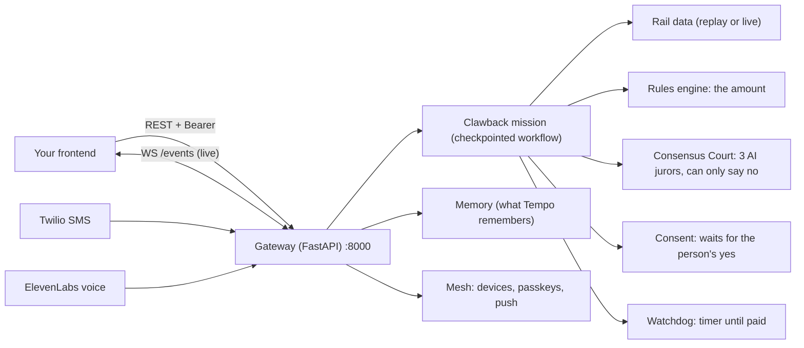
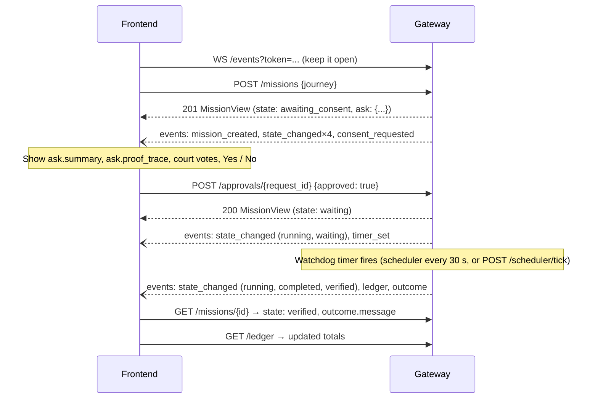
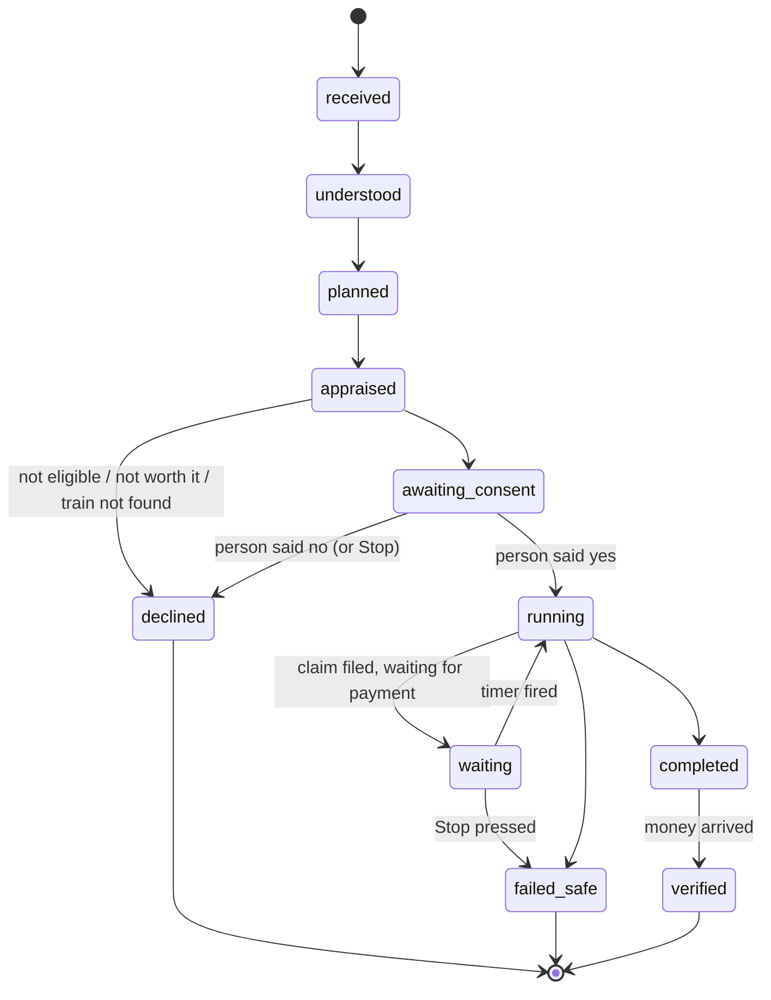

# Tempo backend: guide for building the frontend

This doc covers everything the frontend needs from the backend: how to run it, how to
authenticate, every endpoint with real request and response examples, the live WebSocket events,
the mission lifecycle, TypeScript types you can copy, and the gotchas.

Every example response below was captured from a running Gateway in replay mode. They aren't
hand-written.

---

## TL;DR

- The backend is **one FastAPI app, "the Gateway"**, at `http://127.0.0.1:8000`.
  Interactive API docs (Swagger) are at **`http://127.0.0.1:8000/docs`**.
- **Auth**: send `Authorization: Bearer <TEMPO_API_TOKEN>` on every REST call. The WebSocket
  takes the same token as `?token=`. The `/mesh/*` device routes use an `X-Tempo-Device` header.
- **CORS**: your frontend's origin must be in `WEB_ORIGINS` (default `http://localhost:3000`).
  Any other origin is rejected.
- **The main object is a `MissionView`**. Start one with `POST /missions`. When it reaches
  `awaiting_consent`, show `ask.summary` with Yes/No buttons and answer with
  `POST /approvals/{ask.request_id}`. Listen on `WS /events` and refetch when something changes.
- **Money is always a string** (`"14.20"`), never a float.
- Replay mode (the default) needs **no API keys and no network**. Rail data, the AI jurors and
  the train company are all simulated, and `/health` tells you so.
- `apps/web/lib/api.ts`, `apps/web/lib/live.ts` and `apps/web/lib/mesh.ts` are existing, working
  TypeScript clients for all of this. Copy them.

---

## 1. What the backend does

Tempo is a personal AI agent that claims compensation people are owed. The flagship flow is
**Clawback Rail**: a train was late, so Tempo works out the Delay Repay amount from published
rules, asks the person **once**, files the claim, waits until the money actually arrives, and
counts the hours and pounds returned.



Besides missions, the Gateway also serves some standalone tools: **Scam Shield**, **Entitlement
Check** (benefits screening), the **PIP Letter Explainer**, the **Memory Card**, and the
**Privacy Proof** panel.

---

## 2. Running the backend locally

Prerequisites: Python 3.12+ and [uv](https://docs.astral.sh/uv/). Postgres is optional, because
without it everything is kept in memory.

```bash
cd tempo
uv sync
```

Start the Gateway with a token you choose. Use the demo-friendly settings:

```bash
TEMPO_API_TOKEN=devtoken TEMPO_DEMO=1 PAYMENT_CHECK_AFTER_S=0 uv run tempo-gateway
```

Optional: load demo people (Amir has a paid claim, Margaret has one waiting for her OK, and
Margaret also gets memories). Run this in a second terminal while the Gateway is running:

```bash
TEMPO_API_TOKEN=devtoken make seed
```

### Environment variables that matter to the frontend

Set these in `tempo/.env` or on the command line. The full list is in `.env.example`.

| Variable | Default | Why you care |
|---|---|---|
| `TEMPO_API_TOKEN` | *(unset)* | The bearer token. **If it's unset, every authenticated call returns 401.** |
| `WEB_ORIGINS` | `http://localhost:3000` | CORS allow-list, comma-separated. Add your dev server, e.g. `http://localhost:3000,http://localhost:5173`. The **first** origin is also used to build device-pairing links. |
| `TEMPO_DEMO` | `0` | `1` enables `POST /demo/memory` and the honesty badge. |
| `PAYMENT_CHECK_AFTER_S` | `604800` (7 days) | How long a mission waits before checking whether it was paid. Use `0` (or `10`) for demos. |
| `TEMPO_MODE` | `replay` | `replay` uses recorded data with no keys. `live` calls real services. |
| `DATABASE_URL` | *(unset)* | Postgres. Without it, missions and memories are lost when the Gateway restarts. |
| `MESH_RP_ID` | `localhost` | Passkey domain. It must equal your frontend's hostname. |
| `VAPID_PUBLIC_KEY` / `VAPID_PRIVATE_KEY` / `VAPID_SUBJECT` | *(unset)* | Web Push. Generate them with `uv run python scripts/gen_vapid.py >> .env`. |

**Host and port:** `uv run tempo-gateway` always binds to `127.0.0.1:8000`. To use another
host or port (for example, to reach it from a phone on your LAN), run uvicorn directly. Note that
this skips the 30-second background timer, so call `POST /scheduler/tick` to fire timers:

```bash
uv run uvicorn tempo_gateway.main:build --factory --host 0.0.0.0 --port 8000
```

---

## 3. Connecting: base URL, auth, CORS, conventions

### Three kinds of auth

| Who | Header | Used for |
|---|---|---|
| **Mission Control (the web app)** | `Authorization: Bearer <TEMPO_API_TOKEN>` | All REST routes except `/mesh/*` device routes, `/voice/*` and `/sms/*` |
| **WebSocket** | `?token=<TEMPO_API_TOKEN>` query parameter | `WS /events` |
| **A paired device** | `X-Tempo-Device: <device token>` | `/mesh/*` routes (the token comes from registering or pairing the device) |

> ⚠️ The bearer token is a **single shared demo token**. Anything put in `NEXT_PUBLIC_*` ends up in
> the browser bundle. That's acceptable for the hackathon, not for production. Passkeys
> (section 5.11) are the real per-person auth.

### CORS

- Allowed methods: `GET, POST, PUT, DELETE`
- Allowed headers: `Authorization, Content-Type, X-Tempo-Device`
- An origin that isn't in `WEB_ORIGINS` gets **HTTP 400 "Disallowed CORS origin"** on preflight.

### Data conventions

| Thing | Format | Example |
|---|---|---|
| Money | **string** with 2 decimals (you may send numbers, but you get strings back) | `"14.20"` |
| Timestamps | ISO 8601 with offset (UTC from the server) | `"2026-10-24T21:21:16.811386+00:00"` |
| Dates | `YYYY-MM-DD` | `"2026-10-23"` |
| Times | `HH:MM` or `HHMM` | `"08:12"` |
| Station codes (CRS) | 3 letters, any case | `"OXF"`, `"PAD"` |
| Mission ID | `m_` + 12 hex characters | `"m_68734aae4d8a"` |
| Approval request ID | UUID | `"e8f12c2d-73df-4695-801b-a2c3752b05e3"` |
| Device ID | `d_` + 12 hex characters | `"d_4e4648430fae"` |

### Errors

Most errors are JSON with a string `detail`:

```json
{ "detail": "a valid bearer token is required" }
```

Validation errors (**422**) have a `detail` **array**:

```json
{ "detail": [ { "type": "missing", "loc": ["body", "display_name"], "msg": "Field required", "input": {...} } ] }
```

> ⚠️ **One exception:** an unknown mission ID returns **404 as plain text** (`mission not found`),
> not JSON. Don't call `response.json()` on a 404 without a guard.

| Status | Meaning |
|---|---|
| 401 | Missing or wrong bearer token, or the device isn't paired |
| 403 | Not allowed. Examples: this person has a passkey and must approve on their device; the device isn't confirmed yet |
| 404 | Not found, or nothing is waiting for this answer (already answered) |
| 409 | Already answered on another device; a challenge was replayed |
| 410 | Pairing link or passkey challenge expired |
| 422 | Request body is invalid |

---

## 4. The main flow: a Clawback mission

### 4.1 Sequence



### 4.2 Mission states



**Terminal states:** `declined`, `failed_safe`, `verified`. A mission in one of these never moves
again.

`checkpoint` exists in the enum, but the current Clawback flow never enters it. Handle it in your
label map anyway.

Suggested UI labels (from `apps/web/components/labels.ts`):

| State | Label | What the UI should do |
|---|---|---|
| `received` | Received | spinner |
| `understood` | Understood the journey | spinner |
| `planned` | Worked out the entitlement | spinner |
| `appraised` | Checked it's worth your time | spinner |
| `awaiting_consent` | Waiting for your OK | **Show the consent card (`ask`)** |
| `running` | Acting for you | spinner |
| `checkpoint` | Needs a decision | (unused today) |
| `waiting` | Waiting for the company | show `message` (says when it'll check) |
| `completed` | Claim resolved | claimed, but not paid yet after all checks |
| `verified` | Money arrived 🎉 | show `outcome.message`, `outcome.amount_gbp`, `outcome.reference` |
| `declined` | Declined | show `message` (why: not eligible, said no, train not found…) |
| `failed_safe` | Stopped safely | `message` may be **null**, so supply your own text |

In practice the steps from `received` to `awaiting_consent` happen in a few milliseconds. The
`POST /missions` response already contains the final state.

---

## 5. API reference

Base URL: `http://127.0.0.1:8000`. "Bearer" means `Authorization: Bearer <TEMPO_API_TOKEN>`.

### Route map

| Method | Path | Auth | Purpose |
|---|---|---|---|
| GET | `/health` | none | Mode, what's simulated (honesty badge) |
| GET | `/missions` | Bearer | All missions, newest first |
| POST | `/missions` | Bearer | Start a rail delay claim |
| GET | `/missions/{id}` | Bearer | One mission |
| POST | `/missions/{id}/stop` | Bearer | Kill switch |
| POST | `/approvals/{request_id}` | Bearer | Answer Yes/No (no passkey) |
| POST | `/scheduler/tick` | Bearer | Fire due timers now (demo button) |
| GET | `/ledger` | Bearer | Hours and £ returned (totals) |
| WS | `/events?token=` | token | Live updates |
| POST | `/scam/check` | Bearer | Scam Shield |
| POST | `/scam/payee` | Bearer | Before You Pay: pay, wait or stop, in plain words (5.13) |
| GET | `/skills` | Bearer | Every skill manifest (5.13) |
| GET | `/profiles`, `/profiles/{id}` | Bearer | Tempo Profiles: who Tempo works for and what it may never do (5.13) |
| GET | `/profiles/{id}/share` | Bearer | A share code and link for a profile (5.13) |
| POST | `/profiles/import` | Bearer | Validate a shared profile; never stored (5.13) |
| POST | `/letters/read`, `/letters/reply` | Bearer | Read It To Me: a photographed letter, read back; a reply in the person's words (5.13) |
| POST | `/entitlement/screen` | Bearer | Benefits screening |
| POST | `/letters/pip` | Bearer | PIP decision explained + draft letter |
| GET | `/memories?user_id=` | Bearer | Memory Card |
| POST | `/memories/{id}/correct` | Bearer | Correct a memory |
| DELETE | `/memories/{id}?user_id=` | Bearer | Forget a memory |
| DELETE | `/timeline/{episode_id}?user_id=` | Bearer | Forget a timeline event |
| POST | `/demo/memory` | Bearer | Seed memories (`TEMPO_DEMO=1` only) |
| GET | `/privacy?user_id=` | Bearer | Privacy Proof panel |
| GET | `/voice/profile?user_id=` | Bearer | How Tempo will speak with this caller (5.9b) |
| * | `/mesh/...` | device / Bearer | Devices, pairing, passkeys, push (see 5.11) |
| POST | `/voice/tools/{name}`, `/voice/post-call`, `/voice/initiation` | webhook secret | **Not for the frontend** (ElevenLabs) |
| POST | `/sms/inbound` | Twilio signature | **Not for the frontend** (Twilio) |

---

### 5.1 `GET /health`

No auth. Call it on load and show a badge listing what is simulated.

```json
{
  "status": "ok",
  "mode": "replay",
  "demo": true,
  "simulated": ["company", "rail data", "jurors"],
  "deploy": "cloud-standard",
  "region": "eu",
  "third_parties": ["cortex", "elevenlabs", "gemini"]
}
```

- `simulated` is always at least `["company"]`. In replay mode it also contains `"rail data"`
  and `"jurors"`. The team's rule is to **always show this to the user** (e.g.
  "REPLAY data · SIMULATED company").
- `deploy` is one of `local | cloud-standard | cloud-private | cloud-confidential`.

---

### 5.2 Missions

**Profiles.** `POST /missions` and `POST /missions/ofcom` take an optional `profile_id` (one of
`GET /profiles`). The Gateway refuses an unknown one with 422 before anything starts, the
`MissionView` echoes it as `profile_id`, and where the Negotiator runs, the profile's
`CapabilityGuard` and `BudgetGuard` sit in the Harness right after the consent check.

#### `POST /missions` → `201 MissionView`

Starts a Delay Repay claim for one train journey.

Request body:

| Field | Type | Required | Rules |
|---|---|---|---|
| `user_id` | string | ✅ | any ID you choose, e.g. `"u_margaret"` |
| `display_name` | string | ✅ | max 80 characters |
| `phone` | string \| null | | E.164. Enables SMS replies (YES/NO/STOP); only a hash is stored |
| `origin_crs` | string | ✅ | 3 letters, e.g. `"OXF"` |
| `destination_crs` | string | ✅ | 3 letters, e.g. `"PAD"` |
| `travel_date` | string | ✅ | `YYYY-MM-DD` |
| `departure` | string | ✅ | timetabled departure, `HH:MM` or `HHMM` |
| `fare_gbp` | string/number | ✅ | ≥ 0 |
| `time_value_gbp_h` | string/number | | default `"18"`: what an hour of the person's time is worth (used to decide whether a claim is worth it) |

```json
{
  "user_id": "u_margaret",
  "display_name": "Margaret",
  "phone": "+447700900123",
  "origin_crs": "OXF",
  "destination_crs": "PAD",
  "travel_date": "2026-10-23",
  "departure": "08:12",
  "fare_gbp": "28.40",
  "time_value_gbp_h": "18"
}
```

Response (`state: awaiting_consent`). Court verdicts are trimmed to one juror here:

```json
{
  "id": "m_68734aae4d8a",
  "user_id": "u_margaret",
  "state": "awaiting_consent",
  "message": "38 min late → 50% of £28.40 under GWR DR15 (demo values: not yet checked against GWR's published terms). I claim online for you: £14.20 for 0 min of your time (your time is worth about £18.00 an hour). Expected value £12.73. Shall I claim £14.20 for you?",
  "ask": {
    "request_id": "e8f12c2d-73df-4695-801b-a2c3752b05e3",
    "summary": "38 min late → 50% of £28.40 under GWR DR15 (...). Shall I claim £14.20 for you?",
    "amount_gbp": "14.20",
    "proof_trace": {
      "id": "pt_m_68734aae4d8a",
      "steps": [
        {
          "fact_keys": ["arrival_delay_min", "fare_gbp"],
          "rule_id": "uk-rail.gwr.delay-repay",
          "rule_version": "0.1.0",
          "citation_url": "https://www.gwr.com/help-and-support/refunds-and-compensation/delay-repay",
          "explanation": "38 min late → 50% of £28.40 under GWR DR15 (demo values: not yet checked against GWR's published terms)"
        },
        {
          "fact_keys": ["arrival_delay_min", "fare_gbp"],
          "rule_id": "consensus-court",
          "rule_version": "1",
          "citation_url": "https://www.gwr.com/help-and-support/refunds-and-compensation/delay-repay",
          "explanation": "Consensus Court: 3/3 jurors agreed that this is eligible"
        }
      ],
      "amount_gbp": "14.20"
    },
    "court": { "...": "same object as the top-level `court` below" }
  },
  "outcome": null,
  "timeline": [
    { "to": "understood",       "at": "2026-10-24T21:21:16.811386+00:00", "latency_ms": 6 },
    { "to": "planned",          "at": "2026-10-24T21:21:16.812780+00:00", "latency_ms": 1 },
    { "to": "appraised",        "at": "2026-10-24T21:21:16.814717+00:00", "latency_ms": 1 },
    { "to": "awaiting_consent", "at": "2026-10-24T21:21:16.815682+00:00", "latency_ms": 0 }
  ],
  "trace_url": null,
  "court": {
    "outcome": "proceed",
    "eligible": true,
    "agreement_rate": 1.0,
    "verdicts": [
      {
        "juror": "claude-sonnet-5-5",
        "verdict": {
          "eligible": true,
          "rule_id": "uk-rail.gwr.delay-repay",
          "band": null,
          "amount_gbp": null,
          "citations": ["if your train arrives 15 minutes or more late, you can claim"],
          "confidence": 0.95,
          "reasoning": "The train arrived 38 minutes late, inside the 30 to 59 minute band."
        }
      }
      // ... "openai-gpt-5-mini", "llama4-maverick"
    ],
    "absent": [],
    "flags": []
  }
}
```

What to render from a `MissionView`:

- **`message`**: always the best one-line status for the person (or `null`).
- **`ask`**: present **only** when the mission is waiting for an answer. It holds the question
  (`summary`), the amount, the **Proof Trace** (fact → rule → citation → amount) and the court
  votes.
- **`court`**: the Consensus Court's 3 votes. `outcome` is `proceed`, `proceed_flagged` or
  `human_checkpoint`. `flags` lists reasons a person should look (e.g. "juror absent: …"). It is
  `null` if the court didn't sit.
- **`timeline`**: every state change, with `latency_ms` = time spent in the *previous* state.
  This is good for a per-stage timer. The first entry, `received`, isn't listed.
- **`outcome`**: set when the mission finishes (`verified`, `completed`, `declined`, some
  `failed_safe`).
- **`trace_url`**: a Langfuse trace link, only when tracing keys are configured. Otherwise `null`.

Possible results straight from `POST /missions` (all are **201**):

| Case | `state` | `message` |
|---|---|---|
| Eligible and worth it | `awaiting_consent` | "…Shall I claim £14.20 for you?" |
| Too little delay | `declined` | "Nothing to claim: 9 min late is below the DR15 threshold of 15 min (…)" |
| Not worth the time | `declined` | "Not worth your time: … it's only worth £0.40 to you." |
| Train not in the records | `declined` | "I couldn't find that train in the rail records (…)" |
| Operator not supported | `declined` | "Tempo can't claim from this operator yet (…)" |

#### `GET /missions` → `MissionView[]`

All missions, **newest first**, for **all users**. There is no per-user filter, so filter on
`user_id` on the client if you need to.

#### `GET /missions/{id}` → `MissionView`

Returns 404 (**plain text**) if the mission doesn't exist.

#### `POST /missions/{id}/stop` → `MissionView`

The kill switch. No body. What it does depends on the mission's state:

- If the mission is waiting for an answer, it's treated as a **No**: `state: declined`,
  message "Stopped: you said no. Nothing was sent."
- If it's `waiting` for payment (or at a checkpoint), consent is revoked: `state: failed_safe`,
  and `message` and `outcome` are **`null`**.
- If it's already finished, nothing changes.

#### `POST /scheduler/tick` → `{ "fired": ["m_..."] }`

Fires every Watchdog timer that is due now. A background loop already does this every 30 s, so
use it as a "Check the payment now" demo button. It only fires timers whose time has come, so
set `PAYMENT_CHECK_AFTER_S=0` for demos.

---

### 5.3 Approvals: `POST /approvals/{request_id}` → `MissionView`

Answers the question in `mission.ask`. Use **`ask.request_id`**, not the mission ID.

```json
{ "approved": true, "limits": { "auto_accept_max_gbp": "50" } }
```

`limits` is optional (default `{}`) and is recorded with the consent.

Response after **yes** (`state: waiting`):

```json
{
  "id": "m_68734aae4d8a",
  "state": "waiting",
  "message": "Claim filed. I'll check the payment has arrived on 24 Oct at 22:21.",
  "ask": null,
  "outcome": null,
  "timeline": [ "... + running, waiting" ],
  "court": { "..." : "..." }
}
```

After the timer fires, `GET /missions/{id}` returns:

```json
{
  "id": "m_68734aae4d8a",
  "state": "verified",
  "message": "GW (a simulated company) has paid you £14.20 (reference GW-45604). That's 20 minutes of your time back.",
  "ask": null,
  "outcome": {
    "state": "verified",
    "message": "GW (a simulated company) has paid you £14.20 (reference GW-45604). That's 20 minutes of your time back.",
    "amount_gbp": "14.20",
    "reference": "GW-45604"
  }
}
```

Response after **no**: `state: declined`, message "Stopped: you said no. Nothing was sent."

Errors:

- **404** `"nothing is waiting for this answer"`: the question was already answered (by SMS,
  voice, another tab…) or the ID is wrong. Refetch the mission.
- **403** `"approve with your passkey on one of your devices"`: this person has registered a
  passkey, so a plain approval isn't allowed any more. Use the Mesh approval flow (5.11).

The same answer can also arrive by **SMS** (`YES` / `NO` / `STOP`) or **voice**. The frontend
learns about it through the WebSocket.

---

### 5.4 `GET /ledger` → totals

Totals across **all** missions, as strings. Minutes are counted when a claim is filed, and pounds
only once the money has arrived.

```json
{ "minutes_returned": "20", "hours_returned": "0.3", "gbp_recovered": "14.20" }
```

---

### 5.5 Live updates: `WS /events?token=<TEMPO_API_TOKEN>`

```js
const ws = new WebSocket(`ws://127.0.0.1:8000/events?token=${encodeURIComponent(token)}`);
ws.onmessage = (m) => handle(JSON.parse(m.data));
```

- With a bad token, the socket is **closed with code `4401`**.
- The server only sends; it ignores anything you send.
- **No history is replayed.** You only get events that happen after you connect. On connect (and
  reconnect), fetch `GET /missions` first, then apply events.
- Events are broadcast for **all users**.
- **Recommended pattern** (what `apps/web` does): treat events as "something changed" signals
  and refetch `GET /missions` and `GET /ledger`, debounced. Reconnect with exponential backoff
  (see `apps/web/lib/live.ts`).

Event types, as captured:

```jsonc
{"type":"mission_created","mission_id":"m_080a9a328964"}
{"type":"state_changed","mission_id":"m_080a9a328964","from":"received","to":"understood","at":"2026-10-24T21:21:21.644665+00:00","latency_ms":4,"actor":"agent"}
{"type":"consent_requested","mission_id":"m_080a9a328964","request_id":"c1975935-8cad-4b95-8c67-df66e62141e1"}
{"type":"timer_set","mission_id":"m_080a9a328964","wake_at":"2026-10-24T21:21:21.655362+00:00"}
{"type":"ledger","mission_id":"m_080a9a328964"}
{"type":"outcome","mission_id":"m_080a9a328964","state":"verified","message":"GW (a simulated company) has paid you £14.20 (reference GW-25206). That's 20 minutes of your time back.","amount_gbp":"14.20","reference":"GW-25206"}
```

| `type` | When | Extra fields |
|---|---|---|
| `mission_created` | a mission started | `mission_id` |
| `state_changed` | each state transition | `mission_id, from, to, at, latency_ms, actor` (`agent` \| `user` \| `system`) |
| `consent_requested` | a question is waiting | `mission_id, request_id` |
| `timer_set` | Watchdog scheduled a payment check | `mission_id, wake_at` |
| `ledger` | ledger entry written | `mission_id` |
| `outcome` | mission finished or reported | `mission_id, state, message, amount_gbp, reference` |
| `signal` | a phone's notification filter matched | `signal_id, from` + the declared fields |
| `call_ended` | a voice call ended | `conversation_id` |
| `log_stall` | voice agent saw a company stalling (Stall Radar) | `category`, `counter`, `quote`, … (all strings) |
| `record_reference`, `request_human` | voice agent tools | whatever the agent sent (all strings) |

`log_stall.category` is one of `callback_deflection, transfer_loop, policy_wall,
form_deflection, information_fishing, hold_extension, lowball_offer, denial_without_reason`, or
`unknown`.

---

### 5.6 Scam Shield: `POST /scam/check`

The person pastes a message they're unsure about. Tempo checks the pressure tactics and, if a
firm is named, the official registers (FCA, Companies House).

```json
{
  "text": "Halifax fraud team: move your savings to a safe account within 2 hours. Don't tell anyone.",
  "firm": "Halifax",
  "phone": "07700900999",
  "website": null
}
```

Limits: `text` up to 2000 characters (required), `firm` up to 120, `phone` up to 40, `website`
up to 200.

```json
{
  "level": "likely_scam",
  "reasons": [
    "it uses Halifax's name with contact details that aren't theirs (a clone)",
    "it asks for a safe account",
    "it uses pressure: a safe account",
    "it uses pressure: moving your money",
    "it uses pressure: a deadline to act now",
    "it uses pressure: secrecy"
  ],
  "advice": "Don't reply, click or pay. Call the firm on the number from its own website or your bank card, never one from the message.",
  "simulated": true
}
```

| `level` | Show as |
|---|---|
| `likely_scam` | 🔴 "This looks like a scam" |
| `caution` | 🟠 "Be careful with this one" |
| `unknown` | ⚪ "I can't tell yet" (a register couldn't be checked) |
| `no_flags` | 🟢 "No warning signs found". **Never say "safe".** Always show `advice` |

`simulated: true` means the register answers were recorded fixtures, so show a badge. In replay
mode the recorded firms are `Halifax` and `Quick Refund Services`.

---

### 5.7 Entitlement Check: `POST /entitlement/screen`

Ten questions in, and out comes which benefits are worth claiming. **This is screening, not a
decision.** Always show `disclaimer`.

Request (the ten questions, in order, are in `QUESTIONS` in
`packages/tempo_core/src/tempo_core/entitlement.py`):

| Field | Type | Default | Question to show |
|---|---|---|---|
| `age` | int 16–120 | **required** | How old are you? |
| `couple` | bool | `false` | Do you live with a partner? |
| `weekly_income_gbp` | money ≥ 0 | **required** | Roughly how much comes in each week, from pensions and earnings? |
| `savings_gbp` | money ≥ 0 | `0` | Roughly how much do you have in savings? |
| `benefits` | string[] | `[]` | Do you get any benefits now? Values: `universal_credit, pension_credit, jobseekers_allowance, employment_support_allowance, income_support, pip, attendance_allowance` |
| `needs_care_day` | bool | `false` | Do you need help in the day with washing, dressing, eating or the toilet? |
| `needs_care_night` | bool | `false` | Do you need help at night? |
| `care_months` | int ≥ 0 | `0` | How many months have you needed that help? |
| `terminally_ill` | bool | `false` | Has a doctor said you may have less than 12 months to live? |
| `has_broadband_or_phone` | bool | `true` | Do you pay for broadband or a phone line? |

Unknown fields are **rejected** (422).

```json
{
  "age": 78, "couple": false, "weekly_income_gbp": "190", "savings_gbp": "12000",
  "benefits": ["pip"], "needs_care_day": true, "needs_care_night": false, "care_months": 8,
  "terminally_ill": false, "has_broadband_or_phone": true
}
```

```json
{
  "flags": [
    {
      "benefit": "Pension Credit",
      "likelihood": "likely",
      "why": "Your income counts as about £194.00 a week. It tops up to £227.10.",
      "weekly_gbp": "33.10",
      "signpost": "https://www.gov.uk/pension-credit/eligibility"
    },
    {
      "benefit": "Attendance Allowance",
      "likelihood": "likely",
      "why": "You need help in the day or at night. It isn't means-tested.",
      "weekly_gbp": "73.90",
      "signpost": "https://www.gov.uk/attendance-allowance/eligibility"
    },
    {
      "benefit": "Cheaper broadband or phone (social tariff)",
      "likelihood": "likely",
      "why": "You get a benefit that most providers accept.",
      "weekly_gbp": null,
      "signpost": "https://www.ofcom.org.uk/phones-and-broadband/saving-money/social-tariffs"
    }
  ],
  "disclaimer": "This is a quick check, not a decision. Only DWP, or your phone and broadband company, can decide. Use the links to check properly, or ask Age UK or Citizens Advice to help you claim.",
  "pack": "Tempo entitlement check (2025/26 figures)\n\n...plain-text summary to print or download...\n",
  "figures": { "tax_year": "2025/26", "demo_values": true }
}
```

- `likelihood` is `likely | worth_checking | unlikely`.
- `signpost` is the official checker. Make it a button.
- `pack` is a ready-made plain-text summary. Offer it as "Download / Print".
- When `figures.demo_values` is `true`, show "amounts not yet checked against this year's
  rates".

---

### 5.8 PIP Letter Explainer: `POST /letters/pip`

The person enters the facts from their PIP decision letter. They get a plain-English explanation,
the reconsideration deadline (bank holidays are accounted for) and a draft letter built **only**
from their own words.

```json
{
  "decision_date": "2026-10-20",
  "daily_living_points": 6,
  "mobility_points": 4,
  "reference": "PIP-12345",
  "evidence": [
    { "activity": "preparing food", "what_happens": "I can't stand long enough to cook a meal" }
  ]
}
```

Limits: `daily_living_points` 0–60, `mobility_points` 0–40, `reference` up to 40 characters.

```json
{
  "explanation": "DWP gave you 6 points for daily living (no award) and 4 points for getting around (no award). You need 8 points for the standard rate and 12 for the enhanced rate. If you think this is wrong, you can ask them to look again. This is called a mandatory reconsideration. They must get it by 20 November 2026, so post it by 18 November 2026.",
  "deadline": "2026-11-20",
  "post_by": "2026-11-18",
  "draft": "[Your name]\n[Your address]\n[Your National Insurance number]\n\nDear DWP,\n\nI am asking for a mandatory reconsideration of my PIP decision dated 20 October 2026 (reference PIP-12345).\n\n...\n- preparing food: I can't stand long enough to cook a meal\n\n...Yours faithfully,\n[Your name]\n",
  "unsupported": []
}
```

Render `draft` in an editable textarea with a "Copy" button. Highlight `post_by` as the date that
matters.

---

### 5.9 Memory (the Memory Card)

Tempo remembers only what the **person** said (voice, SMS, web) and verified official data. The
Memory Card shows every memory with **where it came from** and **when**, and lets the person
correct or forget it.

#### `GET /memories?user_id=u_margaret` → `MemoryCard`

```json
{
  "memories": {
    "preference": [
      {
        "item": {
          "id": "6c705a941f764d9fa0fb9a3fc26a5623",
          "user_id": "u_margaret",
          "key": "4e7ccdf8104c37409746f2db",
          "text": "prefers phone updates",
          "category": "preference",
          "source": "user_voice",
          "trust": "trusted",
          "observed_at": "2026-10-24T21:21:35.103655Z",
          "confidence": 0.9,
          "consent_scope": null,
          "expires_at": null,
          "superseded_by": null
        },
        "earlier": []
      }
    ],
    "contact": [ { "item": { "text": "Sarah is their daughter", "...": "..." }, "earlier": [] } ]
  },
  "timeline": [
    {
      "id": "f45e0a2baec0461fa544c0df191d6324",
      "user_id": "u_margaret",
      "kind": "appointment",
      "subject": "Broadbandly engineer visit",
      "predicate": "scheduled_for",
      "object": "12 Oct 2026 08:00 to 12:00",
      "valid_from": "2026-10-10T09:00:00+01:00",
      "valid_to": "2026-10-15T14:00:00+01:00",
      "superseded_by": "7edcca4bbb9244e295d7e7636a5ff19b",
      "episode_id": "seed_bb_slot_1"
    },
    {
      "id": "7edcca4bbb9244e295d7e7636a5ff19b",
      "kind": "appointment",
      "subject": "Broadbandly engineer visit",
      "predicate": "scheduled_for",
      "object": "19 Oct 2026 08:00 to 12:00",
      "valid_from": "2026-10-15T14:00:00+01:00",
      "valid_to": null,
      "superseded_by": null,
      "episode_id": "seed_bb_slot_2"
    },
    {
      "kind": "outcome", "subject": "GWR", "predicate": "outcome", "object": "verified £14.20",
      "...": "..."
    }
  ]
}
```

- `memories` is grouped by category: `preference, contact, journey, household, mission_fact,
  health, immigration, finance, access`. `health, immigration, finance` are sensitive: opt-in
  only, with a 30-day expiry (`expires_at`). `access` ("How to speak with me": a stammer, hearing,
  a language, a slower pace) is opt-in too but never expires; label it as such.
- `earlier` lists previous versions (after a correction), oldest first.
- `timeline` contains **every** dated fact, old ones included, oldest first. A fact with
  `valid_to` / `superseded_by` set is **no longer true**, so show it struck through. Display text
  is `subject + " " + predicate.replace("_"," ") + " " + object`.
- Memories (and timeline facts) are written automatically by missions, calls and SMS. The
  frontend only reads, corrects and forgets.
- `source` values: `user_voice`, `user_sms`, `user_web`, `official_api` (trusted), plus untrusted
  ones that never become memories.

#### `POST /memories/{item_id}/correct` → `MemoryItem` (the new version)

```json
{ "user_id": "u_margaret", "text": "I prefer text updates." }
```

`text` is 1–200 characters. Errors: **404** "no such memory"; **409** "say yes to remembering
health details first" (correcting a sensitive category needs opt-in).

#### `DELETE /memories/{item_id}?user_id=u_margaret` → `{ "forgotten": true }`

Hard delete, everywhere, every version.

#### `DELETE /timeline/{episode_id}?user_id=u_margaret` → `{ "forgotten": true }`

Use the fact's **`episode_id`** (not its `id`). This deletes the episode and every fact derived
from it.

#### `POST /demo/memory` (only with `TEMPO_DEMO=1`)

Seeds memories for demos. `make seed` already calls it. Otherwise it returns 404.

```json
{
  "user_id": "u_margaret",
  "said": ["I prefer phone updates.", "My daughter Sarah helps me with letters."],
  "episodes": [
    { "event": "appointment", "id": "seed_bb_slot_1", "user_id": "u_margaret", "company": "Broadbandly",
      "what": "engineer visit", "at": "2026-10-10T09:00:00+01:00",
      "starts_at": "2026-10-12T08:00:00+01:00", "ends_at": "2026-10-12T12:00:00+01:00" }
  ]
}
```

→ `{ "memories": ["store", "store"], "facts": 2 }`

---

### 5.9b The Patience Profile: `GET /voice/profile?user_id=u_dilip`

How Tempo's voice agent will speak with this person on their next call, worked out from their
`access`, `journey` and `contact` memories. It is exactly what `POST /voice/initiation` sends
ElevenLabs as a call connects, except that voice ids are replaced by the names of their settings.

```json
{
  "user_id": "u_dilip",
  "display_name": "Dilip",
  "adjusted": true,
  "how_to_speak": "Speak Hindi unless they switch. Speak slowly, with short pauses.",
  "profile": {
    "language": "hi", "speed": "0.85", "voice": "default", "patience": "normal",
    "stammer": false, "hearing": false, "prefers_text": false, "other_language": null,
    "keywords": ["Reading", "Paddington", "Tempo", "Delay Repay"],
    "reasons": ["speaks Hindi", "wants slower speech"]
  },
  "initiation": {
    "type": "conversation_initiation_client_data",
    "dynamic_variables": {"caller_id": "u_dilip", "display_name": "Dilip", "how_to_speak": "...",
                          "patience": "normal", "channel_hint": "voice"},
    "conversation_config_override": {
      "agent": {"language": "hi", "first_message": "नमस्ते, मैं Tempo हूँ, एक AI सहायक। ..."},
      "tts": {"speed": 0.85},
      "asr": {"keywords": ["Reading", "Paddington", "Tempo", "Delay Repay"]}
    }
  },
  "low_voice_configured": false
}
```

- `reasons` are the memories that set something, in the person's words: show them as "Because
  you said".
- `adjusted: false` means everyone's call (which is already patient). `conversation_config_override`
  is absent when nothing changes.
- `voice: "low"` with `low_voice_configured: false` means the lower voice isn't set up yet
  (`ELEVENLABS_VOICE_TEMPO_LOW`), so the call uses the usual voice. Say so.
- Each call that sounds different adds a timeline fact ("Tempo's voice set to Hindi, slower (call
  …)"), `kind: "voice"`; when a forget returns the next call to normal, a new fact replaces it.
- A live `profile_applied` event (`user_id, language, speed, voice, patience, prefers_text`) is
  published as such a call connects.

### 5.13 Profiles, skills, Read It To Me and Before You Pay

All bearer-authenticated. Shapes mirror `tempo_core.profiles.ProfileView`, `tempo_core.skills.SkillManifest`,
`tempo_core.letters.LetterReading` and `tempo_core.payee.PayeeAdvice`; the full contracts are in
[SHIPPING.md](SHIPPING.md) §4.

- `GET /skills` → `{"skills": [{"id", "name", "version", "status", "summary", "jobs": [...], "needs": [...], "channels": [...], ...}]}`.
- `GET /profiles` → `{"profiles": [ProfileView...]}` (public ones); `GET /profiles/{id}` → one; 404 if unknown.
  A `ProfileView` carries the YAML fields plus `skills: [{"id","name","status","jobs"}]` and `jobs`
  (the ordered union of its skills' jobs).
- `GET /profiles/{id}/share` → `{"code": "tp1....", "url": "<first WEB_ORIGINS>/profiles/import#p=tp1...."}`.
  The code is in the URL fragment so it never reaches a server log.
- `POST /profiles/import` `{"code": "tp1...."}` → `ProfileView`; 413 over 4096 bytes; 422 with a
  plain `detail` when anything fails validation (tampered code, unknown skill, a capability a
  skill needs that the profile forbids). Nothing is stored.
- `POST /letters/read` `{"image_b64", "filename", "user_id", "language"}` → a `LetterReading`:
  `{"kind", "sender", "date", "says", "money": {"direction", "amount_gbp"}, "must_do", "by",
  "clocks": [{"id","label","expires_on"}], "unsure": [{"key","question"}], "reading_text", "language"}`.
  Replay mode reads `fixtures/vision/thames_water_overpayment.png` and `council_tax_reminder.png`
  (the second has one unsure date, so `unsure` has one read-back question). 413 over 8 MiB, 400 on
  bad base64, 503 when vision is off.
- `POST /letters/reply` `{"reading": LetterReading, "said": "..."}` → `{"draft": "...", "added_nothing": true}`.
- `POST /scam/payee` `{"payee_name", "amount_gbp", "reason", "new_payee", "message_text"?, "firm"?}` →
  `{"verdict": "pay"|"wait"|"stop", "reasons": [...], "say": "...", "simulated": bool}`. Tempo never
  moves money; this is the check a person runs before they do.

### 5.10 Privacy Proof: `GET /privacy?user_id=u_margaret`

The facts for a "what happens to my data" panel. The server checks each one rather than just
claiming it.

```json
{
  "mode": "cloud-standard",
  "region": "eu",
  "third_parties": ["cortex", "elevenlabs", "gemini"],
  "image_digest": null,
  "allowlist": "missing",
  "image_allowlisted": false,
  "key_held_on": [],
  "operator_view": null,
  "canary_test": "tests/integration/test_canary.py, on every commit in CI",
  "attestation": "n/a"
}
```

- `key_held_on` is the names of the person's devices that have a passkey.
- `operator_view` is `{ "table": "vault_blobs", "bytes": "<hex>" }` (what an operator sees,
  which is ciphertext), or `null` if nothing is stored yet.
- `allowlist` is `"missing"` or `"signed"`. Show the gaps honestly.

---

### 5.11 Mesh: devices, pairing, passkey approvals, push

This part is optional for an MVP. Skip it and use `POST /approvals` with Yes/No buttons. Add it
if you want "approve with Face ID" and multi-device sync.

**Model:** each browser or phone is a **device** with its own secret token (store it in
`localStorage`, key `tempo.device`), sent as `X-Tempo-Device`. A person's first device is
registered with the bearer token. Further devices join by **QR pairing**. A device can add a
**passkey** (Face ID / fingerprint / Windows Hello). **Once any of the person's devices has a
passkey, plain `POST /approvals` is refused (403), and approvals must be signed.**

The full working client is `apps/web/lib/mesh.ts` (`MeshClient`), with base64url ↔ WebAuthn
conversions. Copy it.

| Method | Path | Auth | Body → Response |
|---|---|---|---|
| GET | `/mesh/config` | none | → `{ rp_id, vapid_public_key }` |
| POST | `/mesh/devices` | **Bearer** | `{ user_id, name, capabilities[] }` → 201 `{ device, token }` |
| GET | `/mesh/devices` | device | → `DeviceInfo[]` (all of this person's devices) |
| DELETE | `/mesh/devices/{id}` | device | → `{ removed: true }` (remove a lost phone) |
| POST | `/mesh/devices/me/passkey/options` | device | → `{ challenge_id, options }` (WebAuthn create options) |
| POST | `/mesh/devices/me/passkey` | device | `{ challenge_id, credential }` → `DeviceInfo` |
| PUT | `/mesh/devices/me/push` | device | Web Push `subscription.toJSON()` (or `{}` to clear) → `{ push: bool }` |
| POST | `/mesh/pairings` | device | → 201 `{ pairing_id, link, expires_at, qr_svg }` |
| GET | `/mesh/pairings/{id}` | device (the one that started it) | → `{ claimed, code, device_name }` |
| POST | `/mesh/pairings/{id}/claim` | **none** (secret from link) | `{ secret, name, capabilities[] }` → `{ device, token, code }` |
| POST | `/mesh/pairings/{id}/confirm` | device (the one that started it) | → `DeviceInfo` (now active) |
| POST | `/mesh/approvals/{request_id}/options` | device | `{ approved, limits }` → `{ challenge_id, options }` (WebAuthn get options) |
| POST | `/mesh/approvals/{request_id}` | device | `{ challenge_id, credential }` → `MissionView` |
| GET | `/mesh/signals` | device | → signal filter specs (for the Android notification reader) |
| POST | `/mesh/signals` | device with `notifications.read` | `{ signal_id, fields }` → `{ accepted, routed_to }` |

`capabilities` values: `approve.biometric`, `notifications.show`, `notifications.read`,
`status.live`, `camera.capture`. Unknown values are silently dropped.

`DeviceInfo`:

```json
{
  "id": "d_4e4648430fae",
  "name": "Margaret's phone",
  "capabilities": ["approve.biometric", "notifications.show"],
  "active": true,
  "passkey": false,
  "push": false,
  "last_active": "2026-10-24T21:21:47.594414+00:00"
}
```

#### Pairing a second device (QR)

1. Device A: `POST /mesh/pairings` returns `qr_svg` (inline SVG, safe to render) and a `link`
   such as `http://localhost:3000/#pair=eb5050aec540.QvC7GxrJcH4jIVJdhvitUg`. It **expires in
   2 minutes**.
2. Device B opens that link. **Your app must read `location.hash` on load**, split
   `#pair=<pairing_id>.<secret>`, and call `POST /mesh/pairings/{pairing_id}/claim`
   `{ secret, name }`. It gets `{ device, token, code }`. Store the token and show the 6-digit
   `code` (e.g. `849 552`). B is **inactive** until confirmed: its calls return 403 "confirm the
   pairing code on your other device first".
3. Device A polls `GET /mesh/pairings/{id}` until `claimed: true`, shows the same `code` and
   asks "Do the codes match?" On yes, it calls `POST /mesh/pairings/{id}/confirm`.

The link's origin is the **first** entry of `WEB_ORIGINS`.

#### Adding a passkey

1. `POST /mesh/devices/me/passkey/options` → `{ challenge_id, options }`
2. `navigator.credentials.create(creationOptions(options))` (convert the base64url fields to
   bytes; see `creationOptions()` in `mesh.ts`)
3. `POST /mesh/devices/me/passkey` `{ challenge_id, credential: credentialJson(cred) }`

#### Signed approval (Face ID)

1. `POST /mesh/approvals/{request_id}/options` `{ approved: true, limits: {"auto_accept_max_gbp": "50"} }`.
   The challenge is **bound to this question and this answer**.
2. `navigator.credentials.get(requestOptions(options))`
3. `POST /mesh/approvals/{request_id}` `{ challenge_id, credential }` → `MissionView`

A **409** means "this was already answered on another device". Challenges are single-use and
expire in 5 minutes.

**Passkey requirements:** a secure context (HTTPS, or `http://localhost`), and `MESH_RP_ID` must
equal the page's hostname. The page origin must be in `WEB_ORIGINS`.

#### Push

`GET /mesh/config` → `vapid_public_key` (null when push isn't configured). Subscribe with the
service worker, then `PUT /mesh/devices/me/push`. A push payload is **only ever**
`{"type":"sync"}`, with no names or amounts. On push, show a generic notification and refetch.
See `apps/web/public/sw.js`.

---

### 5.12 Not for the frontend

- `POST /voice/tools/{name}`, `POST /voice/post-call`: ElevenLabs voice-agent webhooks (shared
  secret / HMAC).
- `POST /voice/initiation`: ElevenLabs' conversation-initiation webhook for inbound calls (shared
  secret header). It recognises the caller by number and answers with dynamic variables and
  per-call overrides (5.9b). An unknown caller gets the defaults; it never fails a call.
- `POST /sms/inbound`: Twilio webhook. People text `YES`, `NO`, `STOP`, `HELP`, `MEMORY`,
  `FORGET <thing>`, `CHECK <message>`.
- **Skill Forge** (`packages/tempo_skill_forge/.../api.py`, `/skill-forge/*`): this router
  exists but is **not mounted** in the Gateway, so these routes return 404 today.
- `apps/worker` (`/report`, `/step`): an internal ephemeral worker for confidential mode, not a
  frontend API.

---

## 6. TypeScript types (copy-paste)

These mirror the backend's pydantic models. Several are already in `apps/web/lib/api.ts`; this
version is complete (it adds `court` on `ConsentAsk`, the health fields, and the tool endpoints).

```ts
// ---------- Common ----------
export type Money = string; // "14.20"
export type ISODateTime = string;

export type MissionState =
  | "received" | "understood" | "planned" | "appraised" | "declined" | "awaiting_consent"
  | "running" | "checkpoint" | "waiting" | "completed" | "failed_safe" | "verified";

export const TERMINAL_STATES: MissionState[] = ["declined", "failed_safe", "verified"];

export interface ApiError { detail: string | { type: string; loc: (string | number)[]; msg: string }[] }

// ---------- Health ----------
export interface Health {
  status: "ok";
  mode: "live" | "replay";
  demo: boolean;
  simulated: string[];                 // e.g. ["company", "rail data", "jurors"]
  deploy: "local" | "cloud-standard" | "cloud-private" | "cloud-confidential";
  region: string;
  third_parties: string[];             // e.g. ["cortex", "elevenlabs", "gemini"]
}

// ---------- Missions ----------
export interface StartMission {
  user_id: string;
  display_name: string;                // max 80
  phone?: string | null;               // E.164
  origin_crs: string;                  // /^[A-Za-z]{3}$/
  destination_crs: string;
  travel_date: string;                 // YYYY-MM-DD
  departure: string;                   // HH:MM or HHMM
  fare_gbp: Money | number;
  time_value_gbp_h?: Money | number;   // default "18"
}

export interface ProofStep {
  fact_keys: string[];
  rule_id: string;                     // "uk-rail.gwr.delay-repay" | "consensus-court" | ...
  rule_version: string;
  citation_url: string;
  explanation: string;                 // plain English, show it
}

export interface ProofTrace { id: string; steps: ProofStep[]; amount_gbp: Money }

export interface JurorVerdict {
  eligible: boolean;
  rule_id: string;
  band: string | null;
  amount_gbp: Money | null;            // audit only; never used
  citations: string[];
  confidence: number;                  // 0..1
  reasoning: string;
}

export interface CourtDecision {
  outcome: "proceed" | "proceed_flagged" | "human_checkpoint";
  eligible: boolean | null;            // null = a person must decide
  agreement_rate: number;              // 0..1
  verdicts: { juror: string; verdict: JurorVerdict }[];
  absent: string[];
  flags: string[];
}

export interface ConsentAsk {
  request_id: string;                  // use this for POST /approvals/{request_id}
  summary: string;                     // the question, in plain words
  amount_gbp: Money;
  proof_trace: ProofTrace | null;
  court: CourtDecision | null;
}

export interface MissionOutcome {
  state: string;                       // "verified" | "completed" | "declined" | "failed_safe"
  message: string;
  amount_gbp: Money | null;
  reference: string | null;
}

export interface TimelineEntry { to: MissionState; at: ISODateTime; latency_ms: number }

export interface MissionView {
  id: string;
  user_id: string | null;
  state: MissionState;
  message: string | null;
  ask: ConsentAsk | null;
  outcome: MissionOutcome | null;
  timeline: TimelineEntry[];
  trace_url: string | null;
  court: CourtDecision | null;
}

export interface Answer { approved: boolean; limits?: Record<string, Money | number> }

export interface LedgerTotals { minutes_returned: string; hours_returned: string; gbp_recovered: Money }

// ---------- Live events ----------
export type LiveEvent =
  | { type: "mission_created"; mission_id: string }
  | { type: "state_changed"; mission_id: string; from: MissionState; to: MissionState; at: ISODateTime; latency_ms: number; actor: "agent" | "user" | "system" }
  | { type: "consent_requested"; mission_id: string; request_id: string }
  | { type: "timer_set"; mission_id: string; wake_at: ISODateTime }
  | { type: "ledger"; mission_id: string }
  | { type: "outcome"; mission_id: string; state: string; message: string; amount_gbp: Money | null; reference: string | null }
  | { type: "signal"; signal_id: string; from: string; [field: string]: string }
  | { type: "call_ended"; conversation_id: string }
  | { type: "log_stall"; category: string; counter: string; quote?: string; mission_id?: string; [k: string]: string | undefined }
  | { type: "record_reference" | "request_human"; [k: string]: string };

// ---------- Scam Shield ----------
export type ScamLevel = "likely_scam" | "caution" | "unknown" | "no_flags";
export interface ScamCheckRequest { text: string; firm?: string | null; phone?: string | null; website?: string | null }
export interface ScamCheckResult { level: ScamLevel; reasons: string[]; advice: string; simulated: boolean }

// ---------- Entitlement Check ----------
export type Benefit =
  | "universal_credit" | "pension_credit" | "jobseekers_allowance" | "employment_support_allowance"
  | "income_support" | "pip" | "attendance_allowance";
export interface EntitlementAnswers {
  age: number;                         // 16..120
  couple?: boolean;
  weekly_income_gbp: Money | number;
  savings_gbp?: Money | number;
  benefits?: Benefit[];
  needs_care_day?: boolean;
  needs_care_night?: boolean;
  care_months?: number;
  terminally_ill?: boolean;
  has_broadband_or_phone?: boolean;
}
export interface EntitlementFlag {
  benefit: string;
  likelihood: "likely" | "worth_checking" | "unlikely";
  why: string;
  weekly_gbp: Money | null;
  signpost: string;                    // official checker URL
}
export interface EntitlementResult {
  flags: EntitlementFlag[];
  disclaimer: string;
  pack: string;                        // printable plain text
  figures: { tax_year: string; demo_values: boolean };
}

// ---------- PIP letter ----------
export interface PipLetterRequest {
  decision_date: string;               // YYYY-MM-DD
  daily_living_points: number;         // 0..60
  mobility_points: number;             // 0..40
  reference?: string | null;
  evidence?: { activity: string; what_happens: string }[];
}
export interface PipLetterResult {
  explanation: string;
  deadline: string;                    // YYYY-MM-DD
  post_by: string;                     // YYYY-MM-DD
  draft: string;
  unsupported: string[];
}

// ---------- Memory ----------
export type MemoryCategory =
  | "preference" | "contact" | "journey" | "household" | "mission_fact"
  | "health" | "immigration" | "finance" | "access";
export interface MemoryItem {
  id: string;
  user_id: string;
  key: string;
  text: string;
  category: MemoryCategory;
  source: "user_voice" | "user_sms" | "user_web" | "official_api" | "company_message" | "transcript" | "letter" | "web";
  trust: "trusted" | "untrusted";
  observed_at: ISODateTime;
  confidence: number;
  consent_scope: string | null;
  expires_at: ISODateTime | null;
  superseded_by: string | null;
}
export interface TemporalFact {
  id: string;
  user_id: string;
  kind: "appointment" | "promise" | "deadline" | "reference" | "outcome" | "voice";
  subject: string;
  predicate: string;
  object: string;
  valid_from: ISODateTime;
  valid_to: ISODateTime | null;        // set = no longer true
  superseded_by: string | null;
  episode_id: string;                  // use this for DELETE /timeline/{episode_id}
}
export interface MemoryCard {
  memories: Partial<Record<MemoryCategory, { item: MemoryItem; earlier: MemoryItem[] }[]>>;
  timeline: TemporalFact[];
}

// ---------- Privacy ----------
export interface PrivacyProof {
  mode: string;
  region: string;
  third_parties: string[];
  image_digest: string | null;
  allowlist: "missing" | "signed";
  image_allowlisted: boolean;
  key_held_on: string[];
  operator_view: { table: string; bytes: string } | null;
  canary_test: string;
  attestation: string;
}

// ---------- Mesh ----------
export type Capability = "approve.biometric" | "notifications.show" | "notifications.read" | "status.live" | "camera.capture";
export interface DeviceInfo {
  id: string; name: string; capabilities: Capability[];
  active: boolean; passkey: boolean; push: boolean; last_active: ISODateTime;
}
export interface MeshConfig { rp_id: string; vapid_public_key: string | null }
export interface WebAuthnStart { challenge_id: string; options: Record<string, unknown> }
export interface PairingStarted { pairing_id: string; link: string; expires_at: ISODateTime; qr_svg: string }
export interface PairingStatus { claimed: boolean; code: string | null; device_name: string | null }
export interface PairingClaimed { device: DeviceInfo; token: string; code: string }
```

---

## 7. Test data (replay mode)

Replay mode only knows **these four journeys** (all Oxford → Paddington, GWR). Any other journey
is declined with "I couldn't find that train in the rail records".

| `travel_date` | `departure` | What happened | Result with fare £28.40 |
|---|---|---|---|
| `2026-10-22` | `07:58` | 64 min late | asks to claim **£28.40** (100%) |
| `2026-10-23` | `08:12` | 38 min late | asks to claim **£14.20** (50%), the main demo |
| `2026-10-23` | `09:12` | 9 min late | `declined`: below the 15 min threshold |
| `2026-10-23` | `17:42` | cancelled | asks to claim **£28.40** (100%) |

The ready-made demo body (Margaret) is `DEMO_MISSION` in `apps/web/lib/api.ts`:

```json
{ "user_id": "u_margaret", "display_name": "Margaret", "origin_crs": "OXF", "destination_crs": "PAD",
  "travel_date": "2026-10-23", "departure": "08:12", "fare_gbp": "28.40", "time_value_gbp_h": "18" }
```

Quick smoke test from a terminal:

```bash
curl -s localhost:8000/health
```

```bash
curl -s -X POST localhost:8000/missions -H "Authorization: Bearer devtoken" -H "Content-Type: application/json" -d '{"user_id":"u_margaret","display_name":"Margaret","origin_crs":"OXF","destination_crs":"PAD","travel_date":"2026-10-23","departure":"08:12","fare_gbp":"28.40"}'
```

---

## 8. Gotchas and limitations (read these)

1. **Without `DATABASE_URL`, a Gateway restart forgets everything** (missions, ledger,
   memories). With Postgres, missions survive, and a question that was waiting is asked again
   with the **same `request_id`**.
2. **Some fields live only in the Gateway's memory**: `outcome`, `court`, `trace_url` and the
   timer message. After a restart, a finished mission still has the right `state`, but
   `outcome` and `message` may be `null`. **Treat `state` as the source of truth** and fall back
   to your own label text.
3. **`failed_safe` usually has `message: null`.** Write your own copy ("Stopped. Nothing more
   will happen.").
4. **404 for an unknown mission is plain text**, not JSON.
5. **Answering twice returns 404** ("nothing is waiting for this answer"). This is expected when
   the person already answered by SMS, voice or another tab. Refetch and move on.
6. **`GET /missions`, `GET /ledger` and the WebSocket cover all users.** There's no per-user
   auth yet (one shared bearer token). Filter by `user_id` client-side.
7. **The WebSocket doesn't replay history.** Fetch first, then listen, and refetch on
   reconnect.
8. **`PAYMENT_CHECK_AFTER_S` defaults to 7 days.** Set it to `0` for demos, or missions sit in
   `waiting` for a week.
9. **CORS:** add your dev server origin to `WEB_ORIGINS` or every call fails in the browser.
10. **Once a user registers a passkey, `POST /approvals` returns 403** for them. Switch to the
    Mesh signed-approval flow.
11. **Honesty is a product rule:** always show what's simulated (`/health.simulated`,
    `scam.simulated`, `figures.demo_values`), never say "safe" for scam checks, and always show
    the entitlement disclaimer.
12. **Money is a string.** Don't `parseFloat` and re-format money you'll send back. Display it
    as `£${amount}`.

---

## 9. Where things are in the code

| What | Where |
|---|---|
| All HTTP routes + WebSocket | `apps/gateway/src/tempo_gateway/app.py` |
| Mesh routes | `apps/gateway/src/tempo_gateway/mesh_routes.py` (logic in `mesh.py`) |
| `MissionView`, `StartMission`, start/answer/stop | `apps/gateway/src/tempo_gateway/missions.py` |
| Live event bus | `apps/gateway/src/tempo_gateway/events.py` |
| Startup and config wiring | `apps/gateway/src/tempo_gateway/main.py` |
| Settings / env vars | `packages/tempo_adapters/src/tempo_adapters/settings.py`, `.env.example` |
| Mission states + allowed transitions | `packages/tempo_core/src/tempo_core/state.py`, `models.py` |
| Mission steps (intake → rules → court → consent → file → watchdog → ledger) | `packages/tempo_missions/src/tempo_missions/clawback_rail/` |
| Scam / Entitlement / PIP logic | `packages/tempo_core/src/tempo_core/scam.py`, `entitlement.py`, `decisions.py` |
| Memory models | `packages/tempo_memory/src/tempo_memory/` |
| Rule packs (amounts) | `skills/clawback-uk-rail/rules/*.yaml` |
| Replay journeys | `fixtures/rail/replay/*.json` |
| **Existing TS client + UI to copy from** | `apps/web/lib/api.ts`, `live.ts`, `mesh.ts`, `apps/web/components/*` |
| Backend integration tests (more request examples) | `tests/integration/test_gateway.py`, `test_mesh.py` |
