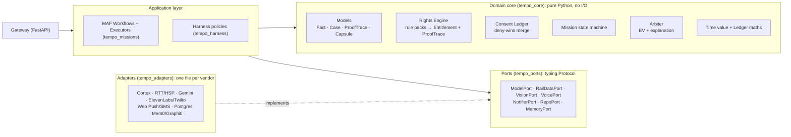

# Architecture: ports and adapters

Tempo is hexagonal. The domain core is pure Python with no I/O, so every decision about money,
eligibility and consent is deterministic and fast to test.

## Rules that keep it maintainable

1. **The domain never imports adapters, vendors or network code.**
2. **Every vendor sits behind a port** with a **Live** and a **Replay** implementation. Replay makes
   demos and CI deterministic (`TEMPO_MODE=replay`).
3. **Models only read and plan.** Money, eligibility, consent and permissions are decided by domain
   code: the Rights Engine, the Consent Ledger, the Arbiter and the Harness policies.
4. **Version-sensitive vendor APIs live in one file each**, for example
   `tempo_harness/hooks_adapter.py` for the Agent Hooks payload shape.
5. **Configuration is code:** voice agent configs, rule packs, skill manifests and policies live in
   the repo and are validated in CI.

Decisions are recorded in [adr/](adr/).
