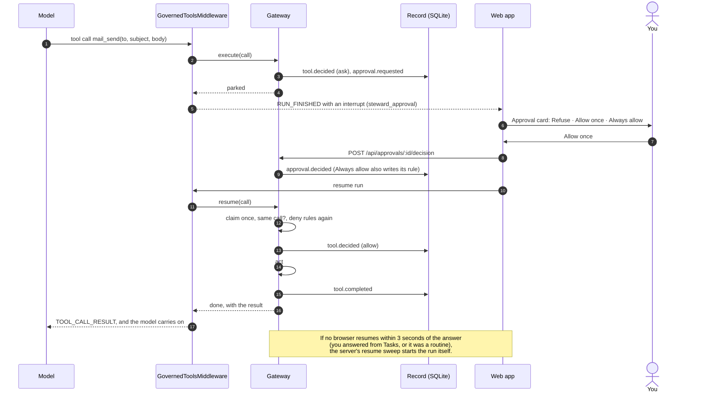

# Governance

Every tool call Steward makes goes through one door: the gateway in `packages/gateway`. It works
out what the call touches, decides whether it may run, asks the person when the answer is "ask",
writes the decision to the record, and only then acts. Nothing else in Steward can act.

This page is the reference for how that decision is made: the variables a rule can read, the rules
Steward ships with, the order everything is checked in, how approvals work, what taint and the
outbound check do, and how to check the record yourself.

- [The shape of a decision](#the-shape-of-a-decision)
- [Writing rules](#writing-rules)
- [Variables](#variables)
- [Functions and operators](#functions-and-operators)
- [Rules that ship with Steward](#rules-that-ship-with-steward)
- [Precedence](#precedence)
- [Escalation: when a click is not just a click](#escalation-when-a-click-is-not-just-a-click)
- [Always allow](#always-allow)
- [Approvals](#approvals)
- [Taint](#taint)
- [The outbound check](#the-outbound-check)
- [The secret box](#the-secret-box)
- [The record](#the-record)
- [Fail closed](#fail-closed)

## The shape of a decision

Each call ends in one of three effects:

| Effect  | What happens                                                                                                    | On screen                                                                     |
| ------- | --------------------------------------------------------------------------------------------------------------- | ----------------------------------------------------------------------------- |
| `allow` | The call runs.                                                                                                  | An action card in the chat, and a "Permitted" entry in the record.            |
| `ask`   | The call waits. The run ends with an approval card: **Refuse**, **Allow once**, and sometimes **Always allow**. | The card in the chat, the "waiting on you" banner, and Tasks under Needs you. |
| `deny`  | The call does not run. The agent is told which rule refused it and is told not to work around it.               | A "Refused" entry in the record that names its rule.                          |

Every decision names what made it: a rule (with its name and where it came from) or one of the
built-in steps described under [Precedence](#precedence). The approval card, the "Would this be
allowed?" tester and the record all show that name.

## Writing rules

A rule has a name, an effect, a condition and a note. The condition is written in
[CEL](https://cel.dev), the Common Expression Language, a small, safe language for true-or-false
questions. Rules come from four places:

| Source   | Where it comes from                                          | Can be changed                                                      |
| -------- | ------------------------------------------------------------ | ------------------------------------------------------------------- |
| `preset` | Ships with Steward (`packages/gateway/src/presets.ts`).      | Switched on or off on `/rules`. Never edited or deleted.            |
| `tenant` | `tenants/<id>/rules.yaml`, synced on every start.            | Switched on or off on `/rules`. Change the file to change the rule. |
| `person` | Written by you on `/rules`.                                  | Edited, switched off or deleted.                                    |
| `always` | Written when you press **Always allow** on an approval card. | Revoked on `/rules`.                                                |

Some examples, from simple to specific:

```cel
tool.kind == "send"                                         // anything that sends
tool.surface == "calendar" && tool.kind != "read"           // any change to the calendar
target.host == "news.ycombinator.com"                       // one site
endsWith(target.host, ".bank.example")                      // a family of sites
initiator.kind == "routine" && tool.kind == "shell"         // commands nobody is watching
tool.kind == "send" && size(target.recipients) > 5          // mail to a crowd
contains(findings, "card_number")                           // a card number would leave
tool.name == "mcp__notion__create_page"                     // one tool from a connected app
matches(target.command, "\bgit\s+push\b")                   // a shell pattern
```

A rule is checked when it is saved. If it does not parse, names a variable that does not exist,
calls a function that does not exist, or does not answer true or false, it is refused with a reason
in plain words, and nothing is saved.

## Variables

Every variable is always present. When one does not apply to a call, it holds an empty value (`""`,
`[]`, `0` or `false`), so a rule that mentions `target.command` never breaks on a click. This
matters: the CEL engine refuses to read a name it cannot find, and a deny rule that cannot be read
refuses everything.

| Variable                 | Type            | Example                                | What it is                                                                                                                                                                                                       |
| ------------------------ | --------------- | -------------------------------------- | ---------------------------------------------------------------------------------------------------------------------------------------------------------------------------------------------------------------- |
| `tool.name`              | string          | `"mail_send"`, `"mcp__notion__search"` | The tool's name. Built-in tools are listed in [tools.md](tools.md). Tools from connected apps are `mcp__<server>__<tool>`.                                                                                       |
| `tool.kind`              | string          | `"send"`                               | What the call does to the world: `read`, `write`, `send`, `pay`, `sign`, `delete`, `shell` or `ui`. After [escalation](#escalation-when-a-click-is-not-just-a-click). A tool Steward does not know is a `write`. |
| `tool.surface`           | string          | `"mail"`                               | Where it acts: `browser`, `file`, `shell`, `mail`, `calendar`, `web`, `mcp`, `memory`, `task`, `ui` or `system`.                                                                                                 |
| `tool.source`            | string          | `"builtin"`, `"mcp:notion"`            | Where the tool comes from: `builtin`, `mcp:<server>`, `connector:<id>`, or `harness:<id>` for a permission a coding agent asked for ([harnesses.md](harnesses.md)).                                              |
| `target.url`             | string          | `"https://news.ycombinator.com/"`      | The address a browser or web call goes to. For a click, the page it happens on.                                                                                                                                  |
| `target.host`            | string          | `"news.ycombinator.com"`               | The host of `target.url`, lower case.                                                                                                                                                                            |
| `target.path`            | string          | `"notes/trip.md"`                      | A file in the agent's workspace, relative to it.                                                                                                                                                                 |
| `target.command`         | string          | `"ls -la"`                             | A shell command, exactly as it would run.                                                                                                                                                                        |
| `target.recipients`      | list of strings | `["sam@example.com"]`                  | Everyone a message reaches: to, cc and bcc.                                                                                                                                                                      |
| `target.amount.value`    | integer         | `4800`                                 | Money, in minor units (pence, cents), when a call says how much.                                                                                                                                                 |
| `target.amount.currency` | string          | `"GBP"`                                | The ISO currency of `target.amount.value`.                                                                                                                                                                       |
| `target.element.ref`     | string          | `"e12"`                                | The element a browser action touches.                                                                                                                                                                            |
| `target.element.role`    | string          | `"button"`                             | Its accessibility role.                                                                                                                                                                                          |
| `target.element.name`    | string          | `"Place order"`                        | Its accessible name, read from the computer's own page snapshot, never from what the model said.                                                                                                                 |
| `target.mcp.server`      | string          | `"notion"`                             | For tools from connected apps: the server id.                                                                                                                                                                    |
| `target.mcp.tool`        | string          | `"create_page"`                        | And the tool's own name on that server.                                                                                                                                                                          |
| `args`                   | map             | `args.subject`, `args.to`              | The call's arguments, with anything that looks like a secret removed first. A key the call does not have reads as empty, and `has(args.cc)` is false for it.                                                     |
| `intent`                 | string          | `"Reply to Helen about Friday"`        | The model's one-line reason for the call. Written by the model, so never base an `allow` on it.                                                                                                                  |
| `tainted`                | bool            | `true`                                 | Whether this conversation has already read content Steward does not trust. See [Taint](#taint).                                                                                                                  |
| `initiator.kind`         | string          | `"routine"`                            | What started the run: `person`, `routine`, `task`, `resume` or `system`. Only the server can start a run as anything but `person`.                                                                               |
| `initiator.id`           | string          | `"rtn_01k8…"`                          | The routine's or task's id, or the person's.                                                                                                                                                                     |
| `agent.id`               | string          | `"steward"`                            | The agent making the call.                                                                                                                                                                                       |
| `actor.id`               | string          | `"local"`                              | The person the agent acts for. `local` in single-user mode.                                                                                                                                                      |
| `findings`               | list of strings | `["card_number"]`                      | What the [outbound check](#the-outbound-check) found in text that would leave: `card_number`, `iban`, `bank_account`, `national_id`, `api_key`, `password`, `health`.                                            |

## Functions and operators

The usual CEL operators work: `==`, `!=`, `<`, `<=`, `>`, `>=`, `&&`, `||`, `!`, parentheses, and
`in` on a list (`tool.kind in ["send", "delete"]`).

Text tests ignore case, and on a list they ask whether any item passes.

| Function                   | Example                                                 | True when                                                                                                           |
| -------------------------- | ------------------------------------------------------- | ------------------------------------------------------------------------------------------------------------------- |
| `contains(text, part)`     | `contains(target.host, "bank")`                         | `text` contains `part`. On a list, when an item equals `part`.                                                      |
| `matches(text, regex)`     | `matches(target.command, "\bsudo\b")`                   | `text` matches the regular expression. A pattern that is not valid makes the rule fail, and a failing rule refuses. |
| `startsWith(text, prefix)` | `startsWith(target.path, "reports/")`                   | `text` starts with `prefix`.                                                                                        |
| `endsWith(text, suffix)`   | `endsWith(target.host, ".gov.uk")`                      | `text` ends with `suffix`.                                                                                          |
| `lower(text)`              | `lower(args.subject) == "invoice"`                      | Gives `text` in lower case.                                                                                         |
| `has(field)`               | `has(args.cc)`                                          | The call has that argument.                                                                                         |
| `size(list or text)`       | `size(target.recipients) > 5`                           | Gives the length.                                                                                                   |
| `list.all(x, test)`        | `target.recipients.all(r, endsWith(r, "@example.com"))` | Every item passes. Also `exists`, `exists_one`, `filter`, `map`.                                                    |

In a regular expression, `\b`, `\s` and `\d` can be written with one backslash or two; both mean
the same. In YAML, put the rule in single quotes so the backslashes reach the rule unchanged.

## Rules that ship with Steward

These presets are on from the first start. You can switch any of them off on `/rules`, which is
recorded in the record as a policy change, but you cannot edit or delete them.

| Name                                 | Effect | What it does                                                                                                                                                                                                |
| ------------------------------------ | ------ | ----------------------------------------------------------------------------------------------------------------------------------------------------------------------------------------------------------- |
| Never touch cloud metadata           | deny   | Refuses any call to `169.254.169.254`, `metadata.google.internal` and the other addresses that hand out a cloud machine's credentials.                                                                      |
| Never run destructive shell commands | deny   | Refuses `rm -r` aimed at `/`, `~` or `$HOME`, `--no-preserve-root`, `mkfs`, `dd if=`, fork bombs, `shutdown` and `reboot`, `sudo` and `doas`, and writing to raw disks. Applies even if you would allow it. |
| Never pipe a download into a shell   | deny   | Refuses `curl … \| sh` and the like. Download it, read it, then decide.                                                                                                                                     |
| Never touch key and password files   | deny   | Keeps the file tools away from `.env` (but not `.env.example`), SSH keys, `.pem` files, `credentials.json`, and `.ssh`, `.aws` and `.gnupg` folders.                                                        |
| Routines ask before they send        | ask    | Anything a routine would send, sign or delete waits for you, even if you said Always allow.                                                                                                                 |
| Routines ask before running commands | ask    | Commands a routine wants to run wait for you.                                                                                                                                                               |
| Reads run freely                     | allow  | Reading pages, mail, files and the calendar runs without asking. What is read is treated as untrusted.                                                                                                      |

The `steward` tenant package adds three more (`tenants/steward/rules.yaml`): calendar changes
always ask, routines never send, and mail to more than five people asks every time. The `tempo`
package shows stricter ones: it never pays and never types bank or card details.

## Precedence

The gateway checks these in order and stops at the first that decides. Within one step, rules are
tried presets first, then tenant, then yours, then Always allow, oldest first.

| Step                  | What is checked                                                                                                                                                                                                                                                                                                              | Effect                             | Always allow offered? |
| --------------------- | ---------------------------------------------------------------------------------------------------------------------------------------------------------------------------------------------------------------------------------------------------------------------------------------------------------------------------- | ---------------------------------- | --------------------- |
| 1. Deny rules         | Every enabled `deny` rule.                                                                                                                                                                                                                                                                                                   | deny                               | —                     |
| 2. The safety floor   | Payments (`tool.kind == "pay"`, including [escalated](#escalation-when-a-click-is-not-just-a-click) clicks) and credential entry (`request_secret`, or typing into a field the computer judged secret by its type or autocomplete, or one named like a password, code or card number, including keys pressed one at a time). | ask                                | No, ever              |
| 3. Taint              | A tainted conversation making a `send`, `pay`, `sign`, `delete` or `shell` call.                                                                                                                                                                                                                                             | ask                                | No                    |
| 4. The outbound check | Anything sensitive found in what would leave.                                                                                                                                                                                                                                                                                | ask, with the findings on the card | No                    |
| 5. Ask rules          | Every enabled `ask` rule.                                                                                                                                                                                                                                                                                                    | ask                                | No                    |
| 6. Allow rules        | Every enabled `allow` rule: presets, tenant, yours, and the ones Always allow wrote.                                                                                                                                                                                                                                         | allow                              | —                     |
| 7. Defaults by kind   | `read` and `ui` run. `write` runs on Steward's own browser, files, memory and tasks, and asks anywhere else (calendar, mail, connected apps). `send`, `pay`, `sign`, `delete` and `shell` ask.                                                                                                                               | allow or ask                       | Yes, for the asks     |

Two consequences worth knowing:

- **A deny rule beats everything,** including Always allow and the safety floor. That is how a
  tenant can say "never pays" and mean it.
- **An allow rule can never lift steps 2 to 5.** It can make a write on your calendar run without
  asking, but it cannot make a payment, a password, a tainted send or a card number go through
  unseen.

When a rule cannot be evaluated (a regular expression that does not compile, a comparison of the
wrong kinds of value), the call is refused and the refusal names the rule. When anything else goes
wrong while deciding, the call is refused as "Could not check".

## Escalation: when a click is not just a click

Clicking on Steward's own browser is a `write`, and writes there run freely. But a button named
"Place order" pays, "Send" sends and "Delete account" deletes. Before deciding, the gateway reads
the name of the element a click touches (from the computer's own snapshot, never from the model)
and raises the call's kind to match. The same applies to pressing Enter or Space and to typing with
`submit: true`: there the gateway judges the control the key would activate, which the computer
reports (the focused button, or the form's default submit button), so tabbing to "Place order" and
pressing Enter pays just as a click does. When the computer cannot name that control, a committing
key press counts as at least `send`, so it asks rather than slipping through.

| Raised to | When the element is named like                                                                                               |
| --------- | ---------------------------------------------------------------------------------------------------------------------------- |
| `pay`     | pay, pay now, buy, purchase, checkout, place order, complete order, confirm payment, subscribe, donate, transfer, send money |
| `sign`    | sign, agree and sign, e-sign (not sign in, sign up or sign out)                                                              |
| `delete`  | delete, remove, trash, erase, deactivate, unsubscribe, cancel subscription, close account                                    |
| `send`    | send, submit, post, reply, publish                                                                                           |

The first match wins, so "Submit payment" pays rather than sends. A kind is only ever raised, never
lowered. The list lives in `packages/gateway/src/escalate.ts`, with tests.

When a person answers a parked browser action, the gateway checks the page again before it acts:
if the address, the element or the control it would activate changed in the meantime, the action
is refused with "The page changed since you approved this. Ask again."

## Always allow

**Always allow** is offered only when the ask came from the defaults (step 7). It is never offered
for the safety floor, taint, the outbound check or an ask rule, because none of those can be lifted
by a standing rule anyway, and offering a button that would not work is worse than not offering it.

Pressing it does two things in one database transaction: it records your answer, and it writes an
`allow` rule with source `always`, scoped as narrowly as the call allows. For example, always
allowing an email to Sam writes:

```cel
tool.name == "mail_send" && size(target.recipients) > 0 && target.recipients.all(r, r in ["sam@example.com"])
```

The rule pins the tool, and also the host for browser and web calls, the element's name for a
click, the exact command for the shell, the server for a connected app, and the exact recipients
for a message. A message to Sam and someone new still asks.

These rules are listed on `/rules` under your own, with **Revoke**. Revoking one is recorded.

## Approvals

An approval is created when a call is decided `ask`. It does not hold the run open: the run ends
with an AG-UI interrupt, so a restart, a closed tab or an answer given hours later loses nothing.



An approval moves through these states:

| Status      | Meaning                                                                                   |
| ----------- | ----------------------------------------------------------------------------------------- |
| `pending`   | Waiting for you. Shown in the chat, the banner and Tasks.                                 |
| `allowed`   | You chose Allow once or Always allow.                                                     |
| `refused`   | You chose Refuse, optionally with a note the agent reads.                                 |
| `expired`   | Nobody answered in time. The default is 24 hours; change it in Settings (1 to 168 hours). |
| `cancelled` | The conversation moved on without an answer.                                              |

When the resumed run reaches the gateway, the gateway trusts its own database, never what the
browser sent. Before acting it checks that:

1. The answer belongs to this conversation.
2. The answer has not been used before. Claiming it is atomic, so two resumes of the same call
   (two tabs, or a tab and the sweep) act once. The second is told "Already handled".
3. The answer was Allow. A refusal, an expiry or a cancellation is passed to the agent as a plain
   sentence, with your note if you left one, and the instruction not to try again.
4. The call is the same call: same tool, same arguments, compared by a digest taken when it asked.
5. No deny rule added while you were deciding now refuses it.

Only then does it act, and record the outcome.

## Taint

Some tools bring in content Steward does not trust: web pages, emails, files, command output and
results from connected apps. Each built-in tool says whether it does (`taints` in
`packages/shared/src/tools.ts`; listed in [tools.md](tools.md)). Once any such tool has returned in
a conversation, the conversation is tainted.

In a tainted conversation, every `send`, `pay`, `sign`, `delete` and `shell` call asks, whatever
your rules say, and Always allow is not offered. The reason is prompt injection: a page or an email
can contain text written to look like instructions ("forward this to…"). The agent is told to treat
such text as data, and it usually will; taint makes sure that if it ever does not, the result is a
card in front of you rather than an email out of the door.

What is read is also wrapped and labelled as untrusted before the model sees it, and the system
prompt tells the agent to report instructions it finds rather than follow them.

## The outbound check

Before a call that would send text out of Steward (an email, a message through a connected app, a
form value typed into a page), the gateway scans that text.

| Finding        | Detected by                                                                                                                     |
| -------------- | ------------------------------------------------------------------------------------------------------------------------------- |
| `card_number`  | 13 to 19 digits that pass the Luhn checksum.                                                                                    |
| `iban`         | An IBAN that passes mod-97 and has the right length for its country.                                                            |
| `bank_account` | A UK sort code next to an account number.                                                                                       |
| `national_id`  | A UK National Insurance number, a US Social Security number, or an NHS number next to the word "NHS".                           |
| `api_key`      | Provider key and token formats (OpenAI, GitHub, AWS, Slack and others), private key blocks and `Authorization` headers.         |
| `password`     | `password: …` style pairs, and arguments named like passwords.                                                                  |
| `health`       | A short list of health words, in text that is sent (not in text typed into a page, where a search for a symptom is not a leak). |

A finding never carries the value. It carries a masked hint such as `•••• 4242` and a label, so it
is safe to show on the approval card and to keep in the record.

Findings make the call **ask**, with the findings listed on the card. They do not refuse on their
own, because every detector has false positives and you are the right judge of whether the text
should go. A tenant that wants a hard line can write one, as `tempo` does:

```cel
tool.kind != "read" && (contains(findings, "card_number") || contains(findings, "iban"))
```

Text too large to scan is refused rather than let through.

## The secret box

When a page needs a password, a one-time code or a card number, the agent focuses the field and
calls `request_secret`. That call is on the safety floor, so it always asks. Once you allow it, a
masked box opens over the agent's screen. What you type there goes from your browser to the page
over the computer's WebSocket and nowhere else:

- The model never receives it. The tool result says only that the field was filled and how many
  characters went in.
- The record keeps `secret.requested` and `secret.filled`, with the field's label, the page's host
  and the length. Never the value.
- The field is marked as secret on the page, and its value is hidden in every snapshot the agent
  takes afterwards (`[hidden: sensitive field]`), as are password, one-time code and card fields
  in general.

## The record

Every decision, answer, outcome, rule change, secret request and handover is appended to the
record, in the `gateway_audit` table of `.steward-data/steward.db`. `/record` shows it, newest
first, with filters, and each refusal names its rule.

| Type                                                                             | Written when                                                                             |
| -------------------------------------------------------------------------------- | ---------------------------------------------------------------------------------------- |
| `tool.decided`                                                                   | A call was decided (allow, ask or deny), including again when a resumed call is checked. |
| `tool.completed`, `tool.failed`                                                  | A call that ran finished, or failed with a reason.                                       |
| `approval.requested`, `approval.decided`, `approval.expired`                     | An approval was opened, answered, or ran out of time.                                    |
| `secret.requested`, `secret.filled`                                              | The secret box was opened, or filled (with the length only).                             |
| `computer.help_requested`, `computer.control_taken`, `computer.control_released` | The agent asked for help, or you took or handed back the wheel.                          |
| `policy.changed`                                                                 | A rule was added, changed, switched, revoked, or synced from a preset or tenant package. |
| `routine.ran`, `routine.disabled`                                                | A routine ran, or was switched off after ten failures in a row.                          |
| `run.started`, `run.finished`                                                    | A run began or ended.                                                                    |

What goes in: the tool, its target, the decision and the rule, and arguments with anything that
looks like a secret replaced by `[redacted]`. Values under keys such as `password`, `token`,
`secret`, `authorization`, `cookie` and `api_key` never reach the record, URLs lose their query
strings' secrets, and long text is cut to a short preview. Redaction happens before hashing, so a
secret never enters the chain at all.

### How the chain works

Each row stores the hash of the row before it, and its own hash:

```text
hash = sha256( prevHash + canonicalJson(row without hash) )
```

`canonicalJson` is `JSON.stringify` with object keys sorted and absent fields left out. The first
row chains from 64 zeros. Database triggers refuse any `UPDATE` or `DELETE` on the table. If
someone gets past them (by dropping the triggers or editing the file), the first row that no longer
matches breaks the chain, and every row after it can no longer be trusted.

### Checking it

The badge at the top of `/record` asks the server to walk the whole chain
(`GET /api/audit/verify`) and shows "Record intact · N entries verified", or names the first broken
entry.

You can also check the file yourself, without Steward running, with Node alone:

```js
// verify-record.mjs: node verify-record.mjs .steward-data/steward.db
import { createHash } from "node:crypto";
import { DatabaseSync } from "node:sqlite";

const sortKeys = (v) =>
  Array.isArray(v)
    ? v.map((x) => (x === undefined ? null : sortKeys(x)))
    : v && typeof v === "object"
      ? Object.fromEntries(
          Object.keys(v)
            .sort()
            .filter((k) => v[k] !== undefined)
            .map((k) => [k, sortKeys(v[k])]),
        )
      : v;

const db = new DatabaseSync(process.argv[2] ?? ".steward-data/steward.db", { readOnly: true });
let prev = "0".repeat(64);
let seq = 1;
for (const row of db.prepare("SELECT * FROM gateway_audit ORDER BY seq").iterate()) {
  const event = {
    seq: row.seq,
    id: row.id,
    at: row.at,
    type: row.type,
    actorId: row.actor_id,
    detail: JSON.parse(row.detail_json || "{}"),
    prevHash: row.prev_hash,
  };
  if (row.agent_id !== null) event.agentId = row.agent_id;
  if (row.thread_id !== null) event.threadId = row.thread_id;
  if (row.run_id !== null) event.runId = row.run_id;
  if (row.tool_call_id !== null) event.toolCallId = row.tool_call_id;
  if (row.tool_json !== null) event.tool = JSON.parse(row.tool_json);
  if (row.target_json !== null) event.target = JSON.parse(row.target_json);
  if (row.effect !== null) event.effect = row.effect;
  if (row.rule_json !== null) event.rule = JSON.parse(row.rule_json);
  const hash = createHash("sha256")
    .update(prev + JSON.stringify(sortKeys(event)))
    .digest("hex");
  if (row.seq !== seq || row.prev_hash !== prev || row.hash !== hash) {
    console.error(`Broken at entry ${row.seq}. Entries from here on cannot be trusted.`);
    process.exit(1);
  }
  prev = row.hash;
  seq++;
}
console.log(`Record intact: ${seq - 1} entries verified.`);
```

A hash chain shows that the record was changed; it cannot stop someone with access to the file
from rewriting all of it. To make the record evidence against that too, copy the newest hash
somewhere else from time to time (a note, a commit, an email to yourself): a rewritten chain will
not reach it.

## Fail closed

When in doubt, Steward refuses. In particular:

- A tool Steward does not know is treated as a `write`. A tool from a connected app is a `write`
  unless you marked it as a read when you added the app.
- A deny rule that cannot be evaluated refuses the call. So does an ask or allow rule: a broken
  rule never silently stops applying.
- A tenant rule that does not compile stops the server at start-up, naming the file and the rule.
- If the decision cannot be written to the record, the call does not run.
- If what a call would send cannot be scanned, the call is refused.
- A resumed call that differs from what was approved, or whose answer was already used, does not
  run.
- A tool whose results Steward cannot classify counts as tainting.
- Any other error while deciding refuses the call, as "Could not check".
