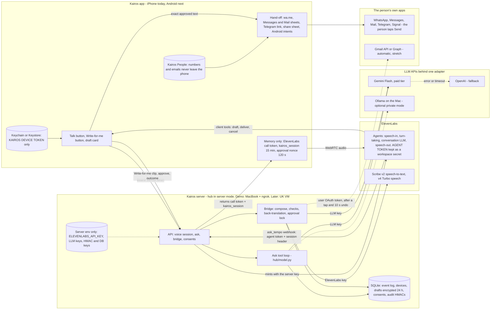

# Kairos on server + API keys - architecture

*Written by a multi-agent research and design workflow, checked against the code at 00:15–00:30 GMT on Sun 25 Oct. UK clocks go back at 02:00 BST (to 01:00 GMT), so the 12:00 deadline is 12:00 GMT. [H] means vendor docs, [M] means a secondary source, and **UNVERIFIED** means not confirmed. Line numbers drift, so grep for the function name.*

## In one minute

- **The app is thin, and the server holds every key.** The native app (Swift now, Kotlin next) stores only a Kairos device token. Our server gives it short-lived tokens.
- **The server is today's hub in "server mode".** For the demo it runs on the MacBook behind ngrok. Later it moves unchanged to a UK VM.
- **Voice stays on ElevenLabs Agents, which already works on the iPhone.** Our server is the brain. An API model replaces Ollama. Ollama stays available as an optional private mode.
- **The Bridge:** Kairos writes down exactly what you said. It rewrites that as a draft without using any tools, then checks the draft in code. It back-translates and reads the draft back to you. When you approve it, your own WhatsApp, Messages or Mail opens with the text filled in, and you tap Send.
- **The model drafts and never sends.** Nothing is sent automatically by default.
- **The main demo path is "Write for me": tap, speak, tap.** It never relies on the hosted LLM choosing a tool.
- **Two blockers come first.**
  - The ngrok policy passes only `POST /api/ask` and `GET /api/hello`, and returns a 413 error for anything over 64 KB.
  - `ask_only()` (`hub/main.py:353`) makes every tunnelled device ask-only, so new routes return 403.

## The big picture



## How a voice question works

1. The app sends its device token to `/api/voice/session`.
2. The server mints an ElevenLabs call token with its own key, plus a 15-minute `kairos_session`. We mint one token per call, because sources disagree on how long a token lasts.
3. The app joins over WebRTC and passes `secret__kairos_session`. ElevenLabs puts this only in tool headers and never gives it to an LLM [H].
4. The person speaks. The agent calls the `ask_tempo` webhook and says "One moment" (`pre_tool_speech: force`).
5. `/api/ask` receives four things: the agent token, the session header, the question in English and a language code. The server identifies the person from the session, never from what the model says.
6. The hub forces a tool call in round 1, then answers in the person's language. When time runs out, it falls back to `memory.fallback_answer`.
7. ElevenLabs speaks the answer. Its LLM may rephrase it.

| Step | Estimate | Limit, then fallback |
|---|---|---|
| Mint call token (before speaking) | 0.3–0.6 s | 3 s, then offer Write for me |
| Turn end + transcript | 0.4–1.0 s | — |
| Agent LLM picks the tool | 0.4–0.9 s | 4 s, then backup LLM |
| Hub: two rounds + tool | 1.0–2.5 s | 10 s, then deterministic answer |
| Answer speech | 0.5–1.1 s | — |
| **Small talk** | about 1–2 s (vendor example: P50 0.68 s [M]) | — |
| **Data question** | about 3–6 s, **UNVERIFIED** (today 7–15 s) | `ask_tempo` 15 s |

Two LLMs still run in series. The hosted LLM can also still skip the tool, because the agent API has no `tool_choice` field we could find. The fix is a Custom LLM: ElevenLabs calls our server, and our server forces the tool [H]. That is a stretch goal tonight.

## The Communications Bridge

**Write for me (the main path)**

1. Tap **Write for me** and pick a person. Kairos People supplies their channel, tone, language and script (`te-Telu` or `te-Latn`).
2. Tap to start, speak for up to 60 s, then tap to stop. Kairos does not cut you off when you go quiet.
3. The app posts the m4a (80–240 KB) to `/api/bridge/draft` with the alias, relationship and language, but never a phone number.
4. Scribe v2 batch transcribes the audio. Aliases are sent as keyterms (batch support **UNVERIFIED**). We never write the audio to disk.
5. A compose LLM with **no tools** returns JSON: the text, the changes made, any missing facts and any risk topics.
   - Tones: warm, polite, formal, brief, or **keep my words**.
   - It keeps every name, number and time.
   - It refuses threats, harassment and impersonation.
6. Code checks the draft, after normalising Telugu and Devanagari digits:
   - **Blocks** any URL, phone number, email, IBAN or sort code that was never spoken.
   - **Flags** numbers that don't match.
   - **Needs a tap** for drafts about money, health, legal matters or work.
7. If the languages differ, a **separate** call back-translates the draft. It sees only the draft, not the transcript.
8. The card shows **I heard** (the verbatim transcript), the draft in large text, the back-translation and any flags. It also has chips (Warmer, More formal, Shorter, Keep my words) and "Say it again", which speaks the exact text. Each revision creates a new version, and old versions can't be approved.
9. Tapping **Send on WhatsApp** calls `approve`. This locks a hash of the draft, version, recipient ref, channel and text, and returns a single-use nonce that expires after 120 s.
10. A 2-second "Opening WhatsApp – tap to stop" countdown runs. Then wa.me opens, built from the number stored on the phone.
11. The person taps Send. The app logs `handed_off`, because wa.me can't report "sent".

**In a call (the second path)**

- `draft_message` takes the alias, channel, tone and language, **never the message**. The app sends the person's own transcript turns.
- The agent's read-back may paraphrase. **The text on screen is what gets approved.**
- `deliver_message` takes only the **`draft_id`**. The app ignores any text or recipient the model sends. Then the same countdown and hand-off run.
- **The app ends the ElevenLabs session before opening WhatsApp.** `project.yml` sets `UIBackgroundModes: [audio]`, so the microphone could otherwise stay live.

**Recipients** resolve on the phone:

- Only an exact alias match resolves on its own.
- For a fuzzy match, Kairos always asks first ("Amma" vs "Anna").
- With no match, the app opens the contact picker, which needs no permission [H].

| Channel | iPhone | Android | Tap or automatic | ToS-safe? |
|---|---|---|---|---|
| WhatsApp | `wa.me/<digits>?text=` | `ACTION_VIEW` on the same link | One tap | Yes (never wacli or the Business API) |
| SMS / iMessage | `MFMessageComposeViewController` [H] | `smsto:` + `sms_body` [H]; later `SmsManager` as Assistant [H] | One tap (Android later automatic) | Yes |
| Email | `MFMailComposeViewController` or `mailto:` | `ACTION_SENDTO mailto:` | One tap | Yes |
| Email, linked (stretch) | Server `gmail.send` or Graph `Mail.Send` [H] | Same | Automatic after a tap, 10 s undo | Yes; Gmail Testing mode: 100 users [M] |
| Telegram | `tg://resolve?phone=&text=` [H] | Same | One tap | Yes |
| Signal | Share sheet | `ACTION_SEND` (**UNVERIFIED**) | Two taps | Yes; nothing automatic is safe [H] |

iOS opens links only while Kairos is in the foreground [M]. The wa.me length limit is **UNVERIFIED**, so use the share sheet above about 1,000 characters.

**Safety rules**

- **Preview and read-back.** The card always appears before sending. Write for me speaks the exact text. In a call, what counts is the text on the screen.
- **Explicit confirm.**
  - Hand-off channels: the person taps Send in their own app.
  - Automatic channels: the person taps in Kairos. A new recipient or a flagged draft also needs Face ID. A 10 s undo follows.
- **No automatic sending by default.** No model has a send tool, and no model runs after approval. This fixes `Tasks.approve()` (`voice/token_server.py:346`), which re-runs the task.
- **Injection defences.**
  - The composer has no tools and no vault access.
  - Replied-to text is wrapped as «untrusted data» (`memory.py:271`).
  - Recipients come only from the phone.
  - Links the person never said are blocked.
  - Each draft has one recipient, with no bulk sends (App Store 5.1.2(v); WhatsApp terms [H]).
  - The LLM's `user_confirmed` is ignored.
- **Audit.** `bridge.*` events record the channel, recipient ref, languages, providers and confirm method. They store the text only as a **per-person keyed HMAC**, because a plain hash of "ok" can be guessed. Full text is stored only if the person opts in.

## Our server's API

| Method and path | Auth | Status | Purpose |
|---|---|---|---|
| `POST /api/devices/register` | join token | exists | Returns a device token |
| `POST /api/voice/session` | device | new (from `mint()`) | Call token + `kairos_session` |
| `POST /api/ask` | device, or agent + session | exists | Questions over the event log |
| `POST /api/bridge/draft` | device | new | Clip (≤2 MB) or transcript in, draft out |
| `POST /api/bridge/drafts/{id}/revise` | device | new | New version |
| `GET /api/bridge/drafts/{id}/readback` | device (header, not URL) | new | MP3 of the exact text |
| `POST /api/bridge/drafts/{id}/approve` | device only | new | Hash lock + nonce |
| `POST /api/bridge/drafts/{id}/outcome`, `/cancel` | device | new | Result, or cancel and purge |
| `POST /api/bridge/drafts/{id}/send` | device + nonce | stretch | Server email with undo |
| `GET`/`PUT /api/consents`; `GET /api/health` | device / none | new | Consent; liveness |
| `POST /v1/chat/completions` | Custom LLM key | stretch | Custom LLM brain |

```http
POST /api/bridge/draft      Authorization: Bearer <device token>   multipart: audio=<m4a>, meta=
{"recipient":{"ref":"p_7f3a","alias":"Amma","relation":"mother","lang":"te-Telu"},
 "channel":"whatsapp","tone":"warm","target_lang":"te-Telu","user":{"sign_off":"Ravi"}}
200 {"draft_id":"d_01","version":1,"heard":{"text":"<verbatim>","lang":"te"},
     "text":"<warm Telugu draft>","back_translation":null,
     "checks":{"blocked":[],"flags":[{"kind":"time","value":"8","in_transcript":true}]},
     "changes_made":["calmer tone"],"missing":[],"text_hash":"sha256:…",
     "timings":{"stt":820,"compose":1400}}
422 {"error":"unclear","ask_user":"Who should I send this to?"}
```

```http
POST /api/bridge/drafts/d_01/approve
{"version":2,"text_hash":"sha256:…","recipient_ref":"p_7f3a","channel":"whatsapp","method":"tap"}
200 {"nonce":"n_…","expires_in":120,"delivery":"handoff","text":"<exact stored text>"}
409 {"error":"stale_or_mismatch"}
```

The server never sees phone numbers, so for hand-off channels the lock binds `recipient_ref`.

## Where API keys and personal data live

| Secret or data | Stored in | Who can see it | Rotation / retention |
|---|---|---|---|
| ElevenLabs, LLM, HMAC and DB keys | Server env (today `voice/.env`, mode 600) | Server only | Rotate after judging |
| Agent token (ask-only) | ElevenLabs workspace secret | ElevenLabs, server | `rotate_hub_token.py` |
| Device token | Phone Keychain; server keeps a hash | App, server | Revocable |
| Call token, `kairos_session`, nonce | App memory | App, ElevenLabs header, server | Per call; 15 min; 120 s |
| People numbers and emails | Phone only | The person | Until deleted |
| Event log incl. health, location | Server SQLite | An LLM only with consent | Until Forget |
| Drafts | Server, encrypted | Server; STT and LLM in transit | 24 h |
| Call audio, transcripts | ElevenLabs and its hosted LLM | ElevenLabs, Google | `retention_days` 1; keep 0–1 (default 2 years [H]) |
| Write-for-me audio | Server memory; Scribe | Server, ElevenLabs | We don't store it; Scribe retention **UNVERIFIED** |
| Demo traffic | ngrok terminates TLS | ngrok | Gone on the VM |

**Consent and UK GDPR** (design notes, not legal advice)

- **Roles:** Kairos is the controller. Each provider is a processor under its DPA.
- **Lawful basis and consent:**
  - Drafting a message relies on Art 6(1)(b).
  - Health, location and notification data need separate, explicit Art 9(2)(a) consent [H].
  - A per-category, per-provider `consents` table replaces the global `TEMPO_LLM_ALLOW_VAULT`.
  - The demo keeps vault data off hosted models and uses synthetic data.
- **Third-party health details** ("Mum's chemo") have no clean Art 9 basis. We store no text, keep retention low and allow no training. Record this in the DPIA and get legal advice.
- **Duties:**
  - Complete a DPIA [H].
  - Pay the ICO fee.
  - Keep a 72-hour breach runbook.
  - Never identify people by voice, which would make it biometric data [H].
  - Gemini requires the paid tier for UK users, and all users must be 18+ [H].
- **Transfers:** ElevenLabs states it holds UK DPF Extension certification [M]. Other providers are **UNVERIFIED**, so use IDTA or Addendum clauses.
- **Disclosure:**
  - The first-run screen names every provider (App Store 5.1.2(i) [H]).
  - Each call opens with "You're talking to Kairos, an AI" (EU AI Act Art 50).
  - Fix the "stays on your Mac" copy in `ContentView.swift:10, :187`, `TempoSession.swift:49, :96` and `LetterReader.swift:51, :362`.

## Providers and fallbacks

| Job | Primary | Fallback | Why |
|---|---|---|---|
| Voice loop | ElevenLabs Agents (Swift 3.4.0; Kotlin SDK [H]) | Write for me; later our push-to-talk route | Works today; te, hi, ru, cy [H] |
| Agent LLM | `simulate.py` bake-off winner | `backup_llm_config`, other vendor | Can't be forced |
| Ask brain | Gemini Flash, paid, OpenAI-compatible [H] | OpenAI, then deterministic answer | Env-only swap (`model.py:29-31`) |
| Compose, back-translation | Native-speaker test winner | Other vendor, then "send as you said it?" | Quality matters most |
| STT | Scribe v2 batch (te High, cy Good [H]) | Azure `te-IN`/`cy-GB`, Google `chirp_3` [H] | Deepgram lacks Welsh [H] |
| Read-back | ElevenLabs v4 Turbo | Azure neural, on-device | Flash v2.5 lacks te, cy [H] |
| Auto email | Gmail `gmail.send` | Graph, compose sheet | Only safe automatic channel |
| Hosting | MacBook + ngrok | UK VM, one replica | SQLite |
| Private mode | Ollama `qwen2.5:7b` | — | Offline; weak in te, cy |

**Adapter rule.** The server uses one internal format: OpenAI-style messages plus `memory.TOOLS`. Each provider sits behind a small adapter (`LLM`, `STT`, `TTS`, `MailSender`, `VoiceSessions`).
- Each adapter has its own parameter map. This replaces the hard-coded `temperature: 0` and `max_tokens` (`model.py:367, 389-390, 417`), which some providers reject [H/M].
- Anthropic is called through its native API, because its OpenAI layer is "not production-ready" [H].
- Prompts are files, routing is set in env, and one eval set tests every provider.

## Making it reliable

**Tool calls.** Stop at the first step that reaches 9 out of 10.

1. Delete "say you're checking" from `system_prompt.md:16` and `tools_config.json:7`. Add this line: "Never say you will check unless you call `ask_tempo` in the same reply."
2. Set `pre_tool_speech: force`, `tool_call_sound` and `thinking_budget: 0`. It is **UNVERIFIED** whether this stops "let me check".
3. Remove the overlapping `phone_task`. **Decision:** this also drops the Navigator money flow (`system_prompt.md:29-35`) from voice. We recommend that for today.
4. Use `simulate.py` to compare 3 models in en, te, hi and cy. Add `backup_llm_config`. The simulate endpoint closes on 31 Oct, so port the tests.
5. The hub forces `tool_choice` on round 1 for agent callers. Whether Gemini's OpenAI layer honours `"required"` is **UNVERIFIED**. One curl will tell us. If it doesn't, name the function.

**Timeouts.** Each layer gives up before the one above it.

| Layer | Limit | On expiry |
|---|---|---|
| `ask_tempo` webhook | 15 s (from 30) | Agent says it couldn't check |
| Hub voice budget | 10 s (from 25) | Deterministic answer |
| One LLM call | 5 s | Fallback provider |
| Compose | 8 s | "Send it as you said it?" |
| Agent LLM | 4 s cascade | Backup LLM |

**Fallbacks, limits and spend.**

- **Fallbacks:** each job has one in the provider table. If ElevenLabs goes down, Write for me keeps working.
- **Daily limits per person:** 60 voice minutes, 60 drafts, 30 sends, 5 new recipients.
- **Concurrency:** raise `TEMPO_ASK_CONCURRENCY` from 2 to 8 (`main.py:1132`). ElevenLabs allows about 4 concurrent calls on Free and 10 on Creator [M].
- **Spend caps:** set the OpenAI project limit, the Gemini project cap (about 10 minutes to apply [M]) and the ElevenLabs key quota. None of these act instantly, so we also keep our own usage counter plus the kill switches `KAIROS_KILL_VOICE` and `KAIROS_KILL_SEND`.
- **Logs:** every response includes `timings`, and logs never contain message text.

## Reuse from today's hub

**What stays and moves into the server:**
- `hub/model.py`: the ask loop and language checks
- `hub/memory.py`: `TOOLS`, `call_tool`, the untrusted wrapper and `fallback_answer`
- From `main.py` and `db.py`: hashed tokens, approvals and Forget
- `token_server.py`: `mint()` (line 393)
- `voice/agent/*`
- iOS: `KeyStore.swift`, the Face ID card and the SDK client-tool hooks

**What stays on the Mac, demo only:** wacli (read-only, on a test account), the hands agents, iCTRL, the Navigator and the letter reader. They can't ship in a store: WhatsApp's terms, Play's Accessibility rule and App Store 5.2.2 rule them out [H].

**What moves off the laptop later:** the hub, its SQLite volume, the secrets, and TLS (Caddy).

**Migration, in this order:**

| Step | Change |
|---|---|
| M0 | `oxford-model-only/tunnel/ngrok-voice.yml`: allow `/api/voice/session`, `/api/bridge/*` and `/api/health`. Allow 2 MB bodies on `POST /api/bridge/draft` only |
| M1 | `KAIROS_SERVER_MODE=1`: `ask_only()` ignores `via_tunnel()`, so trust comes from token capabilities. `device_admin.py` writes the owner's join link, because joining through a proxy is impossible. Update the tunnel tests |
| M2 | `TEMPO_LLM_*` in the process env, a parameter map, a forced round 1 and the new budgets |
| M3 | `/api/voice/session` uses the device token, not the phone key. `/voice/token` stays as a fallback |
| M4 | Agent: prompt fixes, client tools, no `phone_task`, `X-Kairos-Session`, `language_presets` for te, hi and ru. Turn off the `first_message` override, which `agent_config.json` enables (with `language`) although iOS uses neither |
| M5 | `hub/bridge.py`, `bridge_checks.py`, the `drafts`, `consents` and `usage` tables, a purge worker |
| M6 | iOS: device token, People, card, recorder, adapters, client tools, end the call before opening apps, copy fixes |
| M7 | Tests: hash lock, stale version, nonce reuse, blocked links, fuzzy recipients |

## Build plan for the demo

**Roles:** S = server, V = voice, I = iOS, P = product, QA and demo. With three people, S also covers V. Times are GMT and assume a 00:15 start; it was 00:30 GMT when this was published, so slide every step by the delay.

| # | When | Who | Task | Done when |
|---|---|---|---|---|
| 0 | 00:15–00:45 | P+S | Get a **paid**, direct LLM key. There is none in `voice/.env` and no `agents/.env`. Check the ElevenLabs scopes (`voice/check_key.sh`). Set the caps. Run the `tool_choice` curl. Rebuild the app, because free-account builds expire after 7 days | Keys in server env |
| 1 | 00:45–01:30 | S | M0 + M1; run the test suite (262 tests) | New route returns 200 via ngrok |
| 2 | 00:45–01:45 | V | Ladder steps 1–4 | ≥9/10 in 4 languages |
| 3 | 00:45–03:00 | I | Bridge UI on mock JSON | Mock opens WhatsApp with Telugu text |
| 4 | 00:45–01:45 | P | Test sheet (10 questions, 6 utterances, 5 languages); disclosure copy | Ready |
| 5 | 01:30–02:15 | S | M2 | `/api/ask` p50 under 4 s |
| 6 | 02:15–04:00 | S | M5 (text first, then audio) | Telugu m4a gives a draft; edited text fails approve |
| 7 | 01:45–03:00 | V | M3 + M4 | Call starts via the new route |
| 8 | 03:00–04:30 | I | Write for me end to end, then the in-call tools | Full flow on the iPhone |
| 9 | 04:30–05:15 | All | **First iPhone rehearsal**: Telugu wa.me, Messages result, call ends before switching apps | Bug list |
| — | 05:15–08:15 | — | Staggered rest | — |
| 10 | 05:15–07:45 | V+S | One stretch: Custom LLM if step 2 missed 9/10, otherwise Gmail with undo | Works, or cut |
| 11 | 08:15–08:45 | P | Dashboards: auth on, overrides off, retention 0–1, quotas, Gemini billing | No keys shown |
| 12 | 08:15–10:00 | P + native speakers | Score transcript, draft and back-translation (5 × 4 languages); I and S fix | Weak languages named honestly |
| 13 | 10:00–10:30 | P | Backup video | Saved |
| 14 | 10:30–11:00 | All | 3 rehearsals; **freeze 11:00** | — |
| 15 | 11:45 | P | Submit a clean export **without `voice/.env`** (not a git repo) | Submitted |
| 16 | after 15:45 | S | Stop ngrok; rotate every key and token | Done |

**Cut list.** Cut from the top, in this order:
1. Gmail send. Use the Mail sheet instead.
2. Custom LLM.
3. In-call Bridge.
4. Telegram and Signal.
5. Extra chips.
6. Per-category toggles.

**Never cut:** M0, M1, the approval lock, the card, ending the call before the app switch, and the video.

**After the hackathon:**

| When | What |
|---|---|
| Weeks 1–2 | UK VM, secrets manager, paid Apple program, accounts instead of `owner()`, consent ledger, Custom LLM |
| Weeks 2–4 | Kotlin Android app |
| Month 2 | Gmail verification (about 3–5 business days [H]), Graph, Android `ROLE_ASSISTANT` SMS, a "Rewrite message" App Intent, DPIA |
| Later | Our own push-to-talk route, as the exit from ElevenLabs. Realtime speech-to-speech, only once Telugu and Welsh pass native-speaker tests. Encrypted People sync. Red-teaming |

## Risks and open questions

| Risk | Mitigation |
|---|---|
| Hosted LLM skips tools on stage | Ladder; Write for me; backup video |
| Wi-Fi, ngrok or the Mac fails | Hotspot, `caffeinate`, video |
| Rewrite changes meaning or emotion | Keep my words, I heard, back-translation, checks |
| Dialect or code-mixing misheard (**UNVERIFIED** for all vendors) | I heard; edit; keyterms |
| Mic stays live after the app switch | End the session first; test it |
| Health or location data reaches ElevenLabs and Google in spoken answers | Vault off on hosted paths; synthetic data on stage |
| Free-tier Gemini key: trains on data, not allowed in the UK [H] | Check billing in step 0 |
| No Android app yet | Say "designed, not built" |

**Open questions:**

1. Do we have a direct LLM key on a paid plan?
2. Does Gemini's OpenAI-compatible layer honour `tool_choice: "required"`?
3. Does `pre_tool_speech: force` stop the "let me check" replies?
4. Does Scribe batch accept keyterms, and how long does it keep audio?
5. How long does a call token last, and does our plan include Zero Retention Mode?
6. Does the Custom LLM request include the tool list?
7. Does wa.me pass Telugu text through correctly on iOS 26.5?
8. Is saying "send" enough for people who find tapping hard?
9. What is our Art 9 basis for health details about third parties?

## Sources

**ElevenLabs**
- https://elevenlabs.io/docs/eleven-agents/libraries/swift.md
- https://elevenlabs.io/docs/eleven-agents/libraries/kotlin.md
- https://elevenlabs.io/docs/agents-platform/customization/llm/custom-llm
- https://elevenlabs.io/docs/api-reference/tools/create.md
- https://elevenlabs.io/docs/api-reference/agents/create.md
- https://elevenlabs.io/docs/overview/models.md
- https://elevenlabs.io/docs/overview/capabilities/speech-to-text.md
- https://elevenlabs.io/docs/eleven-agents/customization/personalization/dynamic-variables
- https://elevenlabs.io/docs/eleven-agents/customization/privacy/retention.md
- https://elevenlabs.io/blog/voice-agent-latency-optimization [M]

**Google**
- https://ai.google.dev/gemini-api/docs/openai
- https://ai.google.dev/gemini-api/terms
- https://developers.google.com/workspace/gmail/api/auth/scopes

**OpenAI and Anthropic**
- https://developers.openai.com/api/docs/guides/function-calling
- https://developers.openai.com/api/docs/guides/spend-limits
- https://platform.claude.com/docs/en/api/openai-sdk

**Speech recognition**
- https://learn.microsoft.com/en-us/azure/ai-services/speech-service/language-support
- https://developers.deepgram.com/docs/models-languages-overview

**Apple**
- https://developer.apple.com/documentation/messageui/mfmessagecomposeviewcontroller
- https://developer.apple.com/documentation/contactsui/cncontactpickerviewcontroller
- https://developer.apple.com/app-store/review/guidelines/

**Android**
- https://developer.android.com/guide/components/intents-common
- https://support.google.com/googleplay/android-developer/answer/9047303

**Email and messaging**
- https://learn.microsoft.com/en-us/graph/api/user-sendmail?view=graph-rest-1.0
- https://core.telegram.org/api/links
- https://www.whatsapp.com/legal/terms-of-service
- https://signal.org/legal/

**Privacy and security**
- https://ico.org.uk/for-organisations/uk-gdpr-guidance-and-resources/lawful-basis/special-category-data/what-are-the-conditions-for-processing/
- https://genai.owasp.org/llmrisk/llm01-prompt-injection/