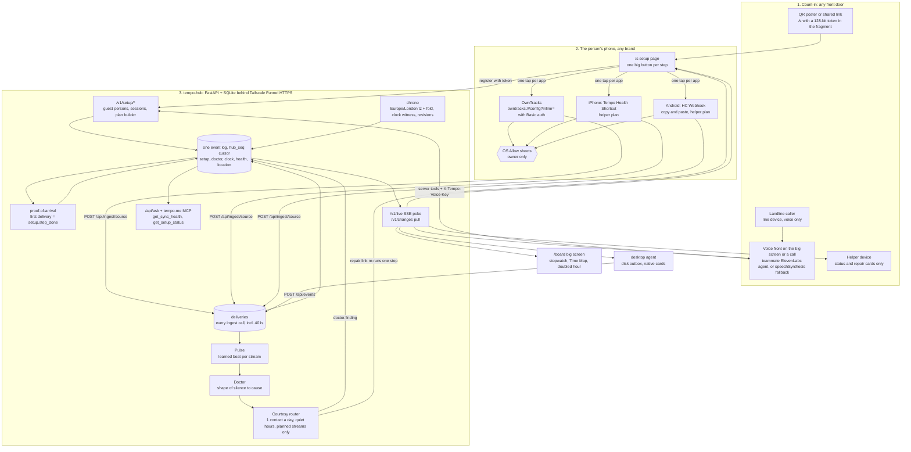

# Tempo Count-In: count in once, then the hub keeps time

> **What this is:** the fully automated architecture for Tempo's sync layer, built on the working `tempo-hub`.
> **How it was made:** 4 independent architects (setup as a conversation, events drive agents, time-native memory, a self-healing mesh), 3 judges (an everyday user, a technical judge, a skeptical engineer), and one synthesizer. Sat 24 Oct 2026, ~19:00 BST.

**One-liner:** You start with one tap or one call. Setup confirms itself: a step counts as done only when your own data arrives, recorded in the same hub_seq log as everything else. After that the hub learns the normal rhythm of every device and app, reads the shape of each silence (a locked phone, a throttled app, a dropped permission, a flat battery), and sends the one fix the phone's OS still needs from you. The fix goes to the right person at a polite time, and nobody is ever asked "did it work?".

**Pitch:** Apple hides sync inside one brand. Across brands nobody can, so Tempo counts you in with one conversation, proves every step with your own data, and then keeps time for every device you own. That includes last night, when 01:00 to 02:00 happened twice.

## Why it's unique
- Setup confirms itself. A step counts as done only when the person's first real event arrives. setup.step_done records the hub_seq of that event, the seconds since setup.started and the tap count. Setup state lives in the same log as the data, so the voice, the phone page, the big screen and the agents always agree. A dropped call, or Safari going to the background when OwnTracks opens, simply resumes from the log. Home Assistant, Fulcra and OpenClaw all ask the user to confirm setup or to read a settings page.
- Any front door works. A QR poster, a shared link, the teammate's ElevenLabs agent, the board's speechSynthesis fallback and a landline all drive the same /v1/setup tools. Voice is a swappable adapter, and onboarding is a deterministic state machine with no LLM in the loop, so it runs with no paid key.
- It reads the shape of a silence instead of running a dead-man's timer. Examples: iPhone health quiet overnight means the phone is locked, so it is resting, not broken. HC Webhook gaps stretching from 30 min to 6 h is an early warning of Android's restricted bucket, before the 8-day cliff. 2,400 steps with no location change means OwnTracks was probably downgraded to While Using. Every stream on the phone going quiet at 3% battery means a flat battery. The rules are pure functions over timings and counts, tested with a fake clock. healthchecks.io and Home Assistant's 'unavailable' state cannot tell these cases apart.
- Repairs are polite and can't be mistaken for phishing. At most one contact a day. Quiet hours 22:00-08:00 Europe/London. Only for streams the person actually set up. Delivered in-band (an open page, the laptop, or a helper's device). Never an unsolicited link in a text. Every outbound contact opens with the person's chosen Tempo word. A fix counts only when new data arrives.
- Correct across the clock change by design. Every naive time is read as Europe/London with fold. A hub clock witness writes clock.* events from 00:30Z to 02:30Z, so tonight's real log holds 01:00-02:00 twice. Upserts keep the old version in event_revisions instead of deleting it. 'Zero false missed beats and zero double counts across the hour that happened twice' is then measured, not claimed (theme: TIME).
- Measured on stage: time-to-first-proof per device in seconds and taps, time-to-diagnosis on a labelled demo clock, and time-to-repair counted only when data returns. For the HRT track, data drives a prediction (early warning of the restricted bucket) and decisions (rest, repair, or who to contact and when).
- Fits the team's values. No paid key is on the critical path: OwnTracks, a free iCloud Shortcut, the FOSS HC Webhook, local Ollama and the free Tailscale Funnel. Health Auto Export and ElevenLabs are optional adapters. A guest's data lives on the team's hub, not in a vendor cloud.

## Architecture

### 1. Front doors (the count-in)

| Component | Job | How it's automatic | File / endpoint |
|---|---|---|---|
| **QR poster / shared link** | Starts setup with no app, no account and no settings screen. | The poster QR encodes only https://hub.<tailnet>.ts.net/s, with no personal data. The page calls POST /v1/setup/start and receives a new guest person plus a 128-bit single-use token in the URL fragment. It then registers the browser and writes setup.started and device.joined. Platform and language come from the user agent and navigator.language, so nothing is asked for. | `web/setup.html; GET /s; POST /v1/setup/start (hub/v1.py)` |
| **Voice front adapter (teammate's lane)** | Holds the conversation: English or Cymraeg, an optional name, choosing a Tempo word, and reading each OS sheet aloud before it appears. Profile facts are saved only after 'Shall I remember that?'. | Narration lines travel inside setup.* event payloads and arrive as /v1/live pokes, so any front speaks the same next step. Today that means the teammate's ElevenLabs agent through server tools and sendContextualUpdate, or speechSynthesis on /board as the open fallback. The narrator runs on a different device from the phone being set up (the big screen or a call), so it keeps talking when Safari goes to the background. The phone page speaks only when session.narrator='page', and it resumes from the log when it comes back to the front. | `POST /v1/setup/start, GET /v1/setup/{sid}, POST /v1/setup/{sid}/tap with header X-Tempo-Voice-Key; web/board.html` |
| **Landline line node** | Gives a person with no smartphone a Tempo account and a device. | /v1/setup/start {channel:'voice', caller_id} creates the person and a device with kind='line'. Identity is caller ID plus the spoken Tempo word, never caller ID alone. Calls become call.* events. Tonight the hub provides only the data model; the voice side belongs to the teammate. | `hub/v1.py; db.add_device(kind='line'); persons.phone, persons.tempo_word` |
| **Helper link** | Lets someone the person trusts (for example a daughter) do the scary steps in person, such as the health sideload or the iPhone automation, and receive repair cards. | POST /v1/setup/{sid}/helper issues a helper-scoped token. A device registered with it gets capabilities ['helper'] and receives only setup.* and doctor.* events: status, never vault data. | `POST /v1/setup/{sid}/helper; db.events_after filtered by kind for helper devices` |

### 2. Count-In engine (setup that confirms itself)

| Component | Job | How it's automatic | File / endpoint |
|---|---|---|---|
| **Guest persons + setup sessions** | Gives each new person their own account, so a judge's phone can never join the owner's data. | persons gains phone, lang, tempo_word, created_via and expires_at. A new setup_sessions table holds id, token_hash, person_id, platform, plan (Essential or Helper) as JSON, narrator, expires_at, used_at, proved JSON {source: hub_seq} and completed_at. create_person() is new. register() accepts setup_token, which is single-use with a 30-minute TTL. Guest persons expire after judging and their data is deleted in full. | `hub/db.py; POST /api/devices/register {setup_token}` |
| **Plan builder** | Produces the steps for each platform and each plan: Essential (voice plus location, about 6-8 taps, done by the person) and Helper (health). | build_plan(platform, plan, person, base_url) returns, for each step: deep_link, store_link, copy_text, the exact OS prompt wording to expect, a tap estimate, proof {source, kinds}, narration {en, cy} and prewarn. The OwnTracks link is owntracks:///config?inline=base64({_type:'configuration', mode:3, url:<base>/api/ingest/owntracks, auth:true, username:'tempo', password:<ingest_key>, tid:'TP', monitoring:1}). The prewarn says: 'In a few days your phone will ask if OwnTracks may keep using location: tap Always Allow'. Welsh lines are used only after a speaker signs them off. | `hub/setup_plan.py; GET /v1/setup/{sid}` |
| **Proof-of-arrival hook** | Marks a step done because real data arrived, never because the person said so. | After insert_events in ingest() and post_events(): if the person has an open session and this source isn't proved yet, write setup.step_done {source, proof_ref: hub_seq, seconds_since_start, taps}. When every required step is proved, write setup.complete with a one-line summary. | `hub/main.py ingest(), post_events(); hub/v1.py` |
| **/s setup page** | Shows one large card per step on the person's phone. | Each card launches exactly one deep link or store link inside its tap handler, after navigator.clipboard.writeText has copied any personal URL. It posts setup.tapped, ticks green from /v1/live, and offers 'Save Tempo as a contact' (a vCard, so later texts show as 'Tempo') plus 'Call instead' and 'Type instead'. ?step=X runs a single step, which is how repair links work. | `web/setup.html (reuses describeDevice, api, store and queue from web/index.html); GET /v1/setup/{sid}/contact.vcf` |

### 3. Borrowed collectors (no Tempo app to install)

| Component | Job | How it's automatic | File / endpoint |
|---|---|---|---|
| **OwnTracks (iPhone + Android)** | Location, the Essential plan's one data source. | The inline-config deep link means zero typing. Background location keeps it posting on movement; on Android it also exempts the app from the restricted bucket once 'Allow all the time' is granted. The key travels as HTTP Basic auth, not in the URL. If Chrome won't launch owntracks://, the fallback is intent://config?inline=...#Intent;scheme=owntracks;package=org.owntracks.android;end. | `POST /api/ingest/owntracks (adapters.owntracks exists); main.ingest() learns HTTP Basic` |
| **Tempo Health Shortcut (iPhone, free, Helper plan)** | Steps, heart rate and sleep from Apple Health. | Built once on a team iPhone and shared by iCloud link. Its Import Question asks for the personal URL, which the page has already copied. A personal automation, 'When WhatsApp is opened, Run Immediately', makes it post every time the phone is in use and unlocked. | `POST /api/ingest/shortcut with X-Tempo-Key (adapters.simple exists); iCloud link held in hub/setup_plan.py` |
| **HC Webhook (Android, FOSS APK, Helper plan)** | Health Connect data from every brand: Galaxy, Pixel/Fitbit, Garmin, Oura, CMF through Gadgetbridge. | It posts every 15-60 minutes. It has no deep link and no config import (its docs/usage.md, checked today, say the URL is entered by hand), so the page copies the URL and the person pastes it once. | `POST /api/ingest/health-connect (adapters.health_connect and hc_webhook exist)` |
| **Health Auto Export (optional, paid)** | A one-tap iPhone health path for people who already pay for Premium. | The com.HealthExport://automation?url=...&headers=X-Tempo-Key,<key>&period=lastsync deep link creates the REST automation, and period=lastsync re-sends anything missed. It is labelled Premium and is never the default. | `POST /api/ingest/health-auto-export (exists)` |

### 4. Hub core: one time-correct log

| Component | Job | How it's automatic | File / endpoint |
|---|---|---|---|
| **Event log + hub_seq cursor (exists) with /v1 aliases** | One append-only log. setup.*, doctor.* and clock.* are just more event kinds. | Unchanged dedupe and cursor. /v1/changes?since= and POST /v1/events are thin aliases over GET /api/events?after= and POST /api/events. | `hub/db.py; hub/v1.py` |
| **chrono + clock witness** | Times stay correct across the 02:00 clock change. | adapters.parse_time reads naive times as Europe/London, not UTC (fixes lines 36-38). In the repeated hour, a live event takes the candidate at or before its receive time. Every event gets event_tz and event_fold. A lifespan task writes clock.tick every 10 minutes from 00:30Z to 02:30Z and clock.transition at 01:00:00Z, so the real log holds the doubled hour even if every phone is asleep. | `hub/chrono.py; hub/adapters.py parse_time; hub/main.py lifespan` |
| **event_revisions** | History is kept, never deleted. | The upsert branch in insert_events copies the old row to event_revisions(id, payload, recorded_at, superseded_at, superseded_by_hub_seq) instead of deleting it. Forget also deletes revisions. | `hub/db.py insert_events, forget, delete_ids` |
| **deliveries log** | Gives Pulse the real arrival rhythm, including deliveries that were all duplicates, and makes rejected keys visible. | Every ingest or events call writes (person_id, device_id, source, at_utc, accepted, duplicates, http_status, key_sha256, user_agent). A 401 is logged with the key hash only. | `hub/db.py deliveries table; hub/main.py ingest(), post_events()` |
| **/v1/live SSE poke** | Live ticks on the phone, the board, the laptop and the voice front. | Poke-only {hub_seq_max} per person, sent with sse_starlette 3.5.1 (already in .venv). Clients read it with fetch streaming and a bearer header, then pull /v1/changes. When the stream drops, for example on iOS in the background, the existing 4-second poll takes over. | `GET /v1/live (hub/v1.py)` |

### 5. Keep-Time: Pulse, Doctor, courtesy

| Component | Job | How it's automatic | File / endpoint |
|---|---|---|---|
| **Pulse** | Learns each stream's normal beat. | A stream is a device plus a kind family. From the deliveries table it keeps the last 20 gaps, the median and a tolerance of max(3x median, median+15 min), and computes next_due. Priors apply until 5 beats: OwnTracks 12 h (iOS significant-change only fires on movement), HC Webhook 3 h, Shortcut 26 h, desktop 10 min. The web page is treated as visits and never goes stale. States are learning, fresh, due, late, silent and rest. All maths is in UTC. | `hub/pulse.py; asyncio task every 60 s from main.py lifespan` |
| **Doctor (shape of the silence)** | Turns a silence into a cause and decides between rest, repair and helper. | Pure rules over (pulse rows, deliveries, plan siblings, now): - R1: iPhone health quiet 22:00-10:00 London = rest (locked). - R2: last 3 gaps over 4x the median, or rising = Android throttling (early warning). - R3: a sibling on the same phone shows activity while this stream doesn't, e.g. at least 1,500 steps since the last location fix = OwnTracks downgraded to While Using or swiped away; heart rate stops while steps continue = permission revoked. - R4: 401s carrying an old key hash. - R5: every stream on the phone silent with last battery under 10% = phone off, rest. - R6: laptop asleep = rest. - R9: a step tapped with no proof after 20 minutes. - R10: a new device joined. It writes doctor.finding, doctor.rest and doctor.recovered events. | `hub/doctor.py; GET /v1/sync/health; POST /v1/doctor/{id}/dismiss` |
| **Courtesy + repair router** | Delivers the one fix politely. | At most one contact per person per day. Quiet hours 22:00-08:00 Europe/London via zoneinfo. Only streams with setup.step_done count, so it never nags about unused sources. Delivery goes to the freshest awake surface: a card on the next POST /api/events reply, an open page via /v1/live, or a native notification from the desktop agent. If the fix needs the person's own phone, it can go to their helper's device instead. The card carries a single-step repair token. Text is neutral, with no health or location values. doctor.recovered is written only when a new delivery arrives. | `hub/doctor.py route(); hub/main.py post_events() reply; hub/v1.py repair tokens` |
| **Demo clock** | Shows days passing on stage, honestly labelled. | POST /v1/pulse/clock {advance_minutes} works only when TEMPO_DEMO_CLOCK=1. It shifts only the Doctor's 'now', and /board shows a 'DEMO CLOCK +3 d' badge while it is set. | `hub/v1.py; hub/doctor.py now()` |

### 6. Surfaces

| Component | Job | How it's automatic | File / endpoint |
|---|---|---|---|
| **/board big screen** | The stage view. | Driven by /v1/live: - a stopwatch per session showing seconds and taps to each proof; - a Time Map with one ring per stream (data age, next beat, state, a one-line reason); - the 01:00-02:00 band drawn twice from clock.* events; - speechSynthesis narration when narrator='board'. It shows place names from a small venue table (e.g. 'near the Maths Institute') and never coordinates or health values. | `web/board.html; GET /board` |
| **Desktop agent** | The laptop collector, and a surface for repair cards. | After 3 failures it runs mDNS discovery again (on your own network only). Its outbox lives on disk at ~/.tempo/outbox.jsonl. It retries with backoff and jitter. Cards come back on its POST reply and show as an osascript notification, with the text passed only through argv. | `agent/desktop_agent.py` |
| **Tools for the model and agents** | Lets the voice front and agents answer 'is everything syncing?' with data age and a reason. | Adds get_sync_health, get_setup_status and start_setup to memory.TOOLS/call_tool and to mcp_server.py. model.SYSTEM gains: 'say how old the data is and why'. There is no decide tool, so agents can ask but never approve. | `hub/memory.py; hub/model.py; hub/mcp_server.py` |

## From a brand-new person to fully synced
1. 0. [HUB OWNER, once per household] Run ./run.sh on an always-on machine with caffeinate. Start Tailscale, then in the admin console turn on HTTPS and the funnel nodeAttr. Run `tailscale funnel --bg 8787` and set TEMPO_PUBLIC_URL. Nobody else ever touches the hub.
2. 1. [PERSON, 1 action] Scan the QR poster with the Camera app, tap a link someone sent, or call Tempo (the web orb on stage tonight, since no UK number is live). No app, no account, no password.
3. 2. [AUTO] /s detects iPhone or Android and the language, then POST /v1/setup/start creates a new guest person and a 128-bit single-use session. The browser registers as the first device, which writes setup.started and device.joined. The board stopwatch starts and the narrator, on the big screen or the call, greets the person in English or Cymraeg.
4. 3. [PERSON, speech or 1 tap, optional] Give a name, and choose a Tempo word: 'I'll always say it when I contact you, so you know it's really me.' These are stored only after 'Shall I remember that?'.
5. 4. [PERSON, 2-3 taps + Face ID, only if OwnTracks is missing] Tap 'Get OwnTracks', then Install, then return to the page. The narrator says what the store sheet will show before it appears.
6. 5. [PERSON, about 3 taps now and 1 later] Tap 'Connect location', which fires owntracks:///config?inline=... with HTTP mode, the hub URL and Basic auth already filled in. Then iOS 'Open in OwnTracks?' (Open) and the location sheet (Allow While Using). Android: also 'Allow all the time' in Settings (2) and notifications (1). Tempo pre-warns about the later 'Always Allow' prompt.
7. 6. [AUTO] The first location.point reaches /api/ingest/owntracks. The proof hook writes setup.step_done {source:'owntracks', proof_ref:#N, seconds, taps}. The page and board tick green within 2 s, and the narrator says 'I can see you're near the Maths Institute. That worked.'
8. 7. [PERSON, 2 taps] 'Save Tempo as a contact' (vCard), so any later text arrives from 'Tempo' and not an unknown number. Optional on iPhone: Add to Home Screen.
9. 8. [AUTO] setup.complete. One summary, e.g. 'Location is connected. 4 taps, 41 seconds. I'll only contact you if something stops, at most once a day, never at night.' The Essential plan is done.
10. 9. [HELPER, optional, in person, iPhone about 14 taps] The helper link opens the Helper plan on the person's phone. 'Add Tempo Health shortcut' copies the URL and opens the iCloud link: Add, then paste into the Import Question (3). Health 'Turn On All' and Allow (2). Then the narrated automation: Automation, +, App, WhatsApp, Is Opened, Run Immediately, Tempo Health, Done (about 9). Proof = the first shortcut POST.
11. 10. [HELPER, optional, in person, Android about 15-20 taps] Install the HC Webhook FOSS APK, including 'install unknown apps' (about 5). 'Copy my health link' (1), then paste (2). Health Connect Allow all plus background (3). Interval 30 min (1). Battery Unrestricted and 'Pause app activity if unused' off (about 6, narrated, because a web page can't open those Settings screens). Proof = the first health.* POST.
12. 11. [LAPTOP, 0 taps or 1 command] Open the personal link once in a browser and the laptop joins. For background collection, run `python agent/desktop_agent.py --install` once with TEMPO_JOIN_TOKEN. It then starts at every login and finds the hub again by itself after the IP changes.
13. 12. [AUTO, forever] Every delivery lands in deliveries and the log, with Europe/London tz and fold. Upserts keep revisions. Pulse learns each stream's beat. Every 60 s the Doctor reads the silences: rest, early warning or repair. The courtesy router sends at most one fix a day, outside quiet hours, to the freshest awake surface or the helper. Each repair link re-runs only the broken step, and recovery counts only when new data arrives.
14. 13. [LANDLINE, 0 taps] The whole count-in happens on the call (voice teammate's lane). The line becomes a device with kind='line', identified by caller ID plus the Tempo word, and a helper link can be sent to a relative's phone.

## What a human must still do (and why)
- Starting: scanning the QR code, tapping a link or making a call. Tempo never cold-contacts a stranger, and links never open by themselves.
- Every OS permission sheet: location, then 'Always' or 'Allow all the time'; Health (HealthKit, or Health Connect plus background read); notifications; microphone. Each OS shows these only to the owner, and no third party can tap or skip them.
- Installing each collector app. App Store and Play need the owner's confirmation or Face ID. The FOSS HC Webhook is a sideload behind an 'install unknown apps' warning, so it belongs to the Helper plan; the alternative is the paid Play build.
- Confirming each custom-scheme launch. iOS Safari asks 'Open in OwnTracks?' every time, and Android Chrome may show an app chooser.
- iPhone: building the 'When WhatsApp is opened, Run Immediately' automation by hand (about 9 taps). Apple lets people share shortcuts but not automations, and there is no 'phone unlocked' trigger.
- iPhone: unlocking normally and not force-quitting. HealthKit can't be read while the phone is locked, so overnight health arrives after the first unlock. The Doctor treats that as rest.
- Android: battery 'Unrestricted', 'Pause app activity if unused' off, and on Samsung 'Never sleeping apps', for HC Webhook. A web page can't open those Settings screens, Play forbids the one-tap exemption dialog for apps like this, and the widget exemption only applies to a native app. Re-check after OS updates.
- HC Webhook: pasting the URL once. It has no deep link or config import, per docs/usage.md, checked today.
- Repairs that live in Settings, such as switching OwnTracks from While Using back to Always. Tempo detects the problem, explains it and routes it to the right person at a polite time, but only the owner's finger can flip the switch.
- Hub owner, once: keep an always-on machine powered and enable Tailscale Funnel in the admin console (HTTPS plus the funnel nodeAttr). This Mac's Tailscale is currently Stopped and has no funnel capability.
- Approving anything binding (a claim, money, sharing, forgetting). This is by design and runs in the teammate's approval flow.
- Choosing to share health data at all, choosing a helper, and 'Forget me'. These are the person's own decisions.

## Per device

| Device | Set up once | Then automatic | Limit |
|---|---|---|---|
| iPhone (any model) | Essential: 1 scan or tap, OwnTracks install (2-3 + Face ID), Connect location (about 3 taps, plus 1 'Always Allow' later, pre-warned), save the Tempo contact (2). Helper plan for health: about 14 taps (Shortcut add + paste + Health sheet + hand-built automation). | OwnTracks reports significant location changes in the background. The Shortcut posts health on every WhatsApp open (phone unlocked). Pulse treats overnight health silence as rest. The page syncs whenever it is opened. | Web apps can't run in the background and there is no silent push. HealthKit is locked overnight. The automation must be built by hand. A While Using downgrade or swiping the app away stops location; the Doctor detects it through R3 (steps without movement), but the fix is a Settings tap. |
| Android (Nothing, Samsung, Pixel) | Essential: 1 tap + OwnTracks (about 8-9 taps including 'Allow all the time'). Helper plan for health: HC Webhook sideload + 1 paste + permissions + battery Unrestricted (about 15-20 taps). | HC Webhook posts every 15-60 min. OwnTracks posts on movement and is exempt from the restricted bucket once it holds background location. The hub upserts growing totals and keeps revisions. | HC Webhook isn't exempt. The 8-day restricted bucket, hibernation and Samsung's 3-day sleep throttle it unless it is set Unrestricted. R2 warns while the gaps stretch, but only the owner can change the setting. Settings screens can't be opened from a web page. |
| Watches and rings (Apple Watch, Galaxy, Pixel/Fitbit, Garmin, Oura, CMF) | The vendor app's 'share with Health Connect / Apple Health' toggle (0-4 taps). | Data flows through the phone's health path above with no further action. | Apple Watch data arrives only through an unlocked iPhone. Galaxy data lags. The Fitbit Web API returns 410 from 2 Nov 2026. Oura's terms allow it only through the OS health store. CMF needs Gadgetbridge auto-fetch turned on. |
| Laptop (Mac, Windows, Linux) | Open the personal link once (0 taps). Optionally run `desktop_agent.py --install` once with TEMPO_JOIN_TOKEN. | Current app, idle time and battery every 15 s, with a heartbeat every 60 s. It finds the hub again after an IP change, keeps a disk outbox, and shows repair cards as native notifications. | Nothing runs while the laptop sleeps; R6 treats that as rest. Tonight the install is still a terminal command. |
| Landline / basic phone | One call (voice teammate). Tonight the QR code and the web orb stand in, because no inbound UK number is live this weekend. | A kind='line' device and call.* events. A helper link can be sent to a relative's phone. | No passive data. Caller ID can be spoofed, so the Tempo word is required. Opt-in check-in calls are roadmap. |
| Hub (this Mac tonight; a Pi or mini PC later) | ./run.sh + caffeinate + Tailscale Funnel enabled in the admin console + TEMPO_PUBLIC_URL. | Dedupe, the hub_seq cursor, tz and fold, revisions, the deliveries log, Pulse and Doctor every 60 s, SSE pokes and the clock witness. Repair cards are routed politely. | A sleeping or offline hub stops everything; phones' own retries and outboxes cover short gaps. Funnel needs a free Tailscale account. |

## Triggers (what fires by itself)

| When | Then | Human touch |
|---|---|---|
| First delivery from a planned source for a person with an open setup session | Write setup.step_done {source, proof_ref hub_seq, seconds, taps}; tick the page and board through /v1/live; the narrator confirms using the data ('near the Maths Institute') | none |
| Every required step in the plan is proved | Write setup.complete; send one summary with the tap count, the duration and the contact promise | none |
| A step was tapped but no proof has arrived after 20 min (R9) | One card, 'finish: tap Allow in OwnTracks', carrying a single-step link, sent to the freshest awake surface or the helper | 1 tap plus the OS sheet |
| iPhone health has been quiet since the last unlock-proxy run and it is 22:00-10:00 London time (R1) | Mark the stream rest ('arrives after unlock'), grey on the board; no finding, no contact | none |
| HC Webhook's last 3 gaps are over 4x its learned median, or the gaps keep rising (R2) | doctor.finding 'Android is putting HC Webhook to sleep'; next morning, within the budget, a card to the person or helper explains how to set battery Unrestricted | about 6 taps in Settings, often by the helper |
| At least 1,500 steps have arrived since the last location fix, or a sibling metric stops while others continue (R3) | doctor.finding 'location probably switched to While Using or OwnTracks swiped away' (or 'heart-rate permission revoked'); a card carrying the exact Settings path | about 4 taps in Settings |
| Every stream on one phone goes silent and the last battery reading was under 10% (R5) | doctor.rest 'phone probably off'; re-check at 24 h before any contact | none |
| An ingest returns 401 with a key hash previously seen from that source's user agent (R4) | doctor.finding 'an app has an old link'; re-issue that step's link | 1 tap |
| A new device joins any person (R10) | device.joined plus an immediate card on every other device, 'New device joined: Pixel. Not you? Remove' (outside the daily budget) | 0, or 1 to remove |
| A finding is due during quiet hours, or the person has already been contacted today | The courtesy router holds it until 08:00 London time, or the next day; one contact a day at most; findings for streams the person never set up are dropped | none |
| A stream with an open finding delivers again | doctor.recovered with time-to-repair; the card disappears everywhere | none |
| UTC is between 00:30Z and 02:30Z on 25 Oct (and every future clock change) | clock.tick every 10 min and clock.transition at 01:00:00Z; naive times in the repeated hour resolve by receive time and carry a fold | none |
| An upsert changes a record (a growing step total, an edited Health Connect record) | The old row is copied to event_revisions and the new row gets a new hub_seq; nothing is deleted | none |
| The desktop agent fails 3 times in a row | Re-run mDNS discovery (own network) or fall back to the public URL; drain ~/.tempo/outbox.jsonl when back | none |
| The teammate's agent needs approval for a claim, money or forgetting | Contract only: the agent writes the request through MCP, the first valid tap wins, and expiry means deny; there is no decide tool in MCP | 1 tap, by design |

## Demo script
1. 0:00 The big screen shows /board: a stopwatch at 0:00 and Time Map rings for the team's real devices from overnight. Presenter: 'Nobody here will open a settings screen, and nobody will be asked if it worked.'
2. 0:05 A judge scans the QR poster with their phone's Camera and taps once. Board: 'iPhone joined, 0:04' (device.joined, guest person). The narrator on the laptop, using the teammate's ElevenLabs agent or the speechSynthesis fallback, asks 'English or Cymraeg?'. Because it runs on the laptop, it keeps talking when the phone switches apps.
3. 0:12 The judge taps 'Connect location'. Narrator: 'Your phone will ask to open OwnTracks. Tap Open. Now it asks about location. Tap Allow While Using App.' OwnTracks is pre-installed on the stage phone, and the presenter says so and shows the rehearsal's first-run figure including the install.
4. 0:30 The first location.point arrives. Board: 'Location proved by #1843 in 0:27, 3 taps', with the proof row highlighted in the log. Narrator: 'I can see you're near the Maths Institute. That worked. In a few days your phone will ask if OwnTracks may keep your location. Tap Always Allow.'
5. 0:40 Time beat 1, real data: the board's striped band reads '01:00-02:00 happened twice last night', with clock.* events in both passes. The team iPhone's health ring turned grey ('resting: locked') at 23:40 and green at 07:32 after unlock. Zero false missed beats and zero double counts across the repeated hour.
6. 0:50 Time beat 2, labelled simulated, with the DEMO CLOCK +3 d badge showing. 'Margaret, three days later': her steps show 2,400 steps but OwnTracks hasn't moved, so the Doctor reports 'location probably switched to While Using'. It's 23:10, inside quiet hours, so the card is held until 08:00 and then sent to her daughter's helper device, not as a text from an unknown number.
7. 1:00 The helper taps the card. The repair link re-runs only the location step, with the Settings path narrated. The next point arrives and the board shows 'Recovered: 1 step, 4 taps, counted when data returned.'
8. 1:05 Close with the pitch line, then: 'The taps left are the ones the OS says only you can make. Tempo narrates them, proves them with your own data, and keeps time after that.'

## Build plan (on top of tempo-hub)

| # | Item | Hours | Files | Done when |
|---|---|---|---|---|
| 1 | Funnel go/no-go + venue safety (18:30-18:45 BST) | 0.25 | `hub/main.py (add 'tailscale-funnel-request' to FORWARD_HEADERS); tests/test_hub.py; shell: tailscale up, rename the machine to 'hub', admin console HTTPS + funnel nodeAttr, `tailscale funnel --bg 8787`, TEMPO_PUBLIC_URL=https://hub.tailfaee3c.ts.net ./run.sh` | An iPhone on 4G loads https://hub.<tailnet>.ts.net/api/hello. A new pytest shows that a request carrying Tailscale-Funnel-Request, or any request while TEMPO_PUBLIC_URL is set, never auto-joins. TEMPO_LAN_AUTOJOIN and TEMPO_MDNS stay 0 at the venue. If Funnel isn't up by 19:00, use the phone hotspot and name_url, and drop 4G from the demo. |
| 2 | Time core, live long before 00:30Z: parse_time fix, tz/fold, clock witness, event_revisions | 1 | `hub/chrono.py (new); hub/adapters.py parse_time; hub/main.py post_events + lifespan task; hub/db.py event_revisions table, insert_events upsert branch, forget/delete_ids cascade; tests/test_time.py` | pytest passes for these cases: - naive '2026-10-25T01:30' with fold 0 maps to 00:30Z and with fold 1 to 01:30Z; - a live event in the repeated hour picks the candidate at or before its receive time; - naive '18:00' on 24 Oct is stored as 17:00Z; - an upsert keeps the old payload in event_revisions; - forget leaves no revision behind; - on a fake clock, the witness emits clock.transition at 01:00:00Z. The live hub is running the witness before 00:30Z. |
| 3 | Guest persons + setup sessions + plan builder + /v1/setup API + voice contract | 1.5 | `hub/db.py (persons: phone, lang, tempo_word, created_via, expires_at; setup_sessions; create_person); hub/setup_plan.py (new); hub/v1.py (new APIRouter mounted in main.py: POST /v1/setup/start, GET /v1/setup/{sid}, POST /v1/setup/{sid}/tap, POST /v1/setup/{sid}/helper); hub/main.py register() takes setup_token and ingest() parses HTTP Basic; tests/test_setup.py` | The token is secrets.token_urlsafe(16), stored hashed, single-use, with a 30-minute TTL, and /start is rate-limited. Registering with it creates a device on a NEW guest person, never owner(). The OwnTracks inline link decodes to mode 3 + url + auth. The ios, android and desktop plans each list the steps, OS prompts, tap estimates, proof sources and en narration. The JSON schemas for the server tools (X-Tempo-Voice-Key) go to the voice teammate at the 21:00 checkpoint. |
| 4 | Proof-of-arrival hook + deliveries log | 0.5 | `hub/db.py (deliveries table); hub/main.py ingest() and post_events(); hub/v1.py` | pytest passes for these cases: - the first OwnTracks POST for a person with an open session writes exactly one setup.step_done carrying the proving hub_seq and seconds since setup.started; - a second POST writes none; - setup.complete fires when every required step is proved; - an all-duplicate delivery still adds a deliveries row; - a 401 is logged with sha256(key) only. |
| 5 | /s setup page + Tempo Health Shortcut + vCard (real-device test 23:30) | 1.25 | `web/setup.html (new; copies describeDevice, api, store and queue from web/index.html); GET /s in hub/main.py; GET /v1/setup/{sid}/contact.vcf; the iCloud Shortcut link (built once on a team iPhone, with an Import Question for the URL) in hub/setup_plan.py` | On a real iPhone in Safari and a real Android in Chrome: QR, then join, then 'Connect location' opens OwnTracks already configured. On Android, owntracks:// is tested from Chrome, with the intent:// fallback ready. The card ticks green within 5 s of the first point, with no reload. Narration speaks only when narrator='page'. The vCard imports as 'Tempo'. ?step=owntracks shows a single card. |
| 6 | Pulse + Doctor (R1, R2, R3, R5, R9, R10) + demo clock + get_sync_health | 1.75 | `hub/pulse.py and hub/doctor.py (new); lifespan task in hub/main.py; hub/memory.py (rhythm field in get_device_status, get_sync_health in TOOLS and call_tool); hub/model.py SYSTEM ('say how old the data is and why'); hub/v1.py (GET /v1/sync/health, POST /v1/pulse/clock gated by TEMPO_DEMO_CLOCK=1); tests/test_doctor.py` | These fake-clock tests pass: - R1: iPhone health quiet 23:40 to 07:30 counts as rest, with no finding. - R2: HC Webhook gaps of 30 min, then 2 h, then 6 h raise a warning before 24 h. - R3: 2,400 steps with no location fix gives 'likely While Using'. - R5: every stream silent with battery at 3% counts as rest. - R9: a tapped step with no proof for 20 min sends exactly one card. - No findings at all across the repeated hour. The demo clock refuses requests unless TEMPO_DEMO_CLOCK=1. /api/ask answers 'is everything syncing?' with data age and reason. |
| 7 | /board big screen + /v1/live SSE + /v1/changes alias | 1 | `web/board.html (new); GET /board; hub/v1.py GET /v1/live (sse_starlette, poke-only, per-person hub_seq_max), GET /v1/changes and POST /v1/events aliases; web/index.html (replace the 4-second setInterval with a fetch stream, keeping polling as the fallback); requirements.txt pins sse-starlette` | On the projector the board shows: - the per-session stopwatch, in seconds and taps to each proof; - one ring per stream (data age, next beat, state, reason); - the striped double hour from real clock.* events; - the DEMO CLOCK badge whenever it is set. A proof appears on the board within 2 s. No coordinates or health values are ever drawn. |
| 8 | Courtesy + repair router + helper delivery | 0.75 | `hub/doctor.py route(); hub/main.py post_events() reply carries a cards[] list; hub/v1.py single-step repair tokens and helper filter in events_after; web/index.html card banner; web/setup.html ?step=` | pytest passes for these cases: - at most 1 contact per person per day; - a finding at 23:10 London time is held until 08:00; - streams without setup.step_done never produce a card; - the card goes to the freshest awake surface, or to a helper device that never sees vault events; - the repair link re-runs one step; - doctor.recovered only after a new delivery; - card text contains no health or location values. |
| 9 | Simulator scenarios + rehearsal + backup video (CUT LINE: everything above, 8.75 h, is demo-critical) | 0.75 | `scripts/simulate.py --scenario first-proof | margaret-week | downgrade | android-bucket (all trust_level=simulated); a demo checklist in README.md` | The 65-second script runs cleanly twice, on venue Wi-Fi and on the phone hotspot. The backup video is recorded before the 09:45 freeze. The README says the Shortcut is the default iPhone path, Health Auto Export is paid, and TEMPO_PUBLIC_URL disables auto-join. |
| 10 | MCP wrappers: start_setup, get_setup_status, get_sync_health | 0.25 | `hub/mcp_server.py; hub/memory.py TOOLS` | The teammate's agent calls get_sync_health over MCP and can say 'iPhone health resting since 23:40 (locked), arrives after unlock' with event refs. |
| 11 | Self-healing extras: desktop agent re-discovery, disk outbox, hub front-door self-test | 0.5 | `agent/desktop_agent.py (re-run mDNS after 3 failures, ~/.tempo/outbox.jsonl, backoff with jitter, osascript card via argv); hub/main.py lifespan (every 60 s GET <public>/api/hello; on failure write hub.unreachable and retry `tailscale funnel --bg 8787` once)` | Killing and restarting the hub loses no desktop events. Changing the laptop's network re-finds the hub without anyone touching it. A broken tunnel shows up as a hub.unreachable event on the board. |

## Security minimums
- Before any stranger's phone joins, keep TEMPO_LAN_AUTOJOIN=0 and TEMPO_MDNS=0 at the venue. Both are already the defaults in the current code. Set TEMPO_PUBLIC_URL, because proxied() then refuses every auto-join, and add Tailscale-Funnel-Request to FORWARD_HEADERS with a test.
- A public /v1/setup/start always creates a NEW guest person. A setup token can attach a device to an existing person only if an authenticated device of that person issued it, or a call carrying the voice key. Guest persons expire (e.g. Sun 16:00), and expiry deletes their events, event_revisions, deliveries and sessions.
- Setup tokens: secrets.token_urlsafe(16) (128-bit), carried only in the URL fragment, stored hashed, single-use for registration, 30-minute TTL. /v1/setup/start is rate-limited per IP (e.g. 10 per hour) and globally. No 4-character /s/K7QX path codes.
- Joining is never silent. Every device.joined puts a card on every other device of that person: 'Not you? Remove'. Helper devices receive only setup.* and doctor.* events, never vault data.
- Keep the ingest key out of URLs wherever the app allows it: HTTP Basic for OwnTracks, X-Tempo-Key for the Shortcut. HC Webhook keeps ?key= because it supports no headers, and gets key rotation on request. The deliveries log stores sha256(key), never the key.
- Voice server tools authenticate with an X-Tempo-Voice-Key env secret, sent server to server only and never present in a page. No personal facts go into the ElevenLabs system prompt or knowledge base (Voice review §1.5).
- Outbound contact never contains health or location values, and lock-screen text stays neutral. Texts carry no links unless they belong to a session the person started. Every outbound text or call opens with the person's Tempo word, and Tempo says it never asks for passwords or money.
- The big screen shows place names from a small venue table and counts only: no coordinates, no health values, and only sessions that consented to appear.
- Third-party text stays untrusted-external (this already exists). Doctor rules read timings and counts only, never event text. The model only phrases findings.
- Agents ask and never decide. MCP has no approve or decide tool. The approval contract handed to the teammate: the first valid tap wins, and expiry means deny.
- Phones use HTTPS only, through Funnel. Plain HTTP on the LAN is only for the laptop agent on the owner's own network. alg and sig are stored but not yet verified, so on stage say 'signed events are roadmap'.

## How this reconciles with the sync session's docs

Each question gets one answer:

1. STACK. Stay on FastAPI + SQLite, the working tempo-hub. It answers at 10.232.29.59:8787 (hub_seq 72) and 16/16 tests pass. Sync-Setup §0 chose Node 24 + Hono + better-sqlite3, but there is no rewrite tonight. Event shapes stay language-neutral, following envelope v1 (Sync-Methods §6.3).

2. /v1 vs /api. Every new endpoint goes under /v1 in a new hub/v1.py router:
- /v1/setup/*, /v1/live, /v1/changes, /v1/sync/health, /v1/doctor/*, /v1/pulse/clock.
- Existing /api/* stays unchanged for the current web page, desktop agent and collectors, whose ingest URLs are already in the field.
- POST /v1/events and GET /v1/changes?since= are thin aliases over POST /api/events and GET /api/events?after=.
- /v1/pair/*, /v1/push/subscribe and /v1/approvals/:id from Sync-Setup §4.2 stay reserved names for later. Approvals belong to the teammate's room.

3. SSE vs POLLING. SSE, poke-only, exactly as Sync-Setup §4.2 says: /v1/live sends {hub_seq_max} and never data, and the client pulls /v1/changes. It uses sse_starlette 3.5.1, already in .venv. Clients read it with fetch streaming plus a bearer header, because EventSource can't send headers and tokens never go in URLs. The existing 4-second poll stays only as the fallback when the stream drops (iOS backgrounding). There is no long-poll endpoint and no WebSocket through Funnel (Sync-Setup Step 1 marks that unverified).

4. HOME ASSISTANT FOR iPHONE. Not tonight, and not the default.
- The default iPhone collectors are OwnTracks with the inline-config deep link (location, Essential plan) and the free iCloud-shared Tempo Health Shortcut with a 'When WhatsApp is opened' automation (health, Helper plan).
- Why: the HA Companion app needs an HA server and a user login, which breaks 'never sees a settings screen', and running HA in Docker eats the 21:00-22:00 hour.
- The 'one borrowed collector per platform' never-cut item is still met: OwnTracks on both platforms, the Shortcut on iPhone, HC Webhook on Android, all with adapters that already parse real payloads.
- HA stays a documented power-user bridge on the roadmap.
- The Health Auto Export deep link (documented on the HAE wiki) is an optional paid adapter. Its REST automations need Premium, so it is never the default. Correct the README, which presents it as the iPhone path.

5. CURSOR. hub_seq stays the only download cursor (Sync-Setup §4.3). setup.*, doctor.* and clock.* are ordinary kinds, so the voice front, the page, the board and the MCP all follow the same log. HLC stays ordering-only and is roadmap. The Sync-Methods §11 correction stands: HLC doesn't fix the clock change; tz + fold + the clock witness do.

6. PAIRING.
- First device of a brand-new person (and of a landline user, who has nothing to scan): the 128-bit setup token.
- Its risk is that it is a weaker bearer secret. Mitigations: single use, a TTL and the R10 'Not you? Remove' alert.
- From the second device onwards, QR plus a signed device.add voucher with safety words (How-It-Works §4) stays the target.
- Auto-join is already off by default, and the 2-minute join window exists.

7. NEVER-CUT LIST (Sync-Setup §6).
- Signed log: alg and sig are stored but unverified, trust_level stays honest, and verification is roadmap.
- 'iPhone push → Face ID approval' moves to the teammate's second-device approval room (Voice review §5.4 item 6). The hub gives them the contract (first valid tap wins, expiry means deny, no decide tool in MCP) and doesn't build a second approval system. Web Push is roadmap unless time remains.
- Forget now also covers event_revisions, deliveries and setup sessions.
- The backup video is kept.

8. SMS GATEWAY (Sync-Setup Step 5). It becomes an optional courier adapter (hub/courier.py, sms-gate local API), used only if a SIM phone is already on the table. It is never the default repair path, because a judge showed that unsolicited 'tap to fix' texts look like smishing. The default is QR and navigator.share for links, and in-band or helper cards for repairs.

9. HOW-IT-WORKS.
- §4's '60-second device' becomes the measured time-to-first-proof stopwatch.
- §5's Setup Doctor and heartbeat become Pulse + Doctor, checked by data arriving rather than self-reported ticks.
- §5's widget exemption needs a native Tempo Android app, which is roadmap. Tonight's protection is OwnTracks's background-location exemption, the narrated Unrestricted step, and R2's early warning.

10. STATE OF THE REPO, which differs from what the designs assumed. LAN auto-join and mDNS already default to OFF. TEMPO_PUBLIC_URL already makes every request count as proxied. Tests number 16, not 12. Tailscale is installed but Stopped and has no funnel capability yet, so the admin console step is the owner's first job.

## Rejected ideas
- Chronicle as the spine. It had the highest raw judge total: Chronicle 109, Reflex 106, Count-In 104, Mesh 100. But all three judges marked 'it doesn't reduce what the person has to do' as fatal for this request, so its time core (parse_time fix, tz/fold, clock witness, revisions) is grafted in as the log layer and Count-In is the spine. Chronicle's facts table, HLC, rhythm learning, overnight 'dream' and two-slider time machine are roadmap: they have a cold start, they are single-shot overnight risks, and Margaret never sees them.
- Count-In's unsolicited SMS 'tap to fix' repair ladder from a spare-SIM 07 number. A judge rated it fatal because it looks identical to smishing. Replaced by in-band and helper cards, the saved 'Tempo' contact, and the Tempo word.
- Health steps on a live call with a 78-year-old: a sideload with a Play Protect warning, plus a 9-tap Shortcuts automation. Moved to the Helper plan, done in person.
- The voice orb on the same iPhone that is being set up. Safari suspends speech when OwnTracks opens. The narrator now runs on the big screen or a call, and the page resumes from the log.
- A 4-character /s/K7QX path code on a public host. Replaced by a 128-bit token in the fragment.
- Depending on an inbound UK number by Sunday. A Twilio regulatory bundle takes up to 3 business days, and trial accounts block streaming. Tonight the QR code and web orb stand in, and outbound 'Tempo rings Margaret' stays with the voice teammate.
- Multi-turn onboarding inside model.ask(). It has no conversation state. Intake is a deterministic state machine instead, and the LLM only phrases.
- Reflex's Reactor, Arbiter scorecard, missions, leases and approval desk in the hub. They are the teammate's lane, and two approval systems would conflict. Only the contract (first tap wins, expiry means deny, no decide tool) and the courtesy budget (1 contact a day, quiet hours, no nagging about unused sources) are kept.
- A rail-delay notification as the hero trigger. It needs paid Tasker or an HA bridge on Android and is impossible on iPhone. It stays a labelled simulator scenario for the teammate's mission.
- Mesh's porch relay on the same Mac. It is an unauthenticated mailbox and doesn't cover the laptop sleeping. Its key-rotation drill on stage was also dropped, because it is an ops demo and not a story about a person.
- 'Treat loopback as remote while a tunnel is up.' The current code already marks every request as proxied when TEMPO_PUBLIC_URL is set; the Funnel header is added on top.
- 'Which 1:30?' as a voice quiz. It defaults to the sensible answer and asks only when the two answers differ. A 7B model won't reliably ask, so the ambiguity is detected in code.
- Learning bedtime, home and work with no up-front consent. That is special-category profiling, so it is not built tonight.
- Health Auto Export and the Home Assistant Companion app as default iPhone paths. HAE needs Premium, and HA needs a server and a login.
- Minting a per-person signed .shortcut with macOS `shortcuts sign --mode anyone` (the command exists on this Mac). The pipeline is untested, it saves only one paste, and the automation still has to be built by hand. Revisit after the hackathon.
- A metronome timescale with no time switch. Mesh's tolerance maths can't go late inside a 20-second beat, so a labelled demo clock (TEMPO_DEMO_CLOCK) is used.

## Judges' scores (1-10)

| Judge | Design | Automation | Uniqueness | Feasibility | Honesty/safety | TIME + demo |
|---|---|---|---|---|---|---|
| Margaret (78, landline plus a basic smar | setup-is-a-conversation (Tempo Count-In) | 7 | 8 | 5 | 7 | 8 |
| Margaret (78, landline plus a basic smar | events-drive-agents (Tempo Reflex) | 5 | 7 | 7 | 9 | 8 |
| Margaret (78, landline plus a basic smar | time-native-memory (Tempo Chronicle) | 4 | 8 | 6 | 7 | 9 |
| Margaret (78, landline plus a basic smar | self-healing-ambient-mesh (Tempo Metrono | 6 | 6 | 5 | 7 | 6 |
| Hackathon technical judge. Zed weights:  | setup-is-a-conversation (Tempo Count-In) | 6 | 8 | 4 | 8 | 7 |
| Hackathon technical judge. Zed weights:  | events-drive-agents (Tempo Reflex) | 8 | 6 | 5 | 8 | 7 |
| Hackathon technical judge. Zed weights:  | time-native-memory (Tempo Chronicle) | 6 | 8 | 7 | 9 | 9 |
| Hackathon technical judge. Zed weights:  | self-healing-ambient-mesh (Tempo Metrono | 8 | 6 | 6 | 8 | 7 |
| Skeptical senior engineer. Can one perso | setup-is-a-conversation (Tempo Count-In) | 8 | 8 | 5 | 7 | 8 |
| Skeptical senior engineer. Can one perso | events-drive-agents (Tempo Reflex) | 7 | 8 | 5 | 9 | 7 |
| Skeptical senior engineer. Can one perso | time-native-memory (Tempo Chronicle) | 4 | 9 | 6 | 8 | 9 |
| Skeptical senior engineer. Can one perso | self-healing-ambient-mesh (Tempo Metrono | 8 | 6 | 7 | 8 | 6 |
