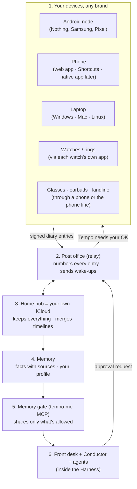
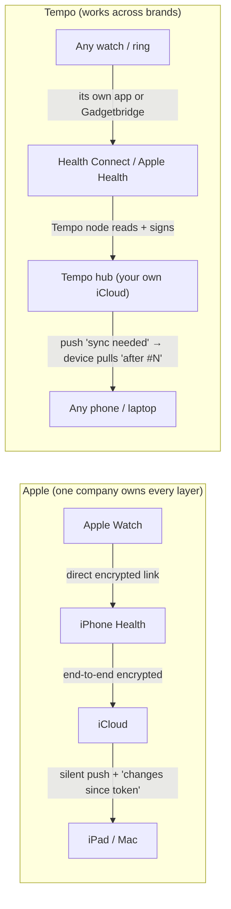
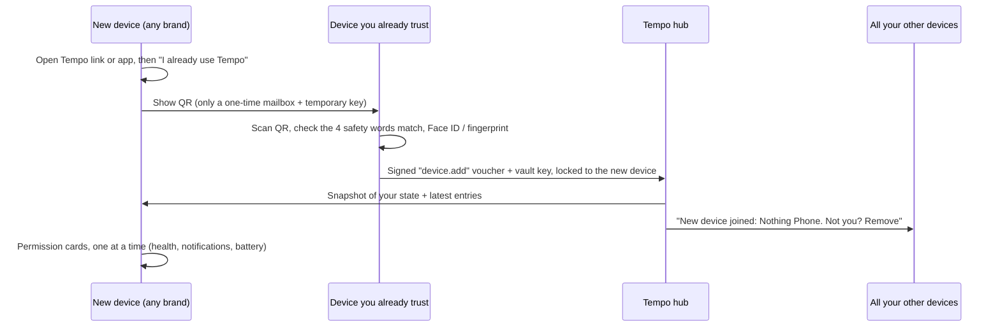

# Tempo: how it works, and how to make it automatic across brands

> **What this is:** a plain-language explainer for the team. It covers what each piece of Tempo does, how Apple makes its ecosystem feel automatic, how Tempo can do the same across **different brands**, how automatic each device can really be, and whether anyone has built this already.
>
> **How it was made:**
> - 3 research agents (Apple's mechanisms, per-platform automation limits, cross-brand identity), each followed by an adversarial fact-checker. A 4-category market sweep followed (§6).
> - Compiled Sat 24 Oct 2026, ~18:30 BST.
>
> **Marking:**
> - ✅ = confirmed by a fact-checker (primary source)
> - ☑️ = sourced by a researcher, not re-checked
> - ⚠️ = unverified, so test it first
>
> **Companions:**
> - `Tempo-Sync-Methods.md`: the detailed sync design, owned by the sync session.
> - `Tempo-Voice-Interface-and-Direction-Review.md`: voice, interface, languages, direction.
> - Corrections this research implies for the sync design are in §7 and in the shared notes.

---

## 0. TL;DR

1. **Apple's "it just works" is five things one company owns** ✅:
   - one account on every device
   - a keychain that syncs secret keys
   - a server that tells each device "what changed since you last asked" (CloudKit)
   - a push service that can wake devices silently (APNs)
   - private radio links that recognise only your own devices
2. **Apple Watch health data doesn't go through iCloud** ✅.
   - The Watch and the iPhone each keep their own Health store and sync directly over their own encrypted link.
   - iCloud then syncs Health, end-to-end encrypted, between your Apple devices.
3. **Tempo copies the *structure*, not the privileges:**

   | Apple | Tempo |
   |---|---|
   | Apple Account | **one Tempo ID** (a passkey per ecosystem) |
   | Adding a device | **one QR scan + approval** |
   | iCloud | **the hub** ("your own iCloud") |
   | APNs | **Web Push / FCM / UnifiedPush** |
   | CloudKit | **a signed event log with a change cursor** |
   | Advanced Data Protection | **device keys + a recovery code**. ADP itself is **not available to new UK users** ✅, which makes this a real UK pitch line |

4. **How automatic it can honestly be:**
   - **Android phones, laptops and the hub: set and forget**, after a one-time setup that switches off three things that silently kill background apps.
   - **iPhone with a native app:** health arrives **about hourly, and only after you unlock** ✅.
   - **iPhone with only the web app:** it syncs **when you open it** and can show alerts ✅.
   - **Approvals always need a tap**, by design.
5. **Watches and rings:** Tempo reads *downstream* of each watch's own app (Apple Health, Health Connect, Gadgetbridge). Nobody but the watch maker can replace the watch-to-phone link ✅.
6. **Has anyone built this? No, not the whole thing** (§6).
   - **The pieces exist:** OpenClaw (device nodes + agents, for developers), Fulcra (an agent-ready "context lake", iPhone + cloud only), Home Assistant (cross-brand sensors, no memory), Open Wearables (cross-brand health).
   - **Big platforms** each stay inside their own brand.
   - **Tempo's open slot:** an open, any-brand, continuous personal timeline that non-technical people can set up, that agents use with consent, including from a landline.

---

## 1. The pieces, and what each one does

| # | Piece | Its job, in one line | Apple's version | Runs on | This weekend |
|---|---|---|---|---|---|
| 1 | **Device helper ("node")** | Reads only what that brand allows, filters on the device (a notification becomes `{operator: GWR, delay: 34}`), and signs each item | The OS's built-in sync | Android app; iPhone web app or Shortcut; laptop tray app | Android node + web app |
| 2 | **Device diary (signed event log)** | An append-only diary per device. Every entry is timestamped (UTC + zone + a hybrid clock for ordering) and signed, so it can't be faked or altered | CloudKit records | Each device | Yes |
| 3 | **Post office (relay)** | Stores and forwards diary entries. Gives every entry a **running number (`hub_seq`)**, so a device just asks "anything after #1842?". Sends wake-up / "needs your OK" pushes | CloudKit + APNs ✅ | A server with a fixed HTTPS address | Yes |
| 4 | **Home hub (archive)** | Keeps every device's diary, merges them into one timeline, and works out current state: preferences, mission status, consent | iCloud storage | A laptop, mini PC, Raspberry Pi or old Android on a charger; later a private cloud | Team laptop |
| 5 | **Memory** | Turns the timeline into **facts with sources** ("commutes Oxford→Paddington on weekdays, from 14 alerts") and a profile. **Forget** deletes the fact and everything derived from it | Siri's on-device personal context | Hub | Lite |
| 6 | **Consent ledger** | Who may do what, and until when. **A "no" always beats a "yes"** unless the yes came *after* the no | Settings → Privacy | Signed events | Yes |
| 7 | **Memory gate (`tempo-me` MCP)** | The only door agents can use. Health, location and full history stay behind it; sponsor-cloud agents get only the few fields a task needs | App permissions | Hub | Stub with fixtures |
| 8 | **Front desk, Conductor, agents, Harness** | Front desk starts a mission; the Conductor spins up short-lived agents with budgets; the Harness checks every action | Siri + Shortcuts, but acting on companies | Server | Teammate |
| 9 | **Voice pop-up** | How you talk to it: QR web page, "call Tempo", Android side button | Siri's UI | Phone browser / phone line | Yes |
| 10 | **Setup Doctor + heartbeat** | Green ticks for each permission on each device; the hub says *"iPhone last synced 9 h ago, open Tempo once"* | iCloud's sync status | Each device + hub | P1 (recommended) |

---

## 2. How Apple makes it automatic, and Tempo's cross-brand version

| Apple feature | How Apple does it | Tempo's cross-brand version | How automatic |
|---|---|---|---|
| **Apple Watch → iPhone** | Each device keeps its own Health store, and HealthKit syncs them over an encrypted Bluetooth / Wi-Fi link ✅ | Each watch's own app (Samsung Health, Garmin Connect, Google Health) or **Gadgetbridge** writes to Health Connect or Apple Health; Tempo reads from there. Tempo can't replace the watch-to-phone link | After one-time setup |
| **Health in iCloud** | End-to-end encrypted by default, even in the UK ✅ | Signed events go through the hub; **raw data never leaves the device** (only extracted fields, facts and summaries) | After setup. The iPhone web app syncs only when opened ✅ |
| **One Apple Account** | Sign in, and the device joins | **One Tempo ID**: scan a QR on the new device, approve with Face ID or fingerprint on a device you already trust, and **every device gets a "New device joined. Not you? Remove" alert** | Once per device, ~60 s |
| **iCloud Keychain** | A trusted device signs a voucher for a new one; escrow hardware allows 10 PIN tries, then destroys the record ✅ | Device keys. The vault key is wrapped per device, per passkey (WebAuthn PRF) and per printed recovery code. **No PIN-only recovery**, because we have no tamper-proof hardware | After setup |
| **CloudKit "what changed"** | A subscription triggers a silent push, then the device fetches changes since its token; three-way merge on conflict ✅ | **`hub_seq` cursor**: the push only says "sync needed", the device asks "after #N". A new device starts from a **signed snapshot** plus the latest entries | After setup |
| **APNs silent push** | Low priority, about 2–3 an hour, needs the paid developer program ✅ | Android native: FCM (new AndroidConfigV2 preview) or UnifiedPush ✅. **No browser allows silent push** ✅ | Native apps only |
| **APNs alert push** | "Tempo needs your OK" | **Web Push** (self-generated keys, no developer account) on Android, desktop and iPhone **home-screen web apps**; every push must be visible ✅ | After allowing notifications |
| **Background work while charging** | The OS picks the moment | The **always-on hub** does the heavy work; Android jobs run "when charging + on Wi-Fi" | Automatic |
| **Conflict resolution** | One version wins; three-way merge ✅ | Events never change. State = newest by hybrid clock. **Money and approval edits carry a "base" hash, so clashes go to the user**; consent is "deny wins" | Fully automatic |
| **Handoff** | Bluetooth adverts tied to your account | "Continue here?" on the other device, via push | Needs a tap |
| **Universal Clipboard** | Private radio link | "Share to Tempo" from any app. Phones block background clipboard reading, for good reason | Each time |
| **Instant Hotspot** | Same account + OS privilege | **Impossible** for a third-party app ✅ | — |
| **Find My** | Apple's offline network | A "last seen" heartbeat, **Remove device**, and a link to Find My / Find Hub. **Tempo is never a location tracker** | Partly |
| **New device restores everything** | Sign in, then restore from iCloud | Snapshot + latest entries + rebuild indexes. **But OS permissions must be granted again** on the new device ✅ | After one scan |
| **Advanced Data Protection** | Not available to new UK users since Feb 2025; still the case in Oct 2026 ✅ | Per-device keys + recovery code + helper shares. A **blind hub** (stores only ciphertext) is roadmap; this weekend is TLS | After setup |

**Pitch slide:**
> *Apple's magic = one account + keychain + a sequencer + silent push + private radios, for one brand. Tempo = one ID + device keys + a hub sequencer + open push + open radios, for every brand. The honest cost is one QR scan per device, one tap per approval, and an iPhone that syncs when you open it.*

---

## 3. How automatic can each device really be? (the honest chart)

**Legend:**
- 🟢 fully automatic
- 🔵 automatic after a one-time setup
- 🟡 partly
- 🟠 needs you each time
- ⛔ impossible for a third-party app

### Phones

| Device | What | Level | How, and the catch |
|---|---|---|---|
| **Android** (Nothing / Samsung / Pixel), Tempo app | Health Connect (every brand that writes to it) | 🔵 ✅ | An hourly background job asks for changes. Health Connect **never notifies apps**, so you must poll. Needs the *background read* permission; history goes back only 30 days before the first grant unless the history permission is granted. Change tokens expire after 30 days unused ✅ |
| | Other apps' notifications → signals | 🔵 ✅ | Notification access toggle. Android 15 hides one-time codes ✅ |
| | Staying alive for months | 🔵 **only if onboarding fixes it** ✅ | Android moves unused apps to a "restricted" bucket after **8 days** (jobs once a day) and **hibernates** them after a few months (permissions reset, pushes stop). **Fixes:** a Tempo **home-screen widget** exempts the app from the restricted bucket; turn off "Pause app activity if unused"; set battery to Unrestricted ✅ |
| | Samsung / Nothing battery killers | 🟡 ✅ | Samsung sleeps apps not opened for **3 days** and may re-add them after updates. Add Tempo to "Never sleeping apps" and re-check after updates ✅ |
| **iPhone, native app** (roadmap; free sideload for the demo) | HealthKit incl. Apple Watch data | 🔵 ✅ | HealthKit wakes the app at most hourly for types like steps. **Health is unreadable from ~10 min after lock**, so overnight data arrives after the first morning unlock. Stops if the app is force-quit or misses 3 wake-ups ✅ |
| | Server-initiated sync | 🟡 ✅ | Silent push needs the paid program ($99/yr); not guaranteed; 2–3 an hour. **Free Apple accounts get HealthKit but no push**, and builds expire after 7 days ✅ |
| **iPhone, Shortcuts only** (no app) | Health summary → hub | 🔵 ✅ | An automation set to "Run Immediately" (allowed for all triggers since iOS 17). **There's no "phone unlocked" trigger**, so use "App opened" (e.g. WhatsApp) as a proxy; time-of-day runs can't read Health while locked ✅. Must be built by hand on each iPhone (≈15 taps) ✅ |
| | SMS / email → signal | 🔵 ✅ | Message / Email trigger; always shows a "ran" notification ✅ |
| **iPhone, home-screen web app** | Background data collection | ⛔ ✅ | Nothing runs in the background. It syncs when opened, and alerts must be visible ✅ |
| | Alerts ("Tempo needs your OK") | 🔵 ✅ | Web Push after Add to Home Screen + allowing notifications from a tap ✅ |

### Watches and rings

| Device | Path into Tempo | Level | Catch |
|---|---|---|---|
| **Apple Watch** | Watch → iPhone Health (Apple, automatic) → then the iPhone rules above | 🟢 then iPhone rules | An Apple Watch can't be used with an Android phone at all ✅ |
| **Galaxy Watch** | Samsung Health → Health Connect → Tempo | 🔵 ✅ | Lagged: syncs when the watch reconnects or Samsung Health is opened; continuous heart rate is delayed on purpose ✅. Android phones only |
| **Pixel Watch / Fitbit** | **Google Health app** (renamed from Fitbit, 19 May 2026) → Health Connect, or → Apple Health on iPhone (v5.05+) | 🔵 ✅ | The **Fitbit Web API returns "410 Gone" from 2 Nov 2026** ✅. Don't build on it |
| **Garmin** | Garmin Connect → Health Connect / Apple Health; or the hub polls Garmin's free **Personal** key | 🔵 ☑️ ✅ | One-way, and only some metrics (no Body Battery etc.) ☑️. The Personal key is **pull-only** ✅ |
| **CMF / Nothing watch** | **Gadgetbridge** (cloud-free) → Health Connect; or the Nothing X app → Health Connect (⚠️ unconfirmed) | 🔵 ✅ | Gadgetbridge is **not automatic by default**: turn on "Auto fetch activity data" (runs on screen unlock) and "Sync after device sync", and stop the vendor app syncing first. CMF Watch Pro needs an auth key, Pro 2 doesn't, Watch 3 Pro is experimental. **The Nothing X app has replaced the CMF Watch app** ✅ |
| **Oura** | Oura app → Health Connect / Apple Health | 🔵 ☑️ | **Oura's API terms ban sending its data to AI models** (except via Oura's own MCP), so read it only through the OS health hub ✅ |
| **WHOOP** | Webhooks to the hub, then fetch by ID | 🔵 ✅ | Thin, sometimes duplicated events, so reconcile periodically ✅ |
| **Withings** | App / API / OS hubs | 🟠 ✅ | **Paid (Withings+) for accounts created from 13 Oct 2026**; older accounts stay free ✅ |
| **Wear OS** (own Tempo watch app) | Passive health data, batched | 🔵 ☑️ | Its phone link (Data Layer) needs Google Play services, so let the watch app post to the hub directly ☑️ |

### Laptops, hub, glasses, landline

| Device | What | Level | Catch |
|---|---|---|---|
| **Windows / Mac** | Tempo helper starts at login | 🔵 ☑️ | Nothing runs while the laptop sleeps ☑️ |
| **Linux / Raspberry Pi / mini PC hub** | Hub, relay, pollers, webhooks | 🟢 ☑️ | Needs power and network. **A sleeping laptop silently breaks "automatic"**, so use an always-on box or an old Android on a charger |
| **Meta glasses** | Photos → phone gallery (Meta AI app auto-import) | 🔵 ☑️ | Into Tempo automatically only with an Android sideload build; Play builds and iPhone need the photo picker each time ☑️ |
| | "Hey Meta, call Tempo" | 🔵 ☑️ | Glasses buttons go to Meta AI. Meta's own "connectors" are a developer preview ✅ |
| **Earbuds** | Mic and speaker for the phone | 🔵 | Buttons go to the vendor's assistant ✅ |
| **Landline** | A virtual node (calls and SMS, signed by the gateway) | 🟠 | Each call; a helper registers the number once |
| **Approvals** (any device) | "Claim £14.20?" | 🟠 **by design** | Face ID or fingerprint every time ✅ |

**Headline for judges:**
> *"Android and laptops: set and forget. iPhone: about hourly, after unlock. iPhone web app: alerts, plus sync when opened. Approvals: always you."*

Being this honest scores better than claiming iCloud-like magic.

---

## 4. One account across brands: adding a device in about 60 seconds

**The Tempo ID** = person + a list of device keys + passkeys.
- A random **vault key** is locked separately for each device, each passkey and a printed recovery code.
- **Passkeys don't cross ecosystems:**
  - iCloud passkeys never reach Android.
  - Google Password Manager passkeys reach iPhone only if the user sets Chrome as the AutoFill provider.
  - The standard for moving passkeys between brands (CXP) is still a 2024 draft ✅.
- So **each ecosystem gets its own passkey**, and the first device of a new brand joins by **QR + approval**.

| Flow | Time | Taps | Notes |
|---|---|---|---|
| Second device, **same ecosystem** (iPad after iPhone; tablet after Android) | 30–60 s | 2–3 (+ Add to Home Screen and notifications on iOS) | The synced passkey + Face ID / fingerprint; no QR ☑️ |
| **iPhone user adds an Android** (Nothing / Samsung / Pixel) | 60–90 s | ~12–15 | Install from Play → QR → approve on iPhone → permission cards ☑️ |
| **Android user adds an iPhone** | ~90 s | ~10–12 | Add to Home Screen; 3-word code fallback. Apple Health comes later (≈15 taps) ☑️ |
| **Laptop** | 30–45 s | ~5 | The laptop shows the QR; the phone scans and approves ☑️ |
| **Watch** | 1–2 min | 4–8 | A card deep-links to the vendor's "share with Health Connect / Apple Health" toggle; Tempo confirms with a 24-hour read ☑️ |
| **Glasses / earbuds** | ~1 min | ~5 | Add the "Tempo" contact; connect calling in the Meta AI app ☑️ |
| **Mum, with a helper** | a few min | — | The helper sits with her (permission taps can't be done remotely) and holds a recovery share; landline users get a virtual node + safe word ☑️ |
| **Lost everything** | — | — | Recovery card words, or 2 helpers approve. Every old device is removed, then a full restore ☑️ |

**Safety rules** (anti-stalking, anti-phishing):
- Joining is **never silent**: every device is alerted ✅.
- The QR **never** carries the vault key ✅.
- **Shown on every device:** the signed device list and 4 safety words.
- **No PIN-only recovery** ✅.
- **The threat:** QR-phishing of linked devices (MITRE ATT&CK T1676) ✅.

---

## 5. Keeping it automatic: what silently breaks it, and how we catch it

| What breaks it | Where | Fix |
|---|---|---|
| App unused for 8 days → jobs once a day; a few months → hibernation | Android ✅ | Home-screen widget; "Pause app activity if unused" OFF; battery Unrestricted |
| "Sleeping apps" after 3 days, re-added after updates | Samsung (similar on Nothing) ✅ | "Never sleeping apps"; re-check after OS updates |
| Play's one-tap "ignore battery optimisation" dialog **isn't allowed for apps like Tempo** | Android (Play) ✅ | Send users to the battery settings list instead |
| User swipes the app away (force-quit) | iPhone ✅ | Tell users "don't swipe Tempo away" |
| Phone locked → Health unreadable | iPhone ✅ | Read on unlock or app-open; the morning brief says *"last night's sleep arrives after you unlock"* |
| Free Apple developer build expires after 7 days | iPhone demo ✅ | Re-sign weekly, or pay for the program |
| The vendor app syncs the watch first | Gadgetbridge ✅ | Disable the vendor app |
| Health Connect change token unused for 30 days | Android ✅ | Re-read 30 days and dedupe by record ID |
| Laptop asleep | Hub ☑️ | An always-on hub (Pi, mini PC, old phone on a charger) |
| OS update resets settings | Samsung, Nothing ☑️ | Re-run the Setup Doctor after updates |

**Setup Doctor:** a green-tick checklist on each device. Re-run it after every OS update.
- **Android:** Health Connect read + background (+ history), notification access, battery Unrestricted, hibernation off, Samsung "Never sleeping".
- **iPhone:** Health permissions, Background App Refresh on, "don't swipe away".

**Heartbeat:** each device sends a signed `node.heartbeat` with its last successful read per source. The hub shows staleness, e.g. *"iPhone last synced 9 h ago, open Tempo once."* This is the honest replacement for Apple's invisible sync, and it demos well.

---

## 6. Has anyone built this already?

> **Method:**
> - A 4-category sweep: health/wearable aggregation, cross-device continuity, personal data stores and life-logs, and AI agents with cross-device context.
> - Each category had an adversarial verifier, then a completeness critic looked for misses.
> - Over 120 products were checked, at their status on 24 Oct 2026.

### 6.1 Short answer

**No one has built the whole thing.** As of 24 Oct 2026, no product combines all of:
1. cross-brand device sync
2. a continuous personal timeline the user owns
3. on-demand agents
4. open source
5. access from any phone, including a landline
6. setup a non-technical person can do

**Every piece exists separately, though.** So Tempo should **reuse the pieces and own the combination**, not claim to be the first to sync devices.

### 6.2 The closest things, and what each lacks

| Product | What it already does | What it lacks vs Tempo | How Tempo should use it |
|---|---|---|---|
| **OpenClaw** (MIT, ~393k stars) ✅ | Device "nodes" on iPhone, Apple Watch, any Android, Wear OS, Mac, Windows and Linux; Markdown memory on your disk; agents and skills; 20+ chat channels; a voice-call plugin ✅ | Nodes answer commands rather than feeding a **continuous timeline**; health is only an iPhone "today" summary; developer-grade setup; **poor security record**: CVE-2026-25253 (CVSS 8.8), 135k+ exposed gateways, 341+ malicious skills ✅ | Prior art for capability nodes (cite it); possible interop target; a lesson in what *not* to do on security |
| **Fulcra Context** ☑️ | An iPhone app syncs Apple Health (incl. Garmin, Oura, Whoop, CGMs via HealthKit), location and calendar into a **"context lake" that any AI agent reads over MCP**; free tier, Pro $14.99/mo | **iPhone only**; cloud-hosted; closed service (its MCP server is Apache-2.0); no Android, PC, glasses or landline | The closest commercial version of Tempo's memory layer. Copy its data catalogue and MCP tool shapes; offer a connector |
| **Home Assistant Companion apps** (Apache-2.0) ✅ | Phones, watches and Macs send dozens of sensors (Health Connect since 2025.5, Apple Health in Labs since 2026.9) to a **self-hosted hub**; has an MCP server ✅ | Built for home automation: **no personal memory**, technical setup, landline only via a local analogue adapter ✅ | Reuse patterns and code for the phone-as-sensor node; an alternative hub for technical users |
| **Open Wearables** (MIT, ~2.7k stars, v0.10.0 on 16 Oct 2026) ✅ | **Cross-brand health aggregation**: SDKs for Apple Health, Health Connect and Samsung Health, plus Garmin, Oura, Whoop, Polar, Withings and Google Health clouds; MCP server ✅ | Health only; a developer backend; pre-1.0; cloud providers depend on gated vendor programmes ✅ | **Use it as the health ingestion layer** (roadmap) instead of building one |
| **Gadgetbridge** (AGPL-3.0; 661 models from 91 vendors) ✅ | Cloud-free watch companion → Health Connect | Android only; technical; off by default | The open route for CMF, Amazfit, Xiaomi, Pebble etc. |
| **KDE Connect** (GPL) + `kdeconnect-mcp` ✅ | Phone ↔ PC notifications, SMS and files; a tiny MCP bridge exists | **iOS can't sync notifications** ✅; no memory | Desktop notification/SMS bridge |
| **Omi** (MIT, ~13.8k stars) ✅ | Conversation and screen memory across phone and Mac, plus its own pendant and glasses; MCP | No health, location or other brands' devices; cloud backend by default ✅ | Capture partner for conversations |
| **Google Health app** (ex-Fitbit, May 2026) ✅ | Reads Health Connect on Android and Apple Health on iPhone, and writes back to Apple Health (v5.05); Gemini coach at $9.99/mo | Closed; Google cloud; health only | A source and sink: Fitbit/Pixel data reaches the OS health hubs without Google's cloud API |
| **Health Sync, Health Auto Export, Exist.io** ✅ ☑️ | Cheap consumer bridges and timelines across brands | Closed or paid; no agents | Proof of demand |

### 6.3 The big platforms: each stays inside its own walls

| Platform (2026) | Personal context across devices | The wall |
|---|---|---|
| **Apple Siri AI** (iOS 27, beta) ✅ | Your messages, mail, photos, apps | Apple devices only; English first |
| **Google Gemini Personal Intelligence + Spark ("Task")** ✅ | Gmail, Photos, Calendar; proactive tasks | Google account; US-first; Spark not in the UK |
| **Samsung Personal Data Engine** ✅ ☑️ | On-device knowledge graph (built on Oxford's RDFox) | Galaxy only |
| **Googlebook + Android 17 "Continue activity"** ☑️ | Google's answer to Apple Continuity (Sep 2026) | Google devices |
| **Meta Muse, Claude Duet, ChatGPT Dots / Health** ✅ | Cloud agents acting on your web accounts | US-first, paid; ChatGPT Health not in the UK |
| **Microsoft Phone Link** ✅ | Windows ↔ Android well; iPhone weakly | One direction; Copilot's phone connection retired in 2026 ☑️ |
| **Xiaomi, OPPO, vivo, HONOR, Huawei ↔ Apple bridges** ☑️ | Their phone ↔ your Mac or iPhone | Each only for its own brand |

### 6.4 The graveyard: why "open and user-owned" matters

Closed products in this space keep getting **bought or switched off, stranding users' data**:
- **Limitless/Rewind:** bought by Meta in Dec 2025, and the service ended in the UK ✅.
- **Dot:** shut down Oct 2025 ✅.
- **Humane AI Pin:** devices bricked Feb 2025.
- **Intel Unison:** dead 2025 ☑️.
- **Amazon Alexa Together:** closed 2024 ☑️.
- **Fitbit Web API:** dead 2 Nov 2026 ✅.
- **B2B aggregators are consolidating:** Validic → ChartSpan (Jun 2026) ✅; Spike reportedly → Raintree ⚠️.
- **Paid aggregators** (Terra, ROOK from $399/mo ✅) are for businesses, not people.
- **Apps that scrape or drive other companies' apps get blocked:** Beeper Mini by Apple in 2023; ByteDance's phone assistant by WeChat and Alipay in 2025 ☑️.

### 6.5 What is genuinely unoccupied (Tempo's slot)

1. **A free, open, local-first, *continuous* personal timeline across any brand.** OpenClaw does commands, Fulcra does iPhone + cloud, and Home Assistant does home.
2. **Consent-scoped access for any agent** (MCP), where the user decides what each agent sees.
3. **Setup a non-technical person can do:** a 60-second add-device flow, the Setup Doctor and safety alerts.
4. **People with only a landline**, older people and Welsh speakers.
5. **Using new legal data-access rights as the "API"** ☑️:
   - **EU Data Act:** connected products placed on the EU market after 12 Sep 2026 must make their data accessible to users by design.
   - **UK:** the Data (Use and Access) Act's Smart Data powers, and the CMA's interoperability-request process for Apple and Google.

**Pitch line:**
> *"OpenClaw, Fulcra and Home Assistant each solve a piece for technical users. Tempo is the first open, any-brand personal timeline that ordinary people can set up, that any agent can use with consent, and that works even from a landline."*

### 6.6 Reuse list (don't rebuild)

| Need | Reuse | When |
|---|---|---|
| Health ingestion across brands | Health Connect / HealthKit directly (weekend); **Open Wearables** (roadmap) | Now / later |
| Cloud-free watches | **Gadgetbridge** | Now |
| Phone ↔ PC notifications and SMS | **KDE Connect** protocol | Roadmap |
| Phone-as-sensor patterns | **Home Assistant Companion** code (Apache-2.0) | Roadmap |
| Memory exposed to agents | Our `tempo-me` MCP; copy **Fulcra's** tool shapes | Now (stub) |
| Export format | **Data Transfer Initiative** schemas ☑️ | Roadmap |
| Push without Google | **ntfy / UnifiedPush** | Roadmap |
| Encrypted multi-device sync | **Automerge / Keyhive** (Ink & Switch) | Roadmap |

---

## 7. What this changes in the sync design

These are verified corrections for `Tempo-Sync-Methods.md`. The sync session owns that doc; the full list is in the shared notes (`voice-session-automation-findings.md`). The biggest:

1. **Change cursor:** add a hub-assigned **`hub_seq`** cursor and a **signed snapshot** for new devices.
2. **Pairing:** a **`device.add` voucher signed by an existing device**. The QR carries no vault key; there's a PAKE code fallback and safety words.
3. **Push:** **no silent Web Push anywhere**. Web apps sync on open; silent wake-ups are native-only.
4. **HealthKit:** **unreadable while locked**; free Apple accounts have no push.
5. **Health Connect:** **must be polled**; tokens expire after 30 days; **never sum across HealthKit and Health Connect** (pick one source per metric: watch > ring > phone).
6. **Android:** the restricted bucket after 8 days, hibernation, and Samsung's 3-day sleep are **the** risks to "set and forget"; the widget exemption helps.
7. **Vendor clouds:** Fitbit API dead from 2 Nov; Garmin Personal is pull-only; Withings is paid for new accounts; Oura data can't go to AI; Gadgetbridge auto-fetch is off by default.

---

## 8. What to build this weekend (automation slice)

This adds to `Tempo-Sync-Methods.md` §8 and the voice doc's §5.4 plan; it doesn't replace them.

| Work | Hours | Demo moment |
|---|---|---|
| `hub_seq` cursor + `/snapshot` + `device.add` voucher + "new device joined" alert + safety words | 1–1.5 | **"Add a device in 60 seconds"** with an on-screen stopwatch (TIME theme): scan → approve → timeline rebuilt, safety words match on both screens |
| Signed heartbeat + Setup Doctor screen (Android + web) | 1 | *"iPhone last synced 9 h ago"*: honesty as a feature |
| Android node: hourly Health Connect job + notification signals + home-screen widget | per sync doc | A real watch's data appears on the laptop |
| iPhone: a shared Shortcut ("App opened" → POST health summary) | 0.5 | Apple Watch data on an Android-owner's laptop, cross-brand |

---

## 9. Sources

**Apple**
- HealthKit overview: https://developer.apple.com/documentation/healthkit/about-the-healthkit-framework
- watchOS security: https://support.apple.com/guide/security/system-security-for-watchos-secc7d85209d/web
- iCloud data security: https://support.apple.com/en-us/102651
- Advanced Data Protection in the UK: https://support.apple.com/en-gb/122234
- Health data protection: https://support.apple.com/guide/security/protecting-access-to-users-health-data-sec88be9900f/web
- Keychain syncing: https://support.apple.com/guide/security/secure-keychain-syncing-sec0a319b35f/web
- Keychain escrow: https://support.apple.com/guide/security/escrow-security-for-icloud-keychain-sec3e341e75d/web
- CKSyncEngine: https://developer.apple.com/documentation/cloudkit/cksyncengine-5sie5
- Background pushes: https://developer.apple.com/documentation/usernotifications/pushing-background-updates-to-your-app
- HealthKit background delivery: https://developer.apple.com/documentation/healthkit/hkhealthstore/enablebackgrounddelivery(for:frequency:withcompletion:)
- Supported capabilities (free vs paid): https://developer.apple.com/help/account/reference/supported-capabilities-ios
- Shortcuts personal automations: https://support.apple.com/guide/shortcuts/apdfbdbd7123/ios
- Declarative Web Push: https://webkit.org/blog/16535/meet-declarative-web-push/
- Wi-Fi Aware: https://developer.apple.com/documentation/wifiaware

**Android / Google**
- Health Connect sync: https://developer.android.com/health-and-fitness/health-connect/sync-data
- Health Connect read data: https://developer.android.com/health-and-fitness/health-connect/read-data
- Health Connect aggregate data: https://developer.android.com/health-and-fitness/health-connect/aggregate-data
- App Standby buckets: https://developer.android.com/topic/performance/appstandby
- Power details: https://developer.android.com/topic/performance/power/power-details
- App hibernation: https://developer.android.com/topic/performance/app-hibernation
- Doze and standby: https://developer.android.com/training/monitoring-device-state/doze-standby
- Foreground service timeouts: https://developer.android.com/develop/background-work/services/fgs/timeout
- FCM v2 API: https://firebase.google.com/docs/cloud-messaging/send/v2-api
- Health Connect backup: https://support.google.com/android/answer/15323271
- Restore Credentials: https://developer.android.com/identity/sign-in/restore-credentials
- Companion device manager: https://developer.android.com/reference/android/companion/CompanionDeviceManager
- Periodic Background Sync: https://developer.chrome.com/docs/capabilities/periodic-background-sync
- Web push (subscribing a user): https://web.dev/articles/push-notifications-subscribing-a-user
- Samsung background limits: https://dontkillmyapp.com/samsung
- Samsung Health and Health Connect: https://developer.samsung.com/health/blog/en/accessing-samsung-health-data-through-health-connect

**Wearable vendors**
- Google Health (Fitbit) API: https://developers.google.com/health/about
- Garmin developer program: https://developer.garmin.com/gc-developer-program/overview/
- WHOOP webhooks: https://developer.whoop.com/docs/developing/webhooks/
- Withings+ and Apple Health sync: https://macrumors.com/2026/10/15/withings-plus-apple-health-syncing
- Gadgetbridge: https://gadgetbridge.org/basics/features/sync/ · https://gadgetbridge.org/internals/automations/intents/ · https://gadgetbridge.org/gadgets/wearables/nothing/
- Meta wearables FAQ: https://developers.meta.com/wearables/faq/

**Identity**
- FIDO credential exchange: https://fidoalliance.org/download-credential-exchange-specifications/
- Proximity Exchange Protocol: https://fidoalliance.org/specs/hybrid/proximity-exchange-protocol-v1.0-wd-20260717.html
- Passkeys in GPM on iOS: https://developer.chrome.com/blog/passkeys-gpm-ios
- PRF support survey: https://www.corbado.com/blog/passkeys-prf-webauthn
- Signal linked devices: https://signal.org/blog/a-synchronized-start-for-linked-devices/
- MITRE ATT&CK T1676: https://attack.mitre.org/techniques/T1676
- Matter commissioning best practices: https://developer.amazon.com/en-US/docs/alexa/smarthome/best-practices-commission-matter.html

**Market (§6)**
- OpenClaw: https://github.com/openclaw/openclaw · nodes: https://docs.openclaw.ai/nodes
- ClawHub malicious skills (Koi Security): https://www.koi.ai/blog/clawhavoc-341-malicious-clawedbot-skills-found-by-the-bot-they-were-targeting
- Fulcra: https://www.fulcradynamics.com/ · pricing: https://www.fulcradynamics.com/pricing
- Home Assistant Companion sensors: https://companion.home-assistant.io/docs/core/sensors/
- Open Wearables: https://github.com/the-momentum/open-wearables
- Gadgetbridge: https://gadgetbridge.org/
- KDE Connect: https://kdeconnect.kde.org/ · kdeconnect-mcp: https://github.com/DaBlitzStein/kdeconnect-mcp
- Omi: https://github.com/BasedHardware/omi
- Google Health app syncing with Apple Health: https://www.droid-life.com/2026/08/03/google-health-adds-full-apple-health-sync/
- Health Sync: https://healthsync.app/
- Health Auto Export: https://www.healthyapps.dev
- Exist: https://exist.io/
- Terra: https://tryterra.co
- Android 17 "Continue activity": https://chromeunboxed.com/android-17-adds-new-continue-activity-settings-hub-ahead-of-googlebook-launch/
- Limitless: https://www.limitless.ai/
- Vana: https://www.vana.org
- Supermemory: https://github.com/supermemoryai/supermemory
- Syncthing: https://github.com/syncthing/syncthing

**Continuity**
- Android Continue On: https://developer.android.com/develop/better-together/continue-on
- Windows cross-device resume: https://learn.microsoft.com/en-us/windows/apps/develop/windows-integration/cross-device-resume
- Phone Link requirements: https://support.microsoft.com/en-us/topic/phone-link-requirements-and-setup-cd2a1ee7-75a7-66a6-9d4e-bf22e735f9e3
- Quick Share with AirDrop: https://9to5google.com/2025/11/20/android-quick-share-airdrop-pixel-10/
- Apple proximity pairing (EU): https://developer.apple.com/proximity-pairing/
