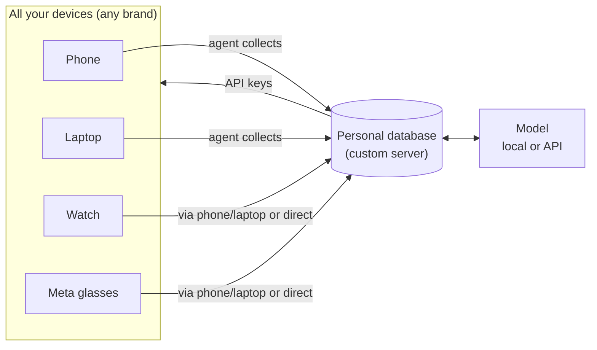
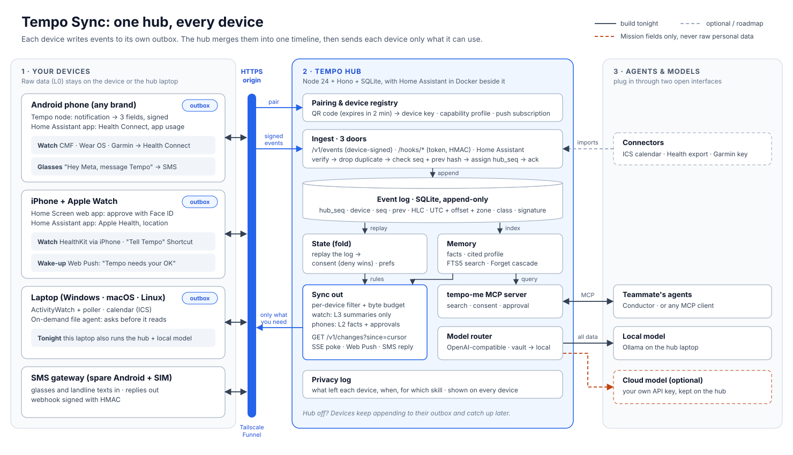

# Tempo Hub: one personal data server for every device you own

> **Status:** architecture v1.1. Sat 24 Oct 2026, evening.
>
> **v1.1:** the second research round changed the build. **The focused, step-by-step setup is in `Tempo-Sync-Setup.md`**, and the diagrams are in `diagrams/`. Main changes:
> - Home Assistant's free apps collect iPhone and Apple Watch data tonight.
> - An SMS gateway connects the glasses.
> - Devices pull with one `hub_seq` cursor.
> - Live updates use server-sent events (SSE), not WebSockets.
> - The API is now under `/v1`.
>
> **What this is:** the architecture we're planning, written down, with an honest answer to *"does this idea actually work?"* for each part.
>
> **Builds on:**
> - `Tempo-Sync-Methods.md`: the fact-checked research (capability matrix, methods, weekend plan). This doc doesn't repeat it; it points to sections like **[Sync §4.1]**.
> - `Tempo-Voice-Interface-and-Direction-Review.md`: voice, languages, competitors. Pointers look like **[Voice §1.2]**.
>
> **Marks:** ✅ = checked against a primary source in those docs · ⚠️ = needs a hands-on test · ❌ = not possible today.

---

## 0. Short answer: does it work?

**Yes. The core idea works and is buildable.** A personal data server that every device feeds, that a model (local or API) can query, and that pushes the right context back to each device is a sound design. Parts of it already exist in other products (§6). What's new is doing it **across brands, open source, with time as the index and consent built in**.

**But four parts don't work the way they're written.** Each one has a fix:

| # | The plan says | Reality | Fix |
|---|---|---|---|
| 1 | Data comes from every device, whatever the brand | No one integrates with 50 brands. Some vendor clouds are closing or ban AI use ✅ | Read the **OS health hubs** (Health Connect, HealthKit) and **importers**, not each brand |
| 2 | Devices connect with custom or other API keys | An API key is one shared secret: it leaks, it can't tell devices apart, and you can't revoke one phone | Each device gets **its own key pair**, paired once by QR. API keys are only for vendor and model services, and they stay on the server |
| 3 | Agents on phones and laptops grab as much as they can | **Phones:** the OS sandbox stops it, and Play bans Accessibility-based autonomous agents ✅. **Laptops:** possible, but collecting everything is a legal and security liability | **Collectors** gather a small, declared set of data. **Agents fetch more on demand, with permission** |
| 4 | Watches and glasses can connect directly | Most watches only talk Bluetooth to their own companion app. Meta's glasses toolkit can't publish apps yet ✅ | **Wearables are peripherals of a host** (phone or laptop). Direct connection is a roadmap extra for a few devices |

**One more correction:** "run your local model" works on the **hub** (a laptop or mini PC), not on a cheap phone. The smallest good model is ~2.6 GB ✅ [Sync §6.4].

**Overall:** feasible as a product, and **one vertical slice is feasible this weekend** [Sync §8]. The biggest risk isn't technology. It's trying to build all of it by Sunday 12:00.

---

## 1. The idea as planned



1. **One database per user**, fed by every device, whatever the brand.
2. **The database is connected to a model**, either local or through an API.
3. **The database connects back to every device** through custom or other API keys.
4. **On phones and laptops, agents collect** as much information as they can.
5. **Watches and glasses connect** through a phone or laptop, or directly. A **custom server** syncs everything across devices and holds the full context, so personalisation is easy. The user owns the database and picks local models or market models via API keys.

---

## 2. Point by point

### 2.1 "One database fed by every device, irrespective of brand"
**Verdict: works, if brand-independence comes from the OS layer.**

- **Android (any brand: Nothing, Samsung, Pixel, Xiaomi…):** one **Health Connect** reader covers Samsung, Pixel/Fitbit, Garmin, Zepp, Oura, Polar and Gadgetbridge ✅ [Sync §4.1]. The **notification listener** works on every Android ✅.
- **iPhone and Apple Watch:** the hardest case.
  - A native **HealthKit** app (a free Apple account can sideload it for a demo ✅).
  - Or the Health **export.zip**, Shortcuts forwarders, and the Bluetooth car-kit bridge 🧪 [Sync §3].
- **Cheap or de-Googled watches (e.g. CMF):** **Gadgetbridge → Health Connect** ✅.
- **Laptops:** ActivityWatch (time per app), ICS/CalDAV calendars, Mac Messages `chat.db`, Linux D-Bus notifications [Sync §4.2].
- **Everything with no API:** importers (Google Takeout, WhatsApp export) and the **Data Rights Inbox** (a UK GDPR subject access request; the user sends it) [Sync §4.8].

**What you can't get, whatever you build** ✅ [Sync §3]:
- other apps' notifications from an iOS *app*
- iOS Screen Time data
- the Google Photos library by API
- background sync from an iPhone web app

**Don't build per-brand cloud integrations as the core.** The Fitbit Web API shuts down 30 Oct–2 Nov 2026. Oura's terms ban feeding its API data to AI models. Withings now charges new accounts to export ✅. Read those through Health Connect / HealthKit instead.

### 2.2 "The database is connected to a model (API or local)"
**Verdict: works. Put two layers between the database and the model.**

1. **A retrieval layer.** The model never sees the whole database. It asks a question and gets a small **Context Capsule**: the events relevant to the question, each with a citation [Sync §4.7].
2. **A model router.** One OpenAI-compatible interface, with any backend behind it: Ollama, llama.cpp, Jan, LM Studio, or a cloud API with the user's own key ✅ [Sync §4.7].

The router has one hard rule: **raw personal data (the "Vault" class) only goes to a model running on the user's own hardware.** Cloud API models only see minimal "Mission" fields that the user has consented to [Sync §2.3]. Without this rule, "bring your own API key" quietly ships someone's health data to a third party.

### 2.3 "Connected to all devices with custom API keys or any API keys"
**Verdict: right goal, wrong tool. Use device keys for devices; API keys only for services.**

| | API key per user | **Key pair per device** (recommended) |
|---|---|---|
| Phone stolen | Attacker has full access until you rotate the key everywhere | Remove that one device; the others keep working |
| Which device sent this? | Unknown | Every event is **signed** by its device |
| Key stored on a phone | A plain secret that can be extracted | **Non-extractable**, in the Android Keystore or WebCrypto ✅ |
| Approvals ("pay £14.20?") | Can't prove the user approved | **Passkey / Face ID** signs the exact transaction ✅ |
| New device joins | Silent | **Every device is alerted** (an anti-stalking rule) |

**Where API keys still belong** (stored encrypted **on the hub only**, never on a phone or in a web page):
- **model providers:** the user brings their own key, or uses none and runs local
- **vendor clouds with free personal keys:** Garmin Personal ✅, Polar, WHOOP [Sync §4.1]
- **sponsor services:** ElevenLabs etc., each behind an adapter with an open fallback [Sync §6.5]

### 2.4 "Agents on laptop and phone collect as much information as possible"
**Verdict: half works. Flip it to "collect little by default, fetch more when needed".**

- **On phones, an agent can't roam.**
  - iOS apps are sandboxed.
  - On Android, Google Play bans using the Accessibility service for autonomous agents ✅, and bans deriving SMS data by "alternative methods" ✅ [Sync §4.2].
  - What *does* work is a **collector**: a small, deterministic app (notification listener, Health Connect reader) with a declared allow-list.
- **On laptops, an agent technically *can* read files, mail and history** (with OS permissions such as macOS Full Disk Access). It still shouldn't hoard:
  - **Legal:** UK GDPR data minimisation, and health data is special category (Art 9) [Sync §6.6].
  - **Security:** one database holding a whole life is a honeypot.
  - **Prompt injection:** everything an agent reads is untrusted text. A poisoned email shouldn't become a "fact" about you [Sync §6.6].
  - **Cost:** embedding and storing everything costs money and battery, for data nobody asks about.

**The better design:**

| | Collectors (always on) | Retrieval agents (on demand) |
|---|---|---|
| What | Small apps with a fixed list of signals (`signals.yaml`) | An agent that searches when a question needs it |
| Example | "Rail delay notifications → `{operator, service, delay_min}`" | "Find my last energy bill" → the laptop agent searches `~/Documents`, *asks first*, and stores only the extracted fields |
| Where | Phone, laptop, watch-via-phone | Laptop (full), phone (only through the app's own permissions) |
| Raw data | Stays on the device; only extracted fields leave (L0 → L1) | Same, and every fetch is written to the privacy log |

This also answers the judges' obvious question: *"So it reads everything about me?"* No. **It reads only what a skill declared, and it asks before reading more.**

### 2.5 "Watches and glasses connect through a phone or laptop, or directly"
**Verdict: "through a host" works today. "Directly" mostly doesn't.**

| Device | Through a host (phone / laptop) | Directly to the server |
|---|---|---|
| **Apple Watch** | ✅ data reaches HealthKit on the iPhone | Only with a native watchOS app (Apple developer account, $99/yr to ship) |
| **Wear OS / Galaxy Watch** | ✅ via Health Connect | Possible with a Wear OS app on the watch (roadmap) |
| **Garmin** | ✅ via Health Connect (one-way, opt-in) or the free Garmin Personal key ✅ | Through Garmin's cloud, not the watch itself |
| **CMF / cheap watches** | ✅ via Gadgetbridge → Health Connect (CMF Watch Pro 2 needs no auth key ✅) | ❌ Bluetooth to a companion app only |
| **Meta Ray-Ban glasses** | ✅ "Hey Meta, **message Tempo**" → SMS → gateway phone → hub (Android-paired) ✅. Also a **Bluetooth headset** mic (8 kHz mono) ✅ | ❌ The Device Access Toolkit is invite-only and can't publish apps yet ✅ |
| **Earbuds** | ✅ as a Bluetooth headset | ❌ |

**Don't promise that earbud or glasses buttons launch Tempo.** The voice review refuted this ✅ [Voice §1.2]: Bluetooth voice buttons open Google, Gemini or Bixby, not the default assistant. (Sync §4.3 row 2 is more optimistic; go with the voice review.)

**The rule:** a wearable is a **peripheral of a host node**. The host signs, filters and encrypts. There are no keys on £15 hardware.

### 2.6 "A custom server that syncs everything and holds all the context"
**Verdict: works. The key change is to sync *meaning*, not copies.**

Copying everything to every device fails: a watch can't hold a life log, and every extra copy is another place to leak it from. Instead:

- **The hub keeps the full archive.** Each device keeps what it captured.
- **Each device gets what it can use**, within a byte budget [Sync §2.2]:

| Level | What | Goes to |
|---|---|---|
| **L0 raw** | full notification text, audio, raw health samples | **stays on the device that captured it** |
| **L1 fields** | `{operator:"GWR", service:"08:12", delay_min:34}` | the hub, with consent |
| **L2 facts** | "commutes Oxford → Paddington, Mon–Fri" | the user's own devices and hub |
| **L3 summaries** | morning brief, "Tempo needs your OK" | everything, including the watch (~5 KB/day) and glasses (spoken) |

---

## 3. The corrected architecture



How each device gets in and out tonight: [diagrams/tempo-device-map.svg](diagrams/tempo-device-map.svg). The sync protocol, step by step: [diagrams/tempo-sync-protocol.svg](diagrams/tempo-sync-protocol.svg).

**Who does what** (no device has to do everything) [Sync §3]:
- **Android listens** (notifications, health).
- **The iPhone approves** (Face ID on a passkey).
- **The laptop retrieves** on demand, and can be the hub.
- **The hub thinks and keeps the archive.**
- **Wearables are ears, mic and a tiny screen.**
- **The landline works for people with no smartphone.**

---

## 4. The custom server ("Tempo Hub") in detail

### 4.1 Where it runs

| Option | Who it's for | Weekend? |
|---|---|---|
| **The user's laptop or a mini PC / Mac mini at home** | Most private; runs the local model | ✅ the team laptop is the hub |
| **Raspberry Pi "Tempo Home"** | Always on, cheap; can also be the iPhone Bluetooth bridge 🧪 | Roadmap |
| **A self-hosted VPS** (e.g. Vultr with MLH credits) | Gives a stable HTTPS address; the operator could read data unless payloads are encrypted | ✅ as the origin / relay |
| **An attested confidential cloud** | People with no laptop; the operator can't read data | Roadmap [Sync §6.4 tier D] |

**Must-have from hour 1:** one **stable HTTPS origin** (Tailscale Funnel, a VPS + Caddy, or a *named* Cloudflare tunnel). Passkeys, Home Screen installs and push subscriptions are all tied to it ✅ [Sync §4.5].

**If the hub is off,** nothing is lost: devices keep appending to their local log and catch up when it's back. That's the main advantage of an append-only log over a shared database.

### 4.2 Components

| Component | Job | Weekend |
|---|---|---|
| **Pairing + device registry** | QR code (expires in 2 min) → device public key, capabilities, push subscription. Alerts every device when a new one joins | ✅ |
| **Ingest** | Checks the signature, drops duplicates (`id` = hash of the body), stores the event | ✅ |
| **Event log** | SQLite. Per-device `seq`; **Hybrid Logical Clock** for order across devices; UTC + offset + IANA zone on every event | ✅ |
| **State fold** | Preferences, consents, mission status = a replay of the log (last writer wins by HLC; consent: causal deny-wins) | ✅ |
| **Memory** | events → deterministic facts → a cited "What Tempo knows about me" card. Search = time filter + SQLite full-text search (FTS5); vectors later | ✅ (FTS5) |
| **Consent + privacy log + Forget** | Who may read what; what left each device; Forget removes an item everywhere, including derived facts and the agents' caches | ✅ |
| **Sync out** | Sends L2/L3 to each device within its budget; Web Push wake-ups ("Tempo needs your OK") | ✅ |
| **Model router** | One OpenAI-compatible endpoint; routes by data class | ✅ (local only is fine) |
| **`tempo-me` MCP server** | The single door for agents (tools in §4.6) | ✅ (stub in hour 1) |
| **Connectors** | Vendor keys, ICS URLs, export importers | Pick one |

### 4.3 How a device describes itself

Every node registers a **capability profile**. The hub uses it to decide what to collect from the device and what to send it.

```json
{
  "device_id": "nothing-phone",
  "kind": "phone",
  "os": "android-15",
  "pubkey": "<P-256 public key>",
  "senses": ["notifications", "health_connect", "usage_stats"],
  "acts": ["notify", "approve", "speak"],
  "peripherals": ["cmf-watch-pro-2", "meta-rayban"],
  "compute": "filter+search",
  "sync_budget": { "bytes_per_day": 1000000, "levels": ["L2", "L3"] },
  "push": { "type": "webpush", "endpoint": "<subscription URL>" }
}
```

A watch, by contrast, might be `"levels": ["L3"], "bytes_per_day": 5000` and never receive raw facts.

### 4.4 Event format
Use **envelope v1** from [Sync §6.3] unchanged. It's shared by the hub, the device nodes and the teammate's agents, so **freeze it first**. In short:
- `body` = the raw JSON bytes, `sig` = the device's signature over exactly those bytes.
- `class` = `vault` or `mission` (this drives the model router's rule).
- `trust_level` marks text from outside (a notification, an email) as untrusted, so it can't act as an instruction.
- `deps` on consent events makes "deny wins" work even when two devices were offline.

### 4.5 Model router config (example)

```yaml
models:
  - id: local
    base_url: http://127.0.0.1:11434/v1      # Ollama on the hub
    model: gemma-4-e4b                        # whatever tag your runtime uses
    allowed_classes: [vault, mission]
  - id: cloud
    base_url: https://<provider>/v1
    api_key_ref: secret://cloud_key           # encrypted on the hub, never sent to devices
    allowed_classes: [mission]                # never vault
routing:
  default: local
  fallback: cloud                             # only for requests with no vault data
```

The user switches models by editing one line. That is the "no lock-in" claim made concrete. Put authentication on any model endpoint reachable over the LAN ✅ [Sync §4.7].

### 4.6 What agents can call (MCP tools)
Use the contract in [Sync §6.7]:
- `get_timeline`
- `search_memory`
- `explain_source`
- `get_profile`
- `check_consent`
- `request_approval`
- `append_event`
- `request_forget`

Agents **never delete directly**: they ask the user. Otherwise one poisoned notification could wipe someone's memory.

**Laptop retrieval agent** (the safe version of point 4): add one tool, `request_fetch(source, query, reason)`.
1. The hub asks the user on their phone: "Search Documents for your energy bill?"
2. If approved, the laptop node runs the search locally.
3. Only the extracted fields come back, as a new event, and the fetch appears in the privacy log.

### 4.7 HTTP API (device side)

Superseded by the `/v1` protocol in `Tempo-Sync-Setup.md` §4. In short:

| Method | Path | Purpose |
|---|---|---|
| `POST` | `/v1/pair/start` | One-time QR token (expires in 2 min, rate-limited); alerts every existing device |
| `POST` | `/v1/devices/register` | Device sends its public key, capability profile and pairing token |
| `GET` | `/v1/sync/status` | `hub_epoch`, what the hub already has from each device, server time |
| `POST` | `/v1/events` | A batch of signed envelopes (idempotent; `409` on a sequence gap) |
| `GET` | `/v1/changes?since=<hub_seq>` | Pull what this device is allowed to see, within its budget, using **one hub cursor** |
| `GET` | `/v1/live` (SSE) | A "something changed" poke while an app is open; the app then pulls |
| `POST` | `/v1/approvals/:id` | Signed passkey approval or denial |
| `POST` | `/hooks/{sms,health,note}` | Webhooks from borrowed collectors, checked at the door, then signed by the hub |
| `POST` | `/v1/devices/:id/remove` | Revoke a lost device (the hub rejects its key from then on) |
| — | `/mcp` | The `tempo-me` MCP server for agents |

### 4.8 Stack and layout
Matches the weekend plan [Sync §8]: **Node/TypeScript + better-sqlite3**, the MCP TypeScript SDK, Ollama on the hub, Web Push with self-generated VAPID keys (no Apple or Firebase account needed ✅).

```
tempo-hub/
  schema.ts          envelope v1 + capability profile (shared with nodes and the teammate)
  src/
    pair.ts          QR pairing, device registry, new-device alerts
    ingest.ts        signature check, idempotent insert
    log.ts           events table, per-device seq, HLC with drift guard
    fold.ts          state = replay of the log; causal deny-wins
    memory/          facts, cited profile, FTS5 search, Forget cascade
    sync.ts          per-device pull with L-levels and byte budgets
    push.ts          Web Push (VAPID)
    models.ts        OpenAI-compatible router with class rules
    mcp.ts           tempo-me MCP server
    connectors/      ics.ts, health-export.ts, garmin.ts ...
nodes/
  android/           notification listener, Health Connect, Keystore signing
  pwa/               any phone's browser: pairing, approvals, timeline, Forget
  desktop/           ActivityWatch bridge, on-demand file agent
```

### 4.9 Two flows, end to end

**A. A watch feeds the morning brief**
1. The CMF watch syncs sleep to Gadgetbridge, which writes it to Health Connect.
2. The Android node reads last night's summary and sends one signed `health.sleep_summary` event.
3. The hub stores it and updates the fact "slept 5 h 10 m".
4. At 07:00 the local model writes a two-line brief from cited facts.
5. The hub sends it as L3 to the phone, the laptop and the watch (a few hundred bytes).

**B. A train delay becomes a claim** (the demo path [Sync §8.1])
1. A "GWR 08:12 delayed 34 min" notification arrives on the Android phone.
2. Only `{GWR, 08:12, +34}` leaves the phone, and the privacy log shows it.
3. The hub alerts the teammate's agent through a webhook.
4. The agent calls `check_consent`, then `request_approval`.
5. The iPhone gets a Web Push: "Tempo needs your OK: claim £14.20?". Face ID signs the transaction.

---

## 5. Where it can break

| Risk | Why it matters | Mitigation |
|---|---|---|
| **Honeypot** | A full life log in one place is valuable to attackers | Raw data stays on devices; the hub holds L1+; encryption roadmap [Sync §4.6] |
| **Stalking / coercive control** | A partner silently pairs your phone to their hub | No silent pairing; every new device alerts every device; device list on every node; quick exit [Sync §6.6] |
| **Prompt injection through memory** | A scam SMS says "ignore previous instructions…" | `trust_level` on every event; untrusted text never becomes a fact without corroboration; agents can't delete |
| **Background limits** | iPhone web apps do nothing in the background; Android limits background services ✅ | Android listens, the iPhone approves; Web Push wake-ups; offline outbox |
| **Vendor terms change** | Fitbit shut-down, Oura's AI ban, Withings paywall ✅ | OS hubs first; vendor APIs only as optional adapters |
| **Lost phone / recovery** | A vault key only on the lost phone means everything is gone | Synced passkeys, a printed recovery code, or a share held by a helper |
| **Non-technical onboarding** | adb, notification access and battery settings are hard for most people | Default path = browser + SMS + voice; native nodes are optional power-ups |
| **Hub availability** | Laptop asleep = no brain | Logs queue and catch up; always-on Pi or attested cloud on the roadmap |
| **Scope** | One person, ~12 build hours left | One vertical slice [Sync §8]; everything else is a roadmap slide |

---

## 6. Prior art, and what's actually new

**Already exists (cite it, don't claim it):**
- **Open Wearables:** a self-hosted wearables aggregator with a built-in MCP server (MIT, pre-1.0) ✅.
- **OpenClaw:** an open personal agent with device "nodes" for camera and notifications ✅ [Voice §4.1].
- **Home Assistant companion app:** phone sensors to a home server.
- **Limitless:** a lifelogging pendant bought by Meta. It shut down in the UK and EU and deleted users' data after 19 Dec 2025 ✅. This is the story for why ownership matters.

**New in Tempo Hub:**
1. **Person-centric across ecosystems.** iPhone + Android + Windows + any watch + a landline, in one timeline. Siri, Galaxy AI and Gemini each stay inside one ecosystem.
2. **Time is the index.** Each fact records when it was true *and* when Tempo learned it, so you can ask "what did Tempo believe at 09:00?". It also handles the hour that happens twice tonight (clocks go back at 02:00 BST) ✅ [Sync §5].
3. **Semantic sync with per-device budgets.** The watch gets 5 KB of meaning a day, not a copy of your life.
4. **Consent is part of the data,** with deny-wins that holds up when devices were offline.
5. **Any model, any agent.** Models plug in through an OpenAI-compatible router; agents plug in through MCP. Your data never depends on one vendor.

---

## 7. This weekend vs roadmap

**Build (one slice, see [Sync §8] for the hour-by-hour plan):**
- stable HTTPS origin
- hub: pairing, signed log, HLC, sync out, Web Push
- Android node: notification listener
- web app on the iPhone: approvals, timeline, Forget
- memory + `tempo-me` MCP for the teammate
- model router with a local model

**Say on the roadmap slide:**
- native HealthKit app
- Health Connect, if it's cut for time
- watch apps that connect directly
- Meta toolkit (once publishable)
- encrypted relay and attested cloud
- Raspberry Pi hub with the iPhone Bluetooth bridge
- vector search
- family sharing

---

## 8. Test tonight (could change the plan)
- ⚠️ Does **Nothing X** sync CMF watch data to Health Connect? If not, use **Gadgetbridge**.
- ⚠️ Can an **adb-installed** debug build get Health Connect permissions?
- ⚠️ Do the Meta glasses work as the Bluetooth mic for the web sheet? Does "Hey Meta, call Tempo" work?
- ⚠️ Web Push latency to the iPhone web app over the phone hotspot.
- ⚠️ Which local model runs fast enough on the team laptop for the morning brief (measure on the hotspot, not venue Wi-Fi)?
