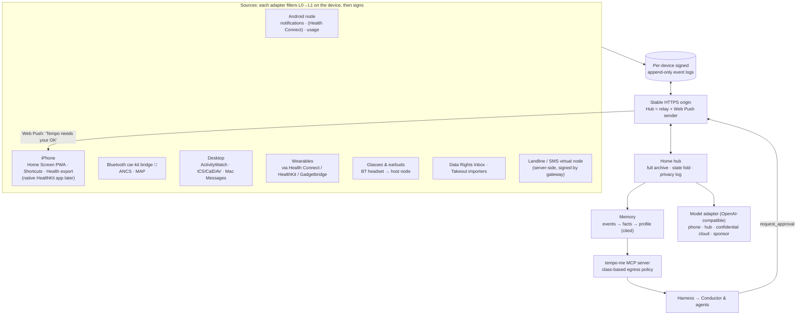

# Tempo Sync: methods to try for syncing one person's devices into one personal data layer

> **Status:** v1.2, fact-checked. Sat 24 Oct 2026, 17:40 BST. Since v1: added 19 corrections from the voice session's adversarial rounds (earbud routing, pairing, push, HealthKit, Health Connect, Android background limits, vendor clouds). See §6.8 and §11.
>
> **How it was made:**
> - **9 research agents** surveyed about 250 methods.
> - **8 fact-check agents** then tried to *disprove* the 84 claims everything depends on: **58 confirmed, 26 partly true (now corrected below), 0 refuted.**
> - An **architecture red-team** rewrote the weekend plan (§8).
>
> **Goal:** sync every device one person has into **one private personal data layer**. That layer feeds a local model and RAG memory, so Tempo knows you well enough to save you time. Devices:
> - iPhone and Apple Watch
> - Android (Nothing Phone, CMF Watch and other brands)
> - other wearables and Meta glasses
> - Windows, macOS and Linux
>
> **Values every method is checked against:**
> 1. **Anyone with a smartphone** can use it, including a £100 Android, a non-technical person, or someone with only a landline.
> 2. **No single vendor and no paid API keys.** Paid or sponsor services only sit behind adapters that have an open fallback.
> 3. **Privacy.** Local-first, end-to-end encrypted, consented, deletable.
>
> **Legend:**
> - ✅ checked against a primary source in the fact-check round
> - ⚠️ still needs a hands-on test
> - 🧪 frontier or crazy idea
>
> **Verdicts:**
> - **W** = build this weekend
> - **R** = strong roadmap
> - **T** = worth a try
> - **X** = avoid
>
> Companion to `Tempo-Platform-Spec.md` (§15 Tempo Mesh) and `Tempo-Demo-Usecases.md`. The voice, interface and direction review lives in `Tempo-Voice-Interface-and-Direction-Review.md`.

---

## 0. TL;DR: the ten decisions

1. **Sync a person's *timeline*, not their devices.** Each device appends to its own **signed, append-only event log**, and the logs merge into one **Tempo Timeline**. Every fact records *when it was true* and *when Tempo learned it*, so **time is the index**.
2. **Get time right; it's the theme.** Two separate problems:
   - **Clock changes:** store **UTC + UTC offset + IANA zone** on every event. UK clocks go back at 02:00 tonight, so 01:00–02:00 local happens twice *during the hackathon*.
   - **Phone clocks that are wrong or drifting:** order events with a **Hybrid Logical Clock**.

   ✅ The HLC does *not* fix the clock change. Phones already keep UTC. The repeated hour only bites when importing **naive local times** (chat exports, CSVs, some ICS).
3. **Read two health hubs, not twenty vendor clouds:**
   - **Health Connect** (Android)
   - **HealthKit** (iPhone)
   - **Gadgetbridge** for cheap or de-Googled watches

   ✅ Vendor clouds are getting worse:
   - The Fitbit Web API dies **30 Oct–2 Nov 2026**.
   - Oura's terms **ban feeding its API data to any AI model**.
   - Withings charges new accounts (from 13 Oct 2026) to export.
   - Garmin's new **Personal** key is free.
4. **Phones are sensors, approvers and thin clients. The "brain" lives on a home hub or an attested cloud.**
   - ✅ The smallest good model, Gemma 4 E2B, is ~2.6 GB, so it won't fit a 2–3 GB RAM phone.
   - Cheap phones **filter, extract, embed and search**.
   - Users without a laptop default to an **attested confidential cloud** (roadmap).
5. **Raw personal data never goes to a sponsor cloud.** There are two data classes:
   - **Vault:** E2EE, held only on the user's devices and hub.
   - **Mission signals:** minimal, consented fields.

   The MCP boundary enforces this split. That fixes the spec's contradiction: §6 sends memory to Snowflake while §15 promises E2EE.
6. **Plug-and-play = two open interfaces:**
   - **MCP** for data: a `tempo-me` server, which your teammate's agents *and* any other client can use.
   - **OpenAI-compatible HTTP** for models: Ollama, llama.cpp, Jan or LM Studio, with sponsors as just another adapter.
7. **iPhone gaps, closed honestly:**
   - a Home Screen **PWA** (Web Push and passkeys, no developer account)
   - **Shortcuts** forwarders
   - the Health **export.zip**
   - 🧪 a **Bluetooth "car-kit bridge"**: ✅ ANCS and MAP read all notifications and SMS/iMessage, with no iOS app at all
8. **Glasses and earbuds are Bluetooth-headset peripherals of a host node.**
   - ✅ Meta's toolkit can't publish apps yet.
   - ✅ On Android, the user can make Tempo the **default assistant**, opened by long-pressing the power/side button or swiping from the corner. The role can't be requested in code.
   - ❌ Earbud and glasses buttons usually go to Google, Bixby, Siri or Meta AI, not the assistant role, so **test each pair**. "Call Tempo" and the in-app mic are the universal paths.
9. **The law is the universal API when vendors have none.** A **Data Rights Inbox** handles UK GDPR Art 15/20 (and the EU Data Act for EU users). Tempo drafts and tracks; **the user sends**.
10. **This weekend, build one vertical slice:** a stable HTTPS origin, Hub, Android node, PWA and memory MCP. Everything else becomes honest roadmap slides (§8).

---

## 1. Review: the direction you're taking, and what to correct

**What's right (keep it):**
- **Person-centric, not device-centric.** This is the real gap. Siri, Galaxy AI and Gemini each live inside one ecosystem, while real families mix iPhone, Android, Windows and a landline.
- **Personalisation is where the time saving comes from.** A generic agent asks you 10 questions. A personal one already knows your train, your sleep and your energy supplier.
- **No lock-in, open source.** There's a sharp real-world story. ✅ Limitless (a lifelogging pendant) was bought by Meta. It stopped selling on 5 Dec 2025, **shut down in the UK and EU**, and deleted users' data after 19 Dec 2025.
- **"Agents get deployed when needed"** rather than people deploying agents on a laptop. That is the right answer to "Muse-style agents are only for developers".

**What to correct:**

| # | Belief or plan | Reality | Fix |
|---|---|---|---|
| 1 | "Sync all devices" = copy everything everywhere | Copying a life log to every device is slow, costly and a privacy hazard. Watches and glasses can't hold it anyway | **Semantic sync.** Raw data stays where it was captured; devices sync extracted fields, facts and summaries, within a byte budget per device (§2) |
| 2 | "Feed it to a local model" on everyone's phone | ✅ Gemma 4 E2B is 2.6 GB (47 tok/s on a 2026 flagship). Gemini Nano: no Nothing/CMF, budget Galaxy A or Pixel "a" phones. Apple Intelligence: iPhone 15 Pro+ only | **Tiered compute** (§6.4): the phone filters, embeds and searches; a hub or attested cloud generates |
| 3 | No paid APIs or lock-in | The spec depends on ElevenLabs, Twilio, Snowflake and Gemini | **Adapters with open fallbacks** (§6.5). Say "**no lock-in, not zero cost**": a phone number always costs money |
| 4 | End-to-end encrypted mesh (§15) | §6.2 wires memory into Snowflake; the Conductor reads signals in the cloud | **Two data classes** (Vault / Mission), enforced at the MCP boundary |
| 5 | "PWA: every feature works" (§15.2) | ✅ A PWA can't read notifications, SMS, Health Connect or HealthKit. No Web Bluetooth in Safari. No background sync on iOS. **When the iPhone PWA is closed, the iPhone contributes nothing** unless Shortcuts forward data | The PWA covers **approvals, capture, alerts, chat and history**. Reading data needs a small native node or a bridge |
| 6 | Everyone has devices to sync | Landline users have nothing to sync, and their data is necessarily processed server-side | Make the landline a **virtual node** that writes call transcripts and SMS replies into the same timeline. Say plainly that E2EE doesn't apply to that path |
| 7 | Syncing a whole life is pure upside | A unified life log is a **honeypot** and a **stalking tool** (silent pairing, "family helper" abuse). Health data is UK GDPR Art 9 special category | No silent pairing. Alert on every new device. A device list on every node. Retention defaults. Lost-phone recovery. A DPIA before launch (§6.6) |
| 8 | One Yjs document for everything (§15.13) | ✅ Yjs has no signatures, its servers read plaintext, and its Swift/Kotlin bindings are stale (2024/2023) | **Everything is a signed log event**; state is a *fold* over the log. Automerge is the roadmap for rich editable docs (§4.4) |
| 9 | Non-technical onboarding | adb, notification access, battery exemptions and "Add to Home Screen" are not for Margaret | **Default path = PWA + SMS + voice.** Native nodes are optional power-ups |
| 10 | Scope | One person with about 20 h can't build mesh + MLS + wearables + glasses + RAG | §8: about 12 build hours, one slice, plus buffer |

---

## 2. What "sync" means for Tempo

### 2.1 Four kinds of data

| Data | Examples | Weekend | Roadmap | Conflict rule |
|---|---|---|---|---|
| **Events** (immutable) | notification signal, daily sleep summary, approval, consent grant/revoke, call transcript | Per-device **signed append-only log** (per-device `seq` for gap detection and signatures). The hub assigns a **`hub_seq` cursor**: `GET /events?after=<hub_seq>` (CloudKit's server-change-token model). New devices bootstrap from **`GET /snapshot`**: a signed fold at `hub_seq` N, then the tail | + version vectors / Negentropy for peer-to-peer; Iroh transport | None: events never change; corrections are new events |
| **Small state** | preferences, mission status, the "what Tempo knows about me" card | A **fold over the log**: last-writer-wins by HLC per field. **State-edit events carry a `base` hash**, so concurrent edits to money or approval fields surface as a **conflict** to resolve instead of being silently overwritten (CloudKit returns client/server/ancestor for the same reason) | **Automerge 3** for rich co-edited docs (✅ the only CRDT with maintained JS, Swift *and* Kotlin bindings) | LWW / CRDT, history visible |
| **Consent** | grants, revokes, limits | Signed events with **`deps`** (hashes of the consent heads the device had seen) | Biscuit/UCAN offline-checkable tokens | **Causal deny-wins**: a re-grant beats a revoke only if its `deps` include that revoke; otherwise the revoke wins |
| **Big data** | years of health samples, photos of letters, export zips | Referenced files | **Encrypted content-addressed chunks**, one per stream per device per day | Set union |
| **Derived** | FTS index, embeddings, facts, profile | **Never synced**; rebuilt on the hub/node | same | Provenance lets Forget cascade |

### 2.2 Four levels of what leaves a device ("semantic sync") 🧪

| Level | What | Leaves the device? |
|---|---|---|
| **L0 raw** | full notification text, raw audio, raw health samples | **Never** by default |
| **L1 extracted fields** | `{operator:"GWR", service:"08:12", delay_min:34}` from a skill's `signals.yaml` | Yes, per consent |
| **L2 facts** | "commutes Oxford→Paddington Mon–Fri" (valid_from / valid_to) | To the user's own devices and hub |
| **L3 summaries / capsules** | morning brief, mission capsule | This is what reaches the agents |

**Per-device budgets** (examples):
- watch: about 5 KB/day, L3 only
- glasses: spoken L3 only
- cheap Android on mobile data: about 1 MB/day
- hub on Wi-Fi: no limit

Every node keeps a **privacy log**: "what left this phone, when, and for which skill". It's cheap and it demos well.

### 2.3 Two trust classes, enforced at the MCP boundary
- **Vault:** raw signals, health, location, memory. Only agents whose model runs on the user's own hub (Tier C) can read it.
- **Mission:** minimal L1/L3 fields. These may reach agents backed by sponsor models (Cortex, Gemini, ElevenLabs), under consent.

Without this rule, context capsules quietly ship personal data to sponsor clouds.

---

## 3. Capability matrix: what each OS and device actually lets us read

✅ yes · ⚠️ partial or conditional · ❌ no. "Bridge" = a Bluetooth car-kit bridge: a Linux laptop or Raspberry Pi paired to the iPhone.

| Signal | iPhone native app | iPhone PWA | iPhone via BT bridge 🧪 | Android native (Nothing etc.) | Android PWA | Windows | macOS | Linux | Watch | Glasses / earbuds | Landline |
|---|---|---|---|---|---|---|---|---|---|---|---|
| Other apps' notifications | ❌ | ❌ | ✅ ANCS (worldwide, "best effort") | ✅ Notification listener (OTP text redacted, Android 15+) | ❌ | ⚠️ packaged app only (MSIX identity) | ❌ no API | ✅ D-Bus | via phone | via phone | ❌ |
| SMS / messages | ⚠️ Shortcuts "Message" trigger (needs sender or keyword; always notifies; body as input ⚠️ likely) | ❌ | ✅ Bluetooth MAP (SMS + iMessage) | ⚠️ previews via listener (Play-policy risk); full SMS for default SMS/**Assistant** apps or Play exceptions | ❌ | ⚠️ Phone Link | ✅ `chat.db` (Full Disk Access) | ⚠️ KDE Connect | ❌ | ❌ | ✅ user texts Tempo's number |
| Health & wearables | ✅ HealthKit, **but not readable while locked** (~10 min after lock), so overnight data arrives after the first unlock. **Free Apple account includes HealthKit** (7-day sideload) | ❌ (export.zip upload ✅) | ❌ | ✅ Health Connect: your own data unlimited, other apps' data 30 days unless the history permission | ❌ (file import ✅) | ❌ | ❌ | ❌ | via phone hub | ❌ | ❌ |
| Calendar | ✅ EventKit | ⚠️ secret ICS URL | — | ✅ CalendarContract | ⚠️ ICS | ✅ ICS / CalDAV / Graph | ✅ | ✅ CalDAV | — | — | ❌ |
| Location | ✅ CoreLocation visits | ⚠️ foreground only | — | ✅ (Play declaration) | ⚠️ foreground | ❌ | ⚠️ | ⚠️ | via phone | — | ❌ |
| App / screen time | ❌ (Screen Time export impossible) | ❌ | — | ✅ UsageStats | ❌ | ✅ ActivityWatch | ✅ ActivityWatch | ✅ ActivityWatch | — | — | ❌ |
| Photos / files | ✅ Share Extension | ✅ upload | — | ✅ share intent | ✅ Web Share Target | ✅ | ✅ | ✅ | — | ⚠️ Meta toolkit camera | ⚠️ MMS |
| Push wake-up | ✅ APNs (**paid** developer account; silent pushes too) | ⚠️ Web Push (Home Screen only; **visible alerts only**) | — | ✅ FCM / UnifiedPush (silent data messages OK) | ⚠️ Web Push (**visible only**: no silent Web Push in any mainstream browser) | ✅ | ✅ | ✅ | mirrored | — | Tempo calls / texts |
| Biometric approval | ✅ Face ID | ✅ passkey | — | ✅ fingerprint | ✅ passkey | ✅ Windows Hello | ✅ Touch ID | ⚠️ | propose only | propose only | safe word + callback |
| "Press and talk" | ⚠️ Siri via App Intents; Action button | ⚠️ in-page mic; Media Session tap | — | ✅ user can set Tempo as **default assistant** (Settings → Default apps; opened by power-button long-press or corner swipe). Earbud buttons: ❌ usually vendor-bound (test each pair) | ⚠️ in-page | ⚠️ hotkey | ⚠️ hotkey | ⚠️ hotkey | ⚠️ | ✅ mic + speaker as BT headset; their buttons go to Siri, Gemini, Bixby or Meta AI | ✅ call Tempo |
| BLE wearables direct | ✅ CoreBluetooth | ❌ Safari (✅ in the Bluefy browser) | — | ✅ | ✅ Web Bluetooth (Chrome) | ✅ | ✅ | ✅ | — | — | — |
| Background work | ⚠️ push-triggered, best-effort; HealthKit background delivery (entitlement; steps at most hourly) | ❌ (syncs only when opened) | ✅ (bridge always on) | ⚠️ WorkManager / listener, **killed by standby buckets and hibernation unless onboarding fixes them** (§6.8); dataSync FGS ≤ 6 h/day when targeting 15+ | ⚠️ Periodic Background Sync (installed PWAs, engagement-gated) | ✅ | ✅ | ✅ | ⚠️ watchOS about 4 refreshes/h with a complication; Wear OS PassiveListener (batched) | ❌ | server-side |
| Local LLM | ⚠️ 15 Pro / 16 / Air / Duo only | ⚠️ WebGPU / wasm, small | — | ⚠️ flagships and upper-mid; tiny models on cheap phones | ⚠️ | ✅ | ✅ | ✅ | ❌ | ❌ | server-side |

**The key idea (as in §15.5, wider now):** no device has to do everything.
- **Android listens.**
- **The iPhone approves.**
- **The Bluetooth bridge covers the iPhone's blind spots.**
- **The hub thinks and keeps the archive.**
- **The landline works for Mum.**

**Not possible: say this to judges (honesty scores well):**
- iOS apps can't read other apps' notifications.
- iOS Screen Time data can't be exported.
- Windows Recall has no read API.
- Mobile clipboard can't be read in the background.
- The Google Photos library is not readable by API (since 31 Mar 2025).
- A PWA can't do background sync on iPhone.
- ✅ The EU-only iOS notification-forwarding API **can't feed memory**. Apple's licence, DPLA §3.3.7(J), bans profiling, model training, cloud storage and passing the data to any other device.

---

## 4. Market methods, ranked by layer

### 4.1 Getting data in: health and wearables

| Rank | Method | What / why | Platforms | Licence / cost | Verdict | Hours |
|---|---|---|---|---|---|---|
| 1 | **Health Connect reader** (in the Android node) | One integration covers many brands:<br/>- Samsung (two-way)<br/>- Pixel/Fitbit<br/>- ✅ Garmin (one-way, Android 14+, opt-in)<br/>- Zepp, Mi Fitness, Oura, Polar<br/>- Gadgetbridge<br/>- phone-only steps<br/><br/>✅ **Health Connect never notifies apps, so you must poll** (WorkManager). Per-type **Changes tokens expire after 30 days unused**. Background reads need `READ_HEALTH_DATA_IN_BACKGROUND`. `aggregate()` dedupes only Activity and Sleep, so add a per-metric **source priority** (watch > ring > phone) and **never sum across HealthKit and Health Connect**. Samsung Health data: read it *only* via Health Connect (Samsung's Jul 2026 AI-training consent wobble). ⚠️ Needs a rationale activity plus a `VIEW_PERMISSION_USAGE` alias, or the permission request fails silently. Alternative ingest: Health Connect **scheduled export** (Android 14+), a zip containing an *unencrypted* SQLite DB | Android 9+ (built into 14+) | Free; Play health declaration | **W** if time (cut 7th) | 2–4 |
| 2 | **Apple Health export.zip importer** | Years of history, no app. Stream-parse in a Worker (a huge XML file) | Export on iOS; import in any browser | Free | **T** | 3–5 |
| 3 | **iOS Shortcut health webhook** | "Find Health Samples" → POST. ✅ There's **no "device unlocked" trigger**, and a scheduled run **can't read Health while locked**, so use **"App opened"** (e.g. the Clock or Messages app) as an unlock proxy | iOS (Watch data via iPhone) | Free; manual set-up per user | **T** | 1–2 |
| 4 | **Phone as wearable** | ✅ Health Connect counts phone steps natively (Android 14 ext 20+; since June 2026 the source is a device SPN, so call `getCurrentDeviceDataSource`). iPhone logs steps itself. Sleep window inferred from screen/charging | All phones | Free | **T** | 1 |
| 5 | **Native HealthKit reader** (Swift or Flutter `health`) | The robust continuous Apple Watch path. ✅ **A free Apple account includes HealthKit**, so a team member with a Mac can sideload it for the demo (7-day expiry, 3 devices; **no Push, iCloud or Associated Domains**). Background delivery needs the entitlement, steps at most hourly, and it **stops after 3 missed completion handlers**. In the UK, Apple's Advanced Data Protection is still unavailable to new users and iCloud Backup isn't E2EE, so mark the vault `isExcludedFromBackup` (5.1.3(ii) bans health in iCloud anyway). Shipping needs $99/yr | iOS | Free to demo; $99/yr to ship | **T** / **R** | 6–10 |
| 6 | **Gadgetbridge → Health Connect** | ✅ Cloud-free companion for 500+ watches; Health Connect since 0.89 (Feb 2026); latest 0.95.1. **CMF Watch Pro needs an auth key; Pro 2 needs none; Watch 3 Pro experimental.** ✅ **Not automatic by default**: turn on "Auto fetch activity data" (fires on screen unlock; needs a screen lock) and Health Connect "Sync after device sync", or trigger the Intent API `ACTIVITY_SYNC`. The vendor app must not sync first | Android | AGPL-3.0 (use via Health Connect, don't embed) | **R** (power users) | 0–1 |
| 7 | **Garmin Personal API key** (BYO key on the hub) | ✅ Garmin-only metrics. The program reopened 21 Oct 2026; **Personal** is free (your own data, pull). "Starter" is free with limited users | Server | Free tiers; Enterprise paid | **T** (adapter) | 3–5 |
| 8 | **Open Wearables** (self-hosted aggregator) | ✅ MIT, MCP server built in, pre-1.0 (0.10.0). Reuse its connectors on the hub. Vendor terms still apply | Hub (Docker) | MIT | **R** | 2–4 |
| 9 | **Web Bluetooth GATT** (HR straps, BP cuffs, Bangle.js) | Zero-install vendor bypass | Android Chrome, desktop, iOS only via Bluefy | Free | **T** | 2–4 |
| 10 | **Polar / WHOOP APIs** | Free individual access, as BYO-credential adapters. WHOOP v2 webhooks are thin: fetch by ID and reconcile | Server | Free tiers | **T** | 3–4 each |
| — | **Fitbit Web API** | ✅ Returns **410 Gone from 2 Nov 2026** (support ended 30 Sep; a consumer page says 30 Oct). The Google Health API has only restricted scopes. The Fitbit app is now **Google Health** (since 19 May 2026) and writes to Apple Health (v5.05+) and Health Connect | — | — | **X** (use Health Connect) | — |
| — | **Oura API** | ✅ Agreement (8 Jun 2026) s.4(d): **no prompting or input to any AI model** (only via Oura's own MCP server); no caching MCP data (s.3(m)); a 10-user default cap is reported (⚠️ the two fact-checks disagree) | — | — | **X** (read Oura via Health Connect / HealthKit) | — |
| — | **Withings** | ✅ New accounts (from 13 Oct 2026) need **Withings+** to export to any partner, Apple Health/Health Connect included. Its MCP connector is Withings+-only | — | Paid | **X** for new users | — |
| — | **Nothing X for CMF watches** | ✅ CMF Watch app removed; Nothing X required since 19 Jul 2026. **Health Connect sync not confirmed** (the listing mentions Apple Health only) | — | — | ⚠️ test; prefer Gadgetbridge | — |
| — | **Paid aggregators** (Terra, Junction, Sahha…) | $300–500/month, a third party in the data path, Oura's AI ban applies | — | Paid | **X** | — |

**Normalise to one schema.** Use `TempoHealthEvent`, aligned with **Open mHealth / IEEE 1752.1**, with UCUM units and LOINC codes.
- `id = hash(source|type|start|end|value)` makes ingestion idempotent.
- Keep vendor scores in `extras`.
- Export to FHIR R4 only for clinicians.

### 4.2 Getting data in: OS context signals

| Rank | Method | What / why | Verdict | Hours |
|---|---|---|---|---|
| 1 | **Android NotificationListener node** | "Android listens". An on-device allow-list and regex produce L1 fields, which are signed and POSTed to the hub; raw text never leaves. For the demo, trigger it deterministically with `adb shell cmd notification post`. ✅ For sideloaded APKs, Android 13+ restricted settings need the user to tap "Allow restricted settings"; **adb installs avoid this** | **W** | 1.5 (timebox) |
| 2 | **Secret ICS URL / CalDAV** | Calendar with zero OAuth review | **T** | 0.5–2 |
| 3 | **ActivityWatch** (MPL-2.0) | Real time per app/site, the ground truth for the **Time Ledger** | **T** | 1–2 |
| 4 | **iOS Shortcuts forwarders** (Message, Email, App opened, Arrive/Leave) | ✅ Message triggers need a sender or a plain-text "contains" match. They can run without a tap but **always show a notification**. The received message is very likely passed as Shortcut Input (commercial forwarders rely on this) ⚠️. Automations can't be installed by link; each user creates the trigger | **T** (DIY tier) | 1–2 |
| 5 | **Mac Messages `chat.db` importer** | iPhone SMS/iMessage via the user's own Mac (Full Disk Access) | **T** | 2–3 |
| 6 | 🧪 **iPhone car-kit bridge**: ✅ **Tether** (MIT, Apr 2026, about 1.5k★) and **ancs4linux** on Linux/BlueZ | **ANCS** gives all notifications; **MAP** reads and sends SMS/iMessage once the iPhone toggles "Show Message Notifications". No iOS app, no developer account, and DPLA terms don't apply (it's Bluetooth, not an SDK). Needs a BlueZ experimental flag, a dual-transport bond, and the phone within Bluetooth range | **T** (stretch) / **R** (Raspberry Pi "Tempo Home") | 3–6 |
| 7 | **Android default-assistant role** | ✅ Play explicitly lets the **default Assistant** hold the SMS and Call Log permissions, a Play-compliant SMS path. It also gets screen context on summon and is exempt from Android 17's 3-hour OTP-SMS delay. The user must pick it manually (the role isn't requestable) | **R** | 4–6 |
| 8 | **KDE Connect protocol** | The existing KDE Connect Android app becomes a source, with no Tempo APK | **R** | 4–8 |
| 9 | **Windows UserNotificationListener** | Needs package identity (MSIX/sparse) | **R** | 3–6 |
| 10 | **Linux D-Bus monitor** | Desktop and forwarded phone notifications | **T** | 1 |
| 11 | **Bulk importers** (Takeout, Apple privacy export, WhatsApp chat export, local iPhone backup) | Day-one memory seed. ✅ WhatsApp exports contain **naive local times**, so they need the clock-change fix in §5 | **T** | 2–4 each |
| — | **Notification listener reading SMS on a Play build** | ✅ Play: "You may not use alternative methods (including other permissions, APIs…) to derive" SMS data; it also bans "SMS or phone notification enhancement and alerts" for non-default apps | **X** on Play (sideloaded demo build only) | — |
| — | **AccessibilityService agents** | ✅ Play bans its use for autonomous planning and acting | **X** | — |
| — | **screenpipe** | No longer open source | **X** | — |

### 4.3 Glasses, earbuds and ambient devices

**Wearables are peripherals of a host node** (phone, laptop, Chrome PWA). The host signs, encrypts and filters. No keys on £15 hardware.

| Rank | Method | What / why | Verdict | Hours |
|---|---|---|---|---|
| 1 | **Bluetooth headset path** (HFP / A2DP / LE Audio) | Works with **every** pair of earbuds and with Meta glasses used as a plain headset. ✅ The Meta glasses mic arrives as 8 kHz mono (narrowband) | **W** (voice teammate) | 1–2 |
| 2 | **Android default assistant** (power/side-button long-press, corner swipe) | ✅ The user selects it in Settings; it can't be requested in code. ❌ **Earbud buttons don't reach it.** In AOSP, a Bluetooth HFP voice request (AT+BVRA) becomes `ACTION_VOICE_COMMAND`, and a headset media long-press becomes `ACTION_WEB_SEARCH` / `VOICE_SEARCH_HANDS_FREE`; the assistant role claims neither. Vendor buds bypass both: Pixel Buds → Gemini, Galaxy Buds → Bixby/Google, AirPods → Siri, Meta glasses → Meta AI. **At best**, declare `VOICE_COMMAND` / `VOICE_SEARCH_HANDS_FREE` intent filters, let the user pick Tempo in a chooser, and test per device | **R** | 2–4 |
| 3 | **"Call Tempo" contact** | "Hey Meta / Hey Siri, call Tempo" turns any wearable that can place calls into a node | **W** | 0.5 |
| 4 | **On-device speech** (✅ Moonshine MIT streaming models; sherpa-onnx Apache-2.0) | Raw audio stops at the host; only text enters the timeline | **T** | 2–3 |
| 5 | 🧪 **"Rewind 30 s"** | RAM-only rolling buffer; "Tempo, keep that" saves only that window (TIME theme, privacy-friendly) | **T** | 2–3 |
| 6 | **DIY ESP32-S3 "Tempo Clip"** speaking the ✅ open **Omi BLE profile** (`19B10000-…`, read the codec characteristic) | £15 push-to-talk clip; a real Omi pendant also works | **T** | 3–5 |
| 7 | **Meta Wearables Device Access Toolkit 1.0** | ✅ Rolling out from 30 Sep 2026.<br/>- Public submissions not open; one private invite-only beta channel.<br/>- Video streaming is *not* experimental; audio streaming and high-quality photo capture are.<br/>- Meta AI app required.<br/>- Policy bans identifying people by face or voice.<br/>- Proprietary terms. | **R** (adapter only) | 4–8 |
| 8 | **MentraOS** (Apache-2.0), **Brilliant Labs Halo** (✅ BSD-3 SDK; firmware mixed licence), **Even G1/G2**, **Android XR** | Open or semi-open glasses behind one **Tempo Wearable Capability Profile** | **R** | 3–6 each |
| — | **Nothing Glyph Matrix SDK** | ✅ Closed-source EULA: **can't be vendored in an open-source repo**; single-vendor eye candy | **X** for sync | — |

**Media rules (add to §15.9):**
- Raw audio and video never leave the host.
- Remember only what the wearer says.
- Blur faces before storage.
- **Never identify bystanders**: Meta's policy, GDPR Art 9 and EU AI Act Art 5 all forbid it.
- Show an indicator whenever capturing.
- Default to push-to-talk.

### 4.4 Data model and sync engine

| Rank | Method | Why | Verdict | Hours |
|---|---|---|---|---|
| 1 | **Tempo Event Log**: per-device, signed, append-only (envelope in §6.3) | One bus for signals, approvals, consent, transcripts and references. Plain SQLite or IndexedDB everywhere. We own it, so there's no lock-in | **W** | 4–5 |
| 2 | **Time correctness**:<br/>- UTC + offset + IANA zone on every event<br/>- HLC (with a max-drift guard) for cross-device order<br/>- fold disambiguation for naive local imports | ✅ The HLC (Kulkarni et al. 2014) orders events and tolerates skew but **can't detect concurrency**. The clock change is a display/import problem, not a sync problem | **W** | 1–2 |
| 3 | **State = fold over the log**; LWW per field by HLC | Simplest correct merge for the weekend; no CRDT library needed | **W** | 1 |
| 4 | **Causal deny-wins via `deps`** | Makes the airplane-mode consent demo *explainable* | **W** | 1 |
| 5 | **Automerge 3** (✅ JS 3.5.0, Swift 0.7.2, automerge-java 0.0.9 with Android AAR + Kotlin helpers; pin `automerge-repo@2.5.6`) | Rich co-edited documents later. ✅ automerge-repo-swift is stale, so iOS gets the low-level binding only | **R** | — |
| 6 | **Negentropy** (✅ MIT; JS/C++ reference; Rust, Go, Kotlin MP ports; no Swift) | Efficient sync of millions of items over any pipe; optional frame-size limit | **R** | 3–6 |
| 7 | **Encrypted content-addressed chunks** + **crypto-shredding** | Years of samples; Forget that is really forgotten (needs per-item keys) | **R** | 3 |
| 8 | **Evolu** (✅ MIT, TypeScript only; the relay sees metadata) | Plan B or reference design for the PWA | **T** | 3–4 |
| 9 | **Loro** (✅ MIT 1.17; Swift/Python/React Native; **no official Kotlin**) | Time-travel CRDT; Android only via React Native or community Dart | watch | — |
| 10 | **Keyhive / Subduction** (Ink & Switch) | ✅ Pre-alpha, "DO NOT use in production", unaudited. The future of E2EE Automerge | watch | — |
| — | Yjs as the core | ✅ v14 still in RC (npm `@y/y`); stale native bindings; plaintext servers | **X** | — |
| — | ElectricSQL, PowerSync, Zero, InstantDB, Triplit, Couchbase, Ditto, DXOS, RxDB-premium | The server reads your data, and/or the licence is source-available or proprietary | **X** | — |
| — | cr-sqlite | ✅ No release since Jan 2024 | **X** | — |

### 4.5 Transport, discovery and wake-up

| Rank | Method | Why | Verdict | Hours |
|---|---|---|---|---|
| 0 | **One stable HTTPS origin**: Tailscale Funnel (`*.ts.net`), a VPS + Caddy (Vultr has MLH credits), or a *named* Cloudflare tunnel | Passkeys (the RP ID can't be an IP), service workers, Home Screen installs and push subscriptions are all **tied to the origin**. A quick tunnel whose URL changes silently breaks all four | **W**, hour 1 | 0.75 |
| 1 | **Hub = relay** (WebSocket + SQLite, per-device inbox) | The minimum always-on piece. This weekend the hub is your own laptop, so it isn't "blind"; say so | **W** | 3 |
| 2 | **Web Push with self-generated VAPID keys** | ✅ Free, no Apple Developer account, no Firebase. Home Screen only on iOS. **No silent Web Push in any mainstream browser** (Chrome included): every push must be **visible**, and on iOS three silent pushes revoke the subscription. Web Push replaces APNs *alert* pushes, not background pushes, so **PWAs sync when opened**, plus visible pushes for things the user must act on. Use a real `mailto:` VAPID subject (Apple rejects localhost). Send generic text ("Tempo needs your OK") and fetch details after the app opens | **W** | 2 |
| 3 | **Pairing = a `device.add` voucher signed by an existing device** (or a passkey assertion with challenge = `H(person‖new_pubkey‖nonce)`); this is iCloud Keychain's sponsor model | The new device shows a QR with only `{one-time provisioning mailbox, ephemeral public key}`; **never the vault key** (Signal's provisioning pattern). A trusted device scans it and approves with biometrics, then sends any secrets *sealed to the ephemeral key* through the mailbox. **The hub can't add devices.** Show **safety words** derived from `H(device list)` on every device. Fallback without a camera: a 3-word **PAKE** code (Apple Watch uses SPAKE2+), not a compare-only code. Threat: MITRE ATT&CK T1676 "Linked Devices" QR phishing | **W** | 1.5 |
| 4 | **WebRTC P2P via Trystero** (✅ MIT; Nostr signalling) | Live sync between open PWAs with no server. ✅ **Set a `password`** derived from the pairing key; the default SDP key is reversible by relay operators. TURN credentials must be minted server-side (Cloudflare's free 1,000 GB is shared with its SFU) | **R** | 2–4 |
| 5 | **Nostr gift-wrapped mailbox** (NIP-44/59) | A "pull the plug on our relay and it still syncs" fallback; accountless | **R** | 2–4 |
| 6 | **UnifiedPush / ntfy** (and FCM for native Android: ✅ new AndroidConfigV2 preview, where RemoteNotification is for visible alerts and BackgroundSync is for data that may be batched) | ✅ Silent wake-ups exist only on **native** nodes (FCM, UnifiedPush, paid APNs). Wake-ups for de-Googled phones. ntfy.sh allows **250 msgs/day per IP** (the venue shares one IP); topics are **unauthenticated**, so use random names, content-free pings or E2EE payloads, or self-host | **R** | 1–4 |
| 7 | **Iroh 1.x** (✅ 1.0 on 15 Jun 2026, now 1.4.1, MIT/Apache) | Transport for the Rust core: dial by public key, hole punching. ✅ iroh-ffi (Swift/Kotlin/Python/Node 1.2.0) exposes **raw endpoints only** (no blobs, docs or gossip). Public relays are "dev and hobby use", so self-host `iroh-relay`. Browsers are relay-only | **R** | — |
| 8 | **LAN / mDNS direct** | ✅ Apps targeting Android 17 need `ACCESS_LOCAL_NETWORK` (or the NSD picker); iOS needs the Local Network prompt; impossible from a PWA | **R** | 2–3 |
| 9 | **BLE GATT/L2CAP** (bitchat's design) | Small offline messages between nearby phones | **R** | 5–8 |
| 10 | 🧪 **Device-to-device Web Push** | A native node pushes straight to the iPhone PWA with no server. Needs the VAPID private key on every sender; **not this weekend** (the hub sends pushes) | **R** | — |
| — | Tailscale/ZeroTier as the default transport | VPN profiles confuse users; non-commercial free tiers | **X** (Funnel is fine *for hosting the origin*) | — |
| — | Syncthing on phones; Wi-Fi Aware / Nearby Connections for iOS↔Android | No official Android app. ✅ Wi-Fi Aware on iOS 26 (iPhone 12+, DeviceDiscoveryUI PIN pairing) is public, but no iPhone↔Android-phone connection was confirmed as of Sep 2026; Nearby on iOS is stale | **X** / experiment | — |

### 4.6 Encryption, identity and consent

| Rank | Method | Why | Verdict | Hours |
|---|---|---|---|---|
| 1 | **Device keys = ECDSA P-256 (ES256)**: non-extractable WebCrypto key in the PWA; **Android Keystore** on the phone | Hardware-backed even on cheap phones (Ed25519 in Keystore needs KeyMint v2); the same algorithm passkeys use; one algorithm everywhere | **W** | 1 |
| 2 | **Sign the raw bytes, send the same bytes**: `{body:"<raw json>", alg, sig}` | Canonical JSON differs between Kotlin and JS, and verification fails at 01:00 | **W** | — |
| 3 | **Passkey approvals bound to the transaction**: challenge = `H(mission, amount, nonce)`; the envelope carries the WebAuthn assertion (`authenticatorData`, `clientDataJSON`, `sig`) | Face ID or fingerprint from the browser commits to *what* was approved | **W** | 2–3 |
| 4 | **Honest encryption this weekend**: TLS + signatures + passkey approvals. *Optional:* AES-256-GCM payloads (WebCrypto / JCA built-ins), with the vault key **sealed to the new device's ephemeral key and sent via the pairing mailbox after approval**, never shown in a QR | Don't claim a "blind relay" or "crypto-shredding" unless built | **T** | 1.5 |
| 5 | **Vault key wrapped per device and per passkey (WebAuthn PRF)** | ✅ Uneven support (Corbado, Aug 2026):<br/>- Safari 18 / iCloud Keychain (bugs fixed in 18.4) and Google Password Manager work.<br/>- Windows Hello needs the Feb 2026 update plus Chrome/Edge 147+ or Firefox 148+.<br/>- Samsung Pass gives PRF on *get* only.<br/>- Microsoft Password Manager PRF *get* fails.<br/>- Bitwarden is partial.<br/><br/>**Treat it as an enhancement, never the only unlock** | **R** | 2–3 |
| 5b | **Recovery across ecosystems** | ✅ **Passkeys don't cross ecosystems.** iCloud passkeys never reach Android. Google Password Manager passkeys reach iOS 17+ only with Chrome set as the AutoFill provider. CXP (credential exchange) is still a Working Draft. So: **enrol one passkey per ecosystem**. **No PIN-only recovery on the hub**: vendor PINs are only safe because HSMs cap attempts (Apple: 10, then the record is destroyed). Use a high-entropy **printed code** or **SLIP-39 shares** held by helpers | **R** (design now) | — |
| 6 | **Consent events + W3C DPV tags** | Portable, auditable consents | **W** (tags) | 0.5 |
| 7 | **Biscuit tokens** (✅ Apache-2.0, WASM) | Offline-checkable, attenuable grants | **R** | 3 |
| 8 | **OpenMLS** (✅ MIT; **pin ≥ 0.9.2**: HIGH DoS advisory GHSA-gc79-23g3-8g52, 8 Oct 2026) / **ts-mls** (MIT) | Family Mesh groups later; overkill for one person | **R** | — |
| 9 | **UCAN 1.0** (✅ declared, untagged, still being edited; pin a commit) | Delegation inside the Mesh and to helpers | **R** | — |
| — | libsignal | ✅ AGPL-3.0 | **X** | — |

### 4.7 Local AI and personal memory

**Memory model: our own bi-temporal tables in SQLite:**

```
events    append-only; event_time (utc + offset + tz), recorded_at, hlc, device, source, kind, body, class, trust_level, consent_scope
facts     subject, predicate, object, valid_from, valid_to, recorded_at, invalidated_at, provenance[event_ids]   ← deterministic rules this weekend
routines  "Mon–Fri 08:12 GWR Oxford→Paddington", next_expected                                                 ← roadmap
profile   ≤300-token pinned "what Tempo knows about me", every line cites events
```

**Retrieval is time-first:**
1. Parse "last Tuesday" deterministically (chrono-node).
2. Apply a time filter.
3. Search with FTS5 BM25.
4. Add vectors and reciprocal-rank fusion later.
5. Output a **Context Capsule** with event-ID citations.

**Forget** cascades through every copy:
- tombstone the event
- FTS5 `delete` with `PRAGMA secure_delete=ON`
- derived facts and the profile
- other replicas, via a tombstone event
- the teammate's Harness caches, via a webhook

**Time travel:** rebuild state from the log up to any moment. Say "except what you told us to forget" out loud.

| Layer | Pick | Licence | Notes |
|---|---|---|---|
| Store + search | **SQLite + FTS5**; sqlite-vec later | public domain / MIT-Apache | ✅ sqlite-vec is pre-1.0 (v0.1.9, quiet since May 2026). SQLite's new in-tree **vec1** (public domain, 3.54 source) is experimental. Vectors are derived, never synced |
| Embeddings | **multilingual-e5-small** (MIT) or ✅ **EmbeddingGemma 2** (Apache-2.0, 740M, 6 Oct 2026; v1 is Gemma ToU) | open | One model per user, store `model_id`; ✅ embeddings can be inverted (vec2text recovered 92% of 32-token inputs), so encrypt them |
| Hub runtime | ✅ **Ollama** (partial OpenAI API), **llama-server**, **Jan** (`:1337`), **LM Studio** | MIT / Apache | All OpenAI-compatible; ✅ **put auth on any LAN endpoint** |
| Hub models | ✅ **Gemma 4 E4B / 26B-A4B**, **Qwen3.5** (Apache-2.0) | open | JSON-schema output, temperature 0 |
| Phone models | ✅ **Gemma 4 E2B** (Apache-2.0, 2.6 GB, 47 tok/s CPU on S26 Ultra) on 6–8 GB phones; **Qwen3.5-0.8B/2B** (Apache-2.0, 201 languages); Gemma 3 270M classifier (Gemma ToU) on cheap phones | open | Cheap phones: prompts < 512 tokens; prefill is the bottleneck |
| System models | ✅ Apple Foundation Models (15 Pro/16/Air/Duo; free PCC only for Small Business Program apps); Gemini Nano (no Nothing/CMF, budget Galaxy A or Pixel "a" phones; foreground only); Windows Phi Silica → **Aion Instruct** (Jan 2027, no token) | proprietary | Adapters only |
| Speech fallback for ElevenLabs | ✅ **Moonshine** (MIT streaming models), **sherpa-onnx** (Apache), **Kokoro** (Apache) | open | ✅ Piper is now **GPL-3.0** (piper1-gpl); run Piper voices through sherpa-onnx instead. openWakeWord models are non-commercial |
| Confidential cloud | ✅ **Privatemode** (€0 tier: 5M tokens + 1M/month, attested), Tinfoil; Apple PCC via native app | free tier / paid | De-identified capsules only |
| Borrow ideas from | Graphiti (bi-temporal facts; ✅ needs Neo4j/FalkorDB, Kuzu dead), Letta (pinned blocks; ✅ sleep-time compute ~5× less compute at answer time), mem0, Cognee | Apache | Run on the hub later |
| **Avoid** | ✅ Cactus (source-available, $2M cap); personal LoRA for facts (can't forget); pooling phones for inference | — | — |

**No LLM "dreams" in the live demo.** A made-up fact about the user on stage is the worst failure a privacy product can have. Build the profile from **deterministic, cited rules**. Run LLM consolidation offline and cache the results, showing only facts that cite events.

### 4.8 Open standards and legal levers (the anti-lock-in layer)

| Method | Why | Verdict | Hours |
|---|---|---|---|
| **`tempo-me` MCP server**: ✅ spec rev **2026-07-28** (stateless, `server/discover`; Sampling/Roots/Logging deprecated; **SSE resumability removed**, so tools must be idempotent); ✅ TS SDK v2.4.0 / Python v2.3.0 | One data interface for your teammate's agents and any MCP client. Tool contract in §6.7 | **W** | 2–3 |
| **Tempo Data Layer folder**: JSONL events by date + content-addressed blobs + a rebuildable SQLite index; JSON-LD `@context` → Open mHealth, schema.org, ActivityStreams, W3C DPV | "Leave Tempo with everything" = zip the folder | **R** (export button **T**) | 1 |
| **Data Rights Inbox** on ✅ **Datenanfragen** (MIT code, CC0 database) | Every company becomes a (slow) data source with no API. Tempo drafts, **the user sends**, Tempo counts down the ✅ **one-month** SAR deadline and chases | **R** (demo **T**) | 3–5 |
| **A2A v1.0** (✅ Mar 2026; joined the Linux Foundation AAIF ~17 Aug 2026, alongside MCP) | Agent-to-agent with helper and company agents | **R** | — |
| **UK levers** | ✅ CMA Apple commitments (1 Apr 2026): an **interoperability request channel** for UK developers. File one: "let users grant notification access to their chosen assistant". ✅ The Google portability CR (since ~17 Sep 2026) covers **search data only**. No UK notification or wearables measure | **T** (1 h slide) | 1 |
| **Legal limits** | ✅ UK GDPR doesn't clearly allow delegating access rights to intermediaries (DSIT CP 1592; no government response yet), so **the user sends**. A portal's T&Cs aren't evidence of authority (ICO). ✅ *Brillen Rottler* (CJEU, Mar 2026) lets controllers refuse abusive requests (persuasive only in the UK): **no mass requests**. ✅ The **EU Data Act doesn't apply in the UK** | — | — |
| Solid/LWS, AT Protocol Spaces | Draft or alpha, not encrypted | export targets only | — |

---

## 5. Crazy and frontier methods (honest feasibility)

| 🧪 Idea | Why it's exciting | Feasibility | Hours |
|---|---|---|---|
| **Time is the index** (bi-temporal timeline) | Every memory knows when it happened *and* when Tempo learned it, so you can ask what Tempo believed when it filed a claim | **Works today** | in the slice |
| **The hour that happened twice**, done right | ✅ Clocks go back at 02:00 BST = 01:00 UTC, *during OxHack*. Phones log UTC, so nothing breaks there. **Naive-local sources do** (WhatsApp/CSV exports). Store UTC + offset + zone; for naive-local imports, switch +01:00 to +00:00 where local time jumps back about 60 minutes (the Temporal API's "earlier/later" fold). Show a "sorted by clock text" column, scrambled, next to Tempo's order | **Weekend** | 1–1.5 |
| **HLC vs a lying clock** | Set the Nothing Phone's clock a few minutes wrong *live*; causal order still holds. A max-drift guard stops a phone set an hour ahead from dragging everyone forward | **Weekend** | in the slice |
| **Verifiable time** (✅ Roughtime = RFC 10049, Oct 2026; OpenTimestamps) | Catch lying clocks with signed time; prove a screenshot existed at 08:47 | **T** | 2–3 |
| **iPhone car-kit bridge** (✅ Tether / ancs4linux) | All iPhone notifications + SMS/iMessage with **no iOS app, no developer account** | **Works today** on Linux + BlueZ; fiddly pairing | 3–6 |
| **Semantic sync with per-device byte budgets** | The watch gets 5 KB/day of meaning, not megabytes of data | **Weekend** (policy layer) | 2 |
| **"Tempo dreams"** (sleep-time consolidation) | Overnight: events → facts → routines → morning brief, as a "what Tempo learned last night" diff. ✅ About 5× less compute at answer time (Letta/Berkeley) | **Roadmap**: keep it off the live stage | 3–4 |
| **SMS-gateway phone as Mum's node** (✅ capcom6 Android SMS Gateway, Apache-2.0; **use local mode**, because cloud mode relays via the developer's server) | Feature phones join with **no Twilio**: "YES" approves, "STOP" revokes (deny-wins) | **Weekend**-able (spare Android + SIM) | 2–3 |
| **Data over sound** (✅ ggwave, MIT) | In-room pairing chirps: accessible, no camera. ✅ **New:** its **dual-tone/mono-tone modes sit at ~1.1–2.6 kHz, inside the phone-call band**, so a *landline data channel* is plausible but **untested** through phone codecs. Try it! | Room: **weekend**. Over a call: **experiment** | 1–3 |
| **Animated fountain-code QR** (qrs / TXQR; ✅ libcimbar decoder is Android-only) | Move an encrypted memory snapshot to a new phone with no cloud | **Weekend** (plain QR) | 2–4 |
| **LLM-as-codec SMS** (ts_sms, llama-zip) | One SMS carries a rich update | **Research**: needs an identical model; llama.cpp isn't deterministic | — |
| **Phone as wearable** (✅ vitallens.js local pulse, MIT; HRV is paid) | No watch? A 30-second selfie pulse check-in (wellbeing, not medical) | **Weekend** | 2–3 |
| **Wi-Fi CSI presence** (✅ ESPectre, GPLv3, 2.4 GHz only, can't identify people) | "Ring the landline only if someone's home" | **Weekend** with an ESP32 | 2–3 |
| **Rewind 30 s**; **"do-not-record" BLE beacon** | Retroactive ephemeral capture; bystanders broadcast "no" | **Weekend** demos | 2–4 each |
| **16-byte memories** (Matryoshka 128-d + 1-bit) | A year of memories in ~1.6 MB on a 2 GB phone | **T** (measure recall) | 1–2 |
| **Cached profile KV-prefix** (llama.cpp state save) | Cuts first-token time on cheap phones | **T** | 2–3 |
| **Attested-TEE "blind cloud brain"** (OpenPCC, dstack; ✅ Google Private AI Compute has *no* third-party access) | No-hub users get a cloud model the operator can't read | **Roadmap** | — |
| **HE private lookups for Scam Shield** (Apple swift-homomorphic-encryption PIR) | "Known scam caller?" without revealing who called Mum | **Roadmap** | — |
| **zkTLS evidence** (✅ TLSNotary alpha.15, TLS 1.2 only, "not for production") | Prove a booking or bill from your logged-in session, no API | **Research** | — |
| **Your logged-in browser as the API** | ✅ Amazon v Perplexity: the injunction was vacated on 4 Aug 2026, en banc denied; the case continues. US-only, interim. UK Computer Misuse Act still applies | **Roadmap** (teammate's browser agent) | — |
| **Contextual-integrity device agents** | Rules + a local model that may only *narrow* a grant; every flow explained | **T** (rules + log) | 2–3 |
| **Federated learning + DP across users** (Flower, OpenDP) | Community priors without pooling data | **Roadmap** (needs scale) | — |
| **Personal LoRA** | "A model that is you" | **Avoid for facts**: weights can't forget | — |
| **Off-grid LoRa** (Meshtastic/Reticulum) | Scam alert to family when networks are down | **Roadmap / hardware** | — |
| **Personal Data MCP Profile** | Companies answer a SAR over MCP in seconds; propose it via the Data Transfer Initiative | **Spec + mock** | 2–3 |

---

## 6. Recommended architecture

### 6.1 Diagram



### 6.2 How it ties into the spec's concepts

| Spec concept | In the Tempo Timeline |
|---|---|
| **Context Capsule** (§7.5) | Generated by memory retrieval with event-ID citations; only Mission-class fields unless the agent's model is local |
| **Consent Ledger** (§5, §13) | Signed consent events with `deps`; causal deny-wins fold; DPV tags; Biscuit tokens later |
| **Time Ledger** (§12.3) | A query over events (ActivityWatch time, hold minutes, mission events) |
| **Tempo Mesh** (§15) | Nodes advertise capabilities; wearables are peripherals; the hub is a node with `archive` + `compute.llm` |
| **Device Router** (§15.8) | Plus presence (worn state, active device, charging) and a **compute** capability |
| **Signal filters** (§15.9) | The L0→L1 step; later compiled per OS |
| **Harness** (§8) | Every MCP call is policy-checked and logged; memory content is **data, never instructions** (`trust_level`) |
| **Proof Trace** (§5) | Can cite what Tempo believed at decision time |

### 6.3 Event envelope v1 (freeze this first)

```json
{
  "v": 1,
  "alg": "ES256",                     // or "webauthn" for passkey approvals
  "body": "{\"id\":\"…\",\"person\":\"…\",\"device\":\"…\",\"seq\":1842,\"hlc\":\"1792805467412-0003-nothing\",\"kind\":\"signal.rail_delay\",\"event_time\":{\"utc\":\"2026-10-24T07:12:00Z\",\"offset\":\"+01:00\",\"tz\":\"Europe/London\",\"fold\":null},\"recorded_at\":\"2026-10-24T07:13:02Z\",\"class\":\"mission\",\"trust_level\":\"untrusted-external\",\"consent_scope\":[\"skill:clawback-uk-rail\",\"dpv:ServiceProvision\"],\"deps\":[],\"payload\":{\"operator\":\"GWR\",\"service\":\"08:12\",\"delay_min\":34}}",
  "sig": "base64…",                    // over the exact UTF-8 bytes of "body"
  "assertion": null                   // {authenticatorData, clientDataJSON, signature} when alg = webauthn
}
```

- `id` = hash of the body bytes, so ingestion is idempotent.
- `deps` = consent heads seen. It is required on `consent.*` and `approval` events.
- `fold` = `earlier` or `later`, set only for naive-local imports during a repeated hour.
- `class` = `vault` or `mission`.
- `base` = hash of the state version an edit was made against. It's required on state-edit events for money and approval fields, so concurrent edits surface as conflicts.
- `hub_seq` is assigned by the hub on receipt and lives *outside* the signed body; it's only a download cursor.
- Virtual nodes (landline, SMS gateway, email) sign with **the gateway's key** and get `trust_level: "gateway-attested"`.

### 6.4 Compute tiers ("anyone with a smartphone")

| Tier | Who | Runs | Status |
|---|---|---|---|
| **A: any phone / PWA** | £100 Android, old iPhone | filter, extract, search; a 270M classifier; prompts < 512 tokens | weekend (filters) |
| **B: flagship phone** | iPhone 15 Pro+, recent Pixel/Galaxy | Gemma 4 E2B, Apple Foundation Models, Gemini Nano | roadmap |
| **C: home hub** | a laptop or Mac mini the family owns | Ollama / llama-server + Gemma 4 E4B / Qwen3.5; overnight consolidation | weekend (the team laptop) |
| **D: confidential cloud** | **default for users with no laptop**, and landline users | attested TEE inference (Privatemode, Tinfoil, OpenPCC); de-identified capsules only | roadmap |
| **Sponsor** | — | Snowflake Cortex etc. for **public / non-personal** data only | adapter |

Don't benchmark phones on venue Wi-Fi in hour 1. Quote ✅ the published LiteRT-LM figures instead: Gemma 4 E2B is 2,583 MB and decodes at 47 tok/s on CPU on an S26 Ultra; Gemma-3n-E2B is 2,965 MB and decodes at 16 tok/s on an S24 Ultra.

### 6.5 Sponsor or paid service → open fallback

| Function | Sponsor / paid | Open fallback |
|---|---|---|
| Voice agent | ElevenLabs | Pipecat / LiveKit Agents + Moonshine or whisper.cpp + Kokoro (Piper voices via sherpa-onnx) |
| Telephony | Twilio | SIP trunk + Asterisk/FreeSWITCH; Android SMS-gateway phone (local mode). A phone number is never free |
| Reasoning | Snowflake Cortex | Ollama / llama-server / Jan |
| Vision | Gemini | Gemma 4 / Qwen3.5 (vision-language) on the hub |
| Push | APNs / FCM | Web Push (VAPID), UnifiedPush / self-hosted ntfy |
| Relay / hosting | "our server" | self-hosted relay, Nostr relays, the user's own WebDAV/S3 |

### 6.6 Threat model (minimum)
- **Stalking / coercive control:**
  - No silent pairing.
  - **New devices need a `device.add` voucher signed by an existing device or a passkey; the hub alone can't add one.**
  - The QR carries only an ephemeral key + one-time mailbox (expires in 2 minutes); hub endpoints are rate-limited.
  - **Every new pairing alerts every device**; the device list and **safety words** (from `H(device list)`) are visible on every node.
  - Periodic "who can see what" review; quick exit.
  - Threat to name: MITRE ATT&CK T1676 (linked-device QR phishing).
- **Lost phone:**
  - A `device.remove` event; the hub rejects that key from then on.
  - Rotating keys doesn't take back what the phone already saw. Say so.
- **Recovery (the most common real failure):**
  - Options: synced passkeys, **one per ecosystem** (iCloud passkeys never reach Android); a high-entropy printed recovery code; or SLIP-39 shares held by helpers.
  - **Never PIN-only recovery on the hub.** Without an HSM capping attempts, a PIN can be brute-forced.
  - Without one of these, a vault key only on the lost phone means **everything is lost**.
- **Metadata leaks:** plaintext `kind`, `source` and time leak a lot ("health.sleep at 03:00", "signal from GWR"). The roadmap moves them inside the ciphertext and pads sizes. Mention this before a judge does.
- **Prompt injection through memory:**
  - Every event carries `trust_level`.
  - Untrusted text never becomes a fact without corroboration.
  - Agents **can't call Forget directly**: they get `request_forget`, which needs the user's approval. Otherwise one poisoned notification could wipe memory.
- **Health data (UK GDPR Art 9):**
  - Explicit consent per type and source.
  - A DPIA.
  - ✅ No health data in iCloud (App Store 5.1.3(ii)).
  - ✅ Apple: HealthKit only for health/fitness purposes.
  - No raw health data to any third-party AI.
- **OTPs and bank credentials:** never relayed. ✅ Android 15 already redacts OTP notifications for normal listeners.
- **Retention:** enforce `retention_days` from `signals.yaml`. Keep a per-device privacy log.

### 6.7 MCP contract with the agents teammate (freeze in hour 1)

| Tool | Purpose | Notes |
|---|---|---|
| `get_timeline(start?, end?, kinds?, hours?)` | Events in a time window (ISO with offset; `hours` as fallback). *Renamed from `from/to` (a Python keyword); FastMCP silently ignores unknown args, so both sides must use these exact names* | Returns `id`, `class`, `trust_level`, `local` time, citations. `kinds` are prefixes (`health` matches `health.*`) |
| `search_memory(query, start?, end?, limit?)` | FTS5 + temporal parse | Idempotent; limit clamped 1–200 |
| `explain_source(fact_or_event_id)` | Provenance | |
| `get_profile()` | "What Tempo knows about me" (cited) | |
| `check_consent(scope)` | Is this action allowed right now? | Causal deny-wins fold |
| `request_approval(mission_id, summary, amount)` | Sends a Web Push and returns the **signed** approval or deny | Blocks or polls; idempotency key |
| `append_event(kind, body)` | Agent writes mission state and voice/landline transcripts | Signed by the agent's service key; `trust_level` set accordingly |
| `request_forget(ids?, category?, reason?)` | Asks the *user* to approve a Forget | Agents never delete directly. The REST `/api/forget` must also refuse unscoped calls (no filter = 400) and agent-scoped tokens |
| **Webhook** `signal → Conductor` | "rail_delay detected" | Plus a labelled **mock-Conductor rule** in the hub so the demo works without the teammate |

Hand the teammate **a stub MCP server returning fixtures** in hour 1, so they're unblocked tonight.

### 6.8 Making it automatic ("like Apple Watch → iCloud", across brands)

Apple's sync feels invisible because Apple owns the OS. Across brands, **automatic has to be engineered and made visible**:

| Problem | Fix |
|---|---|
| ✅ **Android standby buckets:**<br/>- after 8 days without interaction an app drops to the *restricted* bucket (jobs about once a day)<br/>- Android 16 job quotas<br/>- **hibernation** after a few months resets permissions and stops jobs, alarms and FCM<br/>- **Samsung "sleeping apps"** after 3 days | An active **home-screen widget** exempts the app from the restricted bucket. So do companion-device apps, or the user setting "Unrestricted" from the settings list. Play's one-tap battery-exemption dialog is **probably not allowed** for Tempo |
| ✅ dataSync foreground services: ≤ 6 h/24 h (Android 15+ targets) and can't start from `BOOT_COMPLETED` | WorkManager + the system-bound notification listener, not a forever-FGS |
| ✅ HealthKit unreadable while locked; no unlock trigger in Shortcuts | Expect overnight data **after the first unlock**; use "App opened" as an unlock proxy |
| ✅ Health Connect never pushes; Changes tokens expire after 30 days | Poll with WorkManager; refresh tokens; re-read on expiry |
| ✅ Gadgetbridge doesn't auto-fetch by default | Onboarding flips "Auto fetch" + "Sync after device sync" |
| ✅ PWAs have no silent push | Sync on open + visible "needs your OK" pushes only |
| A sleeping laptop silently breaks "automatic" | An **always-on hub**: Raspberry Pi, mini PC, or an old Android on a charger |

**Two features make this honest:**
- **"Setup Doctor" screen:** a per-platform green-tick checklist covering permissions, battery exemption, widget, Gadgetbridge toggles, Health permissions and push. Re-run it after every OS update.
- **Signed `node.heartbeat` events:** the hub flags staleness, e.g. *"iPhone last synced 9 h ago. Open Tempo once."* This openly replaces Apple's invisible sync with a visible, cross-brand one.

---

## 7. Corrections to the current plan (§15 and around it)

1. **§15.5 iPhone notifications ❌ is incomplete.** No *app* can read them, but ✅ a **Bluetooth accessory can (ANCS)**, and a Linux bridge also gets SMS and iMessage over MAP (Tether, MIT).
2. **§15.5 iPhone SMS via Shortcuts:**
   - ✅ The trigger needs a sender or a plain-text "contains" match.
   - It always notifies.
   - The body very likely arrives as input ⚠️.
   - Users create the automation by hand.

   It's a **DIY tier**.
3. **§15.5 Android "SMS via notifications":** ✅ Play forbids deriving SMS data by "alternative methods" and bans "SMS or phone notification enhancement and alerts" for non-default apps. Exclude SMS apps from the Play build's allow-list. Full SMS goes through the **default Assistant** role (Play-compliant; the user picks it in Settings), a declared exception, or a sideloaded build.
4. **§15.5 Desktop:**
   - **Windows:** ✅ needs a packaged app (MSIX/sparse identity).
   - **macOS:** no API (but `chat.db`).
   - **Linux:** D-Bus works.
5. **§15.4 Tauri biometric plugin is mobile-only.** It gives no Windows Hello or Touch ID. Use passkeys or native APIs.
6. **§15.2/15.4 "push carries only 'sync needed'".** ✅ There's no silent Web Push in **any** mainstream browser (Chrome included): every push must be visible, and on iOS three silent pushes revoke the subscription. Silent wake-ups exist only on native nodes (FCM, UnifiedPush, paid APNs). PWAs sync when opened; send "Tempo needs your OK" and fetch details after the app opens.
7. **§15.13 "under 500 ms".** Only when both apps are in the foreground. Show **two timers**: live sync (ms) and push-to-approval (seconds).
8. **§15.13 Yjs for everything.** For the weekend, use **log events + fold**; Automerge for rich docs later. Off-the-shelf CRDT servers read plaintext, so they are **not blind**.
9. **§15.6 MLS for one person's devices is overkill.** Use one vault key wrapped per device and per passkey. Keep MLS for family groups (✅ OpenMLS MIT; pin ≥ 0.9.2).
10. **§15.7 "Deny wins"** must be causal, with `deps`. "Last write wins" must use an HLC. "Forget wins" needs a cascade, and later crypto-shredding. "First valid signature wins" needs an idempotency key, the mission version, an expiry and one executor.
11. **"HLC fixes the clock change"** (an easy mistake, and we made it in draft 1). ✅ Phones keep UTC. Use **UTC + offset + zone**, plus fold disambiguation for naive-local imports. The HLC is for skew and causality.
12. **§15.11 "F-Droid build" as the open route.** ✅ Developer verification has applied since 30 Sep 2026 in BR/ID/SG/TH, for installs from **participating app stores** (Play, Galaxy Store, Xiaomi, OPPO, vivo, HONOR, Transsion). It goes global in 2027. **adb installs are exempt.** Unverified apps need an "advanced flow" (developer mode, a one-day wait, then biometric confirmation). Plan a verified Play listing, with F-Droid for power users.
13. **§15.13 Glyph Matrix:** ✅ closed-source EULA, so it **can't live in an open-source repo**, and it adds nothing to sync. Drop it.
14. **APNs, Live Activities, Dynamic Island, shipping a native iOS app** need the ✅ **$99/yr** program. But ✅ a **free account includes HealthKit and Background Modes**, which is enough to sideload a demo HealthKit reader.
15. **§6.2 Context Manager → Snowflake.** Move personal memory out. Snowflake keeps the public policy corpus and the anonymised Index.
16. **§6.3 phone-number one-time passcode login.** Paid per SMS and open to SIM swaps. Use passkeys for smartphones and phone + safe word + callback for landlines.
17. **Phones without Google Play services** (Huawei, some Android Go) have no FCM Web Push and no Google passkeys. Ship UnifiedPush/ntfy and a fallback login.
18. **Fitbit, Oura and Withings** can't be core integrations (§4.1). Read them through the OS hubs.
19. **§15.6 pairing "scan a QR carrying a one-time secret".** Pairing must be a `device.add` voucher signed by an existing device or a passkey. The QR carries only an ephemeral key + mailbox, **never the vault key**, and the hub can't add devices (iCloud Keychain sponsor model; Signal provisioning; PAKE fallback; safety words).
20. **"Set and forget" isn't free on Android:** standby buckets, hibernation and Samsung sleeping apps kill background sync unless onboarding fixes them (widget, Setup Doctor, heartbeats; §6.8).
21. **Missing from the spec:**
    - wearables layer (§4.1)
    - glasses media policy (§4.3)
    - memory model (§4.7)
    - export format (§4.8)
    - MCP contract with approvals (§6.7)
    - threat model with recovery (§6.6)
    - automation and Setup Doctor (§6.8)
    - stable HTTPS origin and hotspot plan (§8)

---

## 8. Build plan for the remaining hours (hacking ends Sun 25 Oct 12:00)

> **Update 17:35: the build moved.** You asked the voice session to build a working, fully automated prototype now, with no QR scanning ("automated like database to model, user literally shouldn't have to do it, security later").
>
> **What's being built:** `tempo-hub/` (FastAPI + SQLite):
> - auto-join on the home network, or by opening a personal link once
> - envelope v1 field names plus a `hub_seq` cursor
> - adapter endpoints for Health Connect webhook apps, iOS Shortcuts / Health Auto Export and OwnTracks
> - web client and desktop agent
> - an `ask` endpoint (Ollama / OpenAI-compatible, with a no-model fallback)
> - the `tempo-me` MCP server
>
> **What it means for this section:**
> - The **hub, pairing and MCP steps below are superseded there**. Don't build a second hub.
> - The security items are **deferred by your decision**: pairing vouchers, passkeys, signature checks, encryption.
> - Keep the envelope fields (`alg`, `sig`, `deps`, `class`, `trust_level`, `base`) in the schema anyway, even unchecked, so security can be added later **without migrating data**.
> - **Minimum to keep even in "security later" mode:** treat the personal link as a secret token, and don't expose an unauthenticated hub on venue Wi-Fi or a public tunnel. It holds a life log.
> - Still useful from this plan: the three demo moments (§8.1), the pre-flight checklist (§8.2), the clock-change capture overnight, the Android notification node, and the Setup Doctor / heartbeats (§6.8).
>
> One person on sync. **Clocks go back at 02:00 BST, so tonight has 25 hours.** About 12.25 build hours, 1.75 h of shipping and 5 h of sleep. Everything else is honest roadmap slides.

| When (local time) | Build | Done means |
|---|---|---|
| **Sat 17:00–17:30** | **Freeze the contract** with the agents teammate: envelope v1 (§6.3) + MCP tools (§6.7) + signal webhook. Commit `schema.ts`, `mcp-tools.md` and fixtures. Run a **stub MCP server** so the teammate is unblocked. In the background, start the first Gradle build of an empty Android project and install `scrcpy` | Teammate can call stub tools |
| **17:30–18:15** | **Origin spike on real devices (go/no-go):**<br/>- a stable HTTPS origin (Tailscale Funnel, or a Vultr VPS + Caddy)<br/>- a hello-PWA added to the iPhone Home Screen<br/>- one Web Push received (VAPID subject = real `mailto:`)<br/>- one passkey created and asserted<br/><br/>Repeat in Chrome on the Nothing Phone | Push and passkey work on both phones |
| **18:15–21:00** | **Hub** (Node/TS + better-sqlite3):<br/>- events table<br/>- P-256 raw-byte verification<br/>- HLC with drift guard<br/>- per-device `seq` (gap check) + **hub-assigned `hub_seq` cursor** (`GET /events?after=`) + `GET /snapshot`<br/>- WebSocket fan-out<br/>- push sender<br/>- pairing: QR = ephemeral key + one-time mailbox; **`device.add` voucher signed by an existing device / passkey**; safety words<br/>- labelled **mock-Conductor rule** (rail delay → "Claim £14.20?")<br/>- webhook to the teammate | Two tabs sync; a push reaches the iPhone |
| 21:00–21:30 | Food | — |
| **21:30–23:00** | **Android node, 90-minute timebox:**<br/>- NotificationListener with allow-list (+ `com.android.shell` for demo posts)<br/>- regex → `{operator, time, delay}`<br/>- on-device privacy log<br/>- Keystore P-256 signing<br/>- POST to the hub<br/><br/>Install with adb and grant access. At 23:00 fall back to a labelled "simulate" button whatever state it's in | `adb shell cmd notification post …` → approval on the iPhone |
| **23:00 BST → 01:30 GMT** (3.5 real h) | **PWA:**<br/>- pairing, non-extractable device key<br/>- timeline with **Simple view** (big text, plain English, one-tap Forget) and **Judge view** (HLC, UTC, offset, device, signature check)<br/>- passkey approval card<br/>- consent toggles with `deps` (deny-wins)<br/>- foreground offline outbox<br/>- time-travel slider<br/><br/>**At 00:30 BST** start heartbeats (hub, laptop PWA tab, Android) and `caffeinate`. Send a few test/WhatsApp messages at ~01:15 BST; **clocks go back at 02:00 BST**; send them again at ~01:15 GMT | The log contains both 01:00–02:00 passes |
| 01:30–06:30 GMT | **Sleep.** Laptop on the charger, lid open, hub and heartbeats running until at least 02:15 GMT | — |
| **Sun 06:30–07:00** | Check the double hour is in the log; fix the offset/fold display | Judge view shows +01:00 and +00:00 correctly |
| **07:00–08:30** | **Memory + MCP for real:**<br/>- FTS5 + chrono-node temporal filter<br/>- `explain_source`<br/>- the **deterministic, cited** "What Tempo knows about me" card<br/>- **Forget cascade** (tombstone, FTS delete + `secure_delete`, derived facts, webhook to the teammate)<br/>- `check_consent` / `request_approval` wired to the hub | Agent query returns cited events; Forget makes it return nothing |
| **08:30–09:00** | **Integration:** the teammate's agent calls `search_memory`, `check_consent` and `request_approval`; their Conductor receives the rail-signal webhook | End-to-end through the real agent |
| **09:00–09:45** | **One** TIME extra:<br/>(a) WhatsApp-export importer with **fold disambiguation** and a "sorted by clock text vs Tempo order" comparison, **or**<br/>(b) AES-GCM payloads with the vault key sealed to the new device's ephemeral key via the pairing mailbox, so the relay shows ciphertext, **or**<br/>(c) a **Setup Doctor** screen + "last synced 9 h ago" staleness from `node.heartbeat` events | One extra done |
| 09:45 | **Code freeze** | — |
| **09:45–10:30** | Seed and label demo data; full run on the **hotspot** with wired mirroring (QuickTime USB for iPhone, scrcpy for Android); **record the backup video** | Video saved |
| **10:30–11:15** | Rehearse the three moments three times (once with venue Wi-Fi off). Write the Devpost sync section, the README "add an adapter in 5 minutes", and one architecture slide split into **built tonight / roadmap** | — |
| **11:15–11:30** | Submit. 11:30–12:00 is buffer, no new code. **Keep the hub running for judging (13:00–15:45).** | Submitted |

**Cut order if behind:**
1. Everything already marked roadmap: zero minutes, just say it out loud.
2. The phone LLM benchmark.
3. ActivityWatch.
4. Health export.zip.
5. Shortcuts forwarder.
6. ICS.
7. Health Connect (keep the listener).
8. LLM consolidation (keep deterministic facts).
9. sqlite-vec (keep FTS5).
10. Automerge.
11. PRF encryption.
12. Android offline outbox.
13. The fold importer (only if the overnight data captured both passes).

**Never cut:**
- signed log + HLC + UTC/offset
- Android listens → iPhone approves (real or labelled simulated)
- causal deny-wins
- the MCP contract with `check_consent` / `request_approval`
- Forget with cascade
- the backup video

### 8.1 The sync demo beat: three moments
1. **Android listens, iPhone approves (live, cross-OS, measured).**
   - A "GWR 08:12 delayed 34 min" notification lands on the Nothing Phone.
   - The **privacy log** shows that only `{GWR 08:12, +34}` left the phone.
   - The iPhone buzzes "Tempo needs your OK: claim £14.20?" and Face ID signs `H(mission, amount, nonce)`.
   - The Judge view shows the verified signature and **two timers** (sync in ms, push in seconds).
   - *"The agent never saw your notifications, only the three fields the skill declared."*
2. **The hour that happened twice, then time travel.**
   - Scroll to last night's 01:00–02:00: real events appear twice with the same wall time, separated by +01:00 and +00:00, next to a scrambled "sorted by clock text" column.
   - Skew the Nothing Phone's clock *live*; the HLC keeps causal order.
   - Scrub the slider: "what did Tempo believe at 09:00?"
3. **Offline conflict, deny wins, then "Forget that".**
   - The iPhone in airplane mode approves a phone-call claim while the laptop revokes "phone companies" consent.
   - On reconnect, both screens explain the deny-wins result: the call is blocked, and the claim goes in writing.
   - Open "What Tempo knows about me", tap a fact to see its sources, tap **Forget**. The teammate's agent searches again on screen and finds nothing.
   - Inclusion nod: an SMS "STOP" from a feature phone makes the same revoke event.

### 8.2 Pre-flight checklist
- **Hotspot** from the Nothing Phone or a third phone (not the iPhone being demoed). Check the data allowance. Venue/eduroam Wi-Fi blocks the LAN and UDP.
- **One stable origin.** Re-test on the iPhone after every hub restart: install, push, passkey.
- **iPhone:**
  - PWA on the Home Screen
  - push permission granted with a tap
  - Focus / Do Not Disturb off
  - Low Power Mode off
  - open the PWA just before moment 1
- **Nothing Phone:**
  - installed with **adb**
  - notification access granted (re-grant after every reinstall)
  - battery optimisation off
  - Android 15 screen-sharing hides notification content, so mirror over USB with **scrcpy** and rehearse
- **Laptop:** `caffeinate`, a process restart loop, heartbeats every 2 minutes overnight.
- **Self-host ntfy** if you use it (the venue IP hits ntfy.sh's 250/day limit).
- Label seeded and simulated data on screen. **Never file anything live to a real company.** Charge everything and bring a power bank.

---

## 9. Roadmap

| Horizon | Work |
|---|---|
| **Weeks 1–4** | Rust `tempo-core`: envelope, log, HLC, fold; UniFFI → Swift/Kotlin, WASM → PWA. Vault encryption (AES-GCM, PRF wrapping as an enhancement, recovery codes). Self-hostable one-click relay + home-hub installer (Jan/Ollama bundled, QR pairing). Memory eval (synthetic "week in the life" + 30 questions per tier) |
| **Months 1–3** | **Android app on Play** (verified developer): listener, Health Connect, default-assistant mode (the Play-compliant SMS path); F-Droid power build. **Native iOS app** ($99/yr): HealthKit anchored queries, App Intents / Action button, Share Extension, Live Activities, Foundation Models adapter. Desktop tray with MSIX for Windows. **"Tempo Home" Raspberry Pi image** with the iPhone car-kit bridge. Automerge for rich documents. Negentropy |
| **Months 3–6** | Iroh transport + self-hosted relay; UnifiedPush; Biscuit/UCAN consent tokens; Data Rights Inbox → rolling legal sync + public response-time leaderboard; Graphiti-style life graph on the hub; Tier D attested cloud for no-laptop users |
| **Months 6–12** | MLS Family Mesh; wearable adapters (MentraOS, Halo, Omi, Meta toolkit once publishable, Android XR); federated + DP community priors; DTI registry badge; Personal Data MCP Profile; UK smart-data / intermediary authorisation; a CMA interoperability request for assistant notification access |

---

## 10. Test tonight (unknowns that could change the plan)
- ⚠️ Does the iOS **Message** automation pass the message *body* as Shortcut Input on the team's iOS 27 iPhone?
- ⚠️ Does **Nothing X** sync CMF Watch data to Health Connect? If not, pair it with **Gadgetbridge** (Watch Pro 2 needs no key).
- ⚠️ Can an **adb-installed** debug build get Health Connect permissions? Remember the rationale activity + `VIEW_PERMISSION_USAGE` alias.
- ⚠️ Does "Hey Meta, call Tempo" (an ordinary phone call to a contact) work on the team's glasses with current firmware? The glasses' own buttons go to Meta AI only.
- ⚠️ Web Push latency on the iPhone PWA over the hotspot (p50/p95).
- 🧪 ⚠️ Does ggwave's dual-tone mode survive a real phone call (AMR codec)? If yes, landline data-over-sound is a world-first demo.

---

## 11. Fact-check log (what changed after the adversarial round)

| Claim in round 1 | Verdict | Correction |
|---|---|---|
| "HLC fixes the clock-change hour" | ❌ wrong framing (architecture red-team) | Phones log UTC; use UTC + offset + zone + fold for naive-local imports; the HLC is for skew and causality |
| EU iOS notification forwarding "iOS 26.3" | ✅ partly | Betas in 26.3, **shipped in 26.5**; licence section is **DPLA 3.3.7(J)**, not 3.3.3(J) |
| Current iOS | ✅ | **iOS 27.0.1** (28 Sep 2026); 27.2 RC (19 Oct) |
| "Native HealthKit needs the paid program" | ✅ partly | A **free account includes HealthKit** (7-day sideload, 3 devices); push/APNs need the $99 program |
| Shortcuts Message body as input | ✅ partly | Very likely yes (commercial forwarders rely on it); always notifies; test it |
| Play SMS policy | ✅ partly | Exact text: no "alternative methods" to derive SMS data; the notification listener isn't named; the **default Assistant** role is a compliant path |
| Developer verification | ✅ partly | Applies to installs from **participating stores** in BR/ID/SG/TH; **adb exempt**; global in 2027 |
| `ACTION_VOICE_COMMAND` extras | ✅ partly | Only when the app targets >36 **and** runs on Android 17+; the assistant role is user-selected only |
| Pairing QR "carries a one-time secret" (and, in draft 1, optionally the vault key) | ❌ corrected (voice session) | QR = ephemeral key + mailbox only; a `device.add` voucher signed by an existing device or passkey; hub can't add devices; PAKE fallback; safety words |
| Sync cursor = version vectors | ✅ simplified (voice session) | Hub-assigned `hub_seq` cursor + `/snapshot` bootstrap (CloudKit change-token model); version vectors only for future P2P |
| "Web Push can't be silent on iOS" | ✅ broadened | **No mainstream browser allows silent Web Push** (Chrome included); silent wake-ups only on native nodes |
| HealthKit "reads may fail while locked" | ✅ sharpened | Unreadable ~10 min after lock; overnight data arrives after the first unlock; background delivery stops after 3 missed completion handlers |
| Health Connect sync | ✅ added | Never pushes, so poll; Changes tokens expire after 30 days; `aggregate()` dedupes only Activity/Sleep; never sum across HealthKit and Health Connect |
| Android background | ✅ added | Restricted bucket after 8 days, hibernation, Samsung sleeping apps after 3 days; a widget exempts; Setup Doctor + heartbeats (§6.8) |
| "Default assistant ⇒ any earbuds' button opens Tempo" | ❌ **refuted** (voice session's adversarial round) | AOSP sends HFP BVRA to `ACTION_VOICE_COMMAND` and headset long-press to `ACTION_WEB_SEARCH` / `VOICE_SEARCH_HANDS_FREE`; the assistant role claims neither. Vendor buds route to Gemini, Bixby, Siri or Meta AI. Use "call Tempo" or the in-app mic; at best an intent-filter chooser, tested per device |
| Fitbit Web API off 2 Nov | ✅ partly | The developer page says 2 Nov; the consumer page says **30 Oct** |
| Garmin "Startup" tier | ✅ partly | Garmin calls it **"Starter"**; the 1,000-user cap and prices come only from DC Rainmaker |
| Meta DAT "audio and camera experimental" | ✅ partly | Video streaming is *not* experimental; audio streaming and high-quality photo capture are; the 100-tester cap is unverified |
| Glyph SDK "no API key" | ✅ partly | True, but a **closed-source EULA**: can't be in an open-source repo |
| Gemma-3n-E2B ~3 GB as the baseline | ✅ outdated | **Gemma 4 E2B: 2.6 GB, 47 tok/s CPU** (S26 Ultra) |
| Piper "maintained" GPL | ✅ partly | GPL-3.0 and looking for maintainers; run voices via sherpa-onnx |
| ggwave "not over phone lines" | ✅ partly | Default modes no; **dual-tone/mono-tone modes (~1.1–2.6 kHz) sit in the phone band**, untested |
| OpenMLS 0.9.0 | ✅ partly | **Pin ≥ 0.9.2** (HIGH DoS advisory) |
| Iroh mobile bindings | ✅ partly | iroh-ffi exposes **endpoints only**: no blobs, docs or gossip on mobile |
| MCP auth "mandatory" | ✅ partly | Authorisation is optional; PRM is required only when used over HTTP; **SSE resumability removed**, so make tools idempotent |
| Web Bluetooth "no iOS browser" | ✅ partly | Safari no; the **Bluefy** browser yes |
| Amazon v Perplexity | ✅ updated | Injunction vacated 4 Aug 2026; en banc denied; case continues |

---

## 12. Sources

**Apple / iOS**
- Apple developer releases (iOS 27.0.1, 27.2 RC): https://developer.apple.com/news/releases/
- AccessoryNotifications (EU, iOS 26.5): https://developer.apple.com/documentation/accessorynotifications
- MacRumors on the iOS 26.5 EU wearables change: https://www.macrumors.com/2026/05/11/ios-26-5-eu-third-party-wearable-changes
- Apple DPLA §3.3.7(J): https://developer.apple.com/support/terms/apple-developer-program-license-agreement/
- Shortcuts personal automations: https://support.apple.com/guide/shortcuts/apdd711f9dff/ios
- Automations "Run Immediately": https://matthewcassinelli.com/automations-run-immediately-shortcuts-notifications
- Shortcuts sync: https://support.apple.com/guide/shortcuts/sync-shortcuts-apdb3a4240b0/ios
- ANCS spec: https://developer.apple.com/library/archive/documentation/CoreBluetooth/Reference/AppleNotificationCenterServiceSpecification/Specification/Specification.html
- Bluetooth bridges: https://github.com/zackb/tether · https://github.com/pzmarzly/ancs4linux
- Web Push on iOS: https://webkit.org/blog/13878/web-push-for-web-apps-on-ios-and-ipados/ · Declarative Web Push: https://webkit.org/blog/16535/meet-declarative-web-push/ · Safari 26 web apps: https://webkit.org/blog/17333/webkit-features-in-safari-26-0/
- Capabilities by membership: https://developer.apple.com/help/account/reference/supported-capabilities-ios · https://developer.apple.com/support/compare-memberships/
- HealthKit privacy: https://developer.apple.com/documentation/healthkit/protecting-user-privacy · App Review Guidelines: https://developer.apple.com/app-store/review/guidelines/
- What's new in iOS (Foundation Models): https://developer.apple.com/ios/whats-new/ · Apple Intelligence devices: https://support.apple.com/en-us/121115
- WebAuthn PRF: https://webkit.org/blog/15865/webkit-features-in-safari-18-0/ · https://www.corbado.com/blog/passkeys-prf-webauthn

**Android / Google**
- Play SMS/Call Log policy: https://support.google.com/googleplay/android-developer/answer/16585319 · https://support.google.com/googleplay/android-developer/answer/10208820
- Play Accessibility policy: https://support.google.com/googleplay/android-developer/answer/10964491
- Android 15 behaviour changes: https://developer.android.com/about/versions/15/behavior-changes-all · Android 17: https://developer.android.com/about/versions/17/behavior-changes-17 · Local network permission: https://developer.android.com/privacy-and-security/local-network-permission
- Developer verification: https://developer.android.com/developer-verification · Android 15 CDD (restricted settings): https://source.android.com/docs/compatibility/15/android-15-cdd
- Health Connect: https://developer.android.com/health-and-fitness/health-connect/read-data · steps: https://developer.android.com/health-and-fitness/health-connect/features/steps · get started: https://developer.android.com/health-and-fitness/health-connect/get-started
- Fitbit / Google Health API: https://developers.google.com/health/about · https://support.google.com/googlehealth/answer/14236613 · Fit migration: https://developer.android.com/health-and-fitness/health-connect/migration/fit/faq
- `ACTION_VOICE_COMMAND`: https://developer.android.com/reference/android/content/Intent#ACTION_VOICE_COMMAND · AOSP HFP voice routing: https://android.googlesource.com/platform/packages/modules/Bluetooth/+/refs/heads/main/android/app/src/com/android/bluetooth/hfp/HeadsetSystemInterface.java · media-button voice input: https://android.googlesource.com/platform/frameworks/base/+/refs/heads/main/services/core/java/com/android/server/media/MediaSessionService.java · Pixel Buds: https://support.google.com/googlepixelbuds/answer/7560934 · Galaxy Buds: https://www.samsung.com/us/support/answer/ANS10003614/ · AOSP roles: https://android.googlesource.com/platform/packages/modules/Permission/+/refs/heads/main/PermissionController/res/xml/roles.xml
- ML Kit GenAI (Gemini Nano): https://developers.google.com/ml-kit/genai · FGS timeout: https://developer.android.com/develop/background-work/services/fgs/timeout

**Wearables & glasses**
- Oura API agreement: https://cloud.ouraring.com/legal/api-agreement
- Garmin: https://developer.garmin.com/gc-developer-program/overview/ · https://www.dcrainmaker.com/2026/10/garmin-connect-api-revamps-connect-developer.html
- Withings: https://support.withings.com/hc/en-us/articles/203934573-Partner-Apps-What-is-Apple-Health
- Nothing X / CMF Watch: https://nothing.community/d/55287-reminder-nothing-x-app-replacing-cmf-watch-app
- Gadgetbridge: https://gadgetbridge.org/basics/integrations/health-connect/ · https://gadgetbridge.org/gadgets/wearables/nothing/ · releases: https://codeberg.org/Freeyourgadget/Gadgetbridge/releases
- Samsung Health + Health Connect: https://developer.samsung.com/health/blog/en/accessing-samsung-health-data-through-health-connect
- Open Wearables: https://github.com/the-momentum/open-wearables
- Meta Wearables DAT: https://developers.meta.com/wearables/faq/ · https://github.com/facebook/meta-wearables-dat-android · https://wearables.developer.meta.com/docs/develop/dat/build-overview/ · acceptable-use policy: https://wearables.developer.meta.com/acceptable-use-policy/
- Limitless: https://www.limitless.ai/
- Glyph Matrix SDK: https://github.com/Nothing-Developer-Programme/GlyphMatrix-Developer-Kit
- Home Assistant sensors: https://companion.home-assistant.io/docs/core/sensors/
- Omi protocol: https://docs.omi.me/doc/developer/Protocol · Brilliant SDK: https://github.com/brilliantlabsAR/brilliant_sdk · MentraOS: https://github.com/Mentra-Community/MentraOS
- Open mHealth schemas: https://github.com/openmhealth/schemas

**Sync, transport, crypto**
- Iroh: https://iroh.computer/blog/v1 · https://github.com/n0-computer/iroh-ffi · https://docs.iroh.computer/deployment/wasm-browser-support
- Automerge: https://github.com/automerge/automerge-java · https://automerge.org/blog/automerge-3/ · Yjs releases: https://github.com/yjs/yjs/releases · Loro FFI: https://github.com/loro-dev/loro-ffi · Keyhive: https://github.com/inkandswitch/keyhive
- OpenMLS: https://github.com/openmls/openmls (advisories: https://github.com/openmls/openmls/security/advisories) · ts-mls: https://github.com/LukaJCB/ts-mls
- Negentropy: https://github.com/hoytech/negentropy · Trystero: https://github.com/dmotz/trystero · ntfy limits: https://docs.ntfy.sh/publish/ · Cloudflare TURN: https://developers.cloudflare.com/realtime/turn/faq/
- sqlite-vec: https://github.com/asg017/sqlite-vec · SQLite vec1: https://sqlite.org/vec1 · Evolu privacy: https://www.evolu.dev/docs/privacy · cr-sqlite: https://github.com/vlcn-io/cr-sqlite/releases
- HLC paper: https://cse.buffalo.edu/tech-reports/2014-04.pdf · UK clock change: https://www.gov.uk/when-do-the-clocks-change · Roughtime RFC 10049: https://www.rfc-editor.org/rfc/rfc10049.txt
- Biscuit: https://github.com/eclipse-biscuit/biscuit · UCAN: https://github.com/ucan-wg/spec

**Local AI & memory**
- Gemma releases: https://ai.google.dev/gemma/docs/releases · EmbeddingGemma: https://ai.google.dev/gemma/docs/embeddinggemma · Qwen3.5-0.8B: https://huggingface.co/Qwen/Qwen3.5-0.8B
- LiteRT-LM benchmarks: https://developers.google.com/edge/litert-lm/overview
- Piper (GPL): https://github.com/OHF-Voice/piper1-gpl · Moonshine licence: https://raw.githubusercontent.com/moonshine-ai/moonshine/main/LICENSE · sherpa-onnx: https://github.com/k2-fsa/sherpa-onnx · Kokoro: https://huggingface.co/hexgrad/Kokoro-82M
- Cactus licence: https://raw.githubusercontent.com/cactus-compute/cactus/main/LICENSE · Privatemode: https://www.privatemode.ai/pricing · Phi Silica → Aion: https://learn.microsoft.com/en-us/windows/ai/apis/phi-silica
- Graphiti: https://github.com/getzep/graphiti · vec2text: https://arxiv.org/abs/2310.06816 · sleep-time compute: https://arxiv.org/abs/2504.13171
- OpenAI-compatible servers: https://docs.ollama.com/api/openai-compatibility · https://github.com/ggml-org/llama.cpp/blob/master/tools/server/README.md · https://docs.jan.ai/desktop/api-server

**Standards & law**
- MCP 2026-07-28 changelog: https://modelcontextprotocol.io/specification/2026-07-28/changelog · SDK releases: https://github.com/modelcontextprotocol/typescript-sdk/releases
- MCP joins AAIF: https://blog.modelcontextprotocol.io/posts/2025-12-09-mcp-joins-agentic-ai-foundation/ · A2A releases: https://github.com/a2aproject/A2A/releases · https://aaif.io/blog/a2a-joins-aaif
- CMA, Apple's mobile platform: https://www.gov.uk/cma-cases/apples-mobile-platform · Google search portability CR: https://www.gov.uk/find-digital-markets-measures/google-search-data-portability-conduct-requirement
- DSIT CP 1592: https://www.gov.uk/government/consultations/empowering-people-through-data-intermediaries/empowering-people-through-data-intermediaries
- ICO subject access guide: https://ico.org.uk/for-organisations/uk-gdpr-guidance-and-resources/subject-access-requests/a-guide-to-subject-access/
- EU Data Act: https://digital-strategy.ec.europa.eu/en/factpages/data-act-explained
- Brillen Rottler (C-526/24): https://fra.europa.eu/de/caselaw-reference/cjeu-case-c-52624-judgment
- Datenanfragen: https://github.com/datenanfragen/data · https://github.com/datenanfragen/website

**Automation, pairing and background limits** (from the voice session's adversarial rounds)
- CloudKit change tokens / conflicts: https://developer.apple.com/documentation/cloudkit/ckserverchangetoken · https://developer.apple.com/documentation/cloudkit/ckfetchrecordzonechangesoperation · https://developer.apple.com/documentation/cloudkit/ckerror/code/serverrecordchanged
- Signal linked-device provisioning: https://signal.org/blog/a-synchronized-start-for-linked-devices/ · MITRE ATT&CK T1676: https://attack.mitre.org/techniques/T1676
- HealthKit framework: https://developer.apple.com/documentation/healthkit/about-the-healthkit-framework · background delivery: https://developer.apple.com/documentation/healthkit/hkhealthstore/enablebackgrounddelivery(for:frequency:withcompletion:)
- Health Connect sync / aggregate / rate limits: https://developer.android.com/health-and-fitness/health-connect/sync-data · https://developer.android.com/health-and-fitness/health-connect/aggregate-data · https://developer.android.com/health-and-fitness/health-connect/rate-limiting
- Android App Standby buckets: https://developer.android.com/topic/performance/appstandby · hibernation: https://developer.android.com/topic/performance/app-hibernation · Doze: https://developer.android.com/training/monitoring-device-state/doze-standby · Samsung: https://dontkillmyapp.com/samsung
- Chrome Periodic Background Sync: https://developer.chrome.com/docs/capabilities/periodic-background-sync
- Gadgetbridge sync, automations and intents: https://gadgetbridge.org/basics/features/sync/ · https://gadgetbridge.org/internals/automations/intents/
- Fitbit → Google Health: https://support.google.com/googlehealth/answer/17068213 · https://9to5google.com/2026/05/10/google-health-kills-the-fitbit-we-knew-but-maybe-thats-not-a-bad-thing/ · WHOOP webhooks: https://developer.whoop.com/docs/developing/webhooks/
- Voice-session raw results: `/private/tmp/claude-501/-Users-gaddamshivateja-Oxford-hackathon-2026/d77f5123-45e7-4a36-9a70-ad915028bbb4/tasks/wqy7joonn.output`; user-facing explainer: `research/Tempo-How-It-Works.md`

**Frontier**
- ggwave: https://github.com/ggerganov/ggwave (protocol table in `include/ggwave/ggwave.h`)
- Android SMS Gateway: https://github.com/capcom6/android-sms-gateway · vitallens.js: https://github.com/Rouast-Labs/vitallens.js · ESPectre: https://github.com/francescopace/espectre
- TLSNotary: https://github.com/tlsnotary/tlsn · https://tlsnotary.org/docs/faq
- Google Private AI Compute: https://blog.google/technology/ai/google-private-ai-compute/ · libcimbar: https://github.com/sz3/libcimbar · Bluefy: https://apps.apple.com/app/id1492822055
- Amazon v Perplexity: https://www.mediapost.com/publications/article/417793/appeals-court-again-rejects-amazon-bid-to-block-pe.html
- Wider research notes (250 methods, raw agent output) are kept in the session scratchpad. Ask for any section in full.
