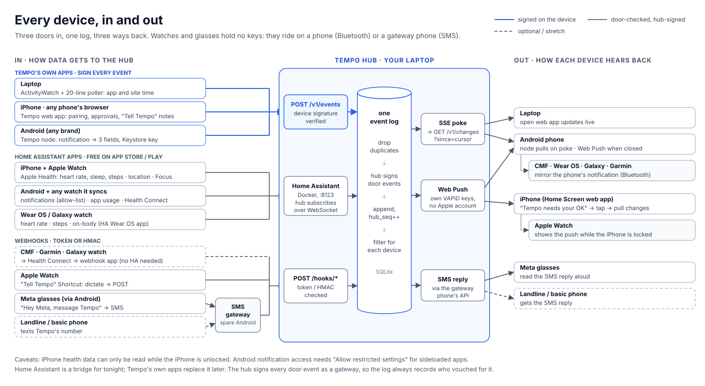
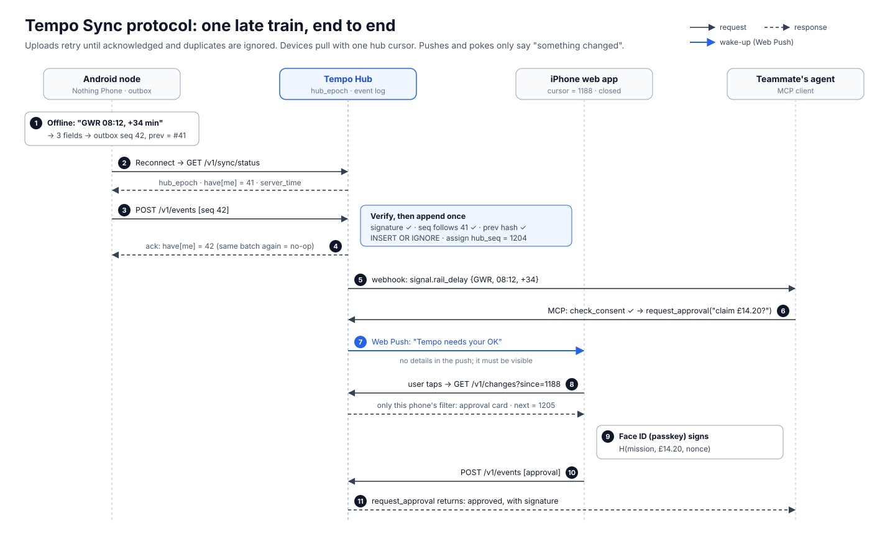

# Tempo Sync: what to set up tonight

> **Status:** v1, Sat 24 Oct 2026, ~18:00 BST. Hacking ends **Sun 25 Oct 12:00**. Clocks go back at 02:00, so tonight has an extra hour.
>
> **Why this doc exists:** the earlier docs list ~250 methods. This one makes the call: **what to build, what to borrow, and the exact order**, so one person can get real data syncing from an iPhone, an Android phone, watches, glasses and a laptop by Sunday morning.
>
> **How it was made:** four research agents worked in parallel and checked primary sources (npm, GitHub releases, official docs) on 24 Oct 2026:
> 1. ready-made data collectors
> 2. server stack and versions
> 3. how proven sync systems work (Atuin, Actual Budget, CloudKit, Standard Notes, Nostr, Home Assistant, the outbox pattern)
> 4. watch and glasses paths
>
> **Builds on:** `Tempo-Hub-Architecture.md` (the why) and `Tempo-Sync-Methods.md` (the full survey).
>
> **Marks:** ✅ checked against a primary source · ⚠️ test on the real device first · ❌ don't.

---

## 0. The decision in one table

**Build the hub and one web app. Borrow every collector that already exists.**

| | What | Why |
|---|---|---|
| **Build** | **Tempo Hub**: Node 24 + Hono + better-sqlite3. Signed event log, `/v1` sync protocol, SSE pokes, Web Push, passkeys, MCP | It's the product. Nothing off the shelf does signatures + push + passkeys + MCP (PocketBase was checked and rejected, §7) |
| **Build** | **Tempo web app (PWA)**: pairing, outbox, timeline, approvals, "Tell Tempo" notes | One codebase for iPhone, Android and laptop browsers. It's the only way to get iPhone push without a $99 developer account ✅ |
| **Build if time** | **Tempo Android node**: notification → 3 fields on the phone, signed with a Keystore key | It's the privacy story ("only 3 fields left the phone"). Home Assistant (HA) is the fallback if it runs late |
| **Borrow** | **Home Assistant + its free Companion apps** (iOS, Android, Wear OS, Apple Watch) ✅ | **Real iPhone + Apple Watch health data tonight with zero iOS code.** Android notifications, app usage and ~40 Health Connect sensors too |
| **Borrow** | **Health Connect → webhook app** (Life Dashboard Companion, MIT, HMAC-signed ✅; or HC Webhook, AGPL) | CMF, Garmin, Galaxy and other watches, without HA |
| **Borrow** | **SMS Gateway for Android** (capcom6, Apache-2.0, local mode) ✅ on a spare Android with a SIM | Meta glasses ("Hey Meta, message Tempo") and landlines, in and out, with no Meta SDK |
| **Borrow** | **ActivityWatch** ✅ + a 20-line poller | Laptop app and site time |
| **Borrow** | **Tailscale Funnel** ✅ | Free, stable HTTPS address; only needs outbound port 443, so it survives venue Wi-Fi |
| **Borrow** | **Ollama** 0.40.10 ✅ | Local model through an OpenAI-compatible API |

---

## 1. Diagrams

**The whole system:** devices, the hub, agents and models.


**Every device, in and out:** the three doors in and three ways back that each device uses tonight.



**The sync protocol:** one late train, end to end, with every request in order.



---

## 2. Device by device (tonight)

| Device | Data in | Updates out | Setup | Watch out for |
|---|---|---|---|---|
| **iPhone** | Tempo web app (approvals, notes) → `/v1/events`. **HA iOS app** → Apple Health (heart rate, resting HR, HRV, sleep), steps, location, Focus ✅ | Web Push to the Home Screen web app ✅. Tap → pull changes | 30 min | Push only works after **Add to Home Screen** (iOS 16.4+) ✅. HealthKit can't be read while the iPhone is **locked** ✅. HA's Apple Health sensors are new ⚠️ |
| **Apple Watch** | Health → HealthKit → HA app (above). **"Tell Tempo" Shortcut** with "Show on Apple Watch": Dictate Text → Get Contents of URL (POST) | The iPhone's Web Push **shows on the watch while the iPhone is locked** ✅ | 15 min | Running the Shortcut on the watch itself is ⚠️ (third-party source) |
| **Android (any brand)** | Tempo node (3 fields, signed) **or** HA Android app: notifications (allow-list), app usage, Health Connect ✅ | Node pulls on SSE poke. Web Push via Chrome when closed | 20–90 min | Sideloaded apps need **"Allow restricted settings"** for notification access ✅. Android 15 redacts OTPs ✅ |
| **CMF / Garmin / Galaxy / Wear OS watch** | Vendor app or **Gadgetbridge** → Health Connect → HA app or the webhook app ✅. Wear OS also via the HA Wear OS app ✅ | **Mirrors the phone's notifications** over Bluetooth ✅ (Wear OS by default; Galaxy and Garmin per-app toggle) | 20 min | CMF Pro 2 is "mostly supported" by Gadgetbridge; Pro 3 only partly ✅. Nothing X → Health Connect for current models ⚠️ |
| **Meta glasses** | "Hey Meta, **message Tempo**" → SMS to the gateway phone → `sms:received` webhook → `/hooks/sms` ✅ (Android phone paired with the glasses) | Hub → gateway `POST /message` → SMS → the glasses **read it aloud** ✅ | 30 min | Sending SMS from glasses paired with an **iPhone** looks unsupported ⚠️. Also works as a Bluetooth mic for the web app ⚠️ |
| **Laptop** | ActivityWatch → poller (signs with the laptop's key) → `/v1/events` ✅ | SSE live updates in the open web app | 15 min | ActivityWatch's API "is subject to change" ✅ |
| **Landline / basic phone** | Texts the gateway number → `/hooks/sms` | SMS reply | (same gateway) | Server-side path: no end-to-end encryption; say so |

**Avoid tonight:**
- ❌ **A second WhatsApp account** to receive glasses messages from an iPhone: it breaks WhatsApp's terms. The official API now needs a payment method past 1,000 free service messages a month.
- ❌ **Meta's glasses SDK (DAT):** 2–3 h to build, and you can't publish with it yet.
- ❌ **Our own iOS app:** the HA app covers it.

---

## 3. Setup, step by step

### Step 1: Stable HTTPS address (30 min, hour 1, go/no-go)
Passkeys, Home Screen installs and push subscriptions are all **tied to the hostname** ✅. Fix it once, before anything else.

1. Install the Tailscale app on the hub laptop and log in.
2. In the admin console:
   - enable **MagicDNS** and **HTTPS certificates**
   - add `"nodeAttrs":[{"target":["autogroup:member"],"attr":["funnel"]}]` to the policy
3. **Rename the machine to `hub` now.** Changing it later orphans every passkey.
4. Run:

```bash
tailscale funnel --bg --https=443 localhost:3000
```

```bash
tailscale funnel status
```

- Public DNS can take **up to 10 minutes** ✅.
- Funnel only listens on ports 443, 8443 and 10000 ✅.
- Funnel through WebSockets is **unverified**, so live updates use **SSE** (plain HTTPS streaming).
- Also install the **Tailscale app on the team's phones** (free). That lets them reach Home Assistant privately, without exposing it to the internet.

**Done when** `https://hub.<tailnet>.ts.net` serves a hello page on the iPhone over mobile data.

### Step 2: Hub skeleton (2 h)

```bash
npm i hono@4.13.13 @hono/node-server@2.1.5 better-sqlite3@13.0.3 web-push@3.6.7 @simplewebauthn/server@14.0.3 @modelcontextprotocol/server@2.4.0 @modelcontextprotocol/hono@2.0.2 zod@4.6.7
```

**Versions** (checked 24 Oct):
- Node **24 LTS**. Your Mac's 24.3.0 works; 24.22.1 is current.
- better-sqlite3 13 has prebuilt binaries for Apple Silicon, and FTS5 works ✅.

**Gotchas:**
- **Don't** install `@hono/node-ws`: it clashes with node-server v2.
- **Don't** use hono 5.0.0-rc.

**Schema:**

```sql
CREATE TABLE meta    (k TEXT PRIMARY KEY, v TEXT);          -- hub_epoch (UUID), gateway keys
CREATE TABLE devices (
  device_id  TEXT PRIMARY KEY,                               -- sha256(public key); never reused
  name TEXT, kind TEXT, pubkey_jwk TEXT,
  caps       TEXT,                                           -- capability profile (JSON)
  push_sub   TEXT,                                           -- Web Push subscription (JSON)
  revoked_at TEXT, created_at TEXT
);
CREATE TABLE events (
  hub_seq     INTEGER PRIMARY KEY AUTOINCREMENT,             -- the one download cursor
  id          TEXT UNIQUE NOT NULL,                          -- sha256(body bytes)
  device      TEXT NOT NULL,                                 -- author: a device, or gw:ha / gw:sms / gw:health
  seq         INTEGER NOT NULL,                              -- author's own counter, gap-free
  prev        TEXT,                                          -- id of the author's previous event
  kind        TEXT NOT NULL,                                 -- "health.heart_rate@1"
  class       TEXT NOT NULL,                                 -- vault | mission
  trust       TEXT NOT NULL,                                 -- device-signed | gateway:<name>
  hlc         TEXT NOT NULL,
  event_time  TEXT NOT NULL,                                 -- {"utc","offset","tz"}
  body        TEXT NOT NULL,                                 -- the exact signed bytes
  sig         TEXT NOT NULL,
  received_at TEXT NOT NULL,
  UNIQUE (device, seq)
);
CREATE TABLE device_filters (device_id TEXT PRIMARY KEY, kinds TEXT, since_days INTEGER, bytes_per_day INTEGER);
```

**Done when** two browser tabs, each paired as a device, see each other's events within a second.

### Step 3: Tempo web app (2.5 h)
- **Device key:** non-extractable ECDSA P-256 in WebCrypto. Store the `CryptoKey` object in IndexedDB.
- **Outbox:** IndexedDB. Write the state change and the event **in one transaction**.
- **Push:**
  - VAPID keys: `npx web-push generate-vapid-keys --json`.
  - The subject must be a real `mailto:`. A localhost subject gets Apple 403 `BadJwtToken` ✅.
  - Ask for permission **from a tap**.
  - Use the **Declarative Web Push** payload (Safari 18.4+). It needs no service worker and can't be "silent" by mistake ✅:
    ```json
    {"web_push":8030,"notification":{"title":"Tempo needs your OK","navigate":"https://hub.<tailnet>.ts.net/approve"}}
    ```
    Keep a service-worker `push` handler for Chrome.
- **Passkey approvals:** SimpleWebAuthn v14 (≥14.0.2 fixes a CVE) ✅. The RP ID is **the exact Funnel hostname**. The challenge is `H(mission, amount, nonce)`.
- **Screens:**
  - Pair (QR)
  - Timeline (Simple view / Judge view)
  - Approval card
  - "Tell Tempo" (text or mic)
  - Privacy log
  - Forget

**Done when** the iPhone (Home Screen app) receives a push, opens, pulls changes, and a Face ID approval lands in the log.

### Step 4: Home Assistant bridge (1 h)

```bash
docker run -d --name homeassistant --restart unless-stopped -p 8123:8123 -v ~/tempo-ha:/config -e TZ=Europe/London ghcr.io/home-assistant/home-assistant:stable
```

1. **Map the port.** Docker Desktop on a Mac doesn't support host networking ✅, so use `-p 8123:8123`.
2. **Onboard** at `http://localhost:8123`.
3. **Create a long-lived token** (Profile → Security).
4. **Install the Companion apps:**
   - iPhone (App Store), Android (Play), Wear OS.
   - Point them at `http://hub:8123` over the tailnet.
   - Turn on the sensors you want:
     - **iOS:** Apple Health, steps, location, Focus
     - **Android:** last notification with an **allow-list** of the rail and banking apps you demo, app usage, Health Connect
5. **Run the hub subscriber,** about 60 lines:
   1. Open `ws://localhost:8123/api/websocket`.
   2. Wait for `auth_required`, then send `{"type":"auth","access_token":"…"}` and wait for `auth_ok`.
   3. Send `{"id":1,"type":"subscribe_events","event_type":"state_changed"}`.
   4. For each state change, **map** the sensor to a Tempo kind (§5).
   5. Wrap it as a `gw:ha` event signed by the hub's HA gateway key.
   6. Append it through the same ingest code.

**Privacy:** the HA path sends **full** notification text to the hub laptop, not 3 fields. The allow-list limits *which* apps. Say this out loud, and keep the Tempo Android node as the "only 3 fields leave" demo.

**Done when** walking 20 steps with the iPhone shows a `health.steps@1` event on the laptop timeline.

### Step 5: Webhooks (1 h)
Every webhook is checked at the door (bearer token or HMAC), then becomes a gateway event in the same log.

| Route | Sender | Check | Kind |
|---|---|---|---|
| `POST /hooks/sms` | SMS Gateway app (local mode) on the spare Android | `X-Signature` HMAC ✅ | `message.sms_in@1` |
| `POST /hooks/health` | Life Dashboard Companion (HMAC-SHA256 ✅) or HC Webhook | HMAC or token | `health.*@1` |
| `POST /hooks/note` | Apple Watch / iPhone "Tell Tempo" Shortcut | bearer token for that device | `note.dictated@1` |

**SMS gateway set-up:**
- The gateway's webhook URL **must be HTTPS with a valid certificate** ✅. The Funnel URL qualifies.
- To reply, the hub calls the gateway phone's **local API** (`POST /message`). Put the gateway phone **on the tailnet** so the hub can reach it from anywhere.
- Save the gateway's number as a contact called **"Tempo"** on the Android phone the glasses are paired with.

**Done when** "Hey Meta, message Tempo: remind me to leave at five" appears in the timeline, and the reply is read aloud by the glasses.

### Step 6: Laptop poller (20 min)
1. Read `GET http://localhost:5600/api/0/buckets/`.
2. For each bucket, read `GET /api/0/buckets/<id>/events?start=<last>` ✅.
3. Sign the results with the laptop's P-256 key (Node `crypto`) and `POST /v1/events`.
4. Run it every minute.

### Step 7: Agents and models (handled with the teammate)
**MCP server:**
- Use `@modelcontextprotocol/server` 2.4.0 + `@modelcontextprotocol/hono` 2.0.2 ✅.
- It implements spec **2026-07-28**: stateless Streamable HTTP, no session ID.
- `createMcpHonoApp()` rejects non-localhost hosts, so pass `allowedHosts:['hub.<tailnet>.ts.net']` ✅.
- Tools are listed in Architecture §4.6. **Hand the teammate a stub with fixtures in hour 1.**

**Ollama** 0.40.10 ✅:
- `/v1/chat/completions` supports streaming, tools and JSON schema; `/v1/embeddings` works too.
- It has no `tool_choice`.
- Set the context size in a Modelfile (`num_ctx`), not through the API.

---

## 4. The sync protocol (≈3 hours to implement)

Proven pattern: **Atuin** (each host writes only its own append-only series) + **CloudKit** (one opaque change token per pull) + **Actual Budget** (`INSERT OR IGNORE`, a 5-minute clock-drift guard) ✅.

### 4.1 Envelope
Keep envelope v1 from `Tempo-Sync-Methods.md` §6.3:
- `body` is the **exact JSON bytes**.
- `sig` = ES256 over those bytes.
- `id` = sha256(body bytes).

This avoids canonical-JSON mismatches between Kotlin and JS. P-256 signatures are random, so `id` must never include `sig`.

**New fields in `body`:**
- `prev`: the author's previous event id. Gaps and forks become detectable.
- `kind@version`, e.g. `"health.heart_rate@1"`. The hub stores and forwards unknown kinds untouched.

### 4.2 Endpoints

| Method | Path | Returns / does |
|---|---|---|
| `POST` | `/v1/pair/start` | One-time QR token (2 min, rate-limited). **Every existing device gets a "new device" alert** |
| `POST` | `/v1/devices/register` | `{pubkey, name, caps, pairing_token}` → `{device_id, hub_epoch, filter}` |
| `GET` | `/v1/sync/status` | `{hub_epoch, have:{device: seq}, hub_seq_max, server_time}` |
| `POST` | `/v1/events` | `{events:[…]}` → `{accepted, duplicate, rejected:[{id,reason}], have}`. `409 seq_gap {expected}` · `422 bad_sig` · `403 revoked` |
| `GET` | `/v1/changes?since=H&limit=500` | `{events, next, more, hub_epoch}`. `410` = epoch or filter changed → reset cursor to 0 |
| `GET` | `/v1/live` (SSE) | `event: poke` / `data: {"hub_seq_max":1209}`. A poke never carries data; the client pulls |
| `POST` | `/v1/push/subscribe` | Stores the Web Push subscription |
| `POST` | `/v1/approvals/:id` | WebAuthn assertion → signed `approval` event |
| `POST` | `/hooks/{sms,health,note}` | Door-checked webhooks (§3, step 5) |
| — | `/mcp` | `tempo-me` MCP server |

### 4.3 Rules that keep it correct
- **Download cursor = `hub_seq` (one number).**
  - Filters mean a phone deliberately skips some events, so per-device sequence numbers can't tell "filtered out" from "lost".
  - Save the cursor **in the same local transaction** that applies the page.
- **Upload position = the hub's `have[me]`**, never what the device believes. Retrying a batch is always safe.
- **HLC is for ordering and the fold, never a cursor.** An event created offline last Tuesday keeps last Tuesday's HLC but gets today's `hub_seq`.
- **Deny wins causally:** a grant beats a revoke only if its `causes` names that revoke. Otherwise the revoke wins.
- **Filter query:** `WHERE hub_seq > ? AND kind IN (filter) AND device != requester ORDER BY hub_seq LIMIT 500`.
  - Consent, device-registry and settings events always pass.
  - Over the byte budget, send headers only (`truncated: true`); the device fetches bodies on demand.

### 4.4 Failure modes → fixes

| Failure | Fix |
|---|---|
| Duplicate delivery | `id` UNIQUE + `UNIQUE(device, seq)` + `INSERT OR IGNORE` |
| Out-of-order upload | Hub expects `have[D]+1`; otherwise `409 {expected}` and the device resends from there |
| Device offline for days | Nothing special: the outbox drains on reconnect; the fold orders by (HLC, device) |
| Wrong phone clock | Hub sends `server_time`; device refuses to stamp events if off by > 5 min (Actual's guard) |
| Same (device, seq), different content | **Fork**: reject, alert all devices |
| Lost or reinstalled phone | New key = new `device_id`; `device.remove` revokes the old one; the hub rejects its key from then on |
| Hub database lost | `hub_epoch` changes → devices reset cursor to 0 and re-upload. Signed events can be verified again from any copy |
| Half-finished upload | One transaction per batch; ack = `have[me]` |
| Big backfill | Pages of ≤ 500 events / ≤ 1 MB; blobs separately, addressed by sha256 |
| New event versions | `kind@version`; the fold upgrades or skips and shows "update required"; stored events are never rewritten |

### 4.5 Reconnect loop (every device)
1. **Trigger:** network back, app foreground, push, or a jittered timer.
2. `GET /v1/sync/status`. If `hub_epoch` changed, reset the cursor to 0.
3. **Upload** from `have[me]+1` in pages. On 409, resend from `expected`.
4. **Pull** `GET /v1/changes` until `more = false`. For each event: verify → `INSERT OR IGNORE` → fold → save cursor.
5. **Live:** open SSE `/v1/live`. On a poke, go back to step 4. New local events are posted immediately.
6. **iPhone closed:** the hub sends one coalesced, **visible** Web Push. The full sync runs when the app opens.

---

## 5. Mapping borrowed data to Tempo events

Entity names below are examples. HA names them after the device; check them in Developer Tools → States.

| Source | Example | Tempo kind | Class |
|---|---|---|---|
| HA iOS | `sensor.iphone_steps` | `health.steps@1` | vault |
| HA iOS (Apple Health) | heart rate, HRV, sleep stage sensors ⚠️ | `health.heart_rate@1`, `health.sleep@1` | vault |
| HA iOS / Android | `device_tracker.*`, geocoded location | `place.visit@1` (rounded to the area) | vault |
| HA Android | `sensor.*_last_notification` (allow-listed apps) | `signal.notification@1` → the rail skill extracts `{operator, service, delay_min}` | vault → mission |
| HA Android | `sensor.*_app_usage` / last used app | `time.app_usage@1` | vault |
| HA Wear OS | `sensor.*_heart_rate`, `*_daily_steps`, `on_body` | `health.*@1`, `presence.worn@1` | vault |
| Life Dashboard / HC Webhook | Health Connect records | `health.*@1` | vault |
| SMS Gateway | `sms:received` | `message.sms_in@1` | vault |
| Shortcut | dictated note | `note.dictated@1` | vault |
| ActivityWatch | window and web buckets | `time.app_usage@1`, `time.afk@1` | vault |
| Tempo Android node | rail notification → 3 fields | `signal.rail_delay@1` | mission |

Only **mission** events may reach a cloud model. The model router enforces this.

---

## 6. Order of work (rest of tonight)

| When (local) | Build | Done means |
|---|---|---|
| **18:00–18:30** | Tailscale Funnel + `hub` name. Freeze envelope + MCP contract with the teammate; give them the stub | iPhone loads the hello page; teammate calls the stub |
| **18:30–20:30** | Hub: schema, register/pair, `/v1/events`, `/v1/changes`, `/v1/sync/status`, SSE, `hub_epoch` | Two tabs sync; retrying a batch is a no-op |
| 20:30–21:00 | Food | — |
| **21:00–22:00** | Home Assistant + Companion apps on iPhone and Android + bridge | iPhone steps show up on the timeline |
| **22:00–23:30** | Web app: pairing, outbox, timeline, push, passkey approval | Push → Face ID → approval in the log |
| **23:30 BST → 00:30 GMT** | SMS gateway (glasses) + health webhook + Watch Shortcut + ActivityWatch poller. **Clocks go back at 02:00 BST** (an extra hour) | Glasses message in, reply read aloud |
| **00:30–01:30 GMT** | Android node, **90-min timebox**. If not done, HA's notification sensor is the fallback | Notification → 3 fields → signed event |
| 01:30–06:30 | Sleep. Hub, HA and `caffeinate` keep running | — |
| **Sun 06:30–08:30** | Memory (FTS5, cited facts, Forget) + MCP tools for real + Ollama router | Agent query returns cited events; Forget empties it |
| **08:30–09:30** | Integration with the teammate; seed and label demo data | End-to-end through the real agent |
| **09:45** | **Code freeze**. Record the backup video on the phone hotspot | Video saved |
| 10:00–11:30 | Rehearse ×3, Devpost, submit by 11:30. Keep the hub running for judging (13:00–15:45) | Submitted |

**Never cut:**
- the signed log with `hub_seq` cursor
- iPhone push → Face ID approval
- one borrowed collector per platform (HA)
- Forget
- the backup video

**Cut first:**
1. the Android node (HA covers it)
2. the Watch Shortcut
3. ActivityWatch
4. the landline path

---

## 7. Checked and rejected

| Option | Why not tonight |
|---|---|
| **PocketBase** as the hub | No WebAuthn, no Web Push, no MCP. Its scripting can't verify signatures (HMAC only). Pre-1.0, and its release source moves around 26 Oct ✅ |
| **MQTT broker** | Every collector we picked speaks HTTP webhooks already |
| **Cloudflare tunnel** | Needs outbound port 7844 (venue Wi-Fi may block it); a quick tunnel's URL changes on every restart, which breaks passkeys and push ✅ |
| **WebSockets for live updates** | Not confirmed to pass through Funnel; SSE does the same job for one-way pokes |
| **Pretending to be Home Assistant** (hub speaks HA's mobile_app protocol so the official apps talk to Tempo directly) | Feasible on Android (2–4 h), harder on iOS (encryption + more endpoints). **A great roadmap item:** every HA Companion install becomes a Tempo collector |
| **Forking Atuin / Actual / Evolu / any-sync** | Each is tied to its own data model; none has push + passkeys + MCP |

---

## 8. What to say (honesty)

- **"Tonight we borrow open-source collectors; Tempo's own apps replace them."** Home Assistant is Apache-2.0 and self-hosted, which fits the no-lock-in rule. It is still a bridge, not the product.
- **Two trust levels are visible in the log:** `device-signed` (Tempo's apps) and `gateway:<name>` (the hub vouches for a webhook or HA). Never present a gateway event as signed by the phone.
- **iPhone health data arrives only when the iPhone is unlocked.** It's an Apple limit, not a bug.
- **This weekend:** TLS + signatures + passkeys. **Not** end-to-end encryption. Don't say "nothing leaves your phone" about the HA path.

---

## 9. Test on the real devices tonight
- ⚠️ Do HA iOS **Apple Health** sensors appear on the team's iPhone (iOS 27)?
- ⚠️ "Hey Meta, message Tempo" from glasses paired with the Android phone: does it send plain SMS?
- ⚠️ Does the CMF watch's data reach Health Connect through Nothing X? If not, use Gadgetbridge.
- ⚠️ Web Push latency to the iPhone over the phone hotspot (p50 / p95).
- ⚠️ Does the "Tell Tempo" Shortcut run on the Apple Watch itself?

---

## 10. Sources (checked 24 Oct 2026)

**Stack:**
- npm registry for every package version above
- Node release schedule: https://raw.githubusercontent.com/nodejs/Release/main/schedule.json
- better-sqlite3: https://github.com/WiseLibs/better-sqlite3/blob/master/docs/compilation.md
- Hono WebSocket on Node: https://github.com/honojs/node-server#websocket
- web-push: https://github.com/web-push-libs/web-push
- iOS Web Push: https://webkit.org/blog/13878/web-push-for-web-apps-on-ios-and-ipados/
- Declarative Web Push: https://webkit.org/blog/16535/meet-declarative-web-push/
- SimpleWebAuthn v14: https://github.com/MasterKale/SimpleWebAuthn/releases/tag/v14.0.0
- MCP 2026-07-28 changelog: https://modelcontextprotocol.io/specification/2026-07-28/changelog
- MCP TypeScript SDK: https://github.com/modelcontextprotocol/typescript-sdk
- Ollama OpenAI compatibility: https://github.com/ollama/ollama/blob/main/docs/api/openai-compatibility.mdx
- PocketBase: https://pocketbase.io/docs/js-overview/ · https://pocketbase.io/jsvm/modules/_security.html
- Tailscale Funnel: https://tailscale.com/kb/1223/funnel · https://tailscale.com/kb/1311/tailscale-funnel · https://tailscale.com/kb/1082/firewall-ports
- Cloudflare quick tunnels: https://developers.cloudflare.com/cloudflare-one/networks/connectors/cloudflare-tunnel/do-more-with-tunnels/trycloudflare/

**Collectors:**
- Home Assistant sensors: https://companion.home-assistant.io/docs/core/sensors · Wear OS sensors: https://companion.home-assistant.io/docs/wear-os/sensors
- HA HealthKit sensor (locked-phone behaviour): https://github.com/home-assistant/iOS/blob/main/Sources/Shared/API/Webhook/Sensors/Health/HealthKitSensor.swift
- HA WebSocket API: https://contributors.home-assistant.io/core/internals/websocket-api/
- HA in Docker: https://www.home-assistant.io/installation/linux
- HA mobile_app API: https://contributors.home-assistant.io/companion/mobile-app-api/sending-data/
- ActivityWatch REST: https://docs.activitywatch.net/en/latest/api/rest.html
- Life Dashboard Companion: https://github.com/owen282000/life-dashboard-companion-app
- HC Webhook: https://github.com/mcnaveen/health-connect-webhook
- SMS Gateway: https://docs.sms-gate.app/getting-started/local-server/ · https://docs.sms-gate.app/features/webhooks/
- Gadgetbridge: https://gadgetbridge.org/gadgets/wearables/nothing/ · https://gadgetbridge.org/internals/automations/intents/
- OwnTracks HTTP (not used tonight): https://owntracks.org/booklet/tech/http/
- Android 15 behaviour changes: https://developer.android.com/about/versions/15/behavior-changes-all

**Wearables:**
- Meta glasses calls and messages: https://www.meta.com/help/ai-glasses/647079267216457/
- Meta glasses message read-out: https://www.meta.com/help/ai-glasses/493802475697609/
- Meta wearables FAQ: https://developers.meta.com/wearables/faq
- Apple Watch notifications: https://support.apple.com/en-us/108369
- Shortcuts on Apple Watch: https://support.apple.com/guide/watch/shortcuts-apd99050d435/watchos
- Wear OS notification bridging: https://developer.android.com/training/wearables/notifications/bridger
- Garmin Connect IQ `makeWebRequest`: https://developer.garmin.com/connect-iq/api-docs/Toybox/Communications.html
- WhatsApp Business pricing: https://developers.facebook.com/documentation/business-messaging/whatsapp/pricing

**Sync design:**
- Atuin: https://github.com/atuinsh/atuin/blob/main/crates/atuin-client/src/record/sync/mod.rs · https://docs.atuin.sh/main/reference/store/
- Actual Budget: https://github.com/actualbudget/actual/blob/master/packages/sync-server/src/sync-simple.js · https://github.com/actualbudget/actual/blob/master/packages/crdt/src/crdt/timestamp.ts
- CloudKit: https://developer.apple.com/documentation/cloudkit/ckfetchrecordzonechangesoperation
- Standard Notes sync: https://en.typeblog.net/56eb/standard-notes-sync-protocol-and-sfrs-a-rust-implementation
- Nostr: https://nips.nostr.com/1 · https://nips.nostr.com/77
- Transactional outbox: https://microservices.io/patterns/data/transactional-outbox.html
- Hybrid Logical Clocks (Kulkarni et al. 2014): https://cse.buffalo.edu/tech-reports/2014-04.pdf
