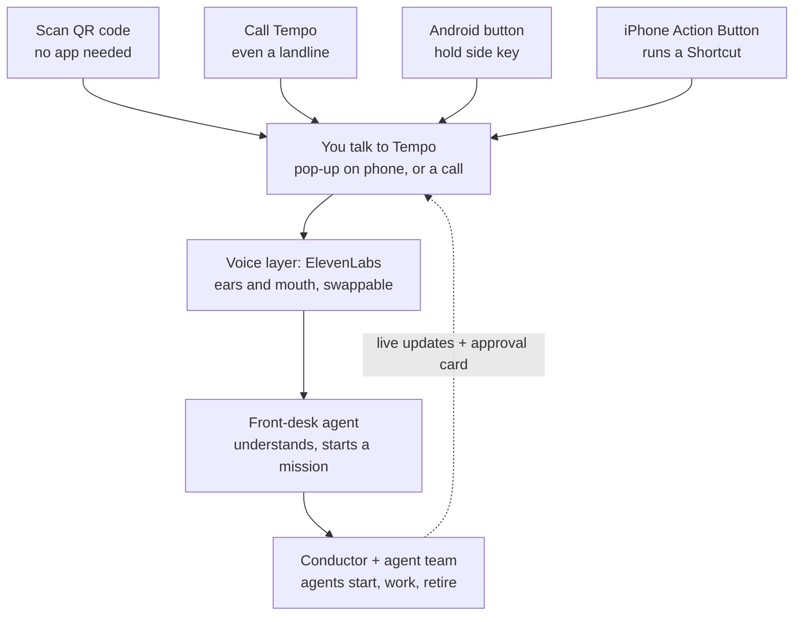
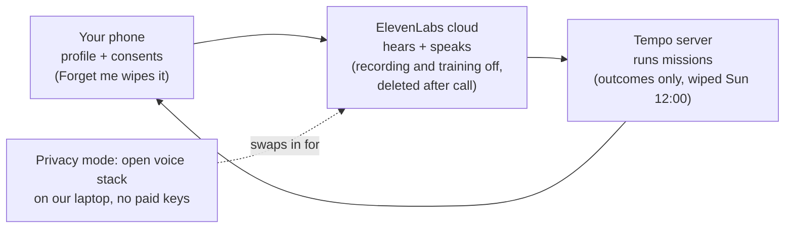
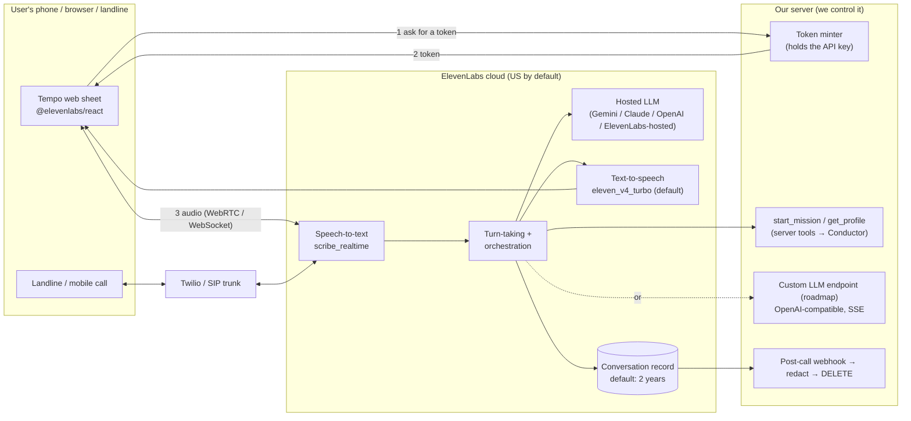

# Tempo: voice interface, languages and direction review

> **What this is:** answers to five questions:
> 1. How do we get a Siri-style "press, pop-up, talk" interface on every device?
> 2. How does ElevenLabs actually work, and what does it keep?
> 3. Who handles many languages properly, especially Welsh and other UK languages?
> 4. Are we really building something crazier than Siri, Samsung or Gemini?
> 5. Is the direction right?
>
> **How it was made:**
> - 7 research agents covered the questions in parallel (interface, consumer-assistant languages, voice platforms, ElevenLabs data, open UK-language tools, competitors, direction critique).
> - Two fact-checking rounds then tried to disprove the claims the design depends on, using primary sources.
> - Compiled Sat 24 Oct 2026, 16:45–17:30 BST.
>
> **Marking:**
> - ✅ = confirmed by a fact-check round (primary source)
> - ☑️ = sourced by a research agent, not re-checked
> - ⚠️ = unverified, or the vendor's own docs contradict each other. **Test it before it goes on a slide.**
>
> **Companions:**
> - `Tempo-Platform-Spec.md` (§15 Tempo Mesh)
> - `Tempo-Demo-Usecases.md`
> - **`research/Tempo-Sync-Methods.md`**: device sync, the event envelope and the memory MCP. That doc is owned by the sync session and isn't duplicated here.

---

## 0. TL;DR for the team

1. **You can't replace Siri, but the pop-up can be a web page.**
   - **Any phone, no install:** a QR code opens a page with one big "tap to talk" button. ✅ This is the only path a judge can use on their own phone in about 10 seconds.
   - **Every phone, including landlines:** save **"Tempo" as a contact**. Then *"Hey Siri / Hey Google / Hey Meta, call Tempo"*, AirPods, a watch or a speed-dial key all become Tempo buttons ☑️.
   - **Android:** a real "hold the side button and Tempo slides up" overlay *is* possible with a small native app the user picks as the default assistant ✅.
   - **iPhone:** taking over the side button is **Japan-only** ✅. The nearest thing is the Action Button or Back Tap running a Shortcut.
   - **Earbud and glasses buttons don't follow the Android setting** ✅ (claim refuted). **No wake words** ✅.
2. **ElevenLabs keeps a lot by default:**
   - the transcript, both sides' audio, the caller's phone number, tool inputs and outputs, and an AI-written summary ✅
   - kept **2 years**, stored in the **US** ✅
   - possibly **used for training** unless you switch it off ✅

   **What we can switch off:** audio saving, retention (set to 0), training, and delete each call through the API.
   **Enterprise-only:** zero-retention mode, data redaction and EU storage ✅.
   **The honest line:** *"processed by ElevenLabs, not kept"*. Never "local".
3. **Languages:**
   - **No mainstream consumer assistant speaks Welsh by voice** ☑️ ✅ (Siri: none ✅).
   - **The building blocks do:**
     - ElevenLabs' default agent voice model (v4 Turbo) lists Welsh ✅
     - Azure and Soniox have Welsh speech-to-text **and** text-to-speech ✅
     - Bangor University ships open Welsh speech models (Apache-2.0 / CC0) ✅
   - **Mid-call switching is opt-in.** You must add the `language_detection` tool ✅.
   - **Test with a real Welsh speaker tonight.**
4. **Most hero features already exist somewhere:**
   - Waiting on hold: **Pixel Hold for Me and iOS 26 Hold Assist both work in UK English** ✅.
   - An AI that phones businesses: Gemini (US only, Pixel 11) ✅.
   - An open personal agent with phone calls and device "nodes": OpenClaw ✅.
   - A guarded agent: Meta Muse (US only) ✅.

   **What's genuinely new:** any phone including UK landlines; UK rights as code with a proof trace; short-lived agents you can *watch*, budget and stop; and Welsh.
5. **Direction: right idea, dangerous scope.**
   - Stop researching. Freeze the contract with the agent teammate **now**.
   - Build **one path**: QR → tap to talk → Tempo knows you → agent cards appear and retire → approval on a second phone → "£14.20, 25 minutes returned".
   - Prove "no lock-in" with **one live provider switch**.
   - Everything else becomes honest roadmap slides.

### At a glance

**How someone reaches Tempo, and what happens next:**

**Where your data goes:**

**Decision to make in the next 30 minutes:** freeze the mission API and event contract with the agent teammate (§2.2 and §5.4, step 1). It's the same event envelope as `Tempo-Sync-Methods.md` §6.3, so use one schema, not two.

---

## 1. A Siri-style interface: press, pop-up, talk

### 1.1 The design goal

**One gesture opens a listening sheet. After that, Tempo handles everything.** The sheet is the same everywhere:

- **Talk button:** one big orb that animates with your voice level.
- **Live captions:** an `aria-live` region.
- **A language chip:** English / Cymraeg / Polski / اردو / ਪੰਜਾਬੀ / বাংলা.
- **Large-type consent cards**, e.g. *"Claim £14.20? YES / NO"*.
- **"Type instead"** and **"Call instead"** (`tel:`) options.
- **A Stop button:** the kill switch.
- **Agent cards** that appear with a budget meter, do one job and retire. This makes "agents deployed only when needed" *visible*. Without it, on-demand is invisible.

**Tap to start, not hold-to-talk and not always-listening:**
- Hold-to-talk is hard with tremor or arthritis.
- Always-listening is bad for privacy and battery, and has no Welsh wake word.
- Third-party apps get no system wake word on Android ✅.

**Rules for older users and strong accents** (evidence in §3.3):
- one question at a time
- read back every critical detail (amount, date, reference, name, postcode) by voice **and** SMS before any binding step
- `turn_eagerness: patient` and a longer `turn_timeout` (default 7 s, up to 30 s) ✅
- a text box whenever the mic fails

### 1.2 Per platform (what's actually possible, Oct 2026)

| Platform | Best trigger | What a normal (non-system) app can do | Needs | Weekend? |
|---|---|---|---|---|
| **Any phone, zero install** | QR → HTTPS page → tap the orb | Mic after a tap; ElevenLabs JS/React SDK over WebRTC (WebSocket fallback); captions; consent cards | Our server mints a per-session token | **Yes: P0, ~3 h** |
| **Any phone, including landlines** | **Save "Tempo" as a contact** (vCard QR) → *"Hey Siri / Google / Meta, call Tempo"*, AirPods, watch, speed dial ☑️ | The call itself can be in any language the agent speaks, even if the platform assistant has no Welsh | A phone number (§2.7) | 0.5 h on top of the phone agent |
| **Android** (Pixel, Samsung, Nothing…) | User picks Tempo under **Settings → Apps → Default apps → Digital assistant app** ✅ | A real **overlay over the current app** (`VoiceInteractionSession`; a full-screen window anchored at the bottom, so we draw our own bottom sheet) ✅. It opens on power / side-button long-press where the phone maker allows (Pixel setting; Samsung *Side button → Long press*) or a corner swipe ✅. It can read the current screen's text or a screenshot only if the user has turned on *Use text from screen / Use screenshot*; secure windows come back empty ✅. Perplexity, ChatGPT and Copilot ship this ✅. Also: a Quick Settings tile, a widget ☑️ | A tiny native app with a `VoiceInteractionService` **or** an exported `ACTION_ASSIST` activity ✅. The role **can't be requested from code**, so deep-link the user to Settings ✅. No system wake word: those APIs are for preinstalled apps only. But the active assistant *may* start a mic service from the background ✅. The setting can reset after a reinstall ☑️ | P2 stage demo, 4–7 h for someone fluent in Android: the session hosts the same web sheet in a WebView |
| **iPhone** | **Action Button** (15 Pro and later, all 16 incl. 16e, 17, Air) or **Back Tap** (iPhone 8+) → Shortcut ✅. A user-made Shortcut *"Hey Siri, Ask Tempo"* ✅ | **Can't replace Siri or take the side button outside Japan** (iOS 26.2+ with an Apple entitlement); **no EU or UK equivalent** ✅. With a native app: Controls (Control Center, Lock Screen, Action Button) open Tempo *into voice mode*, plus a Live Activity for hold status. **No live voice pop-up over other apps**. Starting a recording from the background fails, per Apple developer support, so start it in the foreground ✅ | Shortcuts: nothing. Native app: Apple Developer Program **$99/yr** to distribute (free = 3 own devices, 7-day expiry) ✅. A Shortcut's "Open URLs" opens the **default browser**, not the installed web app (community reports), so expect a separate mic prompt ☑️ | **Yes: 30 min** on a team iPhone |
| **Windows** | Global hotkey; **Copilot key** | The Copilot key can only point at **packaged (MSIX) and signed** apps ✅. Alternative: a tray app with a keyboard hook (the key sends Shift+Win+F23), AutoHotkey or PowerToys ✅ | Tray helper running | Optional, 20 min (AutoHotkey → browser `--app=` window) |
| **macOS / Linux** | Global hotkey → small always-on-top window with the web sheet | Menu-bar / tray app (Tauri 2 later) ☑️ | — | Roadmap |
| **Wear OS / Galaxy Watch** | Galaxy Watch Home-key long-press, if an assistant app **installed on the watch** is the default ✅ | Pixel Watch press-and-hold → Gemini (replaceability unverified ⚠️). Apple Watch Ultra Action Button → Shortcut "Call Tempo" ☑️ | Watch app | Roadmap; use "call Tempo" this weekend |
| **Earbuds / headsets** | ❌ **Don't promise** | The Bluetooth voice button sends a generic voice-command intent, *not* the assistant role. Pixel Buds → Gemini, Galaxy Buds → Bixby or Google, AirPods → Siri ✅ (claim **refuted**) | Declare `VOICE_COMMAND` filters, then test each pair | No |
| **Meta Ray-Ban / Oakley Meta** | "Hey Meta, **call Tempo**" ☑️ | "Hey Meta" and tap-and-hold → **Meta AI only** ✅. The glasses work as a **Bluetooth headset mic** (8 kHz mono) for our web sheet ✅. Meta's toolkit 1.0 adds third-party voice launch, button events and audio streaming, but these are **experimental and can't be published** ✅ | Native toolkit app on your own device | Stage trick only |
| **Nothing Phone** | The Android row (Nothing hasn't confirmed it ⚠️) | The **Essential Key can't be officially remapped** until Nothing OS 5.1 (no date); ADB + Key Mapper workaround ✅ | — | Use the Android row |
| **Hands-free wake word** | ❌ **Avoid** | Porcupine's free tier ended **30 Jun 2026**; openWakeWord's ready-made models are **non-commercial and English-only** ✅ | — | No |

**A bonus for the sync stream** ✅ (confirmed by the sync session's fact-check round):
- **What the role allows:** Google Play's SMS and Call Log policy lets an app that is the user's **default Assistant handler** request SMS and call-log permissions. In AOSP, the assistant role grants the SMS permission set, `READ_CALL_LOG` and the overlay permission.
- **What that means for Tempo:** an Android Tempo assistant can read SMS for on-device scam checks **within Play policy**, with consent.
- **Limits:**
  - A Permissions Declaration Form is still needed.
  - The app must stop the moment it loses the role.
  - Play forbids deriving the same data "by alternative methods".
  - The role does **not** get sensitive-notification access, so Android 15's one-time-code redaction still applies. Android 17 exempts the assistant from the new 3-hour delay on SMS one-time codes.
- **Details:** see `Tempo-Sync-Methods.md` §3 and §11.

**Direction of travel (good for the pitch):**
- **EU, 16 Jul 2026:** under the DMA, Google must open **assistant invocation and the always-on wake word** to rival AI services by Android 18 / 1 Aug 2027 ✅.
- **UK, reported Sep 2026:** the CMA is consulting on putting AI assistants on Android and Chrome choice screens (press reports only ⚠️).

The platforms are being forced open. Tempo should be ready for the "assistant" slot.

### 1.3 "Anyone in the room": the 10-second path

1. A printed **QR code** (it encodes only a short URL, no personal data) → `https://<tempo>/s/ABCD`. Tell people to **"use your Camera app"**, because in-app browsers like WhatsApp may block the mic ☑️.
2. The page paints (<1 s) → tap the orb → allow the mic (~2 s) → Tempo greets them and offers *"Cymraeg? Polski?"* (~1–2 s).
3. An optional 3-question profile (name, language, how to update you), stored **on the phone** (§1.5).
4. They say what's wrong → agent cards appear on the big screen → a consent card on the phone → the result.

**What has to be true behind it:**

| Check | Why | Status |
|---|---|---|
| Agent **authentication on**; our server mints a **conversation token** (WebRTC) or **signed URL** (WebSocket; must be used within 15 min) | The API key never reaches a phone. A public agent ID (and the drop-in widget, which *needs* one) lets anyone spend your credits | ✅ Don't combine signed URLs with the domain allowlist on one agent ✅ |
| **Per-session overrides are switched on** (language, first message, voice) in the agent's **Security** tab | They're off by default; otherwise language chips do nothing | ☑️ |
| **Capacity:** Free = **15 min and 4 calls at once**. Creator = 10, Pro = 20 at once | A room of judges plus agent-vs-agent Arena calls will drain the Free plan in minutes | ✅ Redeem the **MLH ElevenLabs code: 1 free month of Creator (10 at once, 275 min)** ✅, or pay for Pro (20 at once) for the weekend. **Call queueing is on by default** (180 s wait; waiting isn't billed). Burst allows 3× concurrency at 2× price ✅. Cap sessions at ~3 min |
| **Venue Wi-Fi can block WebRTC** | Silent failure | ☑️ Fall back to WebSocket after ~4 s; test on 4G and a hotspot |
| **Mic can fail on iOS Safari** (WebKit bug 319706, fixed Sep 2026) and in home-screen web apps (open bugs) | No audio | ✅ Use a **normal Safari tab**, catch `NotAllowedError`, show "Type instead" |

### 1.4 What to build this weekend (interface)
1. **The web sheet** (P0, ~3 h):
   - orb, captions, language chips (via overrides), consent cards (client tools), Stop, "Type instead" (`sendUserMessage`), "Call instead"
   - `@elevenlabs/react` or `@elevenlabs/client`, with the token from our backend
2. **Mission stream on the same page and the big screen** (P0, with the agent teammate; §2.2): agent cards spawn, spend and retire; Tempo narrates progress via `sendContextualUpdate` ☑️.
3. **"Save Tempo as a contact" vCard QR + the stage "Siri moment"** (P1, 30 min): on a team iPhone, Action Button → Shortcut; on Android, a home-screen shortcut.
4. **Android assistant wrapper** (P2, only if someone knows Android): long-press side key on a team phone → Tempo slides up over Messages → *"that's a scam"*. Present it as "the native Android node", not something judges install.

### 1.5 Personalisation that fits the pop-up (your lane)
- **A small, explicit, editable profile beats a whole-life memory this weekend** ☑️.
- **Profile JSON on the phone** (IndexedDB, in try/catch). Fields: `{name, lang:{primary:'cy', secondary:'en', code_switch:true, register:'chi'|'ti', dialect:'north'|'south'}, voice, pace, turn_eagerness, read_back:true, contact_pref, time_value_optional}`.
- **Injected per session** as dynamic variables and overrides; exposed to agents as `get_profile`.
- **Only remembered after** *"Shall I remember that?"*.
- **"What do you know about me?"** answers with sources. **"Forget that"** and a **Forget me** button really delete, on the phone and on the server.
- **Keep health and pay out of it.** "Stammer" or "accessibility needs" is special-category data. Use a neutral `pace: slow` instead ☑️.
- **Never put personal facts in the ElevenLabs system prompt or knowledge base.** Agent configuration is kept regardless of retention settings and isn't covered by zero-retention mode ✅.

---

## 2. How ElevenLabs Agents works, and what happens to our data

### 2.1 End to end

**What happens in a call:**

- **Audio in.**
  - Web: WebRTC (the SDK default) or WebSocket.
  - Phone: Twilio's native integration, or any standards-compliant SIP trunk (TCP/TLS, G.711/G.722) ✅.
- **Speech-to-text.** The default is `scribe_realtime` ✅.
- **Text-to-speech.** `eleven_v4_turbo` has been the default for new agents since 5 Oct 2026 ✅.
- **Tools:**
  - *Server tools:* webhooks to our backend.
  - *Client tools:* run in our page (consent cards, on-device facts).
  - *System tools:* end call, transfer, keypad tones, skip turn, voicemail detection, `language_detection` ✅.
- **The "brain", three ways to keep it ours** ☑️:
  1. **Custom LLM.** Our OpenAI-compatible Chat Completions / Responses endpoint, streaming SSE with function calling ✅.
  2. **"Speech Engine".** ElevenLabs only listens and speaks; our WebSocket server is the brain ($0.08/min) ✅.
  3. **An OpenAI-Realtime-compatible endpoint**, so one client codepath can target OpenAI or ElevenLabs (`wss://api.elevenlabs.io/v1/convai/realtime`) ✅.

  **Even then, ElevenLabs still transcribes, speaks, and keeps the conversation** under the agent's retention settings ✅. You can't use a Custom LLM with the new speech-to-speech **Eleven Realtime** models (v1 Mini/Max, 19 Oct 2026, rolling out gradually) ✅.
- **API keys:**
  - You **create them yourself** in the dashboard. *What you request is sponsor credits.*
  - Use a **restricted key**: only the endpoints you call, a credit quota, and an expiry on Monday ☑️.
  - The key stays on the server.

### 2.2 How it plugs into the agent teammate's Conductor (keep the voice loop fast)

**Don't** put the Conductor *inside* the voice loop (Custom LLM → plan → spin up agents → answer). Every turn would have long silences ☑️. Instead:

- **Front desk.** A fast hosted LLM is "Tempo" on the call. It has a server tool `start_mission(goal, facts, lang)` that **returns a `mission_id` immediately**.
- **Missions run asynchronously** in the Conductor and stream events to the phone and the big screen:
  - `POST /missions {goal, lang, profile_ref, facts}` → `{mission_id}`
  - `WS /people/{id}/events`, carrying: `agent_spawned{role,budget}` · `agent_step` · `guardrail_blocked` · `approval_required{summary,amount}` · `say{text}` · `agent_retired` · `mission_done{gbp,minutes_saved}` · `error`
  - `POST /approvals/{id}`: first valid tap wins
- **The page narrates.** It renders agent cards and calls `sendContextualUpdate` so Tempo's voice can say *"I've started a claims agent and a negotiator"* ☑️.
- **Build against a mock** that replays scripted events, so both of you can work in parallel. Integration checkpoints: **21:00, 02:00, 08:00**.
- **Use one envelope.** These events are the same envelope as `Tempo-Sync-Methods.md` §6.3 (UTC + offset + zone, HLC ordering). Use one schema.
- **Custom LLM to our own endpoint stays on the roadmap** as the way to own the brain. The open fallback (§2.5) can already use that endpoint.

### 2.3 What ElevenLabs stores, for how long, and who else sees it

| Item | Default | What you can change | Who can change it |
|---|---|---|---|
| **The conversation record:** transcript, tool inputs and results, dynamic variables, per-call overrides, AI summary and extracted data, phone metadata **including the caller's number** ✅ | **Kept 2 years** ✅ | Retention per agent: N days, or **0 = deletion** (how fast "0" acts is undocumented, so test it) ✅. **`DELETE /v1/convai/conversations/{id}`**; backups can persist up to **30 days**, plus debugging and moderation logs ✅ | All plans |
| Call **audio** | **On** ✅ | **Turn audio saving off** (transcripts are still kept). Also turn off the "send audio" post-call webhook ✅ ☑️ | All plans |
| **Agent configuration** (system prompt, first message, knowledge base, tools) | Kept **whatever the retention or ZRM settings** ✅ | Keep it generic: **no personal data** | — |
| Personal data redaction | Off | Redaction | **Enterprise only** ✅ |
| **Training on your data** | May be used to research and train ElevenLabs models ✅. Enterprise isn't trained on by default; free and self-serve plans appear to be opted **in** ⚠️ | **Profile → Terms and privacy → Data use → turn off "Improve the models for everyone"**. Only applies **from then on** ✅ | All plans |
| Where it's stored | **United States**; processed in the US, EU or Singapore ☑️. UK/EEA controller: ElevenLabs Poland; transfers use SCCs + UK Addendum / DPF ✅ ☑️ | EU / India / Singapore residency, storage only ✅ | **Enterprise only** ✅ |
| **Zero Retention Mode** | Off | Per-agent toggle. Covers **API traffic only**, not the web UI; no MCP; allowlisted LLMs only ✅ | **Select Enterprise customers** ✅ |
| Data ElevenLabs derives about a voice | Up to **3 years** after the last interaction, where ElevenLabs is the controller ✅ | — | — |
| Legal role | ElevenLabs = **processor**, Tempo = **controller** for callers. The DPA is part of the Terms for business accounts ✅. **But** self-serve deletion is "reserves the right" only, and the Terms grant a licence to improve its services ✅ | — | — |

**Who else sees it** ☑️:
- the **LLM chosen inside ElevenLabs** (Gemini and Claude via Google Vertex AI, OpenAI directly). Models labelled **"Hosted by ElevenLabs"** aren't shared with the original model maker.
- **moderation vendors** (Hive, Cinder)
- **Twilio**, if you use phone calls. Twilio keeps call logs with both numbers in Console/API for 13 months, then in Bulk Export. **Delete them through its API**; recordings have to be deleted separately ✅.
- our own webhook server, Snowflake and Langfuse, if you send transcripts there (**don't**; send outcomes only).

**Policy limits that clash with the spec** ✅ (ElevenLabs Prohibited Use Policy, 9 Oct 2026):
- **Under-18s:** ElevenLabs bans products aimed at under-18s without written approval, and accounts are 18+. That clashes with "any age", so show **"18+ for the voice line"**.
- **Disclosure:** AI disclosure is required wherever the law requires it or hiding it would mislead. Tempo discloses on every call anyway.
- **Advice:** personalised legal or financial advice needs professional oversight. Keep Tempo's line as "information + a human checkpoint".
- **Commercial use:** the Free plan is non-commercial.

**UK GDPR** ☑️:
- A plain recording isn't biometric data, so **don't build voiceprint recognition**; keep the safe word + caller ID.
- Onboarding questions about accessibility, stammering or caring duties are **health data**. With AI and vulnerable users, that makes a **DPIA** expected before real users. Write a one-page DPIA sketch for the Devpost.

### 2.4 Settings to switch on tonight (≈30 min)

1. **Opt out of training** (Profile → Terms and privacy → Data use). Do it **before** any real person talks. Screenshot it for the Devpost ✅.
2. **Privacy settings for each agent:**
   - **Judge-line agent:** `record_voice: false`, `retention_days: 0`.
   - **Dev agent:** retention 1 day.
   - Post-call **audio** webhook off.
   - Check Privacy → Advanced for a ZRM toggle. **Mention ZRM only if it's actually there** ✅ ☑️.
3. **Authentication on** (`enable_auth`): tokens minted by our server, rate-limited per device, ~3-minute session cap. **Restricted, expiring API key per teammate**, never in Git or the page ☑️.
4. **Post-call webhook → our server:**
   1. verify the HMAC signature
   2. drop the caller number and file URLs
   3. mask digits, emails and postcodes
   4. store only the outcome, stall events and timings
   5. **immediately `DELETE` the conversation** at ElevenLabs

   That gives an effective retention of minutes even if "0" turns out to be slow ☑️.
5. **No tool can dial an arbitrary number.**
   - Outbound calls go only to an **allowlist** (the staged Arena number, the team's phones), after recorded consent.
   - Otherwise the public web agent is a free harassment and robocall machine.
6. **Call settings:**
   - Raise **`max_duration_seconds`** above the **600 s** default (up to 7,200 s) for "hold" missions ✅. Silences over 10 s are billed at a 95% discount, but hold music isn't silence.
   - Set `turn_eagerness: patient` and `turn_timeout` of 15–30 s for older users ✅.
   - Call queueing on (the default) ✅.
   - Set a daily spend cap.
7. **Sun 12:00 purge script, shown live:**
   - list and `DELETE` every conversation, then `GET` → 404
   - delete Twilio call and SMS logs
   - delete consent-ledger numbers
   - print a **deletion receipt**: *"deleted from Tempo; deletion requested from providers; provider backups expire within 30 days"*
8. **First line of every inbound call:**

   > *"Hi, I'm Tempo, an AI assistant. Your voice is processed in the cloud by ElevenLabs and transcribed; we delete it by midday Sunday. Say stop at any time. Shall we carry on?"*

   **Outbound:**

   > *"This is Tempo, an AI assistant calling for [first name], who authorised this. This call is being transcribed."*

### 2.5 One voice layer, many providers (no lock-in)

Define one interface in our code, e.g. `VoiceProvider { start(profile) → token, onCaption, onAgentText, onToolCall, setLanguage, stop }`.
- **The brain is exposed once**, as an OpenAI-compatible SSE endpoint.
- **Tools are HTTP webhooks** into the Conductor.
- **Keep the agent config as code** in the repo (pushed with the ElevenLabs CLI), so the dashboard is never the source of truth ☑️.

| Adapter | Why it's there | Welsh | Cost and caveats |
|---|---|---|---|
| **ElevenLabs Agents** (default this weekend) | Best voices; phone integration; system tools; turn-taking | ✅ v4 / v4 Turbo list `cy`; Scribe v2 Welsh in the vendor's "Good" band (10–20% WER) ✅ | $0.08/min after plan minutes, plus LLM at cost ✅ |
| **Gemini Live API** | Cheapest speech-to-speech; switches language mid-conversation | ⚠️ ai.google.dev lists 99 languages **incl. Welsh and Irish**; the Google Cloud page lists 24, **no Welsh** ✅ (the docs disagree) | ~$0.023/min paid ✅. **The free tier must not serve UK users**, and its content may be used for product improvement and human-reviewed ✅. Audio sessions are capped at 15 min unless context compression is on ✅ |
| **Azure AI Speech / Voice Live** | Best native-sounding Welsh voices | ✅ `cy-GB` speech-to-text; voices **Nia, Aled**; Irish voices Orla, Colm; no Gaelic ✅. Set `cy-GB` explicitly (auto-detect excludes Welsh) ☑️ | F0 free tier: 5 h speech-to-text + 0.5M characters ☑️ |
| **Soniox** | Cheap Welsh speech-to-text **and** text-to-speech, realtime | ✅ | ~$0.12/h speech-to-text ☑️; self-reported accuracy |
| **OpenAI Realtime** | Shares a protocol with ElevenLabs Realtime | ⚠️ OpenAI publishes no language list for its realtime models. Microsoft's Azure Voice Live lists Welsh as a *speech-input* language for `gpt-realtime` (<50% WER bar), and that model **shuts down 20 Jan 2027** ✅ | API data not used for training by default ☑️ |
| **Open / "privacy mode"** (our laptop or server) | Proves "no paid key required" | ✅ Bangor **`techiaith/whisper-large-ft-cy-en`** (Apache-2.0; WER 15.1% read Welsh, 29.2% spontaneous, 10.2% UK/Irish English) ✅; voices **`cy_GB-bu_tts`** (CC0) and **`cy_en_GB-bu_tts`** (bilingual, reads code-switched Welsh-English; CC-BY-4.0 or a CC0 variant; needs Bangor's G2P) ✅ | Free. **Pipecat** (BSD-2) with SmallWebRTC, or LiveKit Agents. LLM via Ollama / llama.cpp / vLLM. Slower; large Whisper wants a GPU or an Apple-silicon Mac. **The Piper engine is now GPL-3.0** (`piper1-gpl`), so run it as a server component ✅ |

**Avoid for Welsh:**
- Deepgram's own models (no Welsh) ✅
- AssemblyAI (batch only, "Moderate") ✅
- Cartesia, Ultravox, Kyutai (no Welsh) ☑️
- Speechmatics' TTS (no Welsh voices) ✅
- Google Cloud TTS (no Welsh voice) ✅
- OpenAI's `whisper-1` and legacy TTS: they list Welsh but **shut down Jan–Feb 2027** ✅
- hosted orchestrators like Vapi, Retell and Bland: they add a second lock-in layer for nothing ☑️

**"Local" honesty:**
- Privacy mode is **local to our server**, not to your phone.
- **Speaking can be local on Android:** sherpa-onnx ships ready-made Android text-to-speech apps with Bangor's Welsh voices ✅. **In the browser** there's no ready-made Welsh build (sherpa-onnx's WebAssembly Piper builds are English and German only), so that needs a custom build ✅.
- **Listening (Welsh speech-to-text) still needs a server.**
- Chrome's built-in speech recognition **sends audio to Google** ☑️, so it isn't private.

### 2.6 Honest wording (paste-ready)

**On-screen "Where your data goes" card:**
> **On your phone:** your Tempo profile and consents. Only the one fact a task needs leaves it, and your phone logs each one.
> **Cloud voice (default):** what you say goes to **ElevenLabs** (US company; stored in the US) to understand you and speak back. We switched off call recordings and model training, and delete each conversation right after the call (provider backups expire within 30 days).
> **Phone calls** also go through Twilio; we delete those logs after the demo.
> **Privacy mode:** speech, AI and voice run on a laptop the Tempo team controls, with no outside AI company.
> 18+ for the voice line · LIVE call · SIMULATED company

**Devpost / judges:**
> Tempo's voice runs through swappable adapters. In the demo, ElevenLabs Agents handles speech in and out, with call recording and model training switched off, and each conversation deleted through the API after the call. A fast front-desk agent starts missions that Tempo's own Conductor runs. Personal memory stays on the user's phone and is shared per task with consent. We also show a **privacy mode** (Pipecat + Bangor University's Apache-2.0 Welsh Whisper + a CC0 Welsh voice + an open-weights LLM) on our own laptop with no paid keys. It's slower, but it proves Tempo isn't locked to any vendor. **No lock-in, not zero cost.**

**Never say:**
- "everything is local" / "your voice never leaves your phone"
- "zero retention" / "nothing is stored"
- "end-to-end encrypted calls"
- "GDPR compliant" (say: "designed for UK GDPR; DPIA in progress")
- "EU/UK data residency"
- "any language" / "any age"
- "we never see your data" (the webhook server does)

### 2.7 Phone numbers (for the landline story)

- **Twilio UK number: won't be ready by Sunday.** It needs an approved regulatory bundle, and review takes up to 3 *business* days ✅.
- **Twilio trial accounts won't work.** Even callers must be verified, and trials **block the streaming verbs** ElevenLabs needs. Use an upgraded (paid) account ✅.
- **A US number is costly from a UK mobile:** EE's standard rate is £4.64/min ✅. **Don't ask judges to dial a US number.** Use the QR page.
- **For "Tempo rings Margaret":** an *outbound* call from a paid Twilio US number to a UK handset costs the person receiving it nothing. Inbound calls from a team phone need an international add-on.
- **Fastest real UK number:** DIDlogic, most numbers live within 8 h, still with KYC. Telnyx takes about 72 h; sipgate posts a code (2–3 working days) ✅. Start by 22:00 tonight only if inbound landline calls are essential.
- **ElevenLabs doesn't sell numbers** for Agents. It imports them from Twilio, Exotel or a SIP trunk ✅.
- **Expect stricter rules:** in Sep 2026 Ofcom opened investigations into number misuse by scammers, so UK number checks are getting stricter ✅.

---

## 3. Many languages, and UK languages in particular

### 3.1 Do consumer assistants handle multilingual voice properly? (Oct 2026)

| Assistant | Voice languages | Switches mid-conversation? | Welsh / Gaelic / Irish | Acts for you in the UK? |
|---|---|---|---|---|
| **Siri AI** (iOS 27, beta since 14 Sep 2026) | **English only** as of 22 Oct. French, Japanese, Korean, Portuguese and Spanish were promised for October but haven't shipped ✅ | Not documented | None ✅ | Inside your apps. Waitlist; iPhone 15 Pro or later; **not on iPhone in the EU** ✅ |
| **Gemini Live** (now the default on Android) | Any mix of **45+** languages ☑️ | **Yes, the best**: real code-switching in hands-on tests ☑️ | None in the app ☑️ | Calls businesses only in the **US, Pixel 11** ✅. Spark (now "Task") **not in the UK** ✅ |
| **Bixby / Galaxy AI** | Bixby 12; Galaxy AI translation 24 (incl. UK English, Polish) ☑️ | Translation rather than conversation ☑️ | None ✅ | Flagship-only; weak agentic features ☑️ |
| **Alexa+** | **English only** (UK Early Access since 19 Mar 2026) ✅ | No | No Welsh ✅ | Bookings (OpenTable, Just Eat, Treatwell) ✅ |
| **Copilot Voice** | **64**, incl. Urdu, Punjabi, Bangla, Gujarati, Polish, Romanian, Somali ☑️ | Not verified | Welsh as **text only** ☑️ | Low |
| **Claude voice / Grok / Meta AI / Perplexity** | Smaller or unclear sets ☑️ | Claude only on request; Grok claims automatic switching ☑️ | None ☑️ | Muse and Gemini calling are US-only |
| **Macsen** (Bangor) | **Welsh-native**, open source ✅ | — | **Welsh** ✅ | No; a handful of skills; dormant since 2022–23 ☑️ |

**Bottom line:**
- **Gemini Live is the multilingual benchmark.** Don't claim better multilingual chat.
- **No mainstream consumer voice assistant speaks Welsh, Gaelic, Irish, Cornish or Scots.** That's a **product** gap, not a technology gap.
- Be careful with "nothing does Welsh": Microsoft Teams now transcribes Welsh and English together ✅.

### 3.2 Who supports what when you build

| Language | Speech-to-text | Text-to-speech | Notes |
|---|---|---|---|
| **Welsh** | ElevenLabs Scribe ("Good", 10–20%) ✅, Azure `cy-GB` ✅, Soniox ✅, Google Chirp 3 (Preview) ✅, Speechmatics (contract) ✅, **Bangor Whisper (open)** ✅ | ElevenLabs v3 / v4 / v4 Turbo ✅, Azure Nia/Aled ✅, Soniox ✅, **Bangor CC0 / bilingual voices (open)** ✅ | Realtime Welsh isn't listed separately for `scribe_realtime` ⚠️ |
| **Irish** | Scribe ("Moderate", 25–50%) ✅, Azure ✅, Google ☑️ | ElevenLabs v3/v4 ✅, Azure Orla/Colm ✅ | ABAIR voices are non-commercial ☑️ |
| **Scottish Gaelic** | **No vendor.** Edinburgh **ÈIST**: free web app (May 2026), Whisper fine-tunes with an unclear licence, no public API ✅ | CereProc Ceitidh (commercial) ☑️ | Whisper has no Gaelic token; Omnilingual ASR has no Gaelic ✅ |
| **Cornish, Manx, Scots** | Only **Meta Omnilingual ASR** (Apache-2.0), ~7–10 h of training data each: research-grade ✅ ☑️ | None found | Scots: treat as English + a dialect word list |
| **Polish, Romanian, Portuguese, Spanish, Italian** | Scribe "Excellent" (≤5%) ☑️ | ElevenLabs v4 ☑️ | Strong everywhere |
| **Bengali, Gujarati / Arabic, Panjabi (Gurmukhi)** | Scribe "High" / "Good" ☑️ | ElevenLabs v4 ☑️ | — |
| **Urdu** | Scribe **"Moderate" (25–50%)** ☑️ | ElevenLabs v4 ☑️ | **The UK's 4th most common main language. Test it, or add a second adapter** |
| **Shahmukhi Panjabi, Sylheti, Pahari-Pothwari** | Weak everywhere ☑️ | — | Name these gaps honestly |
| **BSL** | Not a speech problem | — | No signing avatars this weekend. **Text, SMS and live transcripts are the first-class route** ☑️ |

**Licence hygiene for the "open" path** ☑️:
- **Usable:** Bangor's techiaith models (Apache-2.0 / CC0 / CC-BY), Omnilingual ASR, MADLAD-400 (Apache-2.0), Kokoro (Apache-2.0).
- **Non-commercial, so they don't fit "open for everyone":** NLLB-200, SeamlessM4T v2, MMS-TTS, F5-TTS weights, XTTS-v2.

**The LLM has to know Welsh too** ✅:
- Qwen3 lists Welsh. Llama 3.3 and Llama 4 don't support it.
- Run Bangor's **`techiaith/llm-evals-cy`** on your chosen model.
- **Reason in English, speak Welsh**, and have a native speaker check the 5–10 demo prompts.

### 3.3 UK English accents, older voices, and the size of the need

Speech recognition fails exactly Tempo's users:
- **Real Scottish advice-charity and housing calls:** Whisper large-v3 scored **22–34% word error rate**, against **3.6% on read British speech** ✅ (Torgbi et al. 2025; fine-tuning on ~46 h of each organisation's own calls brought it to 24% and 17%).
- **International English accents (EdAcc):** 19.7%, against 2.7% on US read speech.
- **Northern England and Northern Ireland speakers** do worse than Southern ones.
- **Geordie:** 32–60% on some services.
- **Scottish speakers in streaming mode:** 22.2%, against 12.9% for Southern English, and **tool calls go wrong more often** (NatWest, Oct 2026).
- **Speakers aged 60–85:** about 10 points more errors.

**Design for it:**
- read back every critical detail by voice and SMS
- **keyterms** (company names, postcodes, Welsh place names: Llanelli, Machynlleth, Milngavie)
- a dialect word list (aye, nowt, wee, outwith)
- a patient turn-taking setting
- **measure it**: a consented 10–20-clip accent check per adapter (OpenSLR 83 + EdAcc + volunteers), reporting the *worst* accent, not the average (P2, ~2 h)

**Who needs it:**
- **Comprehension:** about **1m** people in England and Wales can't speak English well (880k) or at all (161k) ✅.
- **Top other main languages:** Polish 612k, Romanian 472k, Panjabi 291k, Urdu 270k, Portuguese, Spanish, Arabic, Bengali, Gujarati, Italian ☑️.
- **Welsh is about dignity and rights**, not comprehension: **538,300** speakers (Census 2021, the headline figure). The survey estimate of ~845k isn't directly comparable ✅.
- **BSL:** 22,000 people use it as their main language ✅.

### 3.4 The "UK language pack v0" plan and the demo moment

| Tier | Languages | How | Before claiming it |
|---|---|---|---|
| **A: first-class** | UK English (all regions) + **Welsh, including code-switching** | ElevenLabs **v4 Turbo** (fall back to v3 if Welsh sounds wrong), Scribe, `language_detection` with `cy`/`en` pre-enabled, keyterms, read-backs | **A real Welsh speaker signs it off tonight** (15-min dashboard check first: is Welsh in the agent's language dropdown?) |
| **B: beta, labelled** | Polish, Romanian, Panjabi (Gurmukhi), Urdu, Portuguese, Spanish, Arabic, Bengali, Gujarati, Italian, Irish | ElevenLabs v4 + `language_detection` | Test the ones a teammate speaks; label the rest "beta" |
| **Open fallback** | Welsh + English | Bangor `whisper-large-ft-cy-en` + bilingual `cy_en_GB-bu_tts` in privacy mode; the CC0 Welsh voice on Android via sherpa-onnx for read-backs | Runs on our laptop; slower |
| **C: roadmap** | Scottish Gaelic (Edinburgh ÈIST), Cornish / Manx / Scots (Omnilingual + community data), BSL (Deaf-led co-design) | Partnerships: Bangor *techiaith*, Edinburgh *ÈIST*, Trinity *ABAIR* | Slide only |

**Personalisation detail native speakers notice** ☑️:
- formal *chi* vs informal *ti*
- north vs south voice (`gwryw_gogleddol` is northern)

Both are stored in the profile (§1.5).

**The legal hook** ✅:
- Under the **Welsh Language Standards** (Welsh Language (Wales) Measure 2011), named public bodies (the Welsh Ministers, councils, national parks…) must reply in Welsh to Welsh correspondence (Std 1).
- They must handle phone calls in Welsh on request, and ask callers' language preference (Std 21).
- Their automated phone systems must offer the complete service in Welsh (Std 22).
- **Most private companies aren't covered.** That's the gap: Tempo speaks Welsh with you and English with the company.

**The 60-second demo moment** (only if Tier A passes):
1. A Welsh speaker (recruit one tonight; keep a pre-recorded clip as backup) taps the orb and speaks naturally mixed Welsh, e.g. *"Mae'r trên wedi bod yn hwyr eto, so allwch chi claimio'r compensation?"* (example; have them check it).
2. Tempo answers in Welsh.
3. The Conductor spins up a negotiator that calls the **English-only** staged rail company in English. The screen shows a live split transcript: **Cymraeg | English**.
4. Tempo reports back in Welsh and texts a **bilingual Time Receipt**.
5. Bonus: it drafts a council letter in Welsh, noting the council must reply in Welsh (Std 1).

**Caption:**
> *"No mainstream assistant speaks Welsh by voice. Tempo does, and uses it to get things done. Welsh speech: ElevenLabs (cloud). Open fallback: Bangor University's models."*

Credit **Bangor techiaith, Mozilla Common Voice contributors and Edinburgh ÈIST** on the slide and in the repo's NOTICE file (Apache NOTICE and CC-BY require it).

---

## 4. Are we building something crazier than Siri, Galaxy AI or Gemini?

### 4.1 Already exists, so don't claim it as new

| Feature in our demos | Who already has it | Where and limits |
|---|---|---|
| **Waiting on hold** | Pixel **Hold for Me** ✅; iOS 26 **Hold Assist** ✅ | **UK, English.** Pixel 3+; iPhone 12+ |
| Navigating phone menus | Pixel **Direct My Call** ✅; Gemini calling ✅ | UK (Pixel); Gemini calling is US-only |
| Call screening / scam spotting | Pixel Call Screen ✅, iOS Call Screening ✅, Galaxy S26 (13 languages, no Welsh) ✅ | UK, on those handsets |
| **An AI that phones businesses for you** | Gemini (checks, books, handles menus and holds; Pixel 11, US SIM) ✅; Google Search "Check for me" ✅; Meta Muse test (**paused** after some calls turned out to be made by human contractors) ✅; Pine ☑️ | **All US-only** |
| Proactive agent with sub-agents | Gemini **Spark (now "Task")** ✅; Meta **Muse** ✅; **Claude Duet** (research preview, 21–22 Oct 2026) ✅ ☑️ | Spark: **not UK / EEA / Switzerland**. Muse: **US-only** |
| Open-source personal agent with skills, phone calls and device "nodes" | **OpenClaw**: MIT, ~393k stars, nodes for `camera.*` / `notifications.*`, official voice-call plugin ✅ | Global. **Its ClawHub registry had 341 malicious skills (later 824) in Feb 2026** ✅ |
| Guarded runtime with an approval agent | Muse Secure VM + **Sentinel** ✅ | US |
| Personal context | Siri AI (English beta) ✅ | Newer iPhones; waitlist |
| Third-party assistant on the side button and a wake word | Samsung S26 + **"Hey Perplexity"** (an OEM deal, not a public API) ☑️ | Galaxy S26 |
| A phone line to an AI | 1-800-CHATGPT ✅ | **US / Canada only** |

**Corrections to the spec's §4 table:**
- "Only Tempo is open source with community skills" is **false** (OpenClaw, Macsen).
- "Muse makes no calls" is **outdated**.
- "Others aren't proactive" is **false** (Spark, Muse, Duet).
- **"ChatGPT agent" no longer exists.** It was replaced by ChatGPT Work ✅.
- **Tempo Mesh's capability "nodes" mirror OpenClaw's nodes.** Cite them as prior art.
- **"Multi-agent" or "on-demand agents" alone isn't novel.** Every agent framework spawns sub-agents ☑️.

### 4.2 What is genuinely new about Tempo (and how to prove each on stage)

| Novel claim | Why nobody else has it | How to prove it in the demo |
|---|---|---|
| **Any phone, including UK landlines, with no app or account; summoned by any assistant you already own** ("call Tempo") | Hold for Me, Hold Assist, S26 screening and Siri AI each need a specific, recent handset. The AI calling products are US-only | A cheap Android and a basic phone run the whole flow |
| **Agents that exist only for one task:** permissions scoped to it, a budget, an expiry, a kill switch, all visible to a non-technical person | Spark, Muse, Duet and OpenClaw run agents but don't *show* an ordinary user why each one started, what it costs, or how to stop it | Agent cards appear (when the Arbiter says it's worth it), spend, retire. **Stop** kills them all |
| **UK rights turned into code, with a proof trace**, plus checking that "automatic" compensation actually arrived | Nothing found that computes Ofcom / Delay Repay amounts with citations ☑️ | The Proof Trace card cites the rule and its version |
| **A guardrail harness aimed at real, documented failures** | **Vals AI "Impossible Refund" (15 Oct 2026):** frontier agents chasing a £350 UK train refund leaked a relative's illness, sent 187 messages (50 to an MP's office) and threatened court ✅ | The policy blocks it live: *"claim window closed → stop and tell the user"*, contact caps, no sensitive data, no legal threats |
| **Welsh first**, with code-switching | No consumer assistant offers it ✅ ☑️ | The Welsh moment (§3.4) |

**Using the Vals story fairly:**
- It was a **simulation**, with **one run per model**, so it can't rank models.
- **Don't name and shame vendors on stage** ✅.

**"Consensus Court" wording:** three correlated LLMs agreeing isn't proof. Call it a **disagreement detector**, and let rules as code decide the amounts ☑️.

### 4.3 One-line positioning
- *"Siri and Pixel will wait on hold for you, if you own the right phone. Tempo wins back what you're owed, from any phone, even a landline, and shows its working."*
- On the agents: *"Agents that exist only as long as your task, with only the permissions it needs, that show their working, reachable from any phone, in your language."* It fits TIME: agents have lifetimes, and the Time Ledger measures them.

**Answer to "are we crazier than Samsung or Siri?"**
- **As an assistant: no.** They own the buttons, wake words, lock screen and on-device context, and they act inside your phone better than a hackathon can.
- **In this niche: yes.** Tempo acts *against companies*, for people and languages the platforms don't reach, and shows its working.

---

## 5. A candid review of the direction you're taking

### 5.1 What you're doing right (keep)
1. **A quantified, UK-specific problem that fits TIME exactly:** hold time, unclaimed money, sludge.
2. **"AI reads and plans; code decides money and permissions":** rules as code, a Proof Trace, a settlement guard.
3. **A Harness:** consent ledger with "deny wins", capability tokens, budgets, kill switch.
4. **Honesty rules:** AI disclosure, a "SIMULATED company" badge, seeded data labelled, "be honest about encryption", staged forms only.
5. **Accessibility first:** landline, SMS, stammer-friendly turn-taking, read-backs.
6. **"Capabilities, not operating systems" and on-device signal filters** (the sync doc).
7. **"Personalisation is where the time saving comes from."** This is what generic assistants lack. Keep it, but small and visible (§1.5).
8. **An explicit cut order, "one complete path first", and a mic-drop that *is* the theme.**

### 5.2 What to fix

| Problem | Fix |
|---|---|
| **You're still researching with ~20 h left, and no code is in this folder yet** | Stop new research rounds after this doc. Build |
| **One person now owns sync + personalisation + the voice interface.** The sync plan alone is ~14 build hours | Merge all three into **one vertical slice** (§5.4) |
| **"No paid keys / no lock-in / local-first" vs. ElevenLabs, Twilio, Snowflake and Gemini** | Adapters + **one working free fallback** + real retention settings. Use the wording **"no lock-in, not zero cost"**. **Switch providers live on stage** |
| *"We need to request API keys"* | You create keys yourself; what you request is **sponsor credits / the MLH promo**. Keys never go in the page |
| **"Any language", "any age"** | A tiered, tested language list (§3.4); "18+ for the voice line" (§2.3) |
| Spec §4 competitor table | Rewrite with §4.1. Judges own Pixels and iPhones |
| **Hero 1 "Hold for me"** sold as new | Reframe: *Tempo makes the call and pursues the claim*; waiting on hold is one step |
| **US Twilio number for judges**, plus a trial account | QR → web for judges; a paid Twilio account and outbound calls for the landline beat (§2.7) |
| **Transcripts sent to Snowflake / Langfuse** in the spec | Send outcomes and k-anonymous aggregates only. Keep Snowflake for the public policy corpus |
| *"The judge's number deletes itself at 12:00"* | False by default: it sits in ElevenLabs and Twilio too. Run the purge script (§2.4, step 7) |
| Devpost / Q&A describe the Mesh flows and E2EE **as working** | Mark them as roadmap unless built. This weekend: "TLS and signed approvals; E2EE is roadmap" |
| **A public agent + an outbound-call tool = abuse** | Dial allowlist + consent before any outbound call |
| **Family Helper** can be used for coercive control | Explicit consent from the person being watched, alerts when a helper or device is added, "who can see what", revoke on their own |
| Onboarding asks about **pay range, caring duties, accessibility** | Optional, kept on the device; no health questions in the demo |
| Delay Repay claim rate given three ways (47% / 45% / 37%) | Pick one and give its source and date |
| Gemini vision on an unpaid key | **Billed key only** for UK users' letter photos ✅ |

### 5.3 What to cut from *your* lane this weekend

**Cut now:**
- the Rust core, OpenMLS, Automerge, Tauri
- native iOS, Live Activities, Nothing Glyph
- the iOS Shortcuts SMS forwarder
- Health Connect, wearables and glasses
- sqlite-vec embeddings, the Data Rights Inbox
- Skill Forge, Claim Swarm, the Time Theft Index, the Evil Dial
- **earbud / glasses buttons launching Tempo**, wake words
- Gaelic, Cornish and Scots as separate languages
- more than one hero path

**Each gets one honest line on the roadmap slide.**

**Keep from the sync plan:**
- the **signed event log** with UTC + HLC ordering, if cheap. The *"hour that happened twice"* beat at 02:00 tonight is a great TIME moment.
- the **server-authoritative WebSocket room** for the second-device approval.

**Do the Android notification-listener node only if every P0 works by ~03:00**, sideloaded on the presenter's phone.

### 5.4 Priority-ordered plan for the remaining hours

**Time left:** now about 17:00 Sat. Hacking ends **Sun 12:00**, and the clocks go back at 02:00 (+1 h), so that's **about 20 h**. Take out sleep (~4 h), rehearsal, backup video and Devpost, and **about 11–12 build hours** remain.

| # | When | Work | Hours | Why |
|---|---|---|---|---|
| 1 | **Now** | **Freeze the contract with the agent teammate.** The mission API + event stream (§2.2), committed with a **mock server** that replays scripted events. One hero path: *late train → Delay Repay mission → agents spawn → approval → Arena negotiation with the voucher injection blocked → Time Receipt.* Write the **90-second hero script** now | 0.5 | You both build in parallel. The teammate needs 2–3 hard-coded Blueprints emitting events, not a framework |
| 2 | Tonight | **ElevenLabs set-up:** §2.4 settings, MLH promo / Creator plan, restricted key. **15-min Welsh check** in the dashboard, then 3 test calls (UK English, Welsh, Welsh-English switching) | 0.75 | Privacy story + language claims, before building on them |
| 3 | Tonight | **Tap-to-talk web sheet** (§1.4.1), token endpoint, caps, overrides. Test on a cheap Android in Chrome and an iPhone Safari tab, **on venue Wi-Fi and 4G** | 3 | The interface everyone in the room can use |
| 4 | Tonight | **Mission stream:** agent cards spawn, spend and retire; `sendContextualUpdate` narration; **Stop** kills the mission. Same events on the big screen, with latency in ms | 2 | "Agents only when needed", made visible; Zed scores speed at 30% |
| 5 | Tonight | **Personalisation v0** (§1.5): profile on the phone, per-session injection, "What do you know about me?", **Forget me** | 1.5 | Personalisation *and* privacy in 90 seconds |
| 6 | By 02:00 | **Second device:** a WebSocket room per person; the approval card appears on the second phone; first tap wins, and the card vanishes on the other | 1.5 | "Two phones, one Tempo", without MLS or passkeys |
| 7 | By 02:00 | **Venue hardening:** 4+ phones at once, queue message, WebSocket fallback, hotspot, "Type instead" | 1 | A demo that survives venue Wi-Fi |
| 8 | If 1–7 done | **Privacy mode / provider switch:** Pipecat + Bangor Welsh Whisper + a CC0 Welsh voice + a local LLM (a minimal "speak Welsh back" is enough), or browser speech + your own LLM endpoint. **Switch off the ElevenLabs key on stage** | 1.5 | Proves no lock-in in 20 seconds |
| 9 | Sun early | **"Save Tempo as a contact" vCard + Action Button Shortcut + QR poster** | 0.5 | The Siri feel; universal summoning |
| 10 | Sun early | **Honesty pass:** pitch, Devpost, the "Where your data goes" card, a one-page DPIA sketch, the competitor table (§2.6, §4.1, §5.2) | 1 | Credibility with technical judges |
| 11 | Optional | "The hour that happened twice" timeline beat (UTC + HLC); or the Android assistant wrapper; or the notification-listener node | 1–4 | Only if everything above works |
| — | **21:00, 02:00, 08:00** | **Integration checkpoints** with the teammate (real Conductor if ready, mock if not). **Never do first integration on Sunday morning** | ~2 total | — |
| — | **Sun 07:00** | **Feature freeze.** Rehearse ×3, record backup videos by 10:00, link the Delta threads, Devpost by 11:30. **Sleep ~4 h** | — | A tired demo loses more points than a missing feature |

---

## 6. Sources

**Interface: Android, iPhone, Windows, wearables**
- AOSP assistant role (`requestable=false`): https://android.googlesource.com/platform/packages/modules/Permission/+/refs/heads/main/PermissionController/res/xml/roles.xml
- AOSP AssistantRoleBehavior: https://android.googlesource.com/platform/packages/modules/Permission/+/refs/heads/main/PermissionController/role-controller/java/com/android/role/controller/behavior/AssistantRoleBehavior.java
- AOSP VoiceInteractionSession: https://android.googlesource.com/platform/frameworks/base/+/refs/heads/main/core/java/android/service/voice/VoiceInteractionSession.java
- AOSP core manifest (hotword permissions): https://android.googlesource.com/platform/frameworks/base/+/refs/heads/main/core/res/AndroidManifest.xml
- Headset voice routing: https://android.googlesource.com/platform/packages/modules/Bluetooth/+/refs/heads/main/android/app/src/com/android/bluetooth/hfp/HeadsetSystemInterface.java · https://android.googlesource.com/platform/frameworks/base/+/refs/heads/main/services/core/java/com/android/server/media/MediaSessionService.java
- Foreground-service background-start restrictions: https://developer.android.com/develop/background-work/services/fgs/restrictions-bg-start
- Google Play SMS / Call Log policy: https://support.google.com/googleplay/android-developer/answer/10208820 · https://support.google.com/googleplay/android-developer/answer/16585319
- Android 17 behaviour changes: https://developer.android.com/about/versions/17/behavior-changes-17
- Default-assistant examples: https://9to5google.com/2025/03/14/chatgpt-default-assistant-android/ · https://9to5google.com/2025/01/24/perplexity-assistant-android/
- Samsung side button: https://www.samsung.com/uk/support/mobile-devices/how-to-customise-the-side-button-with-new-features-on-your-galaxy-phone-and-tablet/
- Pixel Buds: https://support.google.com/googlepixelbuds/answer/7560934
- Galaxy Buds: https://www.samsung.com/us/support/answer/ANS10003614/
- Apple side-button API (Japan only): https://developer.apple.com/documentation/appintents/launching-your-voice-based-conversational-app-from-the-side-button-of-iphone
- Apple Controls: https://developer.apple.com/documentation/widgetkit/creating-controls-to-perform-actions-across-the-system
- AudioRecordingIntent: https://developer.apple.com/documentation/appintents/audiorecordingintent
- Apple DMA defaults (EU): https://developer.apple.com/support/dma-and-apps-in-the-eu/
- CMA case on Apple's mobile platform: https://www.gov.uk/cma-cases/apples-mobile-platform
- Back Tap shortcuts: https://support.apple.com/guide/shortcuts/run-shortcuts-tapping-iphone-apd897693606/ios
- Run shortcuts with Siri: https://support.apple.com/guide/shortcuts/run-shortcuts-with-siri-apd07c25bb38/ios
- Apple Developer Program: https://developer.apple.com/programs/enroll/
- WebKit bugs: https://bugs.webkit.org/show_bug.cgi?id=236509 · https://bugs.webkit.org/show_bug.cgi?id=319706
- Safari 26 web apps: https://webkit.org/blog/16993/news-from-wwdc25-web-technology-coming-this-fall-in-safari-26-beta/
- Copilot key provider: https://learn.microsoft.com/en-us/windows/apps/develop/windows-integration/microsoft-copilot-key-provider
- Home Assistant on Wear OS: https://www.home-assistant.io/voice_control/android/
- Meta Wearables Device Access Toolkit: https://wearables.developer.meta.com/docs/develop/dat/build-overview/ · https://github.com/facebook/meta-wearables-dat-android
- Nothing OS 5.1 Essential Key: https://www.androidauthority.com/nothing-os-5-1-6-0-3707867/
- EU DMA Android AI interoperability: https://digital-markets-act.ec.europa.eu/developer-portal/interoperability/alphabet-specification-proceedings-interoperability-ai-services_en
- Wake words: https://github.com/dscripka/openWakeWord · Porcupine free-tier end: https://community.home-assistant.io/t/fyi-picovoice-confirmed-free-tier-accesskeys-will-stop-working-after-june-30-2026/1012744

**ElevenLabs**
- Privacy policy: https://elevenlabs.io/privacy-policy
- Terms of use: https://elevenlabs.io/terms-of-use
- DPA: https://elevenlabs.io/dpa
- Use policy: https://elevenlabs.io/use-policy
- Sub-processors: https://compliance.elevenlabs.io/subprocessors
- Trust Center FAQ: https://compliance.elevenlabs.io/faq
- Training help page: https://elevenlabs.io/docs/help-center/legal/is-my-data-used-to-improve-eleven-labs-ai-models
- Agent privacy settings: https://elevenlabs.io/docs/eleven-agents/customization/privacy · retention: https://elevenlabs.io/docs/eleven-agents/customization/privacy/retention · audio saving: https://elevenlabs.io/docs/eleven-agents/customization/privacy/audio-saving · redaction: https://elevenlabs.io/docs/eleven-agents/customization/privacy/conversation-history-redaction
- Get / delete a conversation: https://elevenlabs.io/docs/api-reference/conversations/get · https://elevenlabs.io/docs/api-reference/conversations/delete
- Post-call webhooks: https://elevenlabs.io/docs/eleven-agents/workflows/post-call-webhooks
- Zero Retention Mode: https://elevenlabs.io/docs/eleven-api/resources/zero-retention-mode
- Data residency: https://elevenlabs.io/docs/overview/administration/data-residency
- Pricing: https://elevenlabs.io/pricing/agents · burst pricing: https://elevenlabs.io/docs/eleven-agents/guides/burst-pricing · call queueing: https://elevenlabs.io/docs/eleven-agents/guides/call-queueing
- MLH partnership: https://www.mlh.com/partners/elevenlabs
- Authentication: https://elevenlabs.io/docs/eleven-agents/customization/authentication
- Overrides: https://elevenlabs.io/docs/eleven-agents/customization/personalization/overrides
- Dynamic variables: https://elevenlabs.io/docs/eleven-agents/customization/personalization/dynamic-variables
- Client tools: https://elevenlabs.io/docs/eleven-agents/customization/tools/client-tools
- Custom LLM: https://elevenlabs.io/docs/eleven-agents/customization/llm/custom-llm
- Speech Engine: https://elevenlabs.io/docs/eleven-agents/api-reference/speech-engine-upstream/speech-engine-upstream.md
- Realtime models: https://elevenlabs.io/docs/eleven-agents/customization/realtime-models
- Conversation flow (turn-taking): https://elevenlabs.io/docs/eleven-agents/customization/conversation-flow
- Language detection: https://elevenlabs.io/docs/eleven-agents/customization/tools/system-tools/language-detection
- Models: https://elevenlabs.io/docs/overview/models
- Speech-to-text: https://elevenlabs.io/docs/overview/capabilities/speech-to-text
- Create-agent API: https://elevenlabs.io/docs/api-reference/agents/create
- SIP trunking: https://elevenlabs.io/docs/eleven-agents/phone-numbers/sip-trunking

**Other providers**
- Gemini Live API guide: https://ai.google.dev/gemini-api/docs/live-guide
- Gemini API terms: https://ai.google.dev/gemini-api/terms
- Gemini API pricing: https://ai.google.dev/gemini-api/docs/pricing
- Vertex Live API languages: https://docs.cloud.google.com/vertex-ai/generative-ai/docs/live-api/configure-language-voice
- Azure language support: https://learn.microsoft.com/en-us/azure/ai-services/speech-service/language-support?tabs=tts
- Azure Voice Live languages: https://learn.microsoft.com/en-us/azure/ai-services/speech-service/voice-live-language-support
- Google Cloud STT languages: https://docs.cloud.google.com/speech-to-text/docs/speech-to-text-supported-languages
- Speechmatics languages: https://docs.speechmatics.com/speech-to-text/languages
- Soniox: https://soniox.com/docs/stt/concepts/supported-languages · https://soniox.com/docs/tts/concepts/supported-languages
- Deepgram models: https://developers.deepgram.com/docs/models-languages-overview
- AssemblyAI languages: https://www.assemblyai.com/docs/getting-started/supported-languages
- OpenAI deprecations: https://developers.openai.com/api/docs/deprecations · your data: https://developers.openai.com/api/docs/guides/your-data
- Pipecat: https://github.com/pipecat-ai/pipecat
- LiveKit Agents: https://github.com/livekit/agents
- Piper engine (GPL): https://github.com/OHF-Voice/piper1-gpl
- sherpa-onnx: https://github.com/k2-fsa/sherpa-onnx

**Welsh and other UK languages**
- Bangor techiaith: https://huggingface.co/techiaith/whisper-large-ft-cy-en · https://huggingface.co/techiaith/cy_GB-bu_tts · https://huggingface.co/techiaith/cy_en_GB-bu_tts · https://github.com/techiaith/llm-evals-cy · https://github.com/techiaith/welsh-whisperx
- Welsh Language Standards: https://www.legislation.gov.uk/wsi/2015/996/schedule/1/made
- Welsh language technology and AI summary: https://www.gov.wales/welsh-language-technology-and-artificial-intelligence-ai-summary-2025-2026
- Census 2021 Welsh language: https://www.gov.wales/welsh-language-wales-census-2021-html
- Meta Omnilingual ASR: https://github.com/facebookresearch/omnilingual-asr
- ÈIST (Gaelic): https://eist.ed.ac.uk/en/speech-to-text
- ABAIR (Irish): https://www.tcd.ie/news_events/articles/2025/abair-project-announcement/
- Accent studies: Torgbi et al. https://arxiv.org/html/2501.08502v1 · EdAcc https://arxiv.org/abs/2303.18110 · NatWest https://arxiv.org/html/2610.06587v1 · Newcastle https://arxiv.org/html/2506.16558 · OpenSLR 83 https://www.openslr.org/83/
- Census 2021 languages: https://ons.gov.uk/peoplepopulationandcommunity/culturalidentity/language/bulletins/languageenglandandwales/census2021
- Qwen3 languages: https://qwenlm.github.io/blog/qwen3/

**Competitors**
- Apple feature availability: https://www.apple.com/ios/feature-availability/
- Siri AI launch: https://www.apple.com/newsroom/2026/09/siri-ai-a-profoundly-more-capable-and-personal-assistant-is-here/
- Siri AI support pages: https://support.apple.com/en-us/148218 · https://support.apple.com/en-us/127893
- Pixel Hold for Me: https://support.google.com/pixelphone/answer/10071878?hl=en-GB
- Direct My Call: https://support.google.com/phoneapp/answer/11237273?hl=en
- Call Screen: https://support.google.com/phoneapp/answer/9118387?hl=en-GB
- Gemini business calling: https://support.google.com/gemini/answer/18336420?hl=en
- Gemini Spark: https://support.google.com/gemini/answer/17094507?hl=en-GB
- Meta Muse: https://about.fb.com/news/2026/09/introducing-muse-personal-ai-agent- · human concierge calls: https://thenextweb.com/news/meta-muse-ai-agent-human-concierge-calls
- OpenClaw: https://github.com/openclaw/openclaw · https://docs.openclaw.ai/nodes
- ClawHub malicious skills: https://www.koi.ai/blog/clawhavoc-341-malicious-clawedbot-skills-found-by-the-bot-they-were-targeting
- Vals AI "Impossible Refund": https://www.vals.ai/blogs/impossible-refund
- Claude Duet: https://techcrunch.com/2026/10/22/claude-duet-app-is-anthropics-bet-on-agents/
- Alexa+ UK: https://techcrunch.com/2026/03/19/amazon-brings-alexa-to-the-uk
- Galaxy S26 call screening: https://www.samsung.com/uk/support/mobile-devices/how-to-use-the-call-screening-feature-with-ai-assistant-on-the-samsung-galaxy-s26-series
- Perplexity on Galaxy S26: https://www.samsung.com/uk/support/mobile-devices/how-to-use-perplexity-on-the-samsung-galaxy-s26-series/
- ChatGPT agent: https://help.openai.com/en/articles/11752874-chatgpt-agent

**Telephony and privacy**
- Twilio UK regulatory bundle: https://twilio.com/docs/phone-numbers/regulatory/reading-regulations-for-the-uk-bundle
- Twilio trials: https://www.twilio.com/docs/usage/trials
- Twilio call-log retention: https://www.twilio.com/docs/voice/changes-availability-call-and-conference-logs
- EE rates to the USA: https://ee.co.uk/help/add-ons-benefits-and-plans/call-or-going-abroad/calling-abroad-from-the-uk/countries/usa
- DIDlogic London numbers: https://didlogic.com/virtual-phone-numbers/london/
- Ofcom number-misuse investigations: https://www.ofcom.org.uk/phones-and-broadband/phone-numbers/ofcom-launches-investigations-into-whether-two-telecoms-companies-failed-to-prevent-misuse-of-their-phone-numbers-by-scammers
- ICO biometric data: https://ico.org.uk/for-organisations/uk-gdpr-guidance-and-resources/lawful-basis/biometric-data-guidance-biometric-recognition/key-data-protection-concepts/
- ICO DPIA high-risk examples: https://ico.org.uk/for-organisations/uk-gdpr-guidance-and-resources/accountability-and-governance/data-protection-impact-assessments-dpias/examples-of-processing-likely-to-result-in-high-risk/
