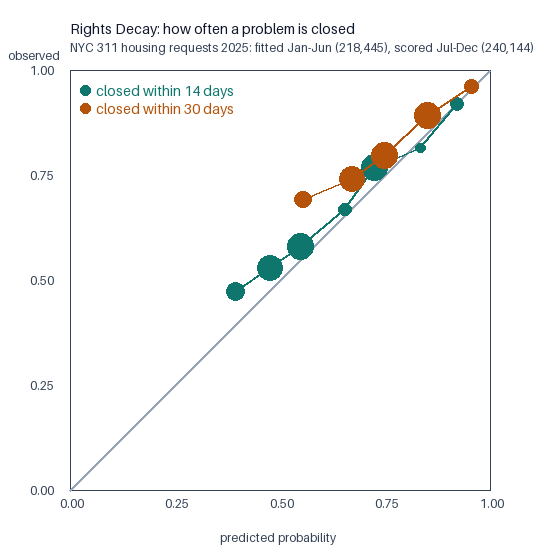

# Rights Decay: how often is a problem closed without a fight? (R3)

**Data:** NYC 311 housing requests 2025 (NYC Open Data erm2-nwe9, HPD, fetched 24 Oct 2026), a STAND-IN for UK companies: housing repairs, not refunds. Requests still open are censored at the download date.

- Fitted on requests made Jan-Jun 2025 (218,445); scored on Jul-Dec 2025 (240,144), which the model never saw.
- Model: Kaplan-Meier per complaint type and descriptor, each descriptor shrunk toward its type (empirical Bayes, strength from the data). Baseline: one curve for every request.

## Brier score on the held-out months (lower is better)

| Question | Cases | Observed | Predicted | Brier: Tempo's model | Brier: one curve for all | Skill | AUC |
|---|---|---|---|---|---|---|---|
| closed within 14 days | 240,144 | 0.608 | 0.570 | 0.2303 | 0.2396 | +3.9% | 0.609 |
| closed within 30 days | 240,144 | 0.805 | 0.751 | 0.1571 | 0.1597 | +1.6% | 0.597 |
| closed within 60 days | 240,144 | 0.901 | 0.867 | 0.0904 | 0.0905 | +0.1% | 0.588 |
| open at day 14: closed in the next 14 days | 94,233 | 0.471 | 0.385 | 0.2551 | 0.2571 | +0.8% | 0.543 |
| open at day 30: closed in the next 14 days | 46,868 | 0.322 | 0.266 | 0.2225 | 0.2215 | -0.4% | 0.517 |

**How to read this.** The curve's shape is the finding: the chance of closing in the next two weeks falls as a case ages, and the held-out months confirm it. Telling one case from another is weak (AUC about 0.6), so the planner leans on the shape, not on a per-case score. The "open at day" rows are the questions it asks on a decision day.

**Drift.** Compare the observed and predicted columns: in Jul-Dec more requests closed than the Jan-Jun curves expected, so the curves are cautious about cases sorting themselves out. That errs toward acting, not toward waiting too long. Refitting on a rolling window would fix it; the curves written to skills/ use all of 2025.

